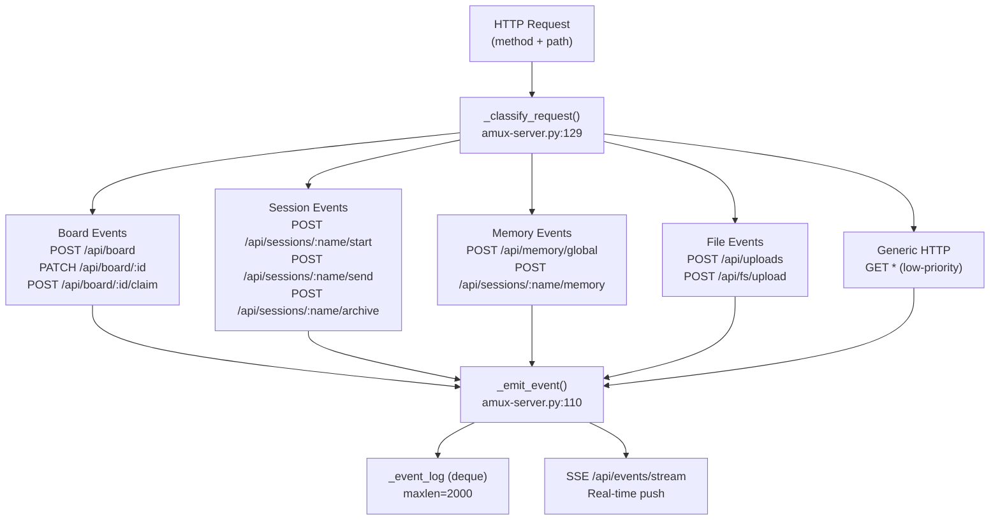
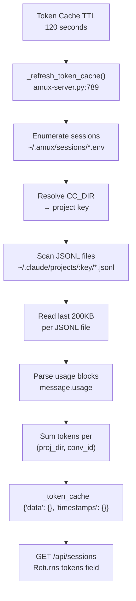
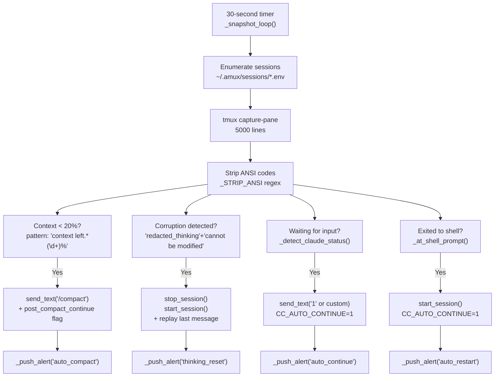
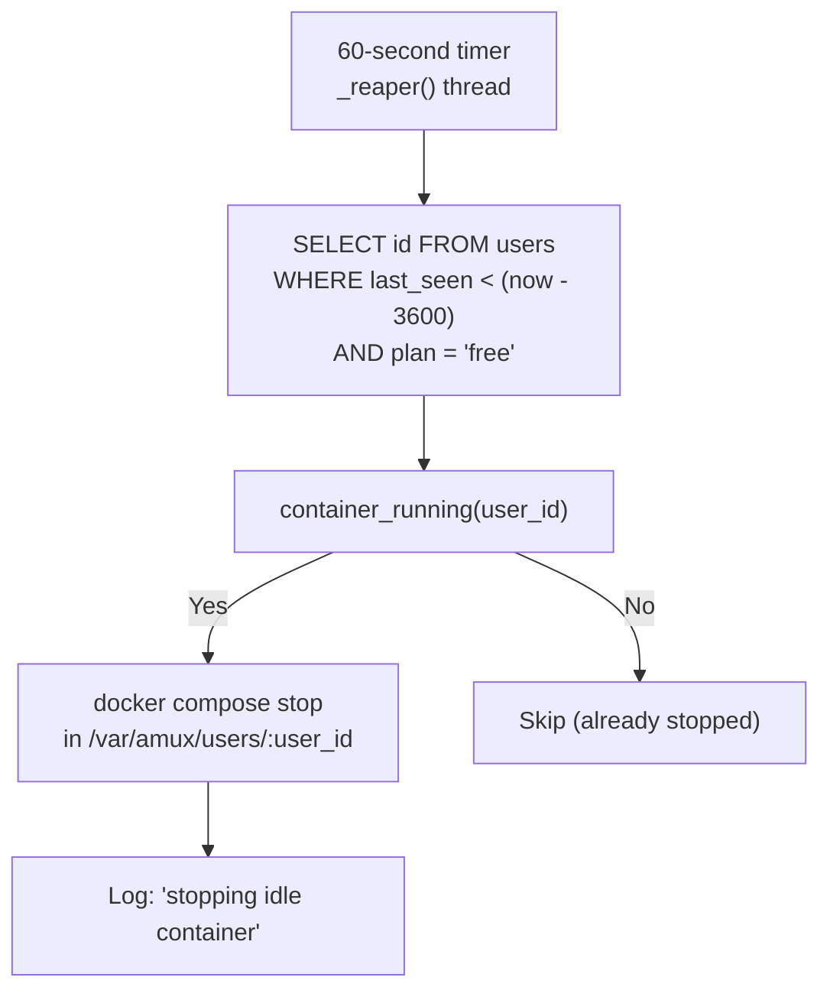
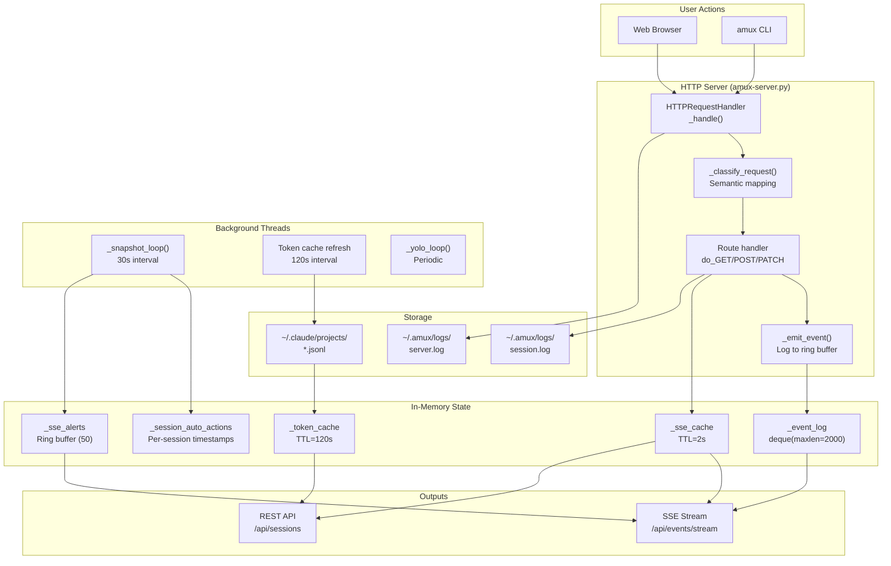

<!-- source: DeepWiki mcp.deepwiki.com · repo mixpeek/amux · page 11.1 Monitoring & Metrics · fetched 2026-10-26 -->

# Monitoring & Metrics

<details>
<summary>Relevant source files</summary>

The following files were used as context for generating this wiki page:

- [amux-server.py](amux-server.py)
- [cloud/gateway/gateway.py](cloud/gateway/gateway.py)
- [test.mjs](test.mjs)

</details>


## Purpose and Scope

This page documents the monitoring, metrics collection, and observability systems in amux. It covers the structured event log, token usage tracking, session health monitoring, alert system, and SSE streaming infrastructure. The focus is on real-time operational visibility and auto-recovery mechanisms.

For REST API endpoint specifications, see [REST API Reference](#5). For operational troubleshooting procedures, see [Troubleshooting](#11.3). For the auto-recovery implementation details, see [Self-Healing Watchdog](#2.4).

---

## Overview

amux implements a multi-layered monitoring system with three primary goals:

1. **Real-time visibility** — Stream session state, board changes, and system events to connected clients via Server-Sent Events (SSE)
2. **Resource tracking** — Monitor Claude API token consumption per session and conversation
3. **Auto-recovery** — Detect session failures (context exhaustion, corruption, stuck prompts) and apply corrective actions automatically

The system operates without external dependencies — all metrics are collected, stored, and served by `amux-server.py` using in-memory ring buffers, SQLite queries, and filesystem-based cache.

---

## Event System Architecture

### Event Log Ring Buffer

The event log is a circular buffer storing the last 2000 events in memory at [amux-server.py:106](). Events are emitted by `_emit_event()` at [amux-server.py:110-127]() and categorized by type:

| Event Type | Trigger | Example Actions |
|------------|---------|-----------------|
| `session` | Session lifecycle | `created`, `started`, `stopped`, `deleted`, `archived` |
| `board` | Board operations | `created`, `updated`, `claimed`, `deleted`, `cleared` |
| `memory` | Memory updates | `updated` (session or global) |
| `file` | File uploads | `uploaded` |
| `system` | System operations | `pull` (git repo update) |
| `http` | Generic HTTP | `get`, `post`, `patch`, `delete` |

**Event Schema:**

```json
{
  "ts": 1704067200,
  "type": "session",
  "action": "started",
  "target": "api-dev",
  "session": "api-dev",
  "detail": "",
  "status": 200,
  "ip": "192.168.1.100"
}
```

Events with `status >= 400` are automatically downgraded to generic `http` type at [amux-server.py:113-116]() to avoid polluting the semantic event stream with failed requests.

### Event Classification

Incoming HTTP requests are classified into semantic events by `_classify_request()` at [amux-server.py:129-186](). This function maps URL patterns to structured event types:



**Sources:** [amux-server.py:104-187]()

### SSE Event Streaming

Events are streamed to connected clients via Server-Sent Events at the `/api/events/stream` endpoint. The implementation maintains two in-memory caches:

1. **Event Log Cache** (`_event_log`) — 2000-event ring buffer at [amux-server.py:106]()
2. **SSE Data Cache** (`_sse_cache`) — 2-second TTL cache for sessions/board snapshots at [amux-server.py:98-102]()

The SSE cache avoids redundant subprocess calls when multiple dashboard tabs connect simultaneously. Cache entries store both the raw data and pre-serialized JSON to eliminate repeated serialization overhead.

**Cache Structure:**

```python
_sse_cache = {
    "sessions": {"data": None, "json": "", "time": 0},
    "board": {"data": None, "json": "", "time": 0},
}
_SSE_CACHE_TTL = 2  # seconds
```

**Sources:** [amux-server.py:98-102](), [amux-server.py:104-128]()

---

## Token Usage Tracking

### Per-Session Token Cache

Token consumption is tracked per session by scanning Claude Code's JSONL conversation files at [amux-server.py:786-883](). The cache refreshes every 120 seconds and aggregates usage from:

- `input_tokens` — Raw input tokens
- `cache_read_input_tokens` — Prompt cache hits
- `cache_creation_input_tokens` — New prompt cache entries
- `output_tokens` — Generated output tokens

**Token Cache Architecture:**



**Cache Keys:**

- `(proj_dir_name, conversation_id)` — Per-conversation totals (session with `cc_conversation_id`)
- `proj_dir_name` — Per-directory aggregate (sessions without explicit conversation ID)

**Deduplication:** Sequential JSONL entries with identical usage signatures are skipped at [amux-server.py:855-856]() to avoid counting the same message multiple times (common in streamed responses).

**Sources:** [amux-server.py:786-883]()

### Last Activity Timestamps

The token cache also tracks the last Claude API call timestamp per session at [amux-server.py:838-849](). This powers the "Last active" display in session cards and helps detect stale sessions.

**Timestamp Extraction:**

```python
ts_str = entry.get("timestamp", "")  # ISO format with Z suffix
ts_unix = int(datetime.fromisoformat(
    ts_str.replace("Z", "+00:00")
).timestamp())
```

**Sources:** [amux-server.py:838-880]()

---

## Session Health Monitoring

### Watchdog Loop

The watchdog thread runs `_snapshot_all_sessions()` every 30 seconds at [amux-server.py:1179-1324](). It captures tmux scrollback (5000 lines) for each running session and applies pattern-matching detection rules:



**Sources:** [amux-server.py:1179-1324]()

### Detection Patterns

#### 1. Context Exhaustion

Regex: `r'context left until auto-compact[:\s]+(\d+)%'` at [amux-server.py:1208]()

**Trigger:** Context drops below 20%

**Action:** Send `/compact` command automatically (rate-limited to once per 300 seconds per session)

**Post-compact Continuation:** After 30 seconds, if status is `idle` or `waiting`, send a continuation message (default: `"continue"`, configurable via `CC_AUTO_CONTINUE_MSG`)

#### 2. Thinking-Block Corruption

Patterns: `"redacted_thinking"` AND `"cannot be modified"` in scrollback at [amux-server.py:1220-1221]()

**Trigger:** Claude's extended thinking feature encounters an internal error

**Action:** 
1. Stop session
2. Clear `cc_conversation_id` from session metadata (forces new conversation)
3. Start session
4. Replay last meaningful user message (>20 chars) after 6-second delay

**Rate limit:** Once per 120 seconds per session

#### 3. Auto-Continue

Requires `CC_AUTO_CONTINUE=1` in session config

**Trigger:** Session in `waiting` state for 2+ consecutive snapshots (~60 seconds)

**Detection:** `_detect_claude_status()` analyzes scrollback for:
- `"Enter to select"` → Send blank Enter
- `❯ \d+\.` selector prompt → Send `"1"`
- `"do you want to proceed"` → Send `"1"`
- `"interrupted"` + `"what should claude do"` → Send custom message

**Rate limit:** Once per 300 seconds per session

#### 4. Auto-Restart (Shell Exit)

Requires `CC_AUTO_CONTINUE=1`

**Trigger:** Session shows bare shell prompt (no Claude UI) AND Claude was alive within last 10 minutes

**Detection:** `_at_shell_prompt()` at [amux-server.py:1166-1176]() checks for:
- No Claude status bar (`bypass permissions`, `plan mode`, spinners)
- Terminal ends with `$` or `%` prompt (not Claude's `❯`)

**Rate limit:** Once per 90 seconds per session

**Sources:** [amux-server.py:1166-1324]()

### Health Monitoring State

Session auto-recovery state is tracked in `_session_auto_actions` dict at [amux-server.py:195]():

```python
{
  "session-name": {
    "last_compact": 1704067200,
    "last_restart": 1704067300,
    "last_auto_continue": 1704067400,
    "last_auto_restart": 1704067500,
    "post_compact_continue": True,
    "ac_waiting_since": 1704067600,
    "last_claude_alive": 1704067700,
    "restarting": False
  }
}
```

**Sources:** [amux-server.py:195](), [amux-server.py:1204-1322]()

---

## Alert System

### Alert Ring Buffer

Alerts are server-initiated notifications pushed to all connected SSE clients. The ring buffer stores the last 50 alerts at [amux-server.py:189]().

**Alert Schema:**

```json
{
  "type": "auto_compact",
  "session": "api-dev",
  "message": "Auto-compacted 'api-dev' — context was at 18%",
  "ts": 1704067200
}
```

**Alert Types:**

| Type | Trigger | Example Message |
|------|---------|-----------------|
| `auto_compact` | Context < 20% | `Auto-compacted 'frontend' — context was at 15%` |
| `thinking_reset` | Corruption detected | `Session 'backend' auto-restarted: thinking block corruption — last message replayed` |
| `auto_continue` | Stuck prompt | `Auto-continued 'api-dev': sent 1 (first option)` |
| `auto_restart` | Shell exit | `Claude exited in 'scraper' — auto-restarting` |

**Push Mechanism:** Alerts are appended via `_push_alert()` at [amux-server.py:1071-1077]() and streamed to clients via the SSE event log.

**Sources:** [amux-server.py:189-192](), [amux-server.py:1071-1077]()

---

## Model Detection

Active Claude model detection scans the most recent JSONL file for `message.model` fields at [amux-server.py:1375-1422](). Results are cached by `(work_dir, mtime)` with a 15-second TTL.

**Detection Strategy:**

1. Find most recent JSONL file in `~/.claude/projects/:dir/*.jsonl`
2. Read from end in increasing chunks (200KB → 1MB → full file)
3. Search backward for first `model` field
4. Cache result keyed by file mtime

**Model Display:** Powers the model badge in session cards (e.g., `claude-sonnet-4`, `claude-opus-4`)

**Sources:** [amux-server.py:1372-1422]()

---

## Cloud-Specific Monitoring

### Container Health Checks

In cloud deployments, `gateway.py` monitors per-user Docker containers at [cloud/gateway/gateway.py:233-243]():

```python
def container_running(user_id):
    """Docker inspect → State.Running boolean"""
    
def container_healthy(user_id):
    """Docker inspect → State.Health.Status == 'healthy'"""
```

The gateway waits for `healthy` status (not just `running`) before proxying requests at [cloud/gateway/gateway.py:268-271](). Health checks are defined in the Docker Compose template with:

- Interval: 10 seconds
- Timeout: 5 seconds
- Retries: 3
- Start period: 30 seconds

**Sources:** [cloud/gateway/gateway.py:233-243](), [cloud/gateway/gateway.py:268-271]()

### Idle Reaper

A background thread stops idle containers to conserve resources at [cloud/gateway/gateway.py:377-394]():



**Timeout:** 3600 seconds (1 hour) for free plan users

**Last Seen Updates:**
- Updated on every HTTP request at [cloud/gateway/gateway.py:684]()
- Refreshed every 60 seconds during active SSE streams at [cloud/gateway/gateway.py:428-436]() to prevent premature reaping

**Sources:** [cloud/gateway/gateway.py:377-394](), [cloud/gateway/gateway.py:428-436]()

---

## Logging Infrastructure

### Server Log

The main server log at `~/.amux/logs/server.log` is written by `slog()` at [amux-server.py:81-95]():

**Format:** `YYYY-MM-DD HH:MM:SS <message>`

**Behavior:**
- Writes to both stderr (if TTY) and log file
- Thread-safe (uses `_server_log_lock`)
- No rotation or size limits (systemd/launchd handle log management)

### Session Logs

Per-session logs at `~/.amux/logs/<session-name>.log` are managed by:

- `save_session_log()` at [amux-server.py:985-1005]() — Append with front-trimming
- `load_session_log()` at [amux-server.py:1008-1016]() — Read full log

**Size Limit:** 10MB per session (front-trimmed when exceeded)

**Trim Strategy:** When `existing_size + new_data > MAX_LOG_BYTES`, read existing log, concatenate, and keep only the most recent 10MB at [amux-server.py:994-1000]().

**Sources:** [amux-server.py:77-96](), [amux-server.py:985-1016]()

### Gateway Logs

The cloud gateway logs to stderr at [cloud/gateway/gateway.py:461-464]():

```python
def log_message(self, fmt, *args):
    sys.stderr.write(f"[gateway] {self.client_address[0]} {fmt % args}\n")
```

**Format:** `[gateway] <ip> <message>`

**Examples:**
- `[gateway] 203.0.113.42 "GET /api/sessions HTTP/1.1" 200 -`
- `[gateway] 192.0.2.100 "POST /api/sessions/test/start HTTP/1.1" 200 -`

**Sources:** [cloud/gateway/gateway.py:461-464]()

---

## Monitoring Endpoints

### Event Stream

**Endpoint:** `GET /api/events/stream`

**Response:** Server-Sent Events stream

**Events:**
- `sessions` — Session list updates (every 2s)
- `board` — Board state updates (every 2s)
- `event` — Individual events from `_event_log`
- `alert` — Server alerts from `_sse_alerts`

**Cache:** Sessions and board snapshots are cached for 2 seconds via `_sse_cache` to reduce load when multiple clients connect

### Session Metrics

**Endpoint:** `GET /api/sessions`

**Response Schema:**

```json
[
  {
    "name": "api-dev",
    "label": "API Development",
    "running": true,
    "dir": "/Users/user/projects/api",
    "tokens": 245000,
    "input": 180000,
    "output": 65000,
    "last_active": "2024-01-01T12:34:56Z",
    "model": "claude-sonnet-4"
  }
]
```

**Token Fields:**
- `tokens` — Total (input + output)
- `input` — Input tokens (including cache reads)
- `output` — Generated output tokens

**Sources:** [amux-server.py:786-883]()

### Session Detail

**Endpoint:** `GET /api/sessions/<name>`

**Response Schema:**

```json
{
  "name": "api-dev",
  "running": true,
  "recent_output": "...",
  "memory": "...",
  "yolo": true,
  "compact_enabled": true,
  "auto_continue": false
}
```

**Fields:**
- `recent_output` — Last 30 lines of tmux scrollback
- `yolo` — Session has `--dangerously-skip-permissions` flag
- `compact_enabled` — Auto-compact preference (default: true)
- `auto_continue` — `CC_AUTO_CONTINUE` config value

---

## Performance Considerations

### Token Cache Refresh Strategy

Token cache refresh at [amux-server.py:789-883]() is expensive (scans 200KB+ of JSONL per session). To minimize overhead:

1. **120-second TTL** — Refresh at most every 2 minutes
2. **Lazy scanning** — Only scan JSONL files for registered sessions (not all Claude projects)
3. **Tail reading** — Read last 200KB instead of full file
4. **Deduplication** — Skip sequential entries with identical usage signatures

### SSE Cache Strategy

The 2-second SSE cache at [amux-server.py:98-102]() prevents redundant subprocess calls when multiple dashboard tabs connect:

**Without cache:** 10 connected tabs × 0.5s subprocess call = 5s total load every refresh

**With cache:** 1 subprocess call = 0.5s total load (9× reduction)

### Watchdog Capture Optimization

The watchdog captures 5000 lines per session at [amux-server.py:1199](). This is balanced between:

- **Too few lines** — Miss context patterns (Claude status bar is often 20+ lines up)
- **Too many lines** — Slow tmux capture and regex scanning

**Parallel capture:** `_tmux_capture_batch()` at [amux-server.py:969-978]() uses `ThreadPoolExecutor` to capture multiple sessions concurrently (max 16 workers).

**Sources:** [amux-server.py:969-978](), [amux-server.py:1199]()

---

## Monitoring Data Flow



**Sources:** [amux-server.py:98-187](), [amux-server.py:786-883](), [amux-server.py:1179-1324]()

---

## Testing & Validation

The E2E test suite at [test.mjs]() validates monitoring functionality:

**API Tests:**
- Session list shape (`GET /api/sessions`)
- Memory endpoints (session + global)
- Board sync endpoint (`GET /api/sync?since=<ts>`)
- iCal feed format (`GET /api/calendar.ics`)

**UI Tests:**
- Event log updates in real-time
- Token display in session cards
- Alert notifications appear
- SSE connection stability

**Test Coverage:** 90+ assertions across desktop, mobile, and API layers

**Sources:** [test.mjs:640-790]()

---

