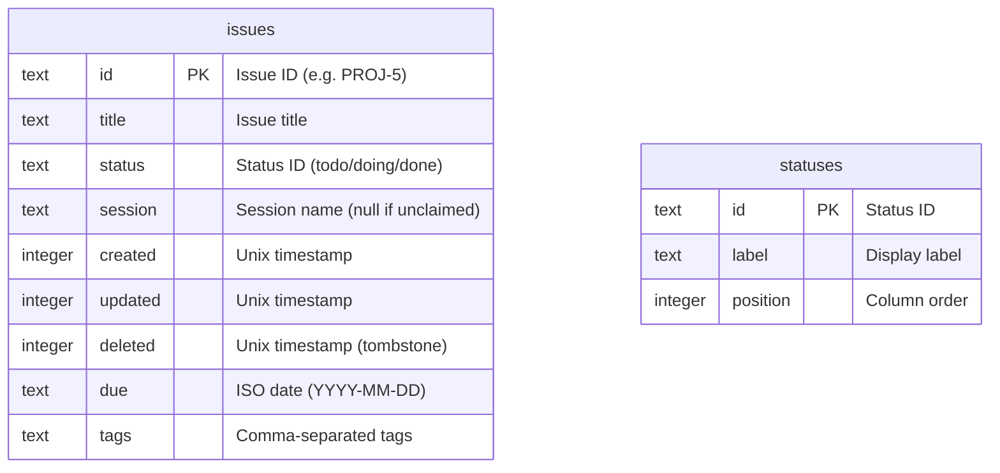
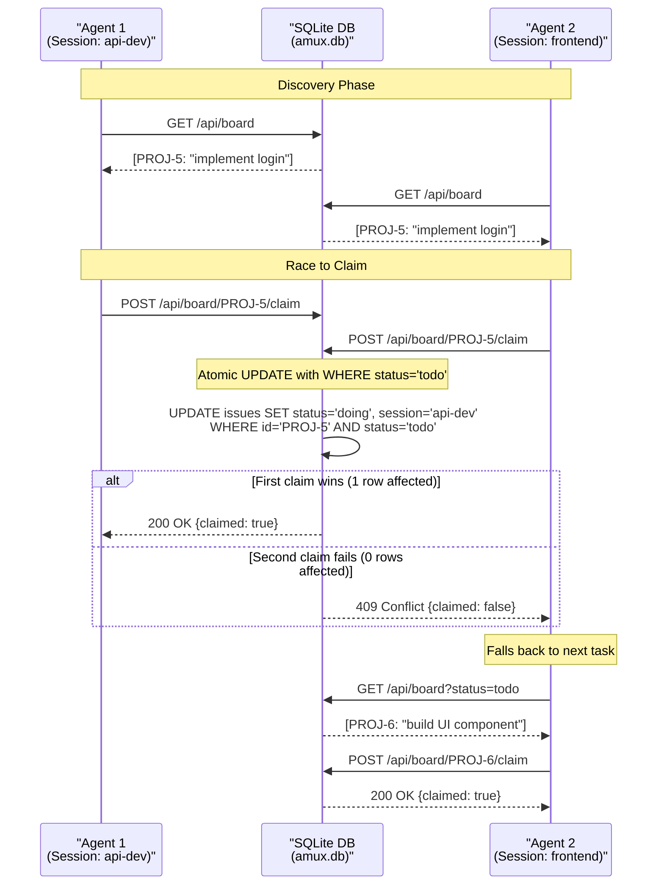
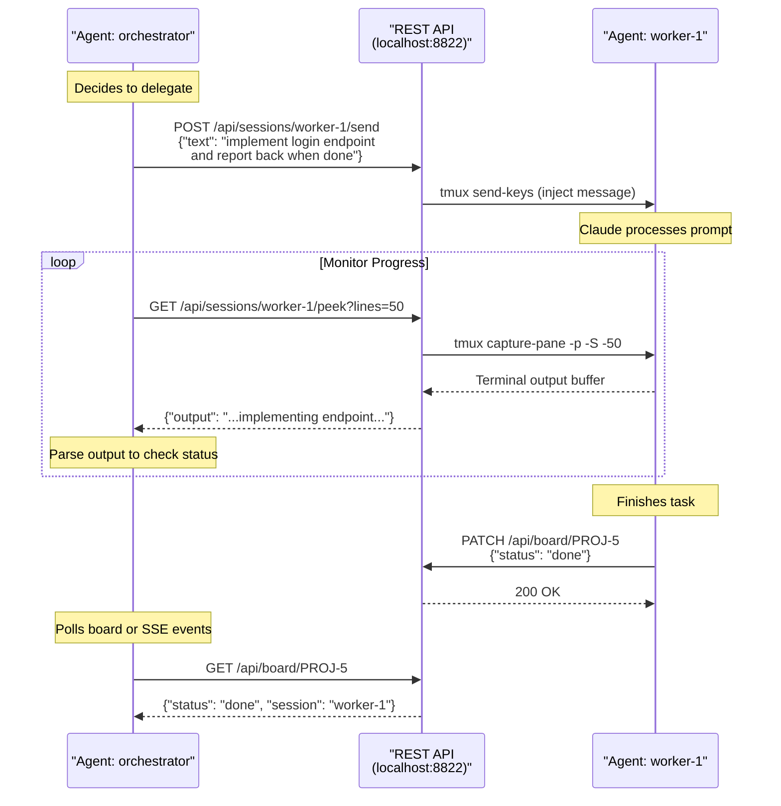
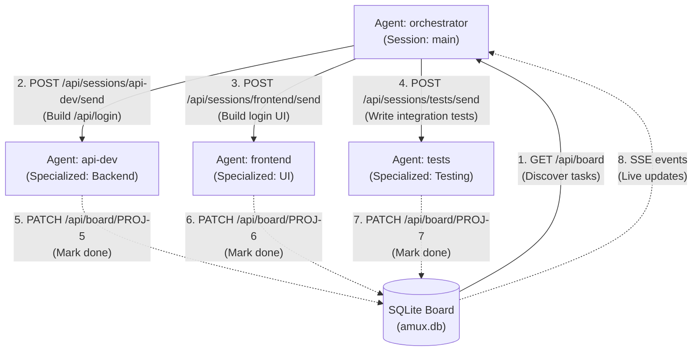
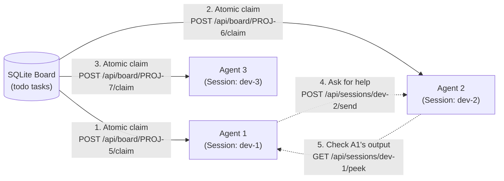
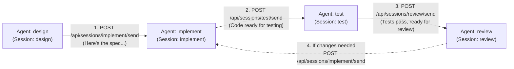
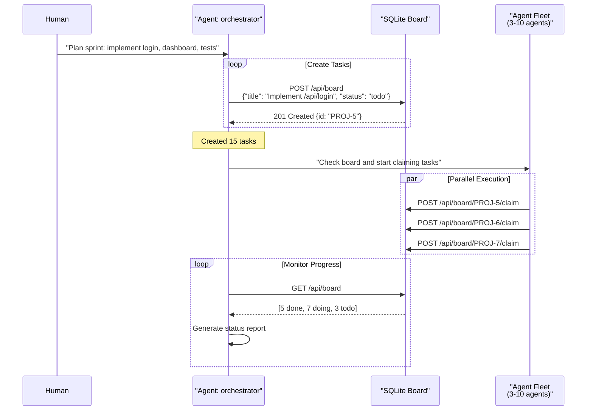
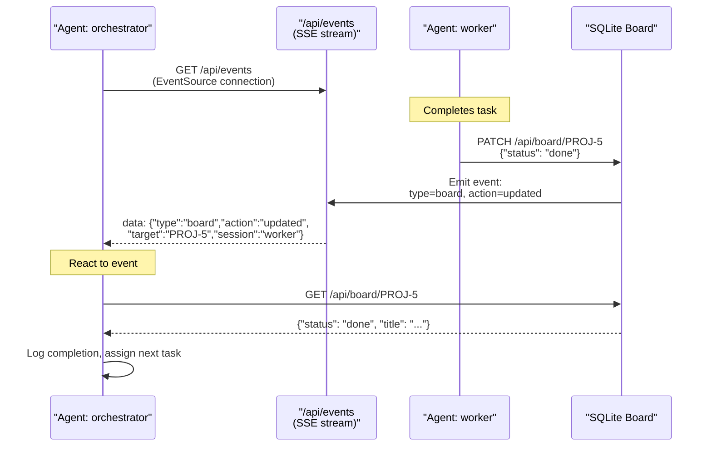
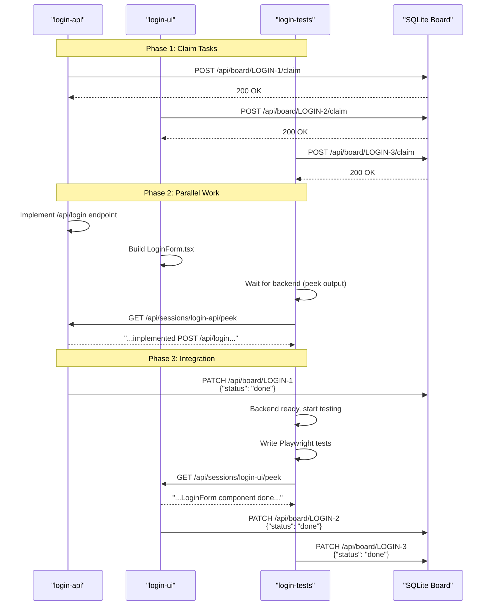
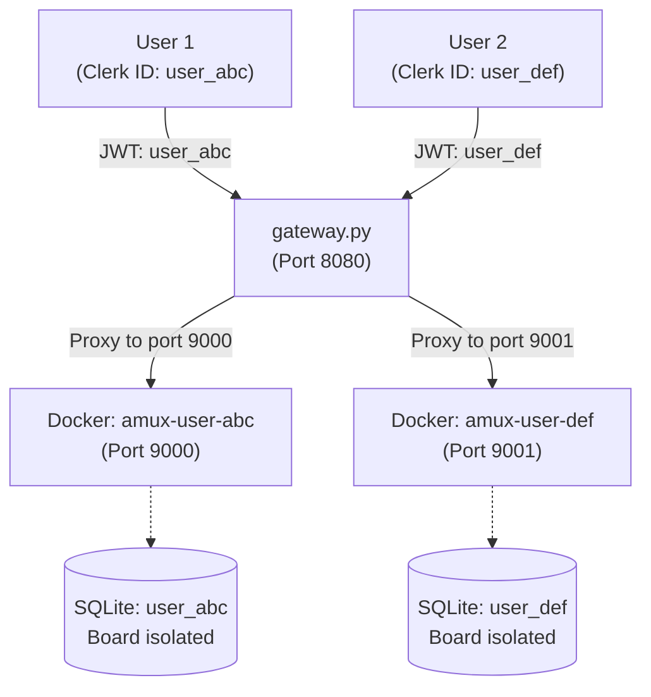

<!-- source: DeepWiki mcp.deepwiki.com · repo mixpeek/amux · page 12 Agent Orchestration Patterns · fetched 2026-10-26 -->

# Agent Orchestration Patterns

<details>
<summary>Relevant source files</summary>

The following files were used as context for generating this wiki page:

- [README.md](README.md)
- [amux-server.py](amux-server.py)
- [cloud/gateway/gateway.py](cloud/gateway/gateway.py)
- [site/llms.txt](site/llms.txt)
- [site/sitemap.xml](site/sitemap.xml)
- [test.mjs](test.mjs)

</details>


## Purpose and Scope

This document explains how to coordinate multiple Claude Code agents running in parallel sessions via amux. It covers task distribution using atomic board claims, inter-agent communication via REST API, and workflow patterns for delegating work between agents. For details on the board data model, see [Board System](#2.2). For the REST API reference, see [REST API Reference](#5). For session management basics, see [Session Management](#2.1).

---

## Core Coordination Primitives

Agent orchestration in amux relies on three primitives:

| Primitive | Location | Purpose |
|-----------|----------|---------|
| **SQLite Board** | `~/.amux/amux.db` | Atomic task claiming via CAS operations |
| **Global Memory** | `~/.amux/memory/global.md` | Shared API reference accessible to all agents |
| **REST API** | `localhost:8822/api/*` | Inter-agent communication (send, peek, claim) |

### Board Database Schema

The board table stores issues with atomic claim support:



Sources: [amux-server.py:1374-1409]()

### Global Memory Injection

All agents receive the full REST API specification in their global memory, enabling natural language commands like "claim task PROJ-5 and report back when done".

The `$AMUX_URL` environment variable is set in every session, pointing to `https://localhost:8822` or the Tailscale hostname. Agents parse this URL from their memory to make API calls.

Sources: [amux-server.py:2162-2191](), [amux-server.py:3179-3186]()

---

## Atomic Task Claiming

### CAS Operation Sequence



Sources: [amux-server.py:1756-1782]()

### Implementation Details

The claim endpoint uses SQLite's `UPDATE` with a `WHERE` clause to atomically check and modify:

```
UPDATE issues 
SET status = 'doing', 
    session = :session_name, 
    updated = :timestamp
WHERE id = :issue_id 
  AND status = 'todo'
  AND (session IS NULL OR session = '')
```

Only one agent succeeds when multiple agents claim simultaneously. The `cursor.rowcount` check determines success (1) or failure (0).

Sources: [amux-server.py:1764-1781]()

### Claiming from Agent Context

Agents call the claim endpoint using `curl` from their environment:

```bash
curl -sk -X POST "$AMUX_URL/api/board/PROJ-5/claim"
```

If the response is `{"claimed": true}`, the agent proceeds with the task. If `{"claimed": false}`, the agent queries for the next available task.

Sources: [amux-server.py:1759-1782](), [README.md:68-74]()

---

## Inter-Agent Communication

### Send and Peek Endpoints

| Endpoint | Method | Purpose |
|----------|--------|---------|
| `/api/sessions/<name>/send` | POST | Inject text into another session's tmux pane |
| `/api/sessions/<name>/peek` | GET | Read last N lines of another session's output |
| `/api/sessions/<name>/config` | PATCH | Update another session's config (model, yolo, auto-continue) |

### Delegation Flow



Sources: [amux-server.py:2392-2445](), [amux-server.py:2477-2517]()

### Send Endpoint Implementation

The send endpoint serializes requests per session to avoid race conditions:

[amux-server.py:2392-2445]()

Key behaviors:
- Acquires per-session lock (`_send_locks[name]`) to serialize sends
- Appends text to `~/.amux/sessions/<name>/queue.txt` for offline replay
- Uses `tmux send-keys -t <session-name> -l <text>` to inject
- Emits `message-sent` SSE event for live monitoring

Sources: [amux-server.py:2392-2445](), [amux-server.py:194-195]()

### Peek Endpoint Implementation

The peek endpoint captures tmux pane history without attaching:

[amux-server.py:2477-2517]()

Key behaviors:
- Uses `tmux capture-pane -p -S -<lines>` to read scrollback
- Strips ANSI codes for clean text
- Returns `{"output": "...", "path": "..."}` JSON
- No session lock required (read-only operation)

Sources: [amux-server.py:2477-2517]()

---

## Delegation Patterns

### Pattern 1: Manager-Worker

One orchestrator agent distributes tasks to specialized worker agents.



**Setup:**

```bash
# Register specialized sessions
amux register orchestrator --dir ~/project --yolo
amux register api-dev --dir ~/project/backend --yolo
amux register frontend --dir ~/project/frontend --yolo
amux register tests --dir ~/project --yolo

# Start all agents
amux start orchestrator
amux start api-dev
amux start frontend
amux start tests
```

**Orchestrator prompt:**

```
You are the orchestrator. Monitor the board at $AMUX_URL/api/board.
For each unclaimed task:
1. Determine which specialist agent should handle it
2. Send them the task via POST $AMUX_URL/api/sessions/<specialist>/send
3. Monitor progress via GET $AMUX_URL/api/sessions/<specialist>/peek?lines=50
4. Verify completion by checking the board status

Specialists:
- api-dev: Backend endpoints, database migrations
- frontend: UI components, styling
- tests: Integration tests, E2E tests
```

Sources: [README.md:62-78](), [amux-server.py:2392-2445]()

### Pattern 2: Peer Collaboration

Agents of equal capability claim tasks autonomously and coordinate when needed.



**Setup:**

```bash
for i in {1..3}; do
  amux register dev-$i --dir ~/project --yolo
  amux start dev-$i
done
```

**Shared global memory (`~/.amux/memory/global.md`):**

```markdown
# Agent Fleet Protocol

You are one of multiple agents working in parallel on this codebase.

## Task Discovery
1. Check the board: GET $AMUX_URL/api/board?status=todo
2. Claim a task: POST $AMUX_URL/api/board/<id>/claim
3. If claim fails (409 Conflict), pick another task

## Asking for Help
If stuck, send a message to another agent:
POST $AMUX_URL/api/sessions/<peer-name>/send
Body: {"text": "I'm stuck on PROJ-5. Can you review my changes in branch feature/login?"}

## Checking Peer Progress
GET $AMUX_URL/api/sessions/<peer-name>/peek?lines=50

## Completing Work
PATCH $AMUX_URL/api/board/<id> with {"status": "done"}
```

Sources: [amux-server.py:3179-3186](), [amux-server.py:2161-2191]()

### Pattern 3: Pipeline

Sequential agents where each stage depends on the previous stage's output.



Sources: [amux-server.py:2392-2445]()

---

## Board-Driven Workflows

### Workflow 1: Sprint Planning

Orchestrator creates board items, agents claim and execute.



Sources: [amux-server.py:1664-1695](), [amux-server.py:1756-1782]()

### Workflow 2: Bug Triage

Agents claim bugs from a backlog and coordinate fixes.

**Initial board setup:**

| ID | Title | Status | Session |
|----|-------|--------|---------|
| BUG-1 | Login timeout on slow connections | todo | null |
| BUG-2 | Dashboard chart rendering broken | todo | null |
| BUG-3 | User profile upload fails | todo | null |

**Agent prompt:**

```
You are a bug-fix agent. Your workflow:

1. Claim a bug:
   curl -sk -X POST "$AMUX_URL/api/board/BUG-1/claim"

2. If claim succeeds, investigate and fix it

3. Mark as done when fixed:
   curl -sk -X PATCH "$AMUX_URL/api/board/BUG-1" \
     -H "Content-Type: application/json" \
     -d '{"status": "done"}'

4. Move to next bug (goto step 1)

If you need help, send a message to another agent:
   curl -sk -X POST "$AMUX_URL/api/sessions/debug-expert/send" \
     -H "Content-Type: application/json" \
     -d '{"text": "Can you help debug BUG-1? Error logs attached..."}'
```

Sources: [amux-server.py:1756-1782](), [amux-server.py:1721-1752]()

---

## Event-Driven Coordination

### SSE Event Stream

Agents can subscribe to server-sent events for real-time coordination:



Sources: [amux-server.py:110-128](), [amux-server.py:129-186](), [amux-server.py:3337-3408]()

### Event Types

The `_emit_event()` function logs structured events to an in-memory ring buffer and streams them via SSE:

| Event Type | Action | Trigger |
|------------|--------|---------|
| `board` | `created` | POST /api/board |
| `board` | `updated` | PATCH /api/board/:id |
| `board` | `claimed` | POST /api/board/:id/claim |
| `board` | `deleted` | DELETE /api/board/:id |
| `session` | `started` | POST /api/sessions/:name/start |
| `session` | `stopped` | POST /api/sessions/:name/stop |
| `session` | `message-sent` | POST /api/sessions/:name/send |
| `memory` | `updated` | POST /api/memory/global or /api/sessions/:name/memory |

Sources: [amux-server.py:110-128](), [amux-server.py:129-186]()

---

## Multi-Agent Coordination Example

### Scenario: Parallel Feature Development

Three agents work on a login feature: backend, frontend, and tests.

**Session setup:**

```bash
# Backend agent
amux register login-api --dir ~/project/backend --yolo --model sonnet
amux start login-api

# Frontend agent  
amux register login-ui --dir ~/project/frontend --yolo --model sonnet
amux start login-ui

# Test agent
amux register login-tests --dir ~/project --yolo --model sonnet
amux start login-tests
```

**Board state:**

```json
[
  {"id": "LOGIN-1", "title": "Implement POST /api/login", "status": "todo", "session": null},
  {"id": "LOGIN-2", "title": "Build login form component", "status": "todo", "session": null},
  {"id": "LOGIN-3", "title": "Write E2E login tests", "status": "todo", "session": null}
]
```

**Coordination sequence:**



Sources: [amux-server.py:1756-1782](), [amux-server.py:2477-2517]()

---

## Best Practices

### 1. Design for Autonomy

Agents should be able to discover and claim work without orchestrator intervention:

**Good:**
```markdown
# Global Memory
Check board for tasks: GET $AMUX_URL/api/board?status=todo
Claim atomically: POST $AMUX_URL/api/board/<id>/claim
If claim succeeds, proceed. If 409, pick another task.
```

**Avoid:**
```markdown
# Global Memory
Wait for orchestrator to assign you a task via /send endpoint.
```

### 2. Use Board Tags for Routing

Tag issues to indicate required skills:

```bash
# Create tagged tasks
curl -sk -X POST "$AMUX_URL/api/board" \
  -H "Content-Type: application/json" \
  -d '{"title": "Optimize SQL queries", "status": "todo", "tags": "backend,database"}'
```

Agents filter by tags:

```bash
# Backend agent queries
curl -sk "$AMUX_URL/api/board?status=todo" | \
  jq '.[] | select(.tags | contains("backend"))'
```

Sources: [amux-server.py:1637-1662](), [amux-server.py:1374-1409]()

### 3. Monitor via Peek, Don't Poll Board

Use `GET /api/sessions/<name>/peek` to check peer progress instead of repeatedly querying board status:

```bash
# Efficient: Check if peer finished task by reading output
OUTPUT=$(curl -sk "$AMUX_URL/api/sessions/api-dev/peek?lines=50" | jq -r .output)
if echo "$OUTPUT" | grep -q "Task complete"; then
  echo "Peer finished"
fi
```

Sources: [amux-server.py:2477-2517]()

### 4. Serialize Related Tasks

If task B depends on task A, use board relationships:

```json
{
  "id": "FEAT-2",
  "title": "Build login UI (depends on FEAT-1)",
  "status": "todo",
  "tags": "frontend,depends:FEAT-1"
}
```

Agents check dependencies before claiming:

```bash
DEPS=$(echo "$ISSUE" | jq -r '.tags' | grep -o 'depends:[^,]*')
if [ -n "$DEPS" ]; then
  DEP_ID=$(echo "$DEPS" | cut -d: -f2)
  DEP_STATUS=$(curl -sk "$AMUX_URL/api/board/$DEP_ID" | jq -r .status)
  if [ "$DEP_STATUS" != "done" ]; then
    echo "Waiting on $DEP_ID"
    exit 0
  fi
fi
```

Sources: [amux-server.py:1637-1662]()

### 5. Use Session-Specific Memory for Context

Store task-specific context in per-session memory, not global:

```bash
# Agent writes task notes to session memory
curl -sk -X POST "$AMUX_URL/api/sessions/login-api/memory" \
  -H "Content-Type: application/json" \
  -d '{"content": "# LOGIN-1 Progress\n\nImplemented POST /api/login\nPending: rate limiting"}'
```

Peer agents can read this:

```bash
curl -sk "$AMUX_URL/api/sessions/login-api/memory" | jq -r .content
```

Sources: [amux-server.py:2162-2191](), [amux-server.py:2193-2238]()

### 6. Handle Claim Failures Gracefully

Always check claim response and fall back:

```bash
CLAIM_RESULT=$(curl -sk -X POST "$AMUX_URL/api/board/PROJ-5/claim")
if echo "$CLAIM_RESULT" | jq -e '.claimed == true' > /dev/null; then
  echo "Claimed PROJ-5, starting work"
else
  echo "PROJ-5 already claimed, finding next task"
  # Query for next todo task
fi
```

Sources: [amux-server.py:1756-1782]()

### 7. Emit Progress Events

Update board status incrementally so orchestrators can monitor:

```bash
# Mark task as in-progress immediately after claiming
curl -sk -X PATCH "$AMUX_URL/api/board/PROJ-5" \
  -H "Content-Type: application/json" \
  -d '{"status": "doing"}'

# Update when done
curl -sk -X PATCH "$AMUX_URL/api/board/PROJ-5" \
  -H "Content-Type: application/json" \
  -d '{"status": "done"}'
```

Sources: [amux-server.py:1721-1752]()

---

## Gateway Multi-Tenancy Considerations

In cloud deployments, the gateway proxies requests to per-user containers. Agents cannot communicate across user boundaries:



Each user's agents coordinate only within their own container. Cross-user collaboration requires organization invites.

Sources: [cloud/gateway/gateway.py:1-750](), [cloud/gateway/gateway.py:397-457]()

---

Sources: [amux-server.py:1-3500](), [cloud/gateway/gateway.py:1-750](), [README.md:1-219](), [test.mjs:1-815]()

---

