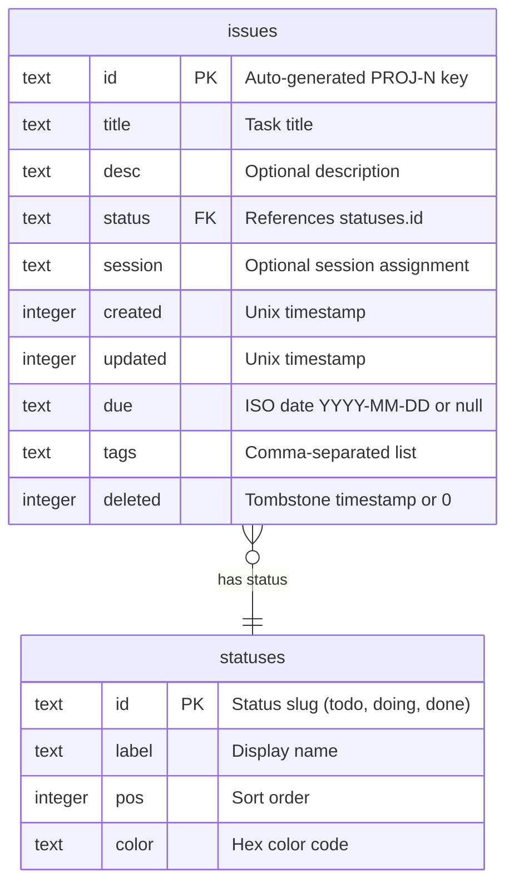
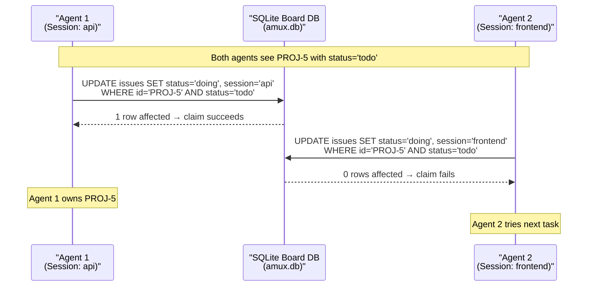
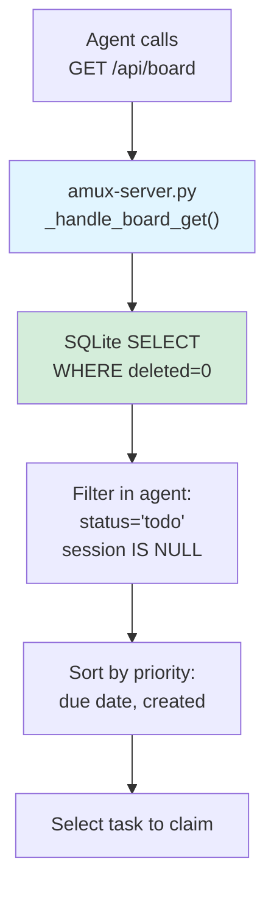
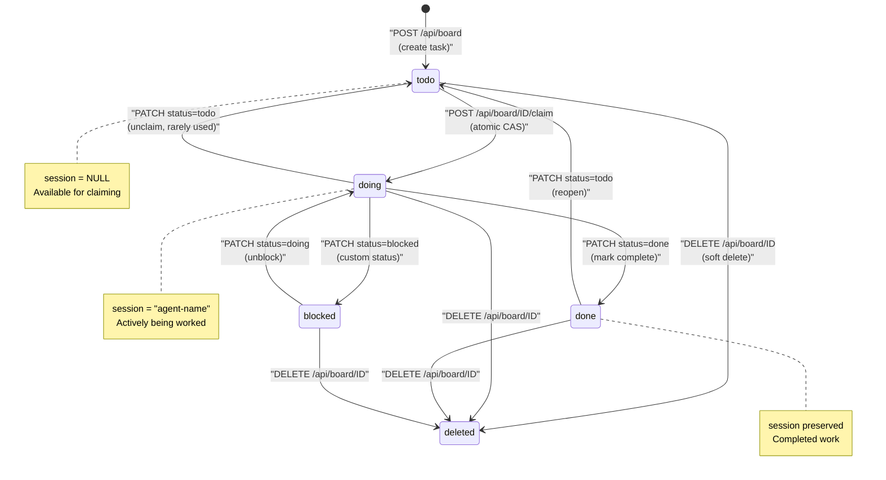
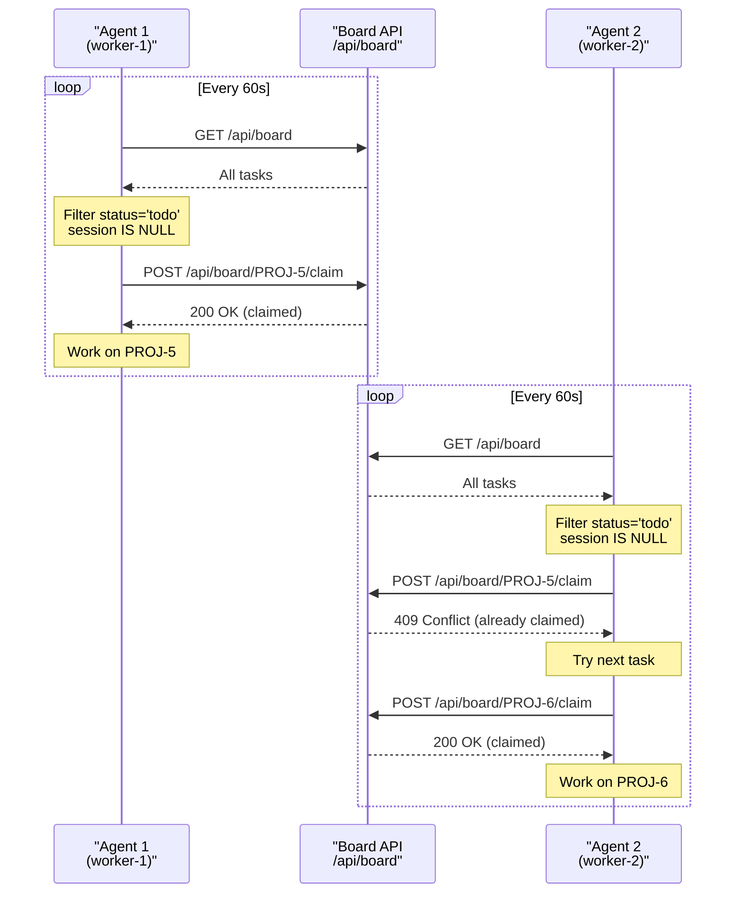
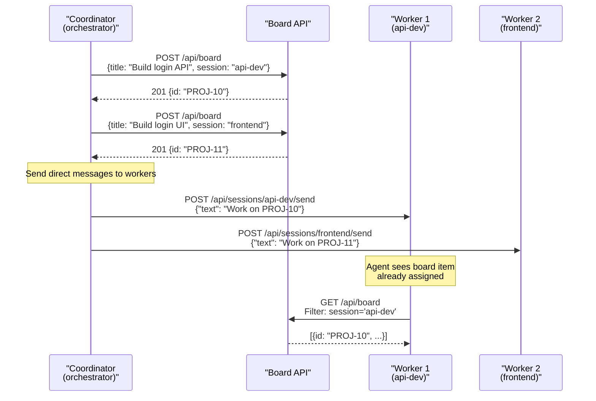
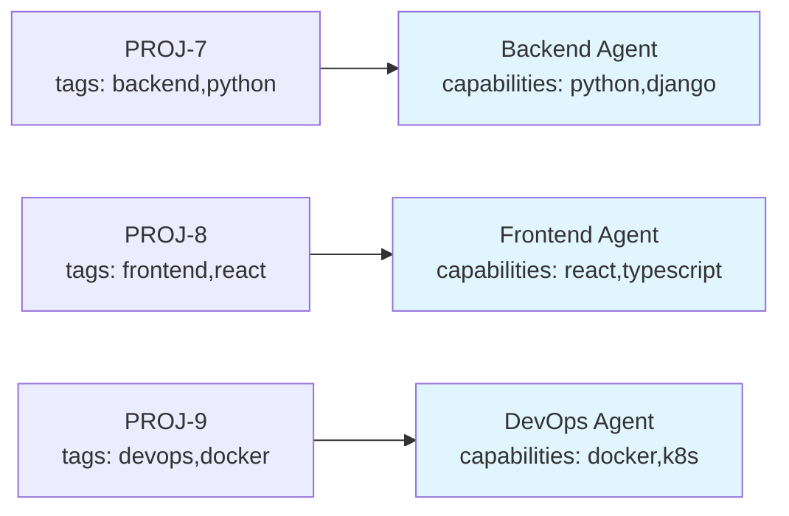

<!-- source: DeepWiki mcp.deepwiki.com · repo mixpeek/amux · page 12.1 Task Distribution · fetched 2026-10-26 -->

# Task Distribution

<details>
<summary>Relevant source files</summary>

The following files were used as context for generating this wiki page:

- [README.md](README.md)
- [amux-server.py](amux-server.py)
- [cloud/gateway/gateway.py](cloud/gateway/gateway.py)
- [test.mjs](test.mjs)

</details>


This page documents patterns for distributing work across multiple agents using amux's SQLite-backed board system with atomic task claiming. It covers the board database schema, compare-and-swap (CAS) claiming mechanism, and API patterns for coordinating parallel agents.

For information about sending messages between agents or monitoring peer output, see [Inter-Agent Communication](#12.2). For the complete board REST API reference, see [Board Endpoints](#5.2).

---

## Board Database Schema

The board system uses a SQLite table to track tasks (called "issues" in the codebase) with support for soft deletes, session assignments, and due dates.

### Issues Table Structure



**Sources:** [amux-server.py:1184-1220]()

The table schema is created in `get_db()` with these constraints:

| Column | Type | Nullable | Purpose |
|--------|------|----------|---------|
| `id` | TEXT | No | Primary key, auto-generated as `PROJ-1`, `PROJ-2`, etc. |
| `title` | TEXT | No | Task title visible in UI and calendar |
| `desc` | TEXT | Yes | Optional markdown description |
| `status` | TEXT | No | Current status (default: `todo`) |
| `session` | TEXT | Yes | Assigned session name or NULL for unassigned |
| `created` | INTEGER | No | Unix timestamp of creation |
| `updated` | INTEGER | No | Unix timestamp of last modification |
| `due` | TEXT | Yes | Due date in ISO format `YYYY-MM-DD` or NULL |
| `tags` | TEXT | Yes | Comma-separated tags for filtering |
| `deleted` | INTEGER | No | Soft-delete tombstone timestamp (0 = active) |

**Default statuses:** The database is initialized with three built-in statuses:
- `todo` (To Do) — position 1
- `doing` (Doing) — position 2  
- `done` (Done) — position 3

Additional statuses can be created via `POST /api/board/statuses`.

**Sources:** [amux-server.py:1184-1220]()

---

## Atomic Task Claiming

### Compare-and-Swap Mechanism

Task claiming uses SQLite's transactional guarantees to implement atomic compare-and-swap. The claim endpoint attempts to transition a task from `status='todo'` to `status='doing'` while simultaneously setting the `session` field, all in a single SQL UPDATE with a WHERE clause.



**Sources:** [amux-server.py:2450-2475]()

### Claim Endpoint Implementation

The atomic claim is implemented in the `POST /api/board/<id>/claim` handler:

**Key code path:**
1. Parse issue ID from request path
2. Execute SQL UPDATE with compound WHERE clause
3. Check `cursor.rowcount` to determine success
4. Return HTTP 200 if claimed, 409 if already claimed/doing

**SQL statement used:**
```sql
UPDATE issues 
SET status = 'doing', 
    session = ?, 
    updated = ?
WHERE id = ? 
  AND status = 'todo' 
  AND deleted = 0
```

The WHERE clause ensures:
- Task exists (`id = ?`)
- Task is available (`status = 'todo'`)
- Task is not deleted (`deleted = 0`)

If any condition fails, `rowcount` returns 0 and the claim is rejected with HTTP 409.

**Sources:** [amux-server.py:2450-2475]()

---

## Task Discovery

### Querying Available Tasks

Agents discover available tasks by calling `GET /api/board` and filtering the response. The endpoint returns all non-deleted issues, so agents must filter locally or use query parameters.



**Sources:** [amux-server.py:1950-2000]()

### Filtering Strategies

**By status (unassigned work):**
```bash
curl -sk $AMUX_URL/api/board | \
  python3 -c "
import json, sys
tasks = [t for t in json.load(sys.stdin) 
         if t['status'] == 'todo' and not t.get('session')]
print(json.dumps(tasks, indent=2))
"
```

**By due date (urgent first):**
```bash
curl -sk $AMUX_URL/api/board | \
  python3 -c "
import json, sys
from datetime import datetime
tasks = [t for t in json.load(sys.stdin) 
         if t['status'] == 'todo' and t.get('due')]
tasks.sort(key=lambda x: x['due'])
print(json.dumps(tasks, indent=2))
"
```

**By session (my tasks only):**
```bash
curl -sk "$AMUX_URL/api/board" | \
  python3 -c "
import json, sys, os
session = os.environ.get('AMUX_SESSION_NAME', 'unknown')
my_tasks = [t for t in json.load(sys.stdin) 
            if t.get('session') == session]
print(json.dumps(my_tasks, indent=2))
"
```

**Sources:** [README.md:63-78]()

---

## Task Lifecycle States

Tasks transition through a defined lifecycle tracked by the `status` field. Agents modify status by calling `PATCH /api/board/<id>` with `{"status": "new_status"}`.

### State Transition Diagram



**Sources:** [amux-server.py:2350-2550]()

### Status Lifecycle Methods

| Method | Endpoint | Effect | Returns |
|--------|----------|--------|---------|
| Create | `POST /api/board` | New task with `status=todo`, `session=NULL` | 201 + `{id}` |
| Claim | `POST /api/board/<id>/claim` | Atomic CAS: `todo` → `doing` + assign session | 200 / 409 |
| Update | `PATCH /api/board/<id>` | Change `status`, `title`, `desc`, `due`, `tags` | 200 |
| Complete | `PATCH /api/board/<id>` with `{status: "done"}` | Mark finished, preserve session | 200 |
| Delete | `DELETE /api/board/<id>` | Soft-delete: set `deleted=<timestamp>` | 200 |

**Sources:** [amux-server.py:1950-2550]()

---

## Distribution Patterns

### Pattern 1: Pull Model (Agents Poll for Work)

Each agent periodically queries the board for unclaimed tasks and atomically claims one.



**Implementation example (agent context):**
```python
import requests, os, time

base_url = os.environ['AMUX_URL']
session_name = os.environ['AMUX_SESSION_NAME']

while True:
    # Fetch all tasks
    resp = requests.get(f"{base_url}/api/board", verify=False)
    tasks = resp.json()
    
    # Find unclaimed tasks
    available = [t for t in tasks 
                 if t['status'] == 'todo' and not t.get('session')]
    
    if available:
        # Try to claim first available
        task = available[0]
        claim_resp = requests.post(
            f"{base_url}/api/board/{task['id']}/claim",
            verify=False
        )
        
        if claim_resp.status_code == 200:
            print(f"Claimed {task['id']}: {task['title']}")
            # Do work...
            # When done:
            requests.patch(
                f"{base_url}/api/board/{task['id']}",
                json={'status': 'done'},
                verify=False
            )
    
    time.sleep(60)  # Poll every minute
```

**Sources:** [README.md:63-78]()

### Pattern 2: Push Model (Coordinator Delegates Work)

A coordinator agent creates tasks and assigns them directly to specific sessions without the claim endpoint.



**Create with direct assignment:**
```bash
curl -sk -X POST $AMUX_URL/api/board \
  -H 'Content-Type: application/json' \
  -d '{
    "title": "Implement login endpoint",
    "session": "api-dev",
    "status": "doing",
    "due": "2025-06-15"
  }'
```

**Sources:** [amux-server.py:2000-2050]()

### Pattern 3: Tagged Specialization

Tasks are tagged with skill requirements; agents claim only tasks matching their tags.



**Filtering by tags:**
```bash
curl -sk $AMUX_URL/api/board | \
  python3 -c "
import json, sys
my_skills = {'python', 'django', 'postgres'}
tasks = [t for t in json.load(sys.stdin)
         if t['status'] == 'todo' 
         and my_skills & set((t.get('tags') or '').split(','))]
print(json.dumps(tasks, indent=2))
"
```

**Sources:** [amux-server.py:1184-1220]()

---

## Best Practices

### Claim Cooldown and Retry Logic

Implement exponential backoff when claim conflicts occur to reduce database contention.

```python
import time, random

def claim_with_retry(task_id, max_retries=3):
    for attempt in range(max_retries):
        resp = requests.post(
            f"{base_url}/api/board/{task_id}/claim",
            verify=False
        )
        if resp.status_code == 200:
            return True
        elif resp.status_code == 409:
            # Already claimed, try next task
            return False
        else:
            # Transient error, retry with backoff
            delay = (2 ** attempt) + random.uniform(0, 1)
            time.sleep(delay)
    return False
```

**Sources:** [amux-server.py:2450-2475]()

### Session Assignment Conventions

| Convention | Session Value | When to Use |
|------------|---------------|-------------|
| Unclaimed | `NULL` | Tasks available for any agent |
| Auto-assigned | Session name | Claimed via `/claim` endpoint |
| Pre-assigned | Specific session | Coordinator delegates to known agent |
| Shared pool | Special value like `"any"` | Tasks claimable by group members |

**Checking session ownership:**
```bash
# View my assigned tasks
curl -sk "$AMUX_URL/api/board" | \
  python3 -c "
import json, sys, os
session = os.environ['AMUX_SESSION_NAME']
mine = [t for t in json.load(sys.stdin) if t.get('session') == session]
print(f'{len(mine)} tasks assigned to {session}')
"
```

**Sources:** [amux-server.py:2450-2475]()

### Status Transition Guards

Always verify current status before transitioning to prevent invalid state changes.

```python
def safe_complete(task_id):
    # Fetch current state
    resp = requests.get(f"{base_url}/api/board", verify=False)
    tasks = resp.json()
    task = next((t for t in tasks if t['id'] == task_id), None)
    
    if not task:
        print(f"Task {task_id} not found")
        return False
    
    if task['status'] != 'doing':
        print(f"Task {task_id} not in 'doing' state (current: {task['status']})")
        return False
    
    if task.get('session') != os.environ['AMUX_SESSION_NAME']:
        print(f"Task {task_id} not assigned to this session")
        return False
    
    # Safe to mark done
    requests.patch(
        f"{base_url}/api/board/{task_id}",
        json={'status': 'done'},
        verify=False
    )
    return True
```

**Sources:** [amux-server.py:2350-2450]()

### Error Handling

Handle common error codes from board endpoints:

| Status Code | Meaning | Action |
|-------------|---------|--------|
| 200 | Success | Continue |
| 201 | Created | New task ID in response body |
| 400 | Invalid request (missing title, etc.) | Fix request and retry |
| 404 | Task not found (deleted or never existed) | Skip task |
| 409 | Claim conflict (already claimed) | Try next task |
| 500 | Database error | Retry with backoff |

**Robust claim wrapper:**
```python
def claim_task(task_id):
    try:
        resp = requests.post(
            f"{base_url}/api/board/{task_id}/claim",
            verify=False,
            timeout=10
        )
        
        if resp.status_code == 200:
            return {'success': True}
        elif resp.status_code == 409:
            return {'success': False, 'reason': 'already_claimed'}
        elif resp.status_code == 404:
            return {'success': False, 'reason': 'not_found'}
        else:
            return {'success': False, 'reason': 'error', 'code': resp.status_code}
    
    except requests.exceptions.Timeout:
        return {'success': False, 'reason': 'timeout'}
    except Exception as e:
        return {'success': False, 'reason': 'exception', 'error': str(e)}
```

**Sources:** [amux-server.py:2450-2475]()

---

## API Reference Summary

Quick reference for task distribution endpoints. For complete details, see [Board Endpoints](#5.2).

### Task Discovery

```http
GET /api/board
```

Returns array of all non-deleted issues. Response includes tombstones if using delta sync (see below).

**Response:**
```json
[
  {
    "id": "PROJ-5",
    "title": "Implement authentication",
    "desc": "Add JWT auth to API endpoints",
    "status": "todo",
    "session": null,
    "created": 1735689600,
    "updated": 1735689600,
    "due": "2025-06-01",
    "tags": "backend,security",
    "deleted": 0
  }
]
```

### Atomic Claiming

```http
POST /api/board/<id>/claim
```

Atomically transitions task from `todo` → `doing` and assigns to calling session.

**Response codes:**
- `200`: Claim succeeded
- `409`: Already claimed or not in `todo` status
- `404`: Task not found

**Response body (200):**
```json
{"ok": true}
```

**Response body (409):**
```json
{"error": "task not available"}
```

### Status Update

```http
PATCH /api/board/<id>
Content-Type: application/json

{
  "status": "done"
}
```

Manually change task status. Use this to mark completion after work is finished.

### Delta Sync (Efficient Polling)

```http
GET /api/sync?since=<timestamp>
```

Returns only tasks modified after `since` timestamp, including tombstones for deleted tasks. More efficient than fetching full board on every poll.

**Response:**
```json
{
  "ts": 1735689700,
  "issues": [
    {
      "id": "PROJ-5",
      "status": "doing",
      "session": "api-dev",
      "updated": 1735689650,
      "deleted": 0
    },
    {
      "id": "PROJ-3",
      "deleted": 1735689660
    }
  ],
  "statuses": [
    {"id": "todo", "label": "To Do", "pos": 1}
  ]
}
```

Agents should:
1. Store last sync timestamp locally
2. Poll `/api/sync?since=<last_ts>` every 30-60 seconds
3. Merge incremental updates into local state
4. Remove tombstones (`deleted > 0`) from local view

**Sources:** [amux-server.py:2550-2650]()

---

