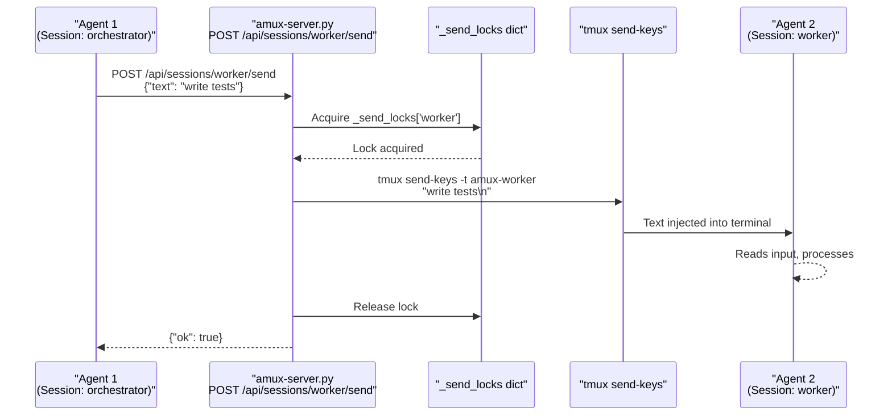
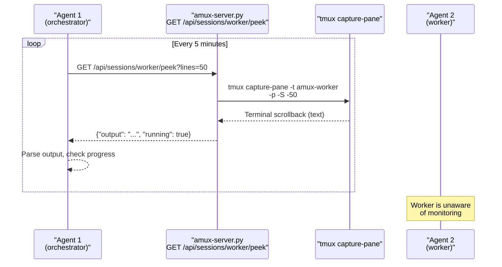
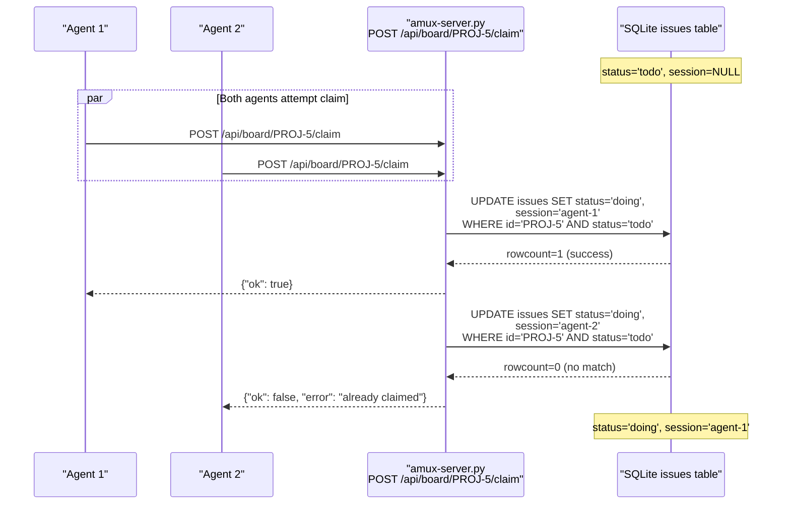
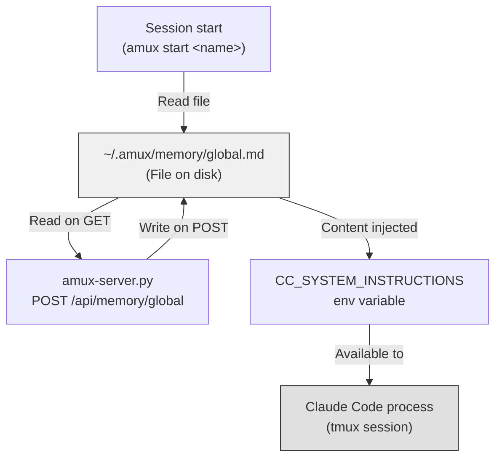
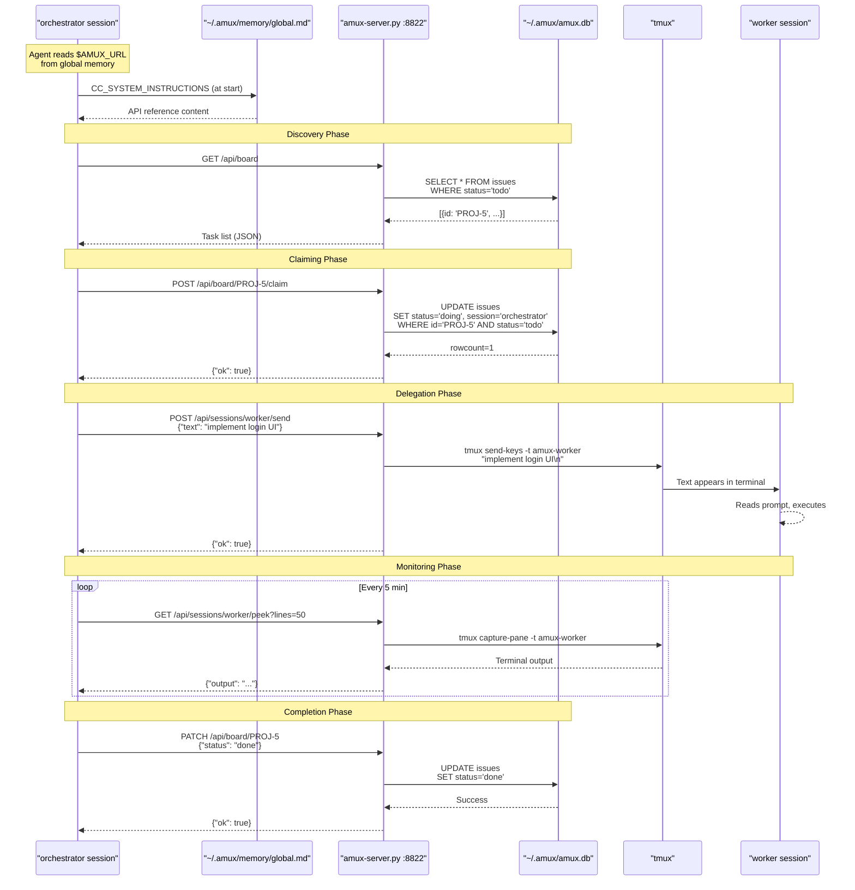
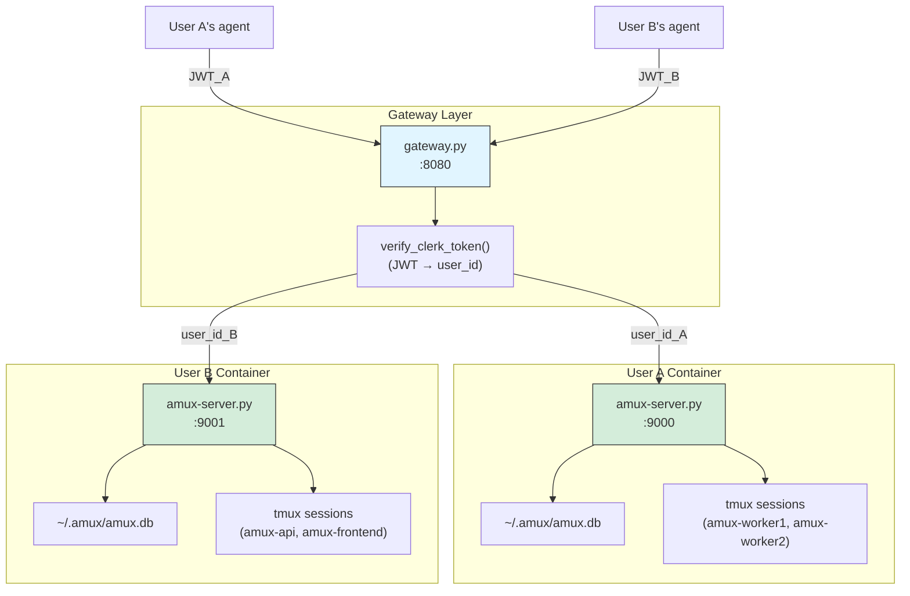

<!-- source: DeepWiki mcp.deepwiki.com · repo mixpeek/amux · page 12.2 Inter-Agent Communication · fetched 2026-10-26 -->

# Inter-Agent Communication

<details>
<summary>Relevant source files</summary>

The following files were used as context for generating this wiki page:

- [README.md](README.md)
- [amux-server.py](amux-server.py)
- [cloud/gateway/gateway.py](cloud/gateway/gateway.py)
- [test.mjs](test.mjs)

</details>


## Purpose and Scope

This page documents how Claude Code agents communicate with each other within amux using the REST API. It covers the primitives for sending messages, monitoring output, claiming tasks atomically, and sharing context through global memory. For information about the board system's data model and UI, see [Board System](#2.2). For the complete REST API reference, see [REST API Reference](#5).

Agents communicate exclusively through HTTP endpoints exposed by `amux-server.py`. There is no direct session-to-session communication or shared memory space—all coordination happens via the REST API and SQLite database.

## Communication Primitives

amux provides four core primitives for inter-agent communication:

| Primitive | Endpoint | Purpose | Isolation |
|-----------|----------|---------|-----------|
| **Message Sending** | `POST /api/sessions/<name>/send` | Inject text into another agent's tmux session | Per-session locks prevent race conditions |
| **Output Monitoring** | `GET /api/sessions/<name>/peek` | Capture terminal output from another agent | Read-only, no side effects |
| **Atomic Task Claiming** | `POST /api/board/<id>/claim` | Claim a board item using SQLite CAS | Database-level atomicity prevents duplicate work |
| **Shared Memory** | `GET/POST /api/memory/global` | Share API documentation and context | Read-write global state visible to all sessions |

Sources: [amux-server.py:110-186](), [amux-server.py:1186-1232](), [amux-server.py:1754-1789](), [amux-server.py:2168-2208](), [amux-server.py:1869-1921]()

## Message Sending

### HTTP Interface

```http
POST /api/sessions/worker-1/send
Content-Type: application/json

{
  "text": "implement the login endpoint and report back",
  "enter": true
}
```

**Response:**
```json
{
  "ok": true,
  "sent": "implement the login endpoint and report back\n"
}
```

### Implementation: tmux send-keys

The `send_text()` function uses tmux's `send-keys` command to inject text into the target session's terminal:

```
tmux send-keys -t amux-<name> <escaped-text> [Enter]
```

**Per-session locking:** A dictionary `_send_locks` [amux-server.py:193]() ensures that only one message is sent to a given session at a time, preventing interleaved input that could corrupt the agent's prompt.

**Lock acquisition:**
```python
with _send_locks_lock:
    if name not in _send_locks:
        _send_locks[name] = threading.Lock()
lock = _send_locks[name]
```

The lock is held for the duration of the `subprocess.run()` call to tmux, typically 50-200ms.

Sources: [amux-server.py:1186-1232](), [amux-server.py:193-194](), [amux-server.py:1682-1729]()

### Diagram: Message Sending Flow



Sources: [amux-server.py:1186-1232](), [amux-server.py:1682-1729]()

## Output Monitoring

### HTTP Interface

```http
GET /api/sessions/worker-1/peek?lines=50
```

**Response:**
```json
{
  "output": "... terminal output (last 50 lines) ...",
  "running": true
}
```

### Implementation: tmux capture-pane

The `tmux_capture()` function uses tmux's `capture-pane` command to extract the scrollback buffer:

```
tmux capture-pane -t amux-<name> -p -S -<lines>
```

**No state modification:** This is a read-only operation. The agent being monitored is unaware of the capture.

**Batch optimization:** For monitoring multiple sessions (e.g., in the dashboard), `_tmux_capture_batch()` [amux-server.py:969-978]() uses `ThreadPoolExecutor` to parallelize captures, reducing latency from O(n) to O(1).

Sources: [amux-server.py:957-966](), [amux-server.py:969-978](), [amux-server.py:1754-1789]()

### Diagram: Output Monitoring Flow



Sources: [amux-server.py:957-966](), [amux-server.py:1754-1789]()

## Atomic Task Claiming

### HTTP Interface

```http
POST /api/board/PROJ-5/claim
```

**Response (success):**
```json
{
  "ok": true,
  "issue": {
    "id": "PROJ-5",
    "title": "implement login",
    "status": "doing",
    "session": "worker-1",
    "claimed_at": 1704067200
  }
}
```

**Response (already claimed):**
```json
{
  "ok": false,
  "error": "already claimed by worker-2"
}
```

### Implementation: SQLite Compare-And-Swap

The claim operation uses a single SQL `UPDATE` with a `WHERE` clause to implement Compare-And-Swap (CAS):

```sql
UPDATE issues 
SET status='doing', session=?, claimed_at=? 
WHERE id=? AND status='todo'
```

**Atomicity guarantee:** SQLite's transaction isolation ensures that only one agent succeeds when multiple agents attempt to claim the same task simultaneously. The `WHERE status='todo'` clause causes the `UPDATE` to affect 0 rows if the task was already claimed.

**Return value:** The endpoint checks `cursor.rowcount` to determine success:
- `rowcount == 1`: Claim succeeded
- `rowcount == 0`: Task was already claimed or doesn't exist

Sources: [amux-server.py:2168-2208](), [amux-server.py:2084-2091]()

### Diagram: Atomic Claiming with CAS



Sources: [amux-server.py:2168-2208]()

## Shared Memory

### HTTP Interface

**Read global memory:**
```http
GET /api/memory/global
```

**Response:**
```json
{
  "content": "# Global Memory\n\nAPI: $AMUX_URL\n\nEndpoints:\n- POST /api/sessions/<name>/send\n...",
  "path": "/Users/user/.amux/memory/global.md"
}
```

**Write global memory:**
```http
POST /api/memory/global
Content-Type: application/json

{
  "content": "# Updated global memory\n\n..."
}
```

### Implementation: File-backed Markdown

Global memory is stored at `~/.amux/memory/global.md` [amux-server.py:52]() and injected into every Claude Code session via the `CC_SYSTEM_INSTRUCTIONS` environment variable.

**Automatic injection:** When a session starts, amux sets:
```bash
CC_SYSTEM_INSTRUCTIONS="$(cat ~/.amux/memory/global.md)"
```

This makes the global memory available to all agents without requiring explicit API calls. Agents can reference the content naturally in prompts.

**Typical contents:**
- API base URL (`$AMUX_URL`)
- REST endpoint documentation
- Project-wide conventions
- Shared credentials (via `${ENV_VAR}` placeholders)

Sources: [amux-server.py:1869-1921](), [amux-server.py:52]()

### Diagram: Global Memory Injection



Sources: [amux-server.py:1869-1921](), [amux-server.py:1543-1602]()

## Natural Language Orchestration

Because global memory contains the full REST API reference, agents can orchestrate other agents using natural language. They don't need to know HTTP syntax—they just need to express intent.

### Example: Delegation Pattern

**Agent 1's prompt:**
```
There's a task on the board labeled PROJ-5: "implement login endpoint".
Claim it, then delegate the frontend work to the worker-2 session.
Monitor their progress and report back when they're done.
```

**Agent 1's internal reasoning:**
1. Claims PROJ-5 via `POST /api/board/PROJ-5/claim`
2. Sends message to worker-2 via `POST /api/sessions/worker-2/send`
3. Polls worker-2's output via `GET /api/sessions/worker-2/peek?lines=50`
4. Marks PROJ-5 done via `PATCH /api/board/PROJ-5` when complete

The agent composes these API calls naturally because the endpoint documentation is in global memory.

Sources: [README.md:62-78]()

## Code-Level Communication Flow

### Complete Message Flow (Agent → Agent)



Sources: [amux-server.py:1682-1729](), [amux-server.py:1754-1789](), [amux-server.py:2168-2208](), [amux-server.py:2220-2283]()

## Security and Isolation

### Session Isolation

Sessions are isolated via tmux session names. The naming scheme `amux-<session>` [amux-server.py:924-937]() ensures that sessions cannot accidentally interfere with each other's tmux targets.

**No shared process space:** Each session is a separate tmux session with its own shell process and working directory. Agents cannot access each other's memory or file descriptors.

### API Authentication

**Local deployment:** No authentication. The API binds to `localhost:8822` and assumes all connections are trusted.

**Cloud deployment:** The gateway [cloud/gateway/gateway.py:1-861]() verifies Clerk JWTs before proxying requests to user containers. Each user gets an isolated Docker container with their own `amux-server.py` instance.

**Container isolation:** In cloud mode, the gateway extracts the user ID from the JWT and proxies requests to the corresponding container:

```python
target_port = user_row["port"]  # e.g., 9000, 9001, ...
proxy(handler, target_port, path, qs, user_email=user_email)
```

Sources: [cloud/gateway/gateway.py:396-457](), [cloud/gateway/gateway.py:641-696]()

### Diagram: Multi-Tenant Isolation (Cloud)



Sources: [cloud/gateway/gateway.py:335-347](), [cloud/gateway/gateway.py:396-457]()

## Common Patterns

### Pattern 1: Work Queue with Atomic Claiming

**Use case:** Multiple agents pull from a shared task queue without duplicating work.

**Implementation:**
1. Agents poll `GET /api/board` for `status='todo'` items
2. Each agent attempts `POST /api/board/<id>/claim`
3. Only one agent succeeds (SQLite CAS guarantees atomicity)
4. Agent works on claimed task, updates to `status='done'` when complete

**Code reference:** [amux-server.py:2168-2208]()

### Pattern 2: Supervisor-Worker Delegation

**Use case:** One agent orchestrates multiple worker agents.

**Implementation:**
1. Supervisor reads board via `GET /api/board`
2. Supervisor sends tasks to workers via `POST /api/sessions/<worker>/send`
3. Supervisor monitors progress via periodic `GET /api/sessions/<worker>/peek`
4. Supervisor detects completion by parsing output for success markers

**Code reference:** [README.md:62-78]()

### Pattern 3: Shared Context via Global Memory

**Use case:** All agents need access to project conventions, API keys, or shared documentation.

**Implementation:**
1. Write shared context to `POST /api/memory/global`
2. Restart sessions to inject updated `CC_SYSTEM_INSTRUCTIONS`
3. Agents reference global context in prompts (e.g., "use the API documented in global memory")

**Code reference:** [amux-server.py:1869-1921]()

### Pattern 4: Progress Monitoring with Search

**Use case:** Agent wants to know if another agent has completed a specific subtask.

**Implementation:**
```bash
output=$(curl -sk "$AMUX_URL/api/sessions/worker/peek?lines=100")
if echo "$output" | grep -q "Login endpoint tests passing"; then
    # Worker completed the task
    mark_done PROJ-5
fi
```

**Code reference:** [amux-server.py:1754-1789]()

## API Reference Summary

| Method | Endpoint | Purpose | Returns |
|--------|----------|---------|---------|
| `POST` | `/api/sessions/<name>/send` | Send text to a session | `{"ok": true}` |
| `GET` | `/api/sessions/<name>/peek` | Capture terminal output | `{"output": "...", "running": true}` |
| `POST` | `/api/board/<id>/claim` | Atomically claim a task | `{"ok": true, "issue": {...}}` |
| `GET` | `/api/board` | List all board items | `[{id, title, status, session, ...}]` |
| `PATCH` | `/api/board/<id>` | Update board item | `{"ok": true}` |
| `GET` | `/api/memory/global` | Read global memory | `{"content": "...", "path": "..."}` |
| `POST` | `/api/memory/global` | Write global memory | `{"ok": true}` |
| `GET` | `/api/sessions/<name>/memory` | Read session memory | `{"content": "...", "path": "..."}` |
| `POST` | `/api/sessions/<name>/memory` | Write session memory | `{"ok": true}` |

For complete endpoint documentation including request/response schemas, see [REST API Reference](#5).

Sources: [amux-server.py:1682-1729](), [amux-server.py:1754-1789](), [amux-server.py:2168-2208](), [amux-server.py:2084-2091](), [amux-server.py:1869-1921](), [amux-server.py:1804-1868]()

---

