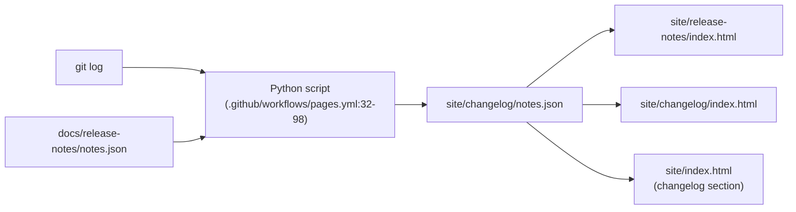
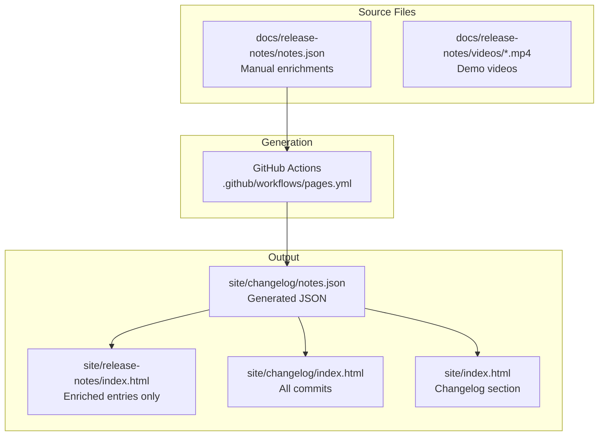
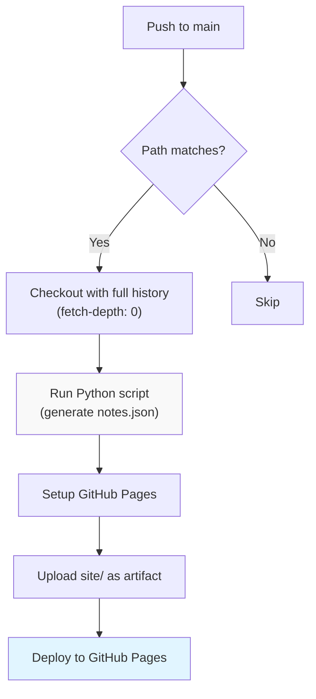

<!-- source: DeepWiki mcp.deepwiki.com · repo mixpeek/amux · page 14 Release Notes · fetched 2026-10-26 -->

# Release Notes

<details>
<summary>Relevant source files</summary>

The following files were used as context for generating this wiki page:

- [.github/workflows/pages.yml](.github/workflows/pages.yml)
- [docs/release-notes/notes.json](docs/release-notes/notes.json)
- [docs/release-notes/videos/crm-people-tab.mp4](docs/release-notes/videos/crm-people-tab.mp4)
- [site/changelog/index.html](site/changelog/index.html)
- [site/changelog/notes.json](site/changelog/notes.json)
- [site/index.html](site/index.html)
- [site/release-notes/index.html](site/release-notes/index.html)
- [site/style.css](site/style.css)

</details>


The release notes system provides a public-facing changelog that automatically generates entries from git commit history and merges in manually curated descriptions, tags, and demo videos. This system powers both the `/release-notes/` page (with detailed descriptions and videos) and the `/changelog/` page (all commits).

For information about session-level logging and event tracking, see [Event System & Logging](#2.5).

---

## System Overview

The release notes architecture consists of three components:

1. **Automatic generation**: GitHub Actions workflow parses git commit history using conventional commit format
2. **Manual enrichment**: Developers add descriptions, tags, and video references to [docs/release-notes/notes.json:1-152]()
3. **Static rendering**: Both enriched and unenriched entries are displayed on separate pages

The system follows a merge-based approach where manual enrichments (keyed by git commit hash) are overlaid onto the automatically parsed commit log.

**Sources**: [.github/workflows/pages.yml:1-111](), [docs/release-notes/notes.json:1-152]()

---

## Generation Pipeline



**Commit Parsing Flow**

The GitHub Actions workflow [.github/workflows/pages.yml:22-98]() runs on every push to `main` that touches:
- `site/**`
- `docs/release-notes/notes.json`
- `amux-server.py`

The Python script executes the following steps:

1. **Load enrichments**: Parse [docs/release-notes/notes.json:1-152]() and index by full commit hash
2. **Parse git log**: Extract commit metadata using format string `%H%x00%h%x00%ad%x00%s` (hash, short hash, date, subject)
3. **Filter commits**: Skip merge commits and low-signal types (`chore`, `test`, `ci`, `build`, `style`, `refactor`) unless manually enriched
4. **Extract commit type**: Parse conventional commit prefix (e.g., `feat:`, `fix:`, `docs:`)
5. **Merge enrichments**: Overlay manual data (description, tags, video) onto parsed commits
6. **Write output**: Generate [site/changelog/notes.json:1-142]() with all entries

**Sources**: [.github/workflows/pages.yml:32-98]()

---

## Data Schema

### Commit Entry Structure

Each entry in `notes.json` follows this schema:

| Field | Type | Source | Description |
|-------|------|--------|-------------|
| `hash` | string | git log | Full commit SHA |
| `short` | string | git log | 7-character abbreviated hash |
| `title` | string | git log / manual | Commit subject with conventional prefix stripped |
| `date` | string | git log | ISO date (YYYY-MM-DD) |
| `type` | string | git log | Conventional commit type: `feat`, `fix`, `docs`, `perf`, `chore` |
| `tags` | array | manual | Topical tags (e.g., `["notes", "ui", "offline"]`) |
| `description` | string | manual | Detailed explanation of the change (paragraph format) |
| `video` | string | manual | Filename of demo video in `docs/release-notes/videos/` |

**Example**:

```json
{
  "hash": "2dc168121706eb9290b55f532803732f0a06aedf",
  "short": "2dc1681",
  "title": "Notes sidebar panel icons, offline save queuing, title sync",
  "date": "2026-03-04",
  "type": "feat",
  "tags": ["notes", "ui", "offline"],
  "description": "Replaced the text chevrons (‹ ›) in the notes sidebar...",
  "video": "2dc1681.mp4"
}
```

**Sources**: [docs/release-notes/notes.json:2-11](), [.github/workflows/pages.yml:80-90]()

---

## File Structure



**Directory Layout**:

```
docs/release-notes/
  notes.json                  # Manual enrichments (source of truth)
  videos/
    2dc1681.mp4              # Demo videos keyed by short hash
    63b4732.mp4
    ...

site/changelog/
  notes.json                  # Generated by CI (not version-controlled)
  index.html                  # Changelog page (all commits)

site/release-notes/
  index.html                  # Release notes page (enriched only)

.github/workflows/
  pages.yml                   # Generation + deployment pipeline
```

**Sources**: [docs/release-notes/notes.json:1](), [.github/workflows/pages.yml:1-111]()

---

## Enrichment Workflow

### Adding a New Release Note

To create a fully documented release note with video:

1. **Commit with conventional format**:
   ```bash
   git commit -m "feat(notes): add markdown export"
   ```

2. **Capture demo video**:
   - Record feature demonstration using the browser recording system (see [Browser Recording](#10.3))
   - Name file with 7-character commit hash: `abc1234.mp4`
   - Place in [docs/release-notes/videos/]()

3. **Add enrichment entry** to [docs/release-notes/notes.json:1-152]():
   ```json
   {
     "hash": "<full-40-char-hash>",
     "short": "abc1234",
     "title": "Add markdown export for notes",
     "date": "2026-03-05",
     "type": "feat",
     "tags": ["notes", "export"],
     "description": "Notes can now be exported to markdown...",
     "video": "abc1234.mp4"
   }
   ```

4. **Push to GitHub**:
   - The [pages.yml:22-110]() workflow triggers
   - Generates `site/changelog/notes.json` with merged data
   - Deploys to GitHub Pages

**Sources**: [docs/release-notes/notes.json:1-152](), [.github/workflows/pages.yml:22-110]()

---

## Commit Type Classification

The generation script uses regex to parse conventional commit prefixes:

```python
CONV = re.compile(r'^(feat|fix|docs|chore|test|ci|build|style|refactor|perf)(?:\([^)]+\))?!?:\s*', re.I)
```

**Type Filtering**:

| Type | Displayed in `/changelog/` | Displayed in `/release-notes/` |
|------|---------------------------|--------------------------------|
| `feat` | ✓ | Only if enriched |
| `fix` | ✓ | Only if enriched |
| `docs` | ✓ | Only if enriched |
| `perf` | ✓ | Only if enriched |
| `chore` | Only if enriched | Only if enriched |
| `test` | Only if enriched | Only if enriched |
| `ci` | Only if enriched | Only if enriched |
| `build` | Only if enriched | Only if enriched |
| `style` | Only if enriched | Only if enriched |
| `refactor` | Only if enriched | Only if enriched |

The skip logic is defined at [.github/workflows/pages.yml:53]():

```python
SKIP_TYPES = {"chore", "test", "ci", "build", "style", "refactor"}

if commit_type in SKIP_TYPES and full_hash not in enrichments:
    continue
```

**Sources**: [.github/workflows/pages.yml:53-78]()

---

## Rendering Implementations

### Release Notes Page

The [site/release-notes/index.html:1-144]() page displays **only enriched entries** (those with descriptions). Key implementation details:

**Video Rendering**:

```javascript
var video = n.video
  ? '<div class="rn-video-wrap"><video controls preload="none"><source src="' + GH_RAW + n.video + '" type="video/mp4"></video></div>'
  : '<div class="rn-video-placeholder"><svg width="32" height="32" viewBox="0 0 24 24"...></svg><span>Video coming soon</span></div>';
```

- Videos load from `https://raw.githubusercontent.com/mixpeek/amux/main/docs/release-notes/videos/`
- Uses `preload="none"` for performance
- Shows placeholder SVG if video not available

**Filtering Logic** [site/release-notes/index.html:74]():

```javascript
var enriched = data.filter(function(n) { return n.description && n.description.trim(); });
```

Only entries with non-empty descriptions are displayed.

**Sources**: [site/release-notes/index.html:45-84]()

---

### Changelog Page

The [site/changelog/index.html:1-169]() page displays **all commits**, with client-side filtering:

**Filter Buttons**:

- All
- Features (`feat`)
- Bug fixes (`fix`)
- Docs (`docs`)

**Rendering Function** [site/changelog/index.html:73-95]():

```javascript
function renderEntries() {
  var filtered = activeFilter === 'all' ? allEntries : allEntries.filter(function(e) { return e.type === activeFilter; });
  // ... render HTML
}
```

**Entry Structure**:

- Date + commit hash (with GitHub link)
- Type badge (styled by commit type)
- Title
- Description (if available)
- Tags (if available)

**Sources**: [site/changelog/index.html:46-109]()

---

### Homepage Changelog Section

The main landing page [site/index.html:459-478]() includes a compact changelog section using the same data feed. Styling uses inline CSS classes:

- `.cl-entry`: Row container
- `.cl-badge`: Type badge (feat/fix/docs/perf/chore)
- `.cl-title`: Commit title (truncated with `text-overflow: ellipsis`)
- `.cl-date`: Date stamp

**Sources**: [site/index.html:459-478]()

---

## Deployment Pipeline



**Workflow Configuration** [.github/workflows/pages.yml:1-21]():

```yaml
on:
  push:
    branches: [main]
    paths:
      - 'site/**'
      - 'docs/release-notes/notes.json'
      - 'amux-server.py'
  workflow_dispatch:

permissions:
  contents: read
  pages: write
  id-token: write

concurrency:
  group: pages
  cancel-in-progress: true
```

**Key Settings**:

- **Full git history required**: `fetch-depth: 0` at [.github/workflows/pages.yml:30]() ensures all commits are available
- **Concurrency control**: Only one deployment runs at a time
- **Artifact upload**: The entire `site/` directory is uploaded at [.github/workflows/pages.yml:104-106]()

**Sources**: [.github/workflows/pages.yml:1-110]()

---

## CSS Styling

### Release Notes Styles

Custom CSS for the release notes page is embedded in [site/release-notes/index.html:1-144](). Key visual elements:

**Header**:

```css
.rn-header {
  text-align: center;
  padding: 4rem 2rem 2rem;
  background: var(--surface);
}

.rn-logo-mark {
  width: 48px;
  height: 48px;
  border-radius: 50%;
  background: var(--accent);
  color: #fff;
}
```

**Entry Cards**:

```css
.rn-entry {
  background: var(--bg);
  border: 1px solid var(--border);
  border-radius: 10px;
  padding: 2rem;
  margin-bottom: 2rem;
}
```

**Video Wrapper**:

```css
.rn-video-wrap video {
  width: 100%;
  border-radius: 8px;
  border: 1px solid var(--border);
}
```

### Changelog Styles

The changelog page uses shared styles from [site/style.css:1-509]() plus inline definitions for:

- `.entry`: Two-column layout (date + body)
- `.type-badge`: Color-coded by commit type
- `.filter-pill`: Tag-style filter buttons

**Type Badge Colors** (from inline styles):

```css
.type-feat  { background: rgba(22,163,74,0.1); color: var(--green); }
.type-fix   { background: rgba(217,119,6,0.1);  color: var(--amber); }
.type-docs  { background: rgba(37,99,235,0.1);  color: var(--blue); }
```

**Sources**: [site/style.css:1-509](), [site/changelog/index.html:1-169]()

---

## Video Asset Management

Demo videos are stored in [docs/release-notes/videos/]() and served from GitHub's raw content CDN:

**URL Pattern**:

```
https://raw.githubusercontent.com/mixpeek/amux/main/docs/release-notes/videos/<short-hash>.mp4
```

**Naming Convention**:

- Videos are named with the 7-character short hash of their commit
- Example: `2dc1681.mp4` corresponds to commit `2dc168121706eb9290b55f532803732f0a06aedf`

**Recording Guidelines**:

1. Use the browser recording system with visible cursor and click ripples (see [Browser Recording](#10.3))
2. Keep videos under 2 minutes
3. Focus on the specific feature/fix being demonstrated
4. Export as MP4 with H.264 codec for browser compatibility

**Sources**: [docs/release-notes/videos/crm-people-tab.mp4:1](), [site/release-notes/index.html:55-57]()

---

## Commit Message Best Practices

To ensure commits appear correctly in the release notes:

**Format**:

```
<type>[optional scope]: <description>

[optional body]

[optional footer]
```

**Examples**:

```
feat(board): add drag-and-drop reordering
fix(sessions): prevent duplicate session names
docs: update installation guide for Windows
perf(watchdog): reduce memory usage in peek mode
```

**Title Formatting** [.github/workflows/pages.yml:72-74]():

The script automatically:
- Strips the conventional commit prefix
- Capitalizes the first letter
- Preserves the rest of the string as-is

```python
title = CONV.sub("", subject).strip()
if title:
    title = title[0].upper() + title[1:]
```

**Sources**: [.github/workflows/pages.yml:54-74]()

---

## Future Enhancements

Potential improvements to the release notes system:

1. **RSS feed generation**: Auto-generate `release-notes.xml` from the JSON feed
2. **Version tagging**: Link release notes to semantic version tags
3. **Category grouping**: Group related commits by feature area
4. **Search functionality**: Client-side full-text search across descriptions
5. **Animated GIFs**: Fallback to lightweight GIFs for older browsers
6. **Contributor attribution**: Include author information from git commits

**Sources**: [.github/workflows/pages.yml:1-111](), [site/release-notes/index.html:1-144]()