<!-- source: DeepWiki mcp.deepwiki.com · repo mixpeek/amux · page 2 Core Server (amux-server.py) · fetched 2026-10-26 -->

# Core Server (amux-server.py)

<details>
<summary>Relevant source files</summary>

The following files were used as context for generating this wiki page:

- [CLAUDE.md](CLAUDE.md)
- [amux-server.py](amux-server.py)
- [cloud/gateway/gateway.py](cloud/gateway/gateway.py)
- [test.mjs](test.mjs)

</details>


## Purpose and Scope

This page documents the architecture and internal mechanisms of `amux-server.py`, the core server implementation that powers both local and cloud deployments of amux. This single Python file serves multiple roles: HTTP server, tmux session manager, SQLite data layer, and web dashboard host.

For detailed information on specific subsystems, see:
- Session lifecycle and tmux integration: [Session Management](#2.1)
- SQLite board schema and atomic operations: [Board System](#2.2)
- Per-session and global memory files: [Memory System](#2.3)
- Auto-recovery and monitoring loops: [Self-Healing Watchdog](#2.4)
- Event emission and SSE streaming: [Event System & Logging](#2.5)

**Sources:** [amux-server.py:1-96](), [CLAUDE.md:1-63]()

---

## Single-File Architecture

`amux-server.py` implements the entire server as a monolithic Python script with inline HTML/CSS/JavaScript for the web dashboard. This design enforces the single-codebase rule: the same file runs identically in local OSS and cloud containerized environments.

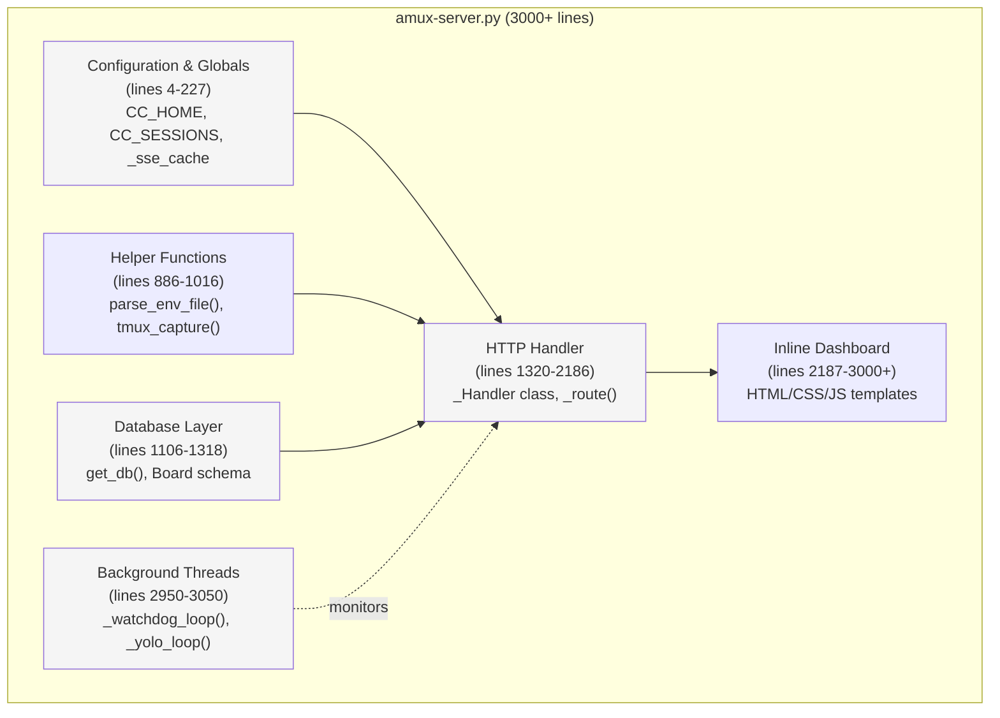

**Key characteristics:**
- **No imports of custom modules** — only Python stdlib
- **No class hierarchy** — single `_Handler(BaseHTTPRequestHandler)` class
- **Configuration via environment variables** loaded from `~/.amux/server.env`
- **Auto-restart on file modification** using `os.execv()` [amux-server.py:3210-3230]()

**Sources:** [amux-server.py:1-96](), [CLAUDE.md:24-31]()

---

## Server Initialization and Configuration

### Directory Structure

The server creates and manages a home directory at `~/.amux/` (migrated from legacy `~/.cmux/` or `~/.cc/` paths):

| Directory | Variable | Purpose |
|-----------|----------|---------|
| `~/.amux/sessions/` | `CC_SESSIONS` | Session `.env` config files |
| `~/.amux/logs/` | `CC_LOGS` | Session terminal logs and `server.log` |
| `~/.amux/memory/` | `CC_MEMORY` | Per-session memory markdown files |
| `~/.amux/board/` | `CC_BOARD_DIR` | Legacy board file storage (deprecated) |
| `~/.amux/uploads/` | `CC_UPLOADS` | User-uploaded files |
| `~/.amux/notes/` | `CC_NOTES` | Notes and `.pins.json` |
| `~/.amux/amux.db` | (computed) | SQLite database for board/logs |

**Sources:** [amux-server.py:29-63]()

### Environment Variable Loading

The server loads persistent configuration from `~/.amux/server.env` before reading any environment variables:

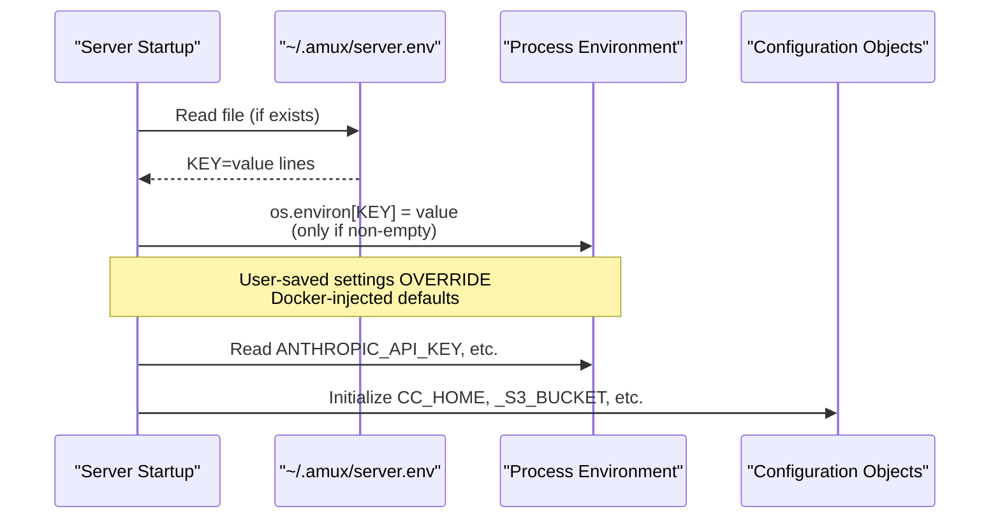

This override behavior allows cloud deployments to inject defaults via Docker environment variables, while user-saved settings (from the Settings UI) take priority.

**Sources:** [amux-server.py:36-47](), [CLAUDE.md:32-43]()

---

## HTTP Server and Request Routing

### ThreadingHTTPServer

The server runs on port 8822 using `ThreadingHTTPServer`, which spawns a new thread for each incoming request:

```python
server = ThreadingHTTPServer(("127.0.0.1", 8822), _Handler)
server.serve_forever()
```

**Sources:** [amux-server.py:3280-3281]()

### Request Handler (`_Handler`)

The `_Handler` class extends `BaseHTTPRequestHandler` and centralizes all HTTP methods through the `_route()` function:

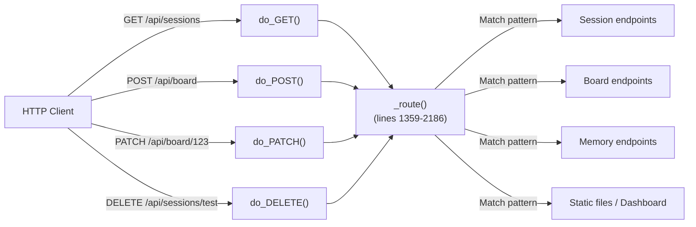

**Sources:** [amux-server.py:2183-2186]()

### Route Matching Logic

Routes are matched using regular expressions within `_route()`. Example patterns:

| Pattern | Route | Handler Logic |
|---------|-------|---------------|
| `^/api/sessions$` (POST) | Create session | [amux-server.py:1426-1458]() |
| `^/api/sessions/([^/]+)/start$` (POST) | Start tmux session | [amux-server.py:1463-1510]() |
| `^/api/sessions/([^/]+)/send$` (POST) | Send text to session | [amux-server.py:1531-1565]() |
| `^/api/board$` (GET) | List board items | [amux-server.py:1819-1826]() |
| `^/api/board/([A-Za-z0-9-]+)$` (PATCH) | Update board item | [amux-server.py:1848-1882]() |
| `^/api/memory/global$` (POST) | Update global memory | [amux-server.py:1746-1762]() |

**Sources:** [amux-server.py:1359-2186]()

### Event Emission

Every request is classified and emitted as a structured event using `_classify_request()` and `_emit_event()`:

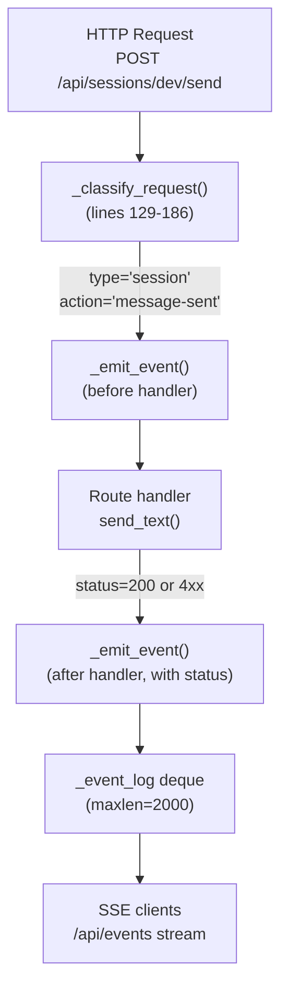

**Sources:** [amux-server.py:108-186]()

---

## Data Layer

### SQLite Database (`amux.db`)

The server uses SQLite with WAL (Write-Ahead Logging) mode for all structured data:

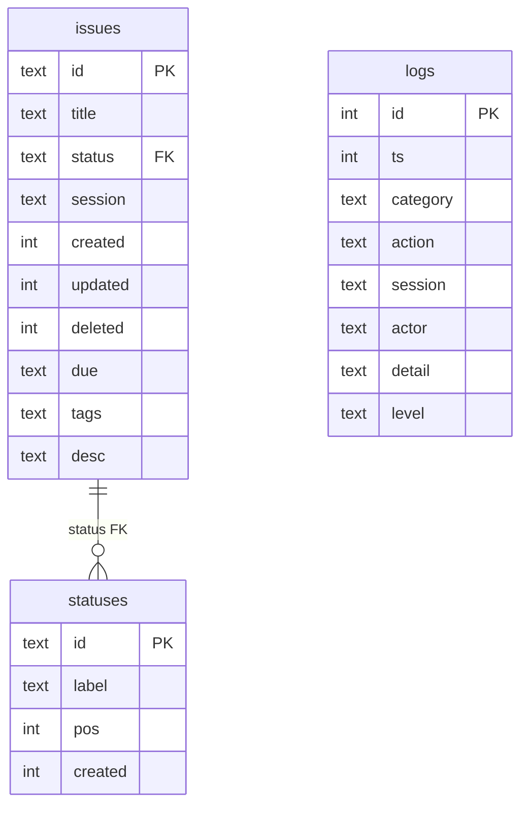

Database initialization:

```python
def get_db() -> sqlite3.Connection:
    db_path = CC_HOME / "amux.db"
    conn = sqlite3.connect(str(db_path), check_same_thread=False)
    conn.row_factory = sqlite3.Row
    conn.execute("PRAGMA journal_mode=WAL")
    # CREATE TABLE IF NOT EXISTS ... (schema setup)
    return conn
```

**Sources:** [amux-server.py:1106-1236]()

### Token Cache

Per-session token usage is cached by reading Claude Code JSONL files from `~/.claude/projects/`:

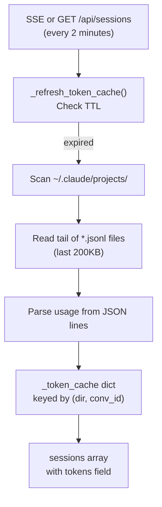

**Sources:** [amux-server.py:786-883]()

### File System Storage

Non-tabular data is stored in the `~/.amux/` directory tree:

- **Session configs:** `~/.amux/sessions/<name>.env` — persistent session settings
- **Session memory:** `~/.amux/memory/<name>.md` — per-session context
- **Global memory:** `~/.amux/memory/global.md` — shared agent context
- **Session logs:** `~/.amux/logs/<name>.log` — terminal capture history (max 10MB)
- **Uploads:** `~/.amux/uploads/<uuid>.<ext>` — user-uploaded files

**Sources:** [amux-server.py:49-63]()

---

## Background Threads

### Watchdog Loop (`_watchdog_loop`)

The watchdog runs every 30 seconds and monitors all running sessions for issues:

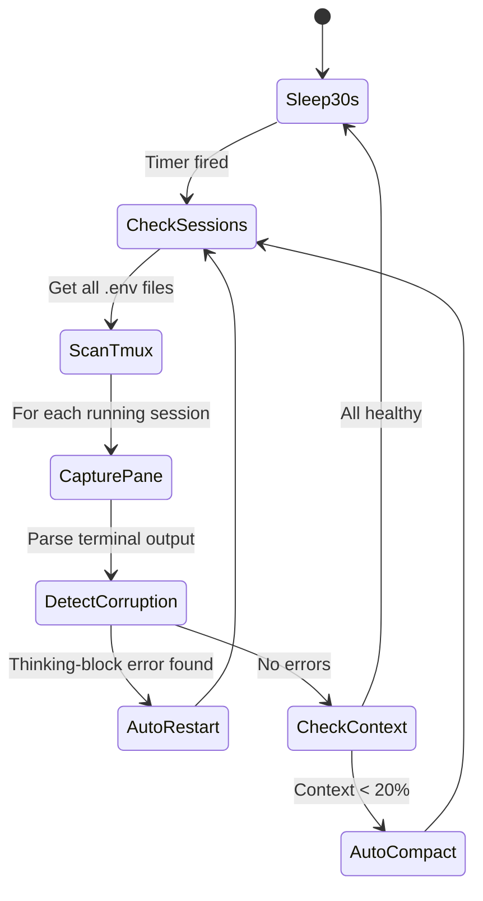

**Detection patterns:**

| Condition | Pattern | Action |
|-----------|---------|--------|
| Corruption | `r'<thinking>.*<thinking>'` | Auto-restart, replay last message |
| Low context | `r'(\d+)% context remaining'` < 20% | Send `/compact` command |
| Stuck prompt | No output change for 3+ cycles | Wake with Enter key |

**Sources:** [amux-server.py:2950-3097]()

### YOLO Auto-Responder (`_yolo_loop`)

For sessions with `--dangerously-skip-permissions`, auto-answers blocking prompts:

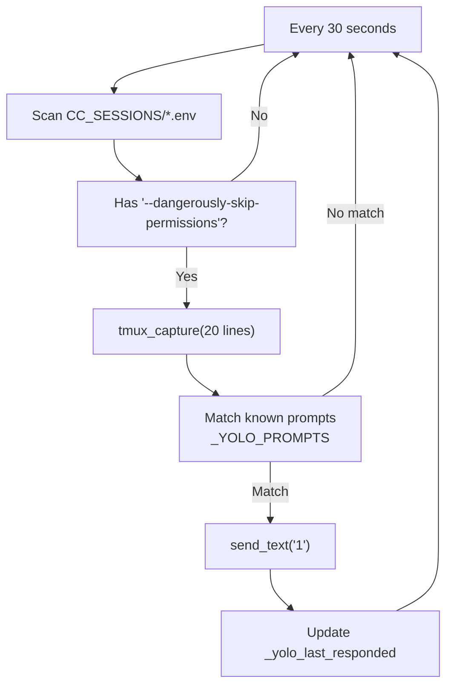

**Prompt patterns:**

```python
_YOLO_PROMPTS = [
    (re.compile(r'command contains.*command substitution.*esc to cancel', re.I | re.DOTALL), '1'),
    (re.compile(r'do you want to proceed.*esc to cancel', re.I | re.DOTALL), '1'),
    (re.compile(r'yes.*and don.t ask again.*esc to cancel', re.I | re.DOTALL), '1'),
]
```

**Sources:** [amux-server.py:1019-1068]()

### Auto-Restart Mechanism

The server monitors its own file modification time and restarts when `amux-server.py` changes:

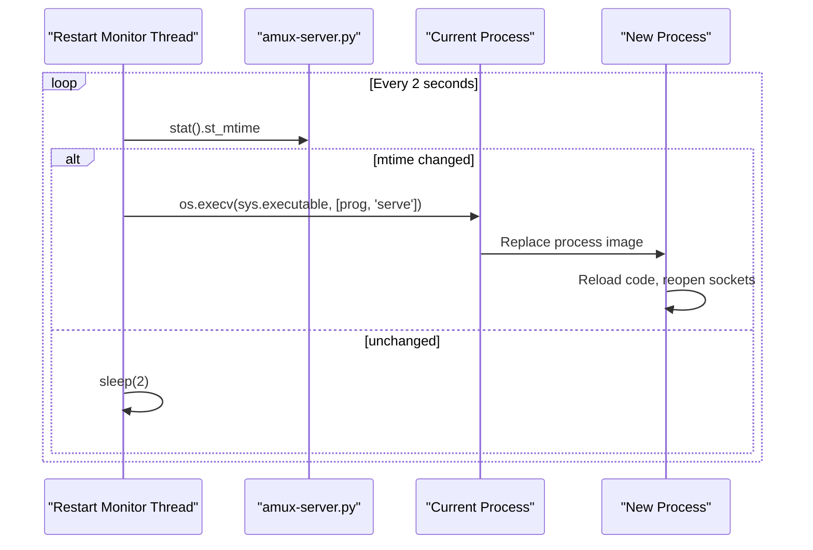

**Implementation:**

```python
def _restart_monitor():
    mtime = os.stat(__file__).st_mtime
    while True:
        time.sleep(2)
        current = os.stat(__file__).st_mtime
        if current != mtime:
            os.execv(sys.executable, [sys.executable, __file__, "serve"])
```

This allows zero-downtime updates in cloud deployments where all containers bind-mount the same file.

**Sources:** [amux-server.py:3210-3230]()

---

## MCP Server Integration

MCP (Model Context Protocol) servers are loaded from `mcp.json` and environment variables are injected from `~/.amux/server.env`:

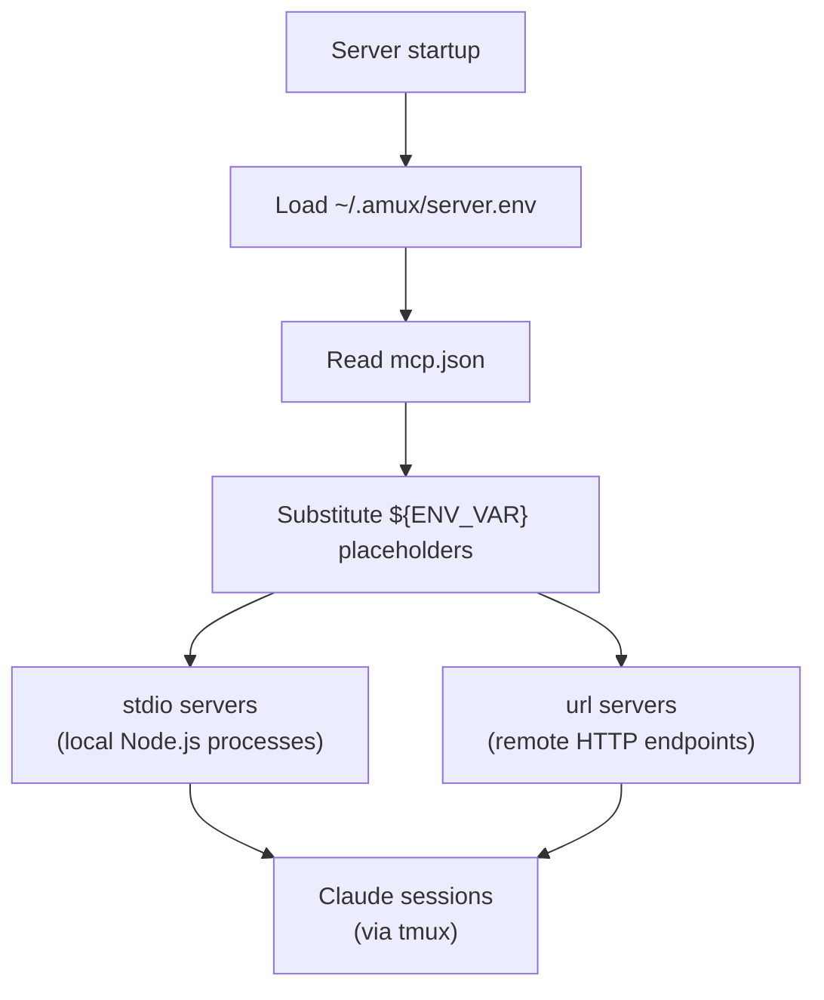

MCP servers are **not** spawned by amux-server.py — Claude Code spawns them directly. The server's role is to:
1. Load and validate `mcp.json`
2. Provide env vars via `~/.amux/server.env` for credential injection
3. Expose MCP config to the dashboard UI

**Sources:** [amux-server.py:36-47](), [CLAUDE.md:59-63]()

---

## Deployment Modes

### Single-Codebase Guarantee

The same `amux-server.py` file runs in both environments without modification:

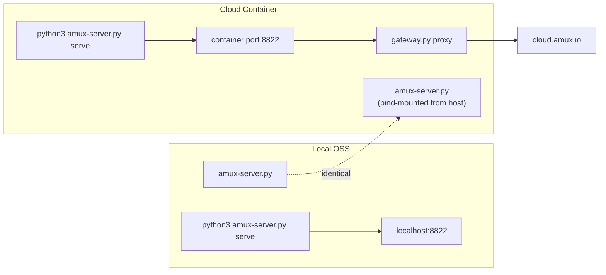

**Differentiation mechanisms:**

| Feature | Local | Cloud | Implementation |
|---------|-------|-------|----------------|
| User email | Not applicable | Via `X-Amux-User-Email` header | [amux-server.py:1350-1355]() |
| HTTPS | Self-signed cert | Gateway terminates TLS | Environment detection |
| S3 sync | Optional (via env vars) | Required (injected by Docker) | `AMUX_S3_BUCKET` presence |
| Multi-tenancy | Single user | Per-user containers | Gateway routing |

**Sources:** [CLAUDE.md:24-31](), [amux-server.py:1-96]()

### Cloud-Specific Headers

The cloud gateway injects headers that the server reads but does not require:

```python
user_email = req.headers.get("X-Amux-User-Email", "")
```

This header is used for display purposes (e.g., showing the logged-in user in the UI) but never for authentication or authorization — the gateway handles all auth upstream.

**Sources:** [amux-server.py:1350-1355](), [cloud/gateway/gateway.py:396-408]()

---

## Key Design Patterns

### Per-Session Locking

Each session has a dedicated lock to prevent race conditions when sending text:

```python
_send_locks: dict = {}
_send_locks_lock = threading.Lock()

def send_text(session: str, text: str):
    with _send_locks_lock:
        if session not in _send_locks:
            _send_locks[session] = threading.Lock()
        lock = _send_locks[session]
    
    with lock:
        # Send to tmux session
        subprocess.run(["tmux", "send-keys", "-t", tmux_target(session), text, "Enter"])
```

**Sources:** [amux-server.py:193-194](), [amux-server.py:1174-1203]()

### SSE Caching

Server-Sent Events use a shared cache to avoid redundant subprocess calls when multiple browser tabs connect:

```python
_sse_cache = {
    "sessions": {"data": None, "json": "", "time": 0},
    "board": {"data": None, "json": "", "time": 0},
}
_SSE_CACHE_TTL = 2  # seconds
```

Cache invalidation is TTL-based (2 seconds) plus version bumping for immediate updates:

```python
_notes_version: int = 0  # bumped on any notes write
_crm_version: int = 0    # bumped on any CRM write
```

**Sources:** [amux-server.py:97-102](), [amux-server.py:189-191]()

### Event Ring Buffer

Structured events are stored in an in-memory ring buffer with automatic overflow:

```python
_event_log: collections.deque[dict] = collections.deque(maxlen=2000)
```

Events are also persisted to the `logs` table in SQLite for long-term storage.

**Sources:** [amux-server.py:104-127]()

---

## Performance Characteristics

| Operation | Implementation | Typical Latency |
|-----------|----------------|-----------------|
| Session list | SQLite query + tmux list-sessions | ~50ms |
| Board list | Single SQLite SELECT | ~10ms |
| Tmux capture | subprocess.run (tmux capture-pane) | ~100ms |
| Token refresh | Read/parse Claude JSONL (cached) | ~500ms (2min cache) |
| Auto-restart | os.execv (full process replace) | ~1-2s |
| SSE stream | Chunked HTTP with 2s cache | Real-time |

**Sources:** [amux-server.py:786-883](), [amux-server.py:957-966]()

---

## Summary

`amux-server.py` implements a complete multi-agent orchestration platform in a single Python file through:

1. **HTTP server** — ThreadingHTTPServer with regex-based routing
2. **Data layer** — SQLite (WAL mode) + file system
3. **Session manager** — tmux wrapper with lifecycle management
4. **Background workers** — Watchdog, auto-responder, restart monitor
5. **Web dashboard** — Inline HTML/CSS/JS templates
6. **Event system** — Ring buffer + SSE streaming

The single-codebase design ensures identical behavior across local and cloud deployments, with differentiation achieved exclusively through environment variables and gateway-injected headers.

**Sources:** [amux-server.py:1-3281](), [CLAUDE.md:1-63]()

---

