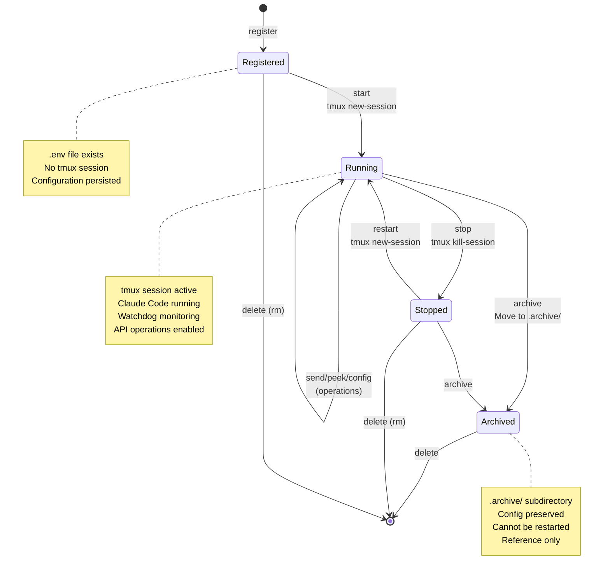
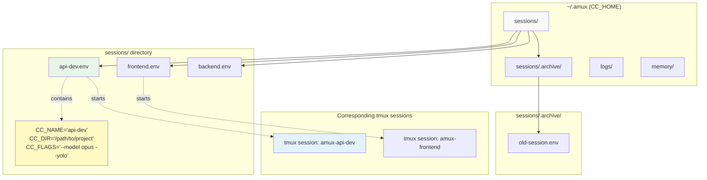
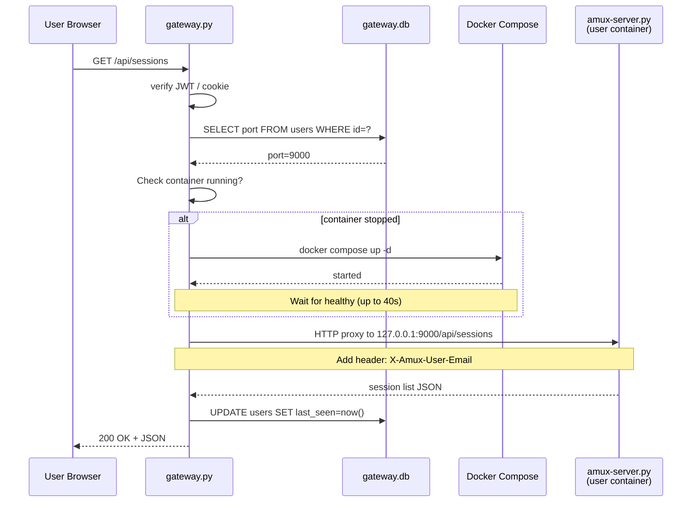

<!-- source: DeepWiki mcp.deepwiki.com · repo mixpeek/amux · page 2.1 Session Management · fetched 2026-10-26 -->

# Session Management

<details>
<summary>Relevant source files</summary>

The following files were used as context for generating this wiki page:

- [amux](amux)
- [amux-server.py](amux-server.py)
- [cloud/gateway/gateway.py](cloud/gateway/gateway.py)
- [cloud/setup.sh](cloud/setup.sh)
- [skills/amux-board.md](skills/amux-board.md)
- [skills/amux.md](skills/amux.md)
- [skills/playwright-auth.md](skills/playwright-auth.md)
- [skills/pw-test.md](skills/pw-test.md)
- [test.mjs](test.mjs)

</details>


Session Management is the core orchestration layer of amux that creates, configures, and controls individual Claude Code instances. Each session represents an isolated Claude agent with its own working directory, configuration, tmux environment, and persistent state. This page covers session lifecycle, persistence, tmux integration, and session operations.

For board task management, see [Board System](#2.2). For per-session memory and global context, see [Memory System](#2.3). For self-healing and auto-recovery mechanisms, see [Self-Healing Watchdog](#2.4).

---

## Session Lifecycle

Sessions follow a well-defined lifecycle from registration through execution to archival or deletion. The state transitions are managed by both the CLI (`amux`) and the HTTP server (`amux-server.py`).



**Sources:** [amux-server.py:152-170](), [amux:166-234](), [amux:306-319]()

---

## Session Persistence Structure

Session state is persisted in `~/.amux/sessions/` as `.env` files. Each file contains the session's configuration, which survives server restarts and is loaded on-demand.



**Session .env File Structure:**

| Field | Type | Description |
|-------|------|-------------|
| `CC_NAME` | string | Session identifier (must match filename without .env) |
| `CC_DIR` | path | Working directory for Claude Code (absolute path) |
| `CC_FLAGS` | string | Space-separated Claude Code CLI flags (e.g. `--model opus --yolo`) |

**Sources:** [amux:88-93](), [amux:176-182](), [amux-server.py:49-51]()

---

## Session Registration

Registration creates a session configuration without starting it. This decouples session definition from execution, allowing preconfigured sessions to be started on-demand.

### CLI Registration

```bash
amux register <name> [--dir /path] [--model opus] [--yolo] [claude flags...]
```

The `register` command:
1. Parses Claude Code flags from arguments ([amux:123-164]())
2. Resolves working directory to absolute path ([amux:152-154]())
3. Writes `.env` file to `~/.amux/sessions/` ([amux:176-182]())
4. Stores all configuration as environment variables

**Flag Parsing Logic:**
- Flags with values: `--model`, `--mcp-config`, `--system-prompt`, etc.
- Boolean flags: `--yolo`, `--dangerously-skip-permissions`, `--verbose`, etc.
- `--dir` is resolved to absolute path and stored separately as `CC_DIR`
- Unknown flags are passed through to Claude Code

**Sources:** [amux:168-186](), [amux:123-164]()

### HTTP API Registration

```http
POST /api/sessions
Content-Type: application/json

{
  "name": "api-dev",
  "dir": "/path/to/project",
  "flags": "--model opus --yolo",
  "tags": ["backend", "python"]
}
```

Response: `201 Created` with session metadata.

**Sources:** [amux-server.py:2287-2373]()

---

## Starting Sessions

Starting a session creates a tmux session and launches Claude Code inside it. The tmux session name is prefixed with `amux-` to avoid conflicts.

### Tmux Session Naming Convention

| Session Name | tmux Session Name |
|--------------|-------------------|
| `api-dev` | `amux-api-dev` |
| `frontend` | `amux-frontend` |
| `my-project` | `amux-my-project` |

This prefix prevents collisions with user tmux sessions and enables safe migration from legacy `cmux-*` or `cc-*` prefixes ([amux:104-113]()).

**Sources:** [amux:101](), [amux:104-113]()

### Start Flow

```mermaid
sequenceDiagram
    participant CLI as amux CLI
    participant Env as ~/.amux/sessions/NAME.env
    participant Tmux as tmux
    participant Claude as Claude Code Process
    
    CLI->>CLI: resolve_session(name)
    CLI->>Env: load session config
    Env-->>CLI: CC_NAME, CC_DIR, CC_FLAGS
    
    CLI->>Tmux: has-session "amux-NAME"?
    alt already running
        Tmux-->>CLI: yes
        CLI->>Tmux: attach-session
    else not running
        Tmux-->>CLI: no
        CLI->>Tmux: new-session -d -s "amux-NAME" -c CC_DIR
        Note over Tmux: Session created in background
        CLI->>Tmux: send command: "cd DIR; claude FLAGS"
        Tmux->>Claude: spawn process
        Claude-->>Tmux: running
        CLI->>Tmux: set-option allow-rename off
        CLI->>Tmux: attach-session
    end
```

**Sources:** [amux:188-234](), [amux:116-119]()

### Start Command Implementation

The `cmd_start` function ([amux:188-234]()):
1. Resolves session name (supports partial matches, numbers, exact names)
2. Checks if already running via `tmux has-session`
3. If running, attaches immediately
4. If not running:
   - Expands `~` in working directory path
   - Validates directory exists
   - Builds `claude` command string with global defaults + session flags + inline args
   - Creates detached tmux session with explicit working directory
   - Locks window name to prevent Claude from changing it ([amux:229-230]())
   - Attaches to session

**Important:** The `cd` command is explicitly run inside the tmux session even though tmux's `-c` flag sets the working directory. This handles cases where shell profiles override `CWD` ([amux:227]()).

**Sources:** [amux:188-234](), [amux:226-230]()

---

## Session Operations

Sessions expose several operations through both CLI and HTTP API.

### Send Message

Injects a message into a running session's Claude Code prompt.

**CLI:**
```bash
amux send <name> <text>
```

**HTTP API:**
```http
POST /api/sessions/<name>/send
Content-Type: application/json

{"text": "implement login endpoint"}
```

**Implementation:** Uses `tmux send-keys` to type text and press Enter ([amux:283-304](), [amux-server.py:2524-2592]()). A per-session lock prevents concurrent sends from interleaving ([amux-server.py:193-194]()).

**Sources:** [amux:283-304](), [amux-server.py:2524-2592](), [amux-server.py:193-194]()

### Peek Terminal Output

Captures recent terminal output without attaching.

**CLI:**
```bash
amux peek <name> [lines]
```

**HTTP API:**
```http
GET /api/sessions/<name>/peek?lines=50
POST /api/sessions/<name>/peek  # for longer output
```

**Implementation:** Uses `tmux capture-pane -p` to extract terminal buffer ([amux:268-281](), [amux-server.py:2644-2714]()).

**Sources:** [amux:268-281](), [amux-server.py:2644-2714]()

### Stop Session

Terminates the tmux session, killing the Claude Code process.

**CLI:**
```bash
amux stop <name>
```

**HTTP API:**
```http
POST /api/sessions/<name>/stop
```

**Implementation:** Executes `tmux kill-session -t amux-<name>` ([amux:306-319](), [amux-server.py:2505-2522]()).

**Sources:** [amux:306-319](), [amux-server.py:2505-2522]()

### Attach to Session

Attaches the current terminal to a running session's tmux pane.

**CLI:**
```bash
amux attach <name>
```

**Implementation:** Runs `tmux attach-session -t amux-<name>` ([amux:258-266]()). CLI-only operation (HTTP API cannot attach a terminal).

**Sources:** [amux:258-266]()

---

## Session Configuration

Session configuration can be updated without restarting.

### Configuration Fields

```http
PATCH /api/sessions/<name>/config
Content-Type: application/json

{
  "tags": ["backend", "python"],
  "yolo": true,
  "auto_compact": true,
  "auto_restart": true
}
```

**Stored Configuration Fields:**

| Field | Type | Default | Description |
|-------|------|---------|-------------|
| `tags` | array | `[]` | Freeform labels for organization |
| `yolo` | boolean | `false` | Auto-respond to permission prompts |
| `auto_compact` | boolean | `true` | Auto-compact when context low |
| `auto_restart` | boolean | `true` | Auto-restart on corruption |
| `auto_respond` | boolean | `false` | Alias for `yolo` |

Configuration is persisted to the session's `.env` file ([amux-server.py:2716-2773]()). The watchdog thread reads these fields to control auto-recovery behavior (see [Self-Healing Watchdog](#2.4)).

**Sources:** [amux-server.py:2716-2773]()

---

## Session Archival and Deletion

### Archive

Archiving moves a session's `.env` file to `.archive/` subdirectory, preserving configuration for reference without allowing restart.

**HTTP API:**
```http
POST /api/sessions/<name>/archive
```

**Implementation:**
1. Stops session if running
2. Moves `sessions/<name>.env` → `sessions/.archive/<name>.env`
3. Returns `200 OK`

Archived sessions are excluded from listing ([amux-server.py:2375-2442]()).

**Sources:** [amux-server.py:2375-2442]()

### Delete

Permanently removes a session.

**CLI:**
```bash
amux rm <name>
```

**HTTP API:**
```http
DELETE /api/sessions/<name>
```

**Implementation:**
1. Stops tmux session if running ([amux:321-332]())
2. Removes `.env` file from `sessions/` or `sessions/.archive/`
3. Does NOT delete logs, memory, or board items

**Sources:** [amux:321-332](), [amux-server.py:2775-2804]()

---

## Session Cloning

Session cloning creates a new session by copying an existing session's configuration.

```http
POST /api/sessions/<source>/clone
Content-Type: application/json

{
  "new_name": "api-dev-experiment",
  "copy_memory": true
}
```

**Clone Behavior:**
- Copies `CC_DIR`, `CC_FLAGS`, `tags` from source
- Optionally copies session memory file
- Does NOT copy board items or logs
- New session is registered but not started

**Sources:** [amux-server.py:2806-2886]()

---

## Session Status Monitoring

### List All Sessions

```http
GET /api/sessions
```

**Response:**
```json
[
  {
    "name": "api-dev",
    "running": true,
    "dir": "/path/to/project",
    "flags": "--model opus --yolo",
    "tags": ["backend"],
    "token_usage": {"input": 125000, "output": 42000},
    "last_activity": 1704067200
  }
]
```

The listing aggregates:
- Session configs from `.env` files
- Running state from `tmux has-session`
- Token usage from Claude JSONL files ([amux-server.py:786-877]())
- Last activity timestamps from JSONL

**Token Cache:** Token counts are cached for 120 seconds to avoid scanning large JSONL files on every request ([amux-server.py:786-787]()).

**Sources:** [amux-server.py:2375-2442](), [amux-server.py:786-877]()

### Check Session State

```http
GET /api/sessions/<name>
```

Returns full session metadata including:
- Basic config (name, dir, flags, tags)
- Running state (boolean)
- Token usage (input, output, cached)
- Memory file path
- Session-specific memory content preview

**Sources:** [amux-server.py:2444-2503]()

---

## tmux Integration Details

### Session Naming Migration

The system supports migration from legacy prefixes:
- `cc-<name>` (old prefix)
- `cmux-<name>` (old prefix)
- `amux-<name>` (current prefix)

The `migrate_tmux` function automatically renames old sessions on first access ([amux:104-113]()).

### Window Name Locking

tmux allows processes to change window names via escape sequences. Claude Code sometimes does this, which breaks session identification. After creating a session, amux locks the window name:

```bash
tmux set-option -t "amux-NAME" allow-rename off
tmux set-window-option -t "amux-NAME" automatic-rename off
```

This ensures the window always displays the session name ([amux:229-230]()).

**Sources:** [amux:104-113](), [amux:229-230]()

### Mouse and History Configuration

Global tmux configuration is applied during cloud VM setup ([cloud/setup.sh:86-95]()):
- Mouse mode enabled
- History limit: 50,000 lines
- 256-color terminal support

**Sources:** [cloud/setup.sh:86-95]()

---

## Multi-Tenancy: Cloud Gateway Session Proxying

In cloud deployments, the gateway proxies session operations to per-user containers. Each user's container runs its own `amux-server.py` instance with isolated sessions.

**Gateway Proxy Flow:**



**Key Gateway Behaviors:**
- **Lazy Start:** Containers start on first request if stopped ([cloud/gateway/gateway.py:261-271]())
- **Health Check:** Gateway waits up to 40 seconds for container to become healthy ([cloud/gateway/gateway.py:268-271]())
- **User Email Injection:** Gateway adds `X-Amux-User-Email` header so `amux-server.py` knows which user is making requests ([cloud/gateway/gateway.py:406-407]())
- **Activity Tracking:** `last_seen` timestamp updated on every request for idle reaper ([cloud/gateway/gateway.py:684]())

**Sources:** [cloud/gateway/gateway.py:261-271](), [cloud/gateway/gateway.py:406-416](), [cloud/gateway/gateway.py:684]()

---

## Session API Endpoint Reference

| Endpoint | Method | Description |
|----------|--------|-------------|
| `/api/sessions` | GET | List all sessions with metadata |
| `/api/sessions` | POST | Register new session |
| `/api/sessions/<name>` | GET | Get single session details |
| `/api/sessions/<name>` | PATCH | Update session (tags only) |
| `/api/sessions/<name>` | DELETE | Delete session (stops + removes) |
| `/api/sessions/<name>/start` | POST | Start session (create tmux) |
| `/api/sessions/<name>/stop` | POST | Stop session (kill tmux) |
| `/api/sessions/<name>/send` | POST | Send message to session |
| `/api/sessions/<name>/peek` | GET/POST | Capture terminal output |
| `/api/sessions/<name>/config` | PATCH | Update session config |
| `/api/sessions/<name>/memory` | GET | Get session memory content |
| `/api/sessions/<name>/memory` | POST | Update session memory |
| `/api/sessions/<name>/archive` | POST | Archive session |
| `/api/sessions/<name>/clone` | POST | Clone session configuration |
| `/api/sessions/<name>/wake` | POST | Wake session (diagnostic) |

All endpoints require authentication in cloud mode (Clerk JWT or session cookie). Local mode has no authentication.

**Sources:** [amux-server.py:2287-2886]()

---

