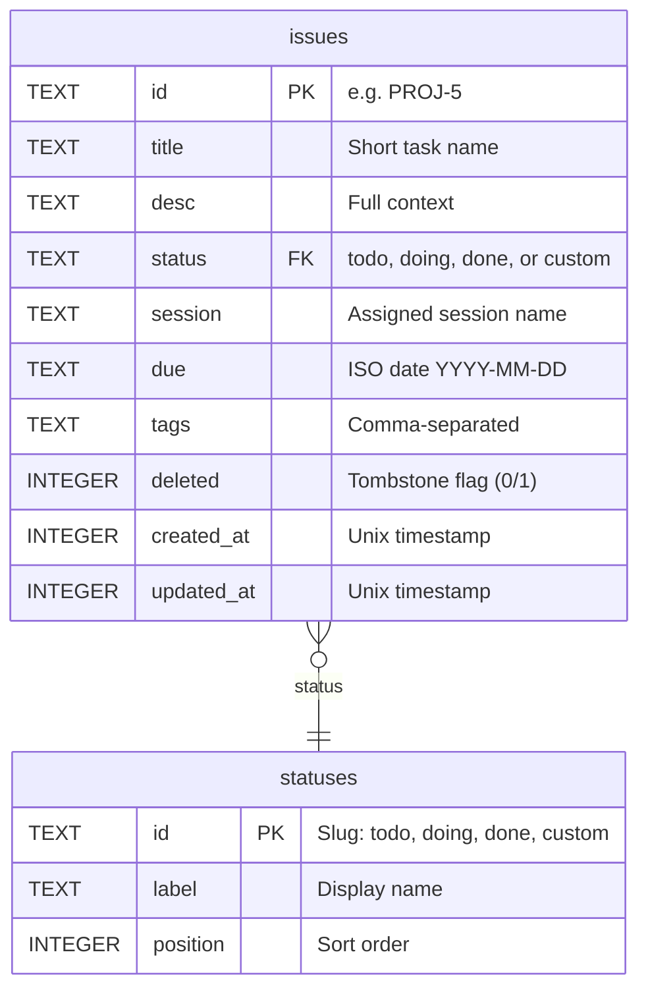
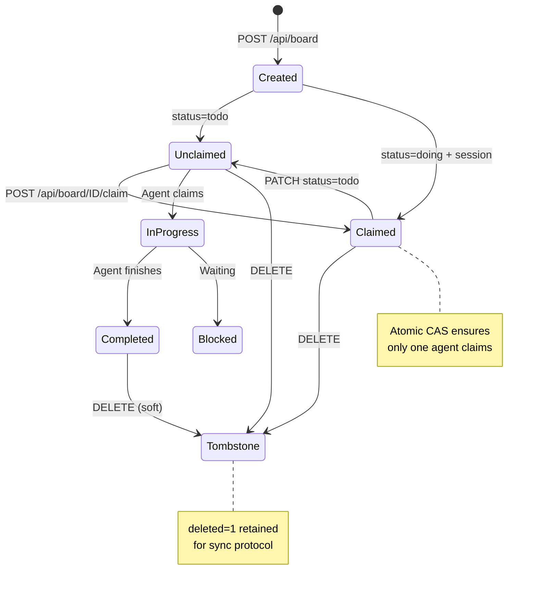
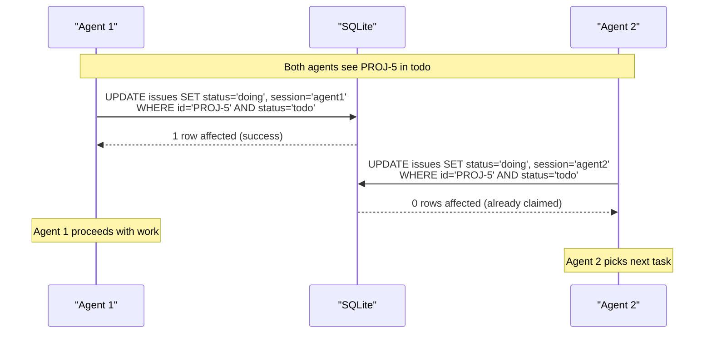
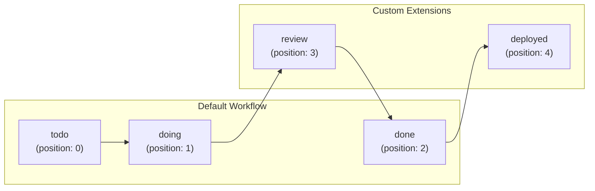
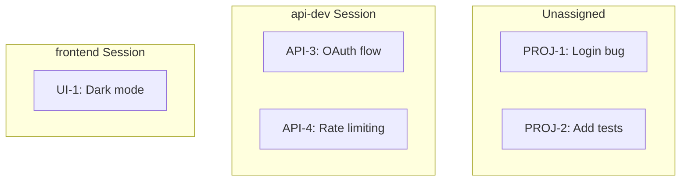
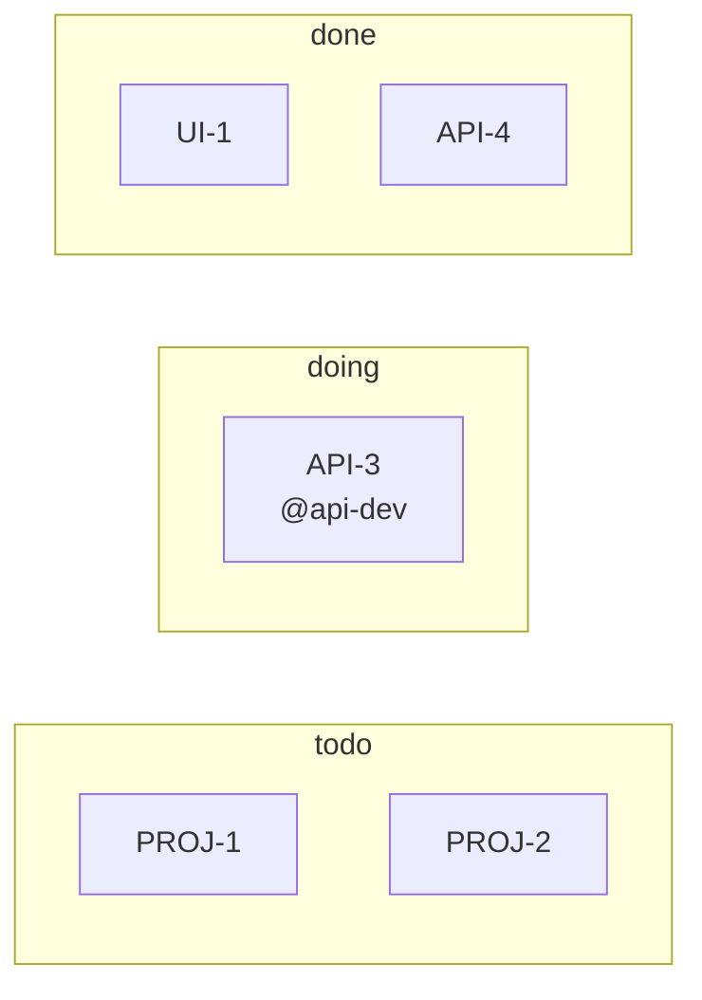
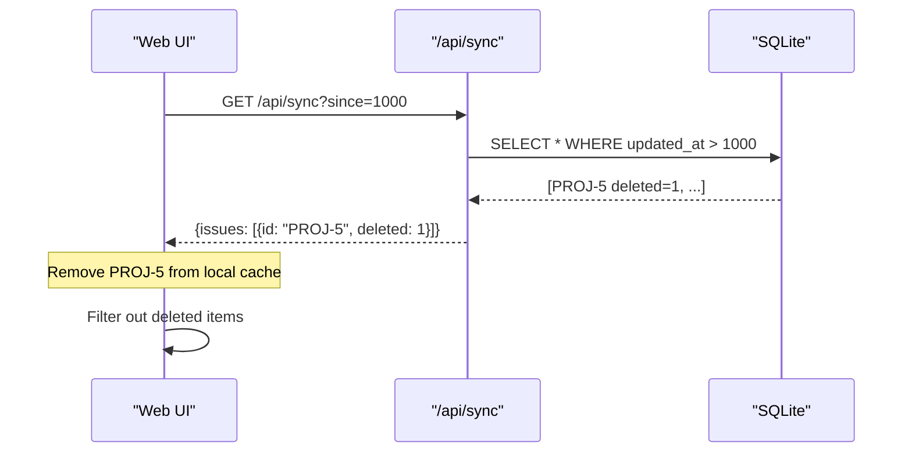

<!-- source: DeepWiki mcp.deepwiki.com · repo mixpeek/amux · page 2.2 Board System · fetched 2026-10-26 -->

# Board System

<details>
<summary>Relevant source files</summary>

The following files were used as context for generating this wiki page:

- [amux-server.py](amux-server.py)
- [cloud/gateway/gateway.py](cloud/gateway/gateway.py)
- [skills/amux-board.md](skills/amux-board.md)
- [skills/amux.md](skills/amux.md)
- [skills/playwright-auth.md](skills/playwright-auth.md)
- [skills/pw-test.md](skills/pw-test.md)
- [test.mjs](test.mjs)

</details>


## Purpose and Scope

The Board System is a SQLite-backed Kanban board that enables task coordination across multiple Claude Code agents. It provides atomic task claiming to prevent duplicate work, supports custom status columns, and integrates with the calendar view through due dates and iCal export. This page documents the database schema, atomic operations, status management, and REST API.

For information about inter-agent communication patterns using the board, see [Task Distribution](#12.1). For the web UI board views, see [Board Interface](#6.2).

---

## Database Schema

The board uses SQLite with two core tables: `issues` for tasks and `statuses` for custom workflow columns.

### Issues Table



The `issues` table stores all board items with soft-delete support. The `id` field is auto-generated from the session name prefix (e.g., `MYPROJ-5` for the 5th issue in session `myproject`). The `deleted` field implements tombstones for sync protocol.

**Sources:** [amux-server.py:1750-1810]()

---

## Issue Lifecycle

### State Diagram



### Creating Issues

Issues are created via `POST /api/board` with optional fields:

| Field | Type | Required | Default | Notes |
|-------|------|----------|---------|-------|
| `title` | string | Yes | — | Short imperative name |
| `desc` | string | No | `""` | Full context with acceptance criteria |
| `status` | string | No | `"todo"` | Must match existing status ID |
| `session` | string | No | `null` | Assigns to session |
| `due` | string | No | `null` | ISO date `YYYY-MM-DD` |
| `tags` | string | No | `""` | Comma-separated |

The server auto-generates the `id` using the session prefix counter:

```python
# Example: session "api-dev" → next ID is "API-DEV-5"
prefix = session_name.upper().replace(" ", "-")
counter = max([int(i.id.split("-")[-1]) for i in existing if i.id.startswith(prefix)]) + 1
issue_id = f"{prefix}-{counter}"
```

**Sources:** [amux-server.py:1810-1920]()

---

## Atomic Claiming Mechanism

### Compare-and-Swap (CAS) Operation

The board uses SQLite's atomic UPDATE to implement lock-free claiming:



The `POST /api/board/:id/claim` endpoint implements this:

```python
# Atomic claim with status constraint
cursor.execute("""
    UPDATE issues 
    SET status = ?, session = ?, updated_at = ?
    WHERE id = ? AND status = ? AND deleted = 0
""", ('doing', session_name, int(time.time()), issue_id, 'todo'))

if cursor.rowcount == 0:
    return {"error": "already claimed or not found"}, 409
```

**Key Properties:**
- **Idempotent**: Re-claiming the same task by the same session succeeds
- **Conflict Detection**: Returns 409 if another session claimed first
- **Status Constraint**: Only `todo` items can be claimed (prevents stealing in-progress work)

**Sources:** [amux-server.py:1955-2010]()

---

## Status Management

### Default and Custom Statuses

The board ships with three default statuses but supports unlimited custom columns:



### Status CRUD

| Operation | Endpoint | Method | Body |
|-----------|----------|--------|------|
| List | `/api/board/statuses` | GET | — |
| Add | `/api/board/statuses` | POST | `{id, label}` |
| Rename | `/api/board/statuses/:id` | PATCH | `{label}` |
| Delete | `/api/board/statuses/:id` | DELETE | — |

**Position Constraints:**
- Default statuses (`todo`, `doing`, `done`) cannot be deleted
- Deleting a status reassigns all issues to `todo`
- Position values auto-adjust when statuses are added/removed

**Sources:** [amux-server.py:2050-2180]()

---

## Board Views

The web UI supports two rendering modes, toggled client-side:

### Session-Grouped View (Default)

Groups issues by assigned session, with unclaimed items in a separate group:



**Use Case:** Monitor what each agent is working on, identify unclaimed tasks.

### Status/Kanban View

Organizes issues by status in horizontal columns:



**Use Case:** Track workflow progression, identify bottlenecks.

**Sources:** [amux-server.py:4200-4350]() (rendering logic in HTML template)

---

## Due Dates and Calendar Integration

### Due Date Format

Due dates are stored as ISO 8601 date strings (`YYYY-MM-DD`) in the `due` column. Issues with due dates appear in:

1. **Board cards** with badge indicators (📅 upcoming, 🔴 overdue)
2. **Calendar view** as clickable chips on the date grid
3. **iCal feed** as `VEVENT` entries

### iCal Export

The board generates an iCalendar feed at `GET /api/calendar.ics`:

```
VCALENDAR
VERSION:2.0
PRODID:-//amux//board//EN
CALNAME:amux Board
BEGIN:VEVENT
UID:PROJ-5@amux
DTSTART;VALUE=DATE:20240115
SUMMARY:Implement login flow
DESCRIPTION:Full context from issue desc field
STATUS:CONFIRMED
END:VEVENT
```

**Sync Behavior:**
- Updates every 60 seconds
- Optionally publishes to S3 for external calendar apps (requires `AMUX_S3_BUCKET` env var)
- Issues without due dates are excluded
- Deleted/tombstoned issues are removed from feed

**Sources:** [amux-server.py:2200-2350]()

---

## Board Sync Protocol

The sync endpoint supports real-time UI updates without polling the full board.

### Sync Request

```http
GET /api/sync?since=1704067200
```

Returns incremental changes since the provided Unix timestamp:

```json
{
  "issues": [
    {"id": "PROJ-6", "title": "...", "updated_at": 1704067800},
    {"id": "PROJ-1", "deleted": 1, "updated_at": 1704067900}
  ],
  "statuses": [
    {"id": "review", "label": "Review", "position": 3}
  ],
  "ts": 1704068000
}
```

### Tombstone Handling

Deleted issues are marked `deleted=1` rather than removed from the database:



**Retention:** Tombstones are kept for 30 days, then purged by a background task.

**Sources:** [amux-server.py:2400-2520]()

---

## REST API Reference

### Core Endpoints

| Endpoint | Method | Purpose | Auth |
|----------|--------|---------|------|
| `/api/board` | GET | List all issues (includes tombstones) | None |
| `/api/board` | POST | Create issue | None |
| `/api/board/:id` | PATCH | Update issue fields | None |
| `/api/board/:id` | DELETE | Soft-delete (set `deleted=1`) | None |
| `/api/board/:id/claim` | POST | Atomic claim (CAS) | Session header |
| `/api/board/statuses` | GET | List statuses | None |
| `/api/board/statuses` | POST | Add custom status | None |
| `/api/board/statuses/:id` | PATCH | Rename status | None |
| `/api/board/statuses/:id` | DELETE | Remove status | None |
| `/api/board/clear-done` | POST | Delete all `status=done` | None |
| `/api/sync` | GET | Incremental updates | `since` param |
| `/api/calendar.ics` | GET | iCal feed | None |

### Example: Atomic Claim

```bash
curl -sk -X POST https://localhost:8822/api/board/PROJ-5/claim \
  -H 'Content-Type: application/json' \
  -d '{"session": "api-dev"}'
```

**Response (success):**
```json
{
  "ok": true,
  "issue": {
    "id": "PROJ-5",
    "status": "doing",
    "session": "api-dev",
    "updated_at": 1704068100
  }
}
```

**Response (conflict):**
```json
{
  "error": "already claimed or not found",
  "current_session": "frontend"
}
```

**Sources:** [amux-server.py:1750-2520]()

---

## Board Database Initialization

The SQLite database is created at `~/.amux/board/amux.db` on first access:

```sql
CREATE TABLE IF NOT EXISTS issues (
    id TEXT PRIMARY KEY,
    title TEXT NOT NULL,
    desc TEXT DEFAULT '',
    status TEXT DEFAULT 'todo',
    session TEXT,
    due TEXT,
    tags TEXT DEFAULT '',
    deleted INTEGER DEFAULT 0,
    created_at INTEGER NOT NULL,
    updated_at INTEGER NOT NULL
);

CREATE TABLE IF NOT EXISTS statuses (
    id TEXT PRIMARY KEY,
    label TEXT NOT NULL,
    position INTEGER NOT NULL
);

-- Default statuses
INSERT OR IGNORE INTO statuses VALUES 
  ('todo', 'To Do', 0),
  ('doing', 'Doing', 1),
  ('done', 'Done', 2);

-- Indexes for sync queries
CREATE INDEX IF NOT EXISTS idx_issues_updated ON issues(updated_at);
CREATE INDEX IF NOT EXISTS idx_issues_session ON issues(session);
CREATE INDEX IF NOT EXISTS idx_issues_status ON issues(status);
```

**Location:** Issues database is stored separately from session metadata in `CC_BOARD_DIR` (`~/.amux/board/`) to enable cross-session access.

**Sources:** [amux-server.py:1750-1810]()

---

## Board Event Emissions

All board operations emit structured events to the event log for UI notifications:

| Action | Event Type | Target | Detail |
|--------|------------|--------|--------|
| Create | `board` | `created` | Issue title |
| Update | `board` | `updated` | Issue ID |
| Claim | `board` | `claimed` | Issue ID + session |
| Delete | `board` | `deleted` | Issue ID |
| Clear Done | `board` | `cleared` | `"done"` |
| Add Status | `board` | `status-added` | Status ID |
| Remove Status | `board` | `status-removed` | Status ID |

Events are consumed by SSE clients for real-time board updates without polling.

**Sources:** [amux-server.py:110-150]()

---

