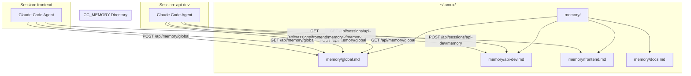
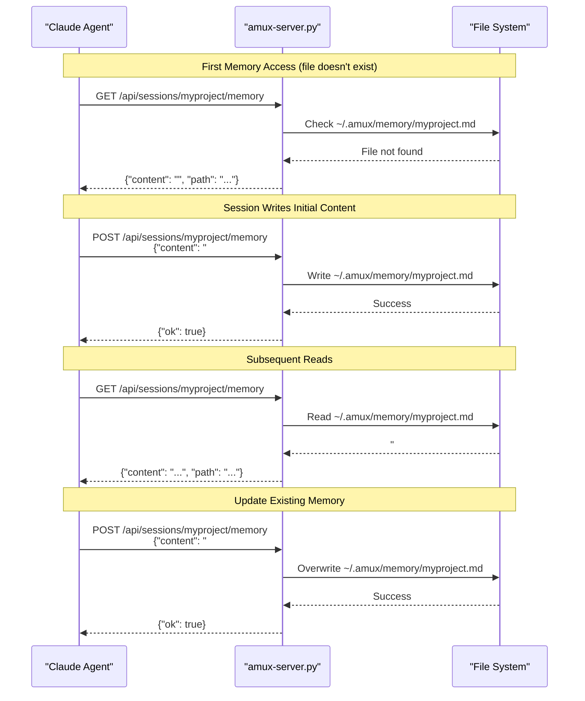
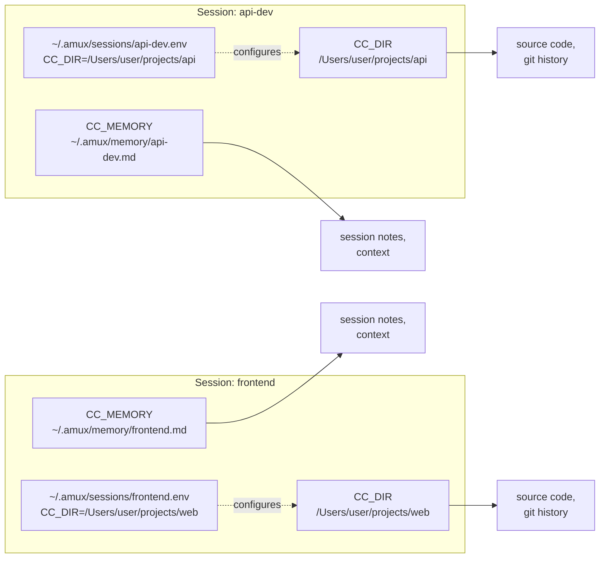
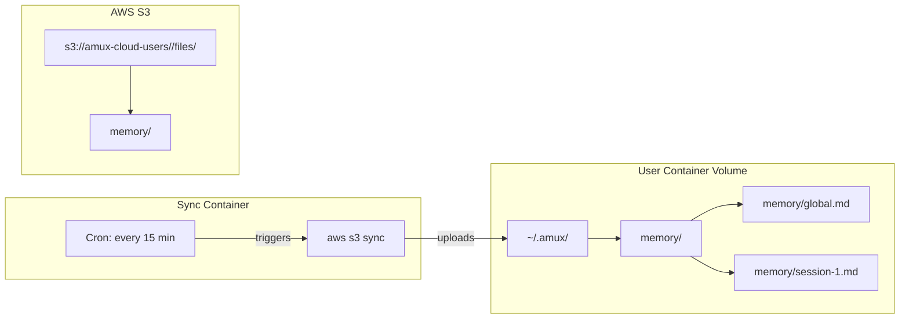
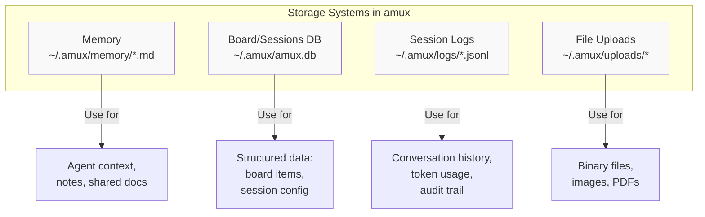
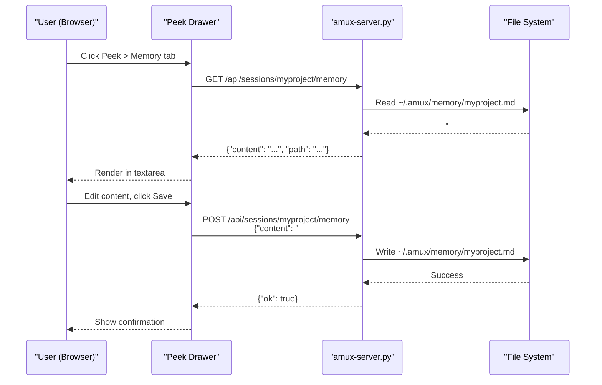

<!-- source: DeepWiki mcp.deepwiki.com · repo mixpeek/amux · page 2.3 Memory System · fetched 2026-10-26 -->

# Memory System

<details>
<summary>Relevant source files</summary>

The following files were used as context for generating this wiki page:

- [amux-server.py](amux-server.py)
- [cloud/gateway/gateway.py](cloud/gateway/gateway.py)
- [skills/amux-board.md](skills/amux-board.md)
- [skills/amux.md](skills/amux.md)
- [skills/playwright-auth.md](skills/playwright-auth.md)
- [skills/pw-test.md](skills/pw-test.md)
- [test.mjs](test.mjs)

</details>


The Memory System provides persistent, markdown-based context storage for amux sessions. Each session maintains its own isolated memory file, while all sessions share access to a global memory space. This enables agents to maintain project-specific context, share API documentation, and coordinate through written knowledge.

For session lifecycle and configuration, see [Session Management](#2.1). For inter-session coordination, see [Board System](#2.2).

---

## Memory Types

amux provides two distinct memory scopes:

| Type | Path | Scope | Use Cases |
|------|------|-------|-----------|
| **Session Memory** | `~/.amux/memory/<session-name>.md` | Single session | Task notes, session-specific context, work-in-progress logs |
| **Global Memory** | `~/.amux/memory/global.md` | All sessions | API documentation, shared credentials, project overview, amux API reference |

Both are plain markdown files. Sessions read and write them via REST API calls.

**Sources:** [amux-server.py:52-60](), [skills/amux.md:50-64]()

---

## Storage Architecture


**Diagram: Memory file system layout and session access patterns**

Memory files are created on-demand when a session first writes to them. The `CC_MEMORY` directory is initialized at server startup.

**Sources:** [amux-server.py:52-63]()

---

## API Interface

### Session Memory Endpoints

**GET `/api/sessions/<name>/memory`**

Returns the session's memory file content and path.

Response structure:
```json
{
  "content": "# API Dev Session\n\nCurrent task: implementing /users endpoint...",
  "path": "/Users/user/.amux/memory/api-dev.md"
}
```

**POST `/api/sessions/<name>/memory`**

Replaces the session's memory content.

Request body:
```json
{
  "content": "# Updated Notes\n\nCompleted /users endpoint.\nNext: /auth flow"
}
```

Returns `{"ok": true}` on success.

**Sources:** [amux-server.py:163-165](), [skills/amux.md:52-58]()

---

### Global Memory Endpoints

**GET `/api/memory/global`**

Returns the shared global memory content.

Response structure:
```json
{
  "content": "# amux API Reference\n\nBase URL: https://localhost:8822...",
  "path": "/Users/user/.amux/memory/global.md"
}
```

**POST `/api/memory/global`**

Updates global memory. All sessions can write to this file.

Request body:
```json
{
  "content": "# Updated API Docs\n\n## New Endpoint: /api/board/claim..."
}
```

Returns `{"ok": true}` on success.

**Sources:** [amux-server.py:172-173](), [skills/amux.md:60-64]()

---

## Memory Lifecycle


**Diagram: Memory file creation and update flow**

Memory files persist across session stop/start cycles. When a session is deleted via `DELETE /api/sessions/<name>`, its memory file remains intact for manual cleanup.

**Sources:** [amux-server.py:52-63]()

---

## Memory in Session Context

Each session's working directory (`CC_DIR`) and memory are independent:


**Diagram: Session workspace vs memory separation**

Memory files are stored in `~/.amux/memory/` regardless of the session's `CC_DIR`. This allows sessions working in different directories to maintain their context in a centralized location.

**Sources:** [amux-server.py:49-52]()

---

## Agent Integration Patterns

Agents access memory via `curl` commands from within the session's tmux environment:

### Reading Session Memory

```bash
# From within a tmux session
SESSION_NAME=$(tmux display-message -p '#S' | sed 's/^amux-//')
curl -sk https://localhost:8822/api/sessions/$SESSION_NAME/memory | python3 -m json.tool
```

### Reading Global Memory

```bash
curl -sk https://localhost:8822/api/memory/global | python3 -c "import sys,json; print(json.load(sys.stdin)['content'])"
```

### Updating Memory

```bash
curl -sk -X POST -H 'Content-Type: application/json' \
  -d '{"content":"# Updated context\n\nCompleted task A.\nNext: task B."}' \
  https://localhost:8822/api/sessions/$SESSION_NAME/memory
```

**Common Use Cases:**

| Pattern | Description | Example |
|---------|-------------|---------|
| **Initialization** | Agent reads global memory on startup to learn amux API | Read `global.md` for API reference, board statuses |
| **Progress Logging** | Agent updates session memory with task status | "Completed /users endpoint, next: /auth" |
| **Knowledge Sharing** | Agent writes API docs to global memory for other sessions | Document new endpoint in `global.md` |
| **Context Retrieval** | Agent reads previous notes to resume work | Read session memory after restart |

**Sources:** [skills/amux.md:52-64](), [skills/amux-board.md:1-54]()

---

## Cloud Synchronization

In cloud deployments, memory files are backed up via two mechanisms:

### Litestream (Database Files)

While memory files are markdown (not SQLite), they reside in the same `~/.amux/` volume that Litestream monitors. However, Litestream only replicates `.db` files.

### S3 Sync (Flat Files)

The `sync` container periodically uploads all `~/.amux/` files, including memory:


**Diagram: Memory backup via S3 sync container**

Memory files are restored when a user's container starts via `_restore_user_files()` in gateway.py. This runs `aws s3 sync` from R2 to the container volume before starting `amux-server.py`.

**Sources:** [cloud/gateway/gateway.py:245-259]()

---

## Memory vs Other Storage


**Diagram: Memory system in context of other storage mechanisms**

**Key Differences:**

- **Memory**: Unstructured markdown, human-readable, version-controlled friendly
- **Board DB**: Structured SQLite, atomic operations, queryable
- **Logs**: Append-only JSONL, immutable conversation history
- **Uploads**: Binary files, user-uploaded content

Memory is ideal for knowledge that agents need to read and write naturally, like documentation or progress notes. Board is better for structured task tracking with atomic claims.

**Sources:** [amux-server.py:52-63]()

---

## Memory Access from Web Dashboard

The web dashboard provides memory editing via the peek drawer:


**Diagram: Memory editing flow in web dashboard**

The peek drawer has three memory tabs:
- **Session** (`#peek-memory-input`): Current session's memory
- **Global** (`#peek-global-input`): Shared global memory  
- **Upload**: File upload to session memory (converts to markdown link)

**Sources:** [amux-server.py:163-173](), [test.mjs:438-451]()

---

## Memory Initialization Pattern

When a new session is created, its memory file doesn't exist until first write. Typical initialization flow:

1. **Session starts** → no memory file
2. **Agent reads memory** → API returns `{"content": "", "path": "..."}`
3. **Agent initializes** → Writes template (e.g., "# Session: myproject\n\n## Context\n...")
4. **File created** → `~/.amux/memory/myproject.md` now exists
5. **Subsequent reads** → Return the written content

Global memory is typically pre-populated with amux API documentation so agents can discover board, session, and memory endpoints.

**Sources:** [skills/amux.md:52-64]()

---

## Security and Access Control

### Local Deployment

Memory files are stored with the user's file permissions in `~/.amux/memory/`. Any process on the local machine can read them if it has access to the user's home directory.

### Cloud Deployment

In cloud mode, each user's memory is isolated:

- Container-level isolation: Each user runs in a separate Docker container
- Volume isolation: Memory stored in per-user named volumes (`amux-data-<user-id>`)
- Gateway enforcement: `gateway.py` verifies Clerk JWT before proxying requests
- No cross-user access: Users cannot read other users' memory via API

**Sources:** [cloud/gateway/gateway.py:233-276]()

---

## Memory File Format

Memory files are plain markdown with no enforced schema. Common patterns:

```markdown
# Session: api-development

## Current Task
Implementing /users CRUD endpoints

## Completed
- [x] Database schema for users table
- [x] GET /users list endpoint
- [x] POST /users create endpoint

## Next Steps
- [ ] PUT /users/:id update
- [ ] DELETE /users/:id

## Notes
- Using SQLite with Foreign Key constraints
- Password hashing via bcrypt
- Email validation regex: ^[\w\.-]+@[\w\.-]+\.\w+$

## API Reference
Base URL: https://localhost:8822
Board API: /api/board
```

Agents may structure memory however they find useful. The system imposes no schema, allowing flexibility for different workflows.

**Sources:** [skills/amux.md:74-94]()

---

