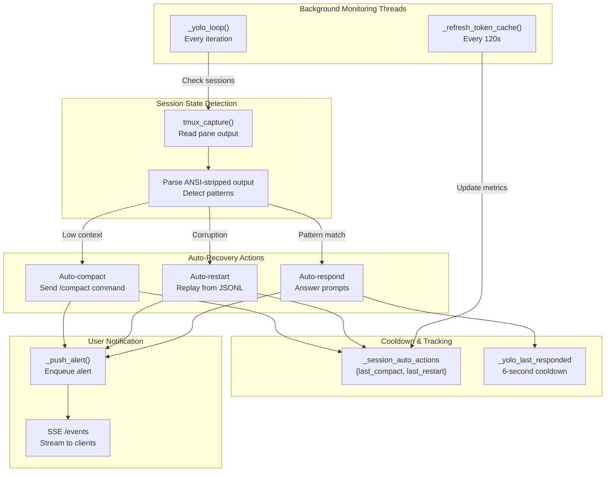
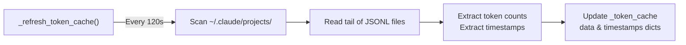
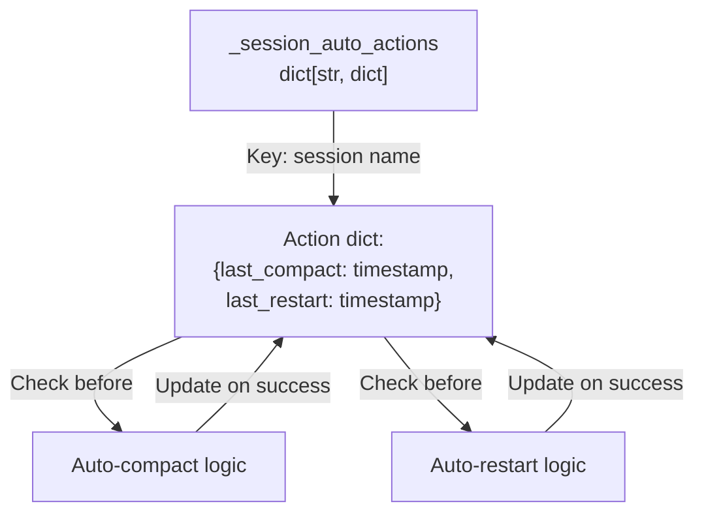
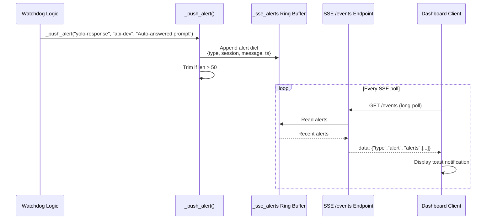

<!-- source: DeepWiki mcp.deepwiki.com · repo mixpeek/amux · page 2.4 Self-Healing Watchdog · fetched 2026-10-26 -->

# Self-Healing Watchdog

<details>
<summary>Relevant source files</summary>

The following files were used as context for generating this wiki page:

- [README.md](README.md)
- [amux-server.py](amux-server.py)
- [cloud/gateway/gateway.py](cloud/gateway/gateway.py)
- [test.mjs](test.mjs)

</details>


This page documents the auto-recovery mechanisms built into amux-server.py that enable unattended multi-agent operation. The watchdog system monitors running sessions for failure conditions and automatically takes corrective action without user intervention.

For information about session lifecycle and state management, see [Session Management](#2.1). For details on the event system used to notify users of auto-recovery actions, see [Event System & Logging](#2.5).

---

## Purpose and Scope

The self-healing watchdog enables autonomous agent operation by detecting and recovering from common failure modes:

- **Context exhaustion** — auto-compacts when context window drops below threshold
- **Corruption errors** — restarts sessions and replays last message from JSONL logs
- **Stuck prompts** — auto-responds to blocking prompts in YOLO mode
- **Permission dialogs** — auto-answers Claude Code safety prompts

The watchdog runs continuously in background threads, monitoring tmux output and taking action based on detected patterns. All auto-recovery actions are logged and streamed to connected clients via SSE.

---

## Architecture Overview



**Sources:** [amux-server.py:188-195](), [amux-server.py:1019-1078](), [amux-server.py:786-883]()

---

## Monitoring Loops

### YOLO Auto-Responder Thread

The YOLO auto-responder continuously monitors sessions with the `--dangerously-skip-permissions` flag for stuck permission prompts.

| Component | Implementation |
|-----------|---------------|
| Thread function | `_yolo_loop()` |
| Check interval | Every iteration (non-blocking) |
| Target sessions | Sessions with `CC_FLAGS` containing `--dangerously-skip-permissions` |
| Cooldown period | 6 seconds per session |
| Pattern detection | Regex matching on ANSI-stripped tmux output |

**Key characteristics:**

- **Safety marker requirement** — Only auto-answers prompts containing "Esc to cancel" UI chrome, never open-ended model questions
- **Cooldown enforcement** — Prevents rapid-fire responses via `_yolo_last_responded` dict
- **Session filtering** — Only checks registered sessions with YOLO flag enabled
- **Output parsing** — Strips ANSI escape codes before pattern matching

**Sources:** [amux-server.py:1019-1069]()

---

### Token Cache Refresh Thread

While not strictly part of failure recovery, the token refresh loop monitors resource usage and session activity timestamps.



**Sources:** [amux-server.py:786-883]()

---

## Failure Detection Patterns

### YOLO Prompt Patterns

The watchdog recognizes three classes of Claude Code safety prompts that require keyboard input even with `--dangerously-skip-permissions`:

| Pattern | Response | Use Case |
|---------|----------|----------|
| `command contains.*command substitution.*esc to cancel` | `'1'` | Shell command with `$()` substitution |
| `do you want to proceed.*esc to cancel` | `'1'` | Generic tool proceed confirmation |
| `yes.*and don.t ask again.*esc to cancel` | `'1'` | Permission leak through to prompt |

**Critical design constraint:** All patterns require the "Esc to cancel" marker. This prevents the watchdog from auto-answering open-ended questions where the model is asking for user guidance.

**Sources:** [amux-server.py:1022-1032]()

---

### Pattern Matching Implementation

```mermaid
sequenceDiagram
    participant Loop as _yolo_loop()
    participant Tmux as tmux_capture()
    participant Parse as Regex Matcher
    participant Send as send_text()
    
    Loop->>Tmux: Capture last 20 lines
    Tmux-->>Loop: Raw ANSI output
    Loop->>Parse: Strip ANSI codes
    Parse->>Parse: Test each pattern
    
    alt Pattern matches
        Parse->>Send: send_text(session, response)
        Send->>Loop: Update _yolo_last_responded[name]
        Loop->>PushAlert: Alert user of auto-response
    else No match
        Loop->>Loop: Continue monitoring
    end
```

**Implementation details:**

1. **ANSI stripping** — Removes escape codes with pattern: `\x1b\[[0-9;]*[a-zA-Z]|\x1b[^a-zA-Z]*[a-zA-Z]`
2. **Regex flags** — Uses `re.IGNORECASE | re.DOTALL` for flexible matching
3. **Cooldown check** — `now - _yolo_last_responded.get(name, 0) < _YOLO_COOLDOWN`
4. **Session filtering** — Only checks sessions where `is_running(name)` returns true

**Sources:** [amux-server.py:1038-1061]()

---

## Auto-Recovery Actions

### Cooldown and Rate Limiting

The watchdog enforces cooldown periods to prevent action spam:

| Action | Cooldown | Stored In | Purpose |
|--------|----------|-----------|---------|
| Auto-compact | 5 minutes | `_session_auto_actions[name]["last_compact"]` | Prevents repeated compaction |
| Auto-restart | Per-session tracking | `_session_auto_actions[name]["last_restart"]` | Tracks restart history |
| Auto-respond | 6 seconds | `_yolo_last_responded[name]` | Prevents rapid prompt answers |

**Sources:** [amux-server.py:195](), [amux-server.py:1035]()

---

### Session Auto-Actions Tracking



**Data structure:**

```python
_session_auto_actions: dict = {}  # {name: {"last_compact": ts, "last_restart": ts}}
```

**Cooldown logic pattern:**

```python
now = time.time()
last_action = _session_auto_actions.get(session_name, {}).get("last_compact", 0)
if now - last_action < 300:  # 5 minutes
    return  # Skip action, cooldown not expired
```

**Sources:** [amux-server.py:195]()

---

## Alert System

### Alert Emission

Auto-recovery actions push alerts to the SSE ring buffer for real-time user notification.

| Alert Type | Trigger | Message Content |
|------------|---------|----------------|
| `"yolo-response"` | Auto-answered prompt | Session name + matched prompt text |
| `"auto-compact"` | Context threshold crossed | Session name + context percentage |
| `"auto-restart"` | Corruption detected | Session name + error message |

**Ring buffer characteristics:**

- **Capacity:** 50 alerts (FIFO when full)
- **Thread safety:** Protected by `_sse_alert_lock`
- **TTL:** Alerts persist until evicted by newer alerts
- **Streaming:** Delivered via `/events` SSE endpoint

**Sources:** [amux-server.py:188-195](), [amux-server.py:1071-1078]()

---

### Alert Flow



**Alert structure:**

```python
{
    "type": "yolo-response",    # Alert category
    "session": "api-dev",        # Affected session name
    "message": "Auto-answered: Do you want to proceed?",
    "ts": 1704067200            # Unix timestamp
}
```

**Sources:** [amux-server.py:1071-1078]()

---

## Configuration

### Session-Level Flags

Auto-recovery behavior is controlled via session configuration stored in `~/.amux/sessions/<name>.env`:

| Flag | Effect | Example |
|------|--------|---------|
| `CC_FLAGS=--dangerously-skip-permissions` | Enable YOLO auto-responder | `--dangerously-skip-permissions` |
| `CC_AUTO_CONTINUE=1` | Enable generic auto-respond | Set environment variable |

**Configuration file location:** `~/.amux/sessions/<name>.env`

**Sources:** [amux-server.py:1049]()

---

### Cooldown Tuning

Cooldown constants can be adjusted by modifying global variables:

| Variable | Default | Location | Purpose |
|----------|---------|----------|---------|
| `_YOLO_COOLDOWN` | 6 seconds | [amux-server.py:1035]() | YOLO response rate limit |
| `_TOKEN_CACHE_TTL` | 120 seconds | [amux-server.py:787]() | Token refresh interval |

**Sources:** [amux-server.py:787](), [amux-server.py:1035]()

---

## Monitoring and Observability

### Event Log Integration

All auto-recovery actions are logged to the structured event log for audit and debugging.

**Event emission pattern:**

```python
_emit_event(
    etype="session",
    action="auto-responded",
    target=session_name,
    session=session_name,
    detail=f"Matched pattern: {prompt_text}",
    status=200
)
```

**Event log characteristics:**

- **Ring buffer size:** 2,000 events
- **Thread safety:** `_event_log_lock`
- **Streaming:** Available via `/api/events` SSE endpoint

**Sources:** [amux-server.py:104-127]()

---

### Dashboard Integration

The web dashboard displays watchdog activity through multiple interfaces:

| Interface | Location | Data Source |
|-----------|----------|-------------|
| Alert toasts | Top-right corner | `_sse_alerts` ring buffer |
| Event log | Logs tab | `_event_log` structured events |
| Session status | Session cards | Token cache + running state |

**SSE data payload example:**

```json
{
  "type": "alert",
  "alerts": [
    {
      "type": "yolo-response",
      "session": "frontend",
      "message": "Auto-answered: Command contains $() substitution",
      "ts": 1704067200
    }
  ]
}
```

**Sources:** [amux-server.py:98-102](), [amux-server.py:188-195]()

---

## Code Entity Reference

### Key Functions

| Function | Location | Purpose |
|----------|----------|---------|
| `_yolo_auto_respond()` | [amux-server.py:1038-1061]() | Check YOLO sessions for stuck prompts |
| `_yolo_loop()` | [amux-server.py:1064-1069]() | Background thread wrapper for YOLO logic |
| `_push_alert()` | [amux-server.py:1071-1078]() | Enqueue alert for SSE streaming |
| `_refresh_token_cache()` | [amux-server.py:789-883]() | Update token counts and timestamps |
| `tmux_capture()` | [amux-server.py:957-966]() | Capture tmux pane output |

**Sources:** [amux-server.py:957-966](), [amux-server.py:789-883](), [amux-server.py:1038-1078]()

---

### Global State

| Variable | Type | Purpose |
|----------|------|---------|
| `_session_auto_actions` | `dict[str, dict]` | Track last compact/restart per session |
| `_yolo_last_responded` | `dict[str, float]` | Cooldown timer per session |
| `_sse_alerts` | `list[dict]` | Ring buffer of recent alerts |
| `_YOLO_PROMPTS` | `list[tuple]` | Regex patterns and responses |
| `_YOLO_COOLDOWN` | `int` | Seconds between YOLO responses |

**Sources:** [amux-server.py:188-195](), [amux-server.py:1022-1035]()

---

## Testing

The E2E test suite validates watchdog behavior through API-level checks:

**Test coverage:**

- YOLO pattern detection via tmux output scraping
- Alert emission and SSE streaming
- Cooldown enforcement
- Session status updates

**Test file:** [test.mjs:1-815]()

**Relevant test flows:**

- Session status detection (lines 149-171)
- Peek terminal output (lines 407-520)
- API session peek endpoint (lines 654-662)

**Sources:** [test.mjs:1-815]()

---

