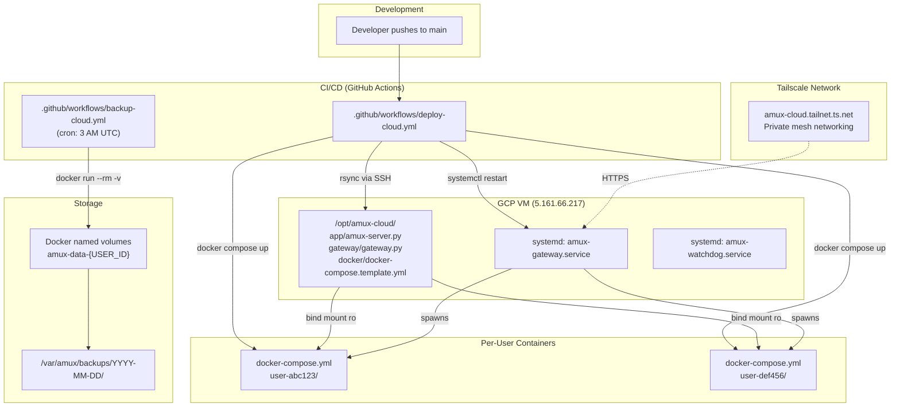
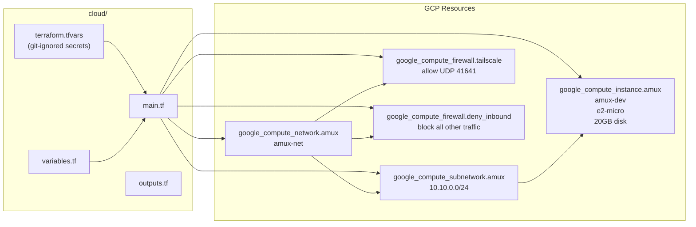
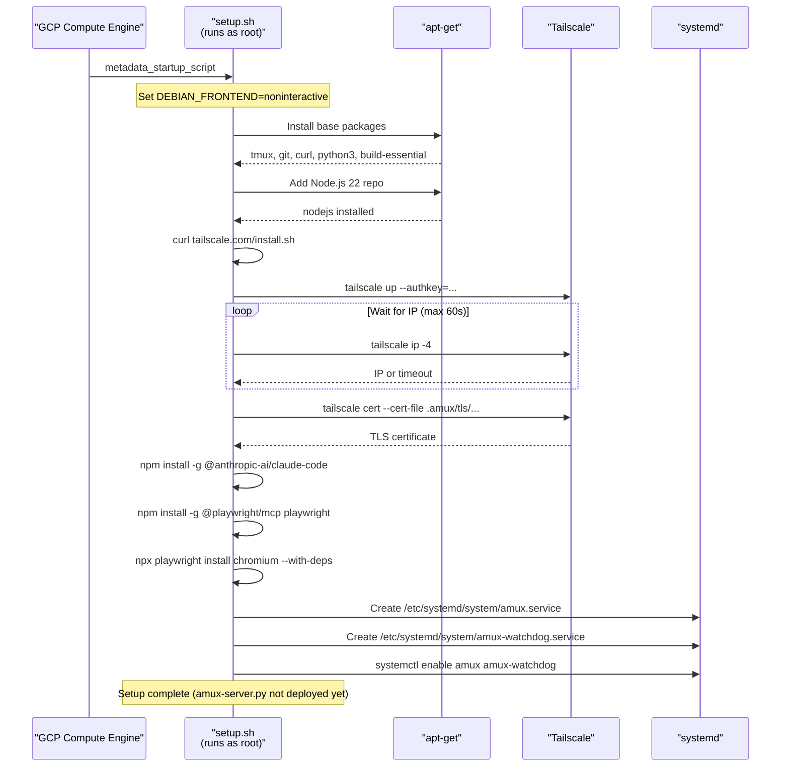
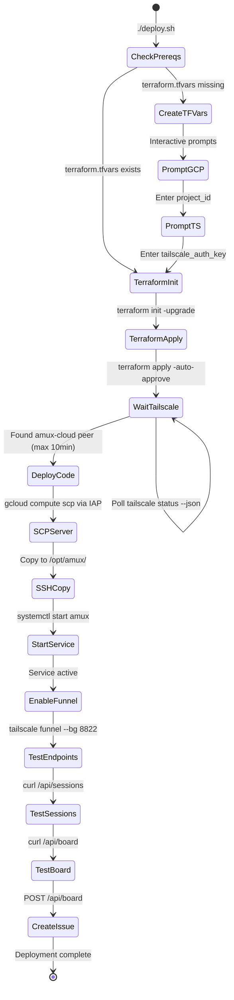
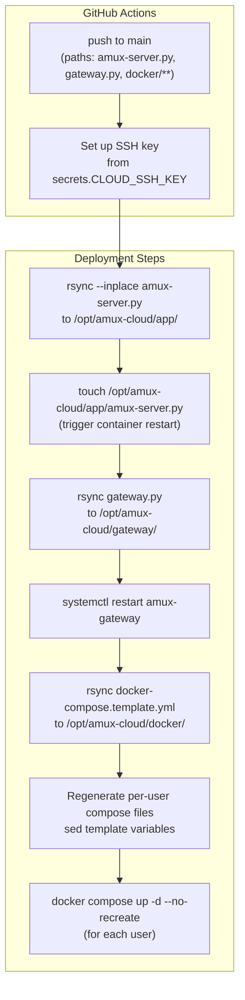
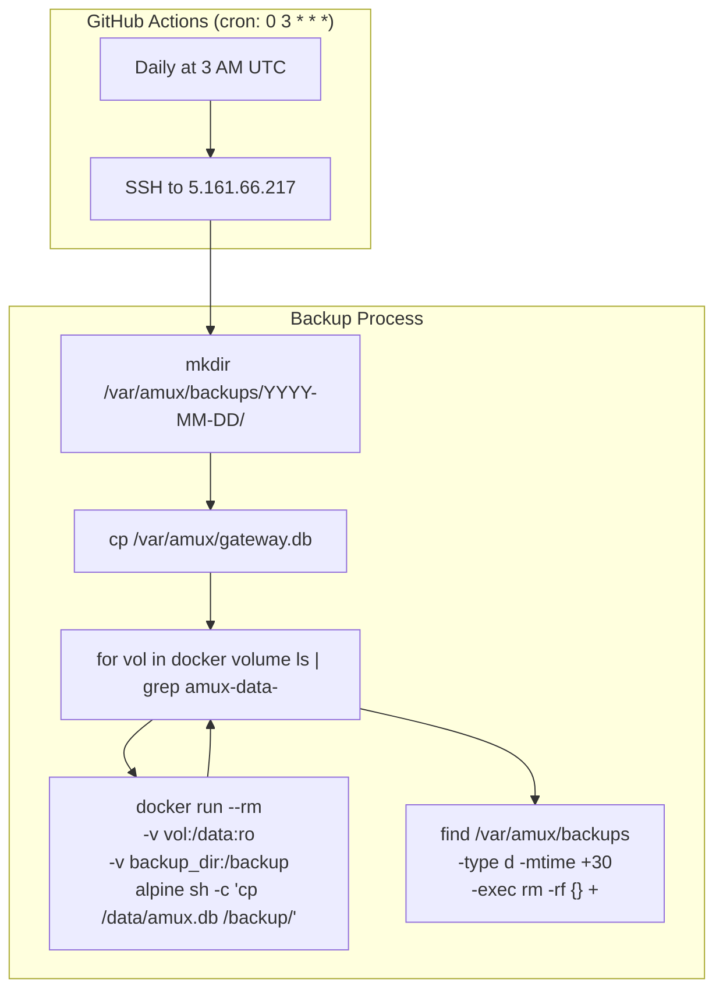

<!-- source: DeepWiki mcp.deepwiki.com · repo mixpeek/amux · page 4 Cloud Deployment · fetched 2026-10-26 -->

# Cloud Deployment

<details>
<summary>Relevant source files</summary>

The following files were used as context for generating this wiki page:

- [.github/workflows/backup-cloud.yml](.github/workflows/backup-cloud.yml)
- [.github/workflows/deploy-cloud.yml](.github/workflows/deploy-cloud.yml)
- [amux](amux)
- [cloud/.gitignore](cloud/.gitignore)
- [cloud/deploy.sh](cloud/deploy.sh)
- [cloud/docker/docker-compose.template.yml](cloud/docker/docker-compose.template.yml)
- [cloud/main.tf](cloud/main.tf)
- [cloud/outputs.tf](cloud/outputs.tf)
- [cloud/setup.sh](cloud/setup.sh)
- [cloud/terraform.tfvars.example](cloud/terraform.tfvars.example)
- [cloud/variables.tf](cloud/variables.tf)
- [templates/README.md](templates/README.md)
- [templates/content-creator/CLAUDE.md](templates/content-creator/CLAUDE.md)
- [templates/content-creator/template.json](templates/content-creator/template.json)
- [templates/fitness-tracker/CLAUDE.md](templates/fitness-tracker/CLAUDE.md)

</details>


## Purpose and Scope

This page covers deploying amux to Google Cloud Platform for multi-tenant cloud hosting. It documents the infrastructure provisioning, VM bootstrap process, container orchestration, and automated deployment pipelines.

For information about the gateway service that orchestrates user containers, see [Gateway & Multi-Tenancy](#3). For Docker container architecture details, see [Docker Architecture](#4.1). For local OSS deployment, see [Quick Start](#1.1).

---

## Cloud Deployment Architecture

The cloud deployment runs on a single GCP VM that hosts multiple user containers. Unlike local deployment where `amux-server.py` runs directly on the host, cloud deployment isolates each user in a Docker Compose stack with dedicated containers for the amux server, database replication, and file sync.

### Deployment Overview



**Key Architectural Decisions:**

| Aspect | Implementation | Rationale |
|--------|---------------|-----------|
| **Multi-tenancy** | Per-user Docker Compose stacks | Process isolation without VM overhead |
| **Code deployment** | Bind mount from `/opt/amux-cloud/app/` | Zero-downtime updates across all users |
| **Networking** | Tailscale mesh + ephemeral public IP | Secure access without firewall configuration |
| **Orchestration** | `gateway.py` + systemd | Lightweight, no Kubernetes complexity |
| **State** | Docker named volumes + Litestream | Persistent data with continuous backup |

**Sources:** [Diagram 1 from high-level architecture](), [cloud/docker/docker-compose.template.yml](), [.github/workflows/deploy-cloud.yml]()

---

## Infrastructure Provisioning

Infrastructure is defined in Terraform and deployed to GCP. The setup creates a single VM with Tailscale for secure networking.

### Terraform Resources



### Required Variables

The `terraform.tfvars` file (git-ignored) must contain:

| Variable | Description | Example |
|----------|-------------|---------|
| `project_id` | GCP project ID | `"my-project-123456"` |
| `tailscale_auth_key` | Tailscale reusable auth key | `"tskey-auth-xxxxx"` |
| `region` | GCP region (optional) | `"us-central1"` (default) |
| `zone` | GCP zone (optional) | `"us-central1-a"` (default) |
| `machine_type` | VM size (optional) | `"e2-micro"` (default, ~$7/mo) |
| `disk_size_gb` | Boot disk size (optional) | `20` (default) |

**Sources:** [cloud/variables.tf:1-35](), [cloud/terraform.tfvars.example:1-10]()

### Network Configuration

The firewall rules implement a strict security posture:

1. **Allow Tailscale UDP 41641** - Required for WireGuard mesh connections [cloud/main.tf:32-43]()
2. **Deny all other inbound** - Explicit deny at priority 1000 [cloud/main.tf:46-60]()
3. **Ephemeral public IP** - VM has outbound internet for apt/npm but no exposed services [cloud/main.tf:83-85]()

All HTTPS access to the dashboard goes through Tailscale, never the public IP.

**Sources:** [cloud/main.tf:17-61]()

---

## VM Bootstrap Process

When the GCP VM starts, it executes [cloud/setup.sh]() as a startup script. This is an idempotent bootstrap that installs dependencies and configures services.

### Bootstrap Sequence



### Directory Structure Created

```
/opt/amux/                   # Application root (AMUX_DIR)
/root/.amux/                 # amux data (AMUX_DATA)
├── tls/
│   ├── {hostname}.crt       # Tailscale-issued certificate
│   └── {hostname}.key
├── sessions/
├── logs/
├── memory/
├── board/
└── playwright-auth/profile/ # Persistent browser auth profile
```

**Sources:** [cloud/setup.sh:1-192]()

### Installed Dependencies

| Component | Version | Installation Method | Purpose |
|-----------|---------|-------------------|---------|
| **tmux** | Latest from apt | `apt-get install tmux` | Session multiplexing |
| **Node.js** | 22 LTS | NodeSource repo | Claude Code CLI runtime |
| **Tailscale** | Latest | curl script | Mesh networking |
| **Claude Code** | Latest | `npm install -g @anthropic-ai/claude-code` | AI agent CLI |
| **Playwright MCP** | Latest | `npm install -g @playwright/mcp` | Browser automation |
| **Chromium** | Latest | `npx playwright install chromium --with-deps` | Headless browser |

**Sources:** [cloud/setup.sh:14-83]()

### systemd Services

Two services are created and enabled:

#### 1. `amux.service`

```ini
[Unit]
Description=amux server
After=network.target tailscaled.service
Wants=tailscaled.service

[Service]
Type=simple
User=root
WorkingDirectory=/opt/amux
ExecStart=/usr/bin/python3 /opt/amux/amux-server.py
Restart=always
RestartSec=5
Environment=HOME=/root
StandardOutput=append:/var/log/amux.log
StandardError=append:/var/log/amux.log

[Install]
WantedBy=multi-user.target
```

**Note:** The service is enabled but not started during bootstrap because `amux-server.py` hasn't been deployed yet. The deploy script starts it.

**Sources:** [cloud/setup.sh:97-124]()

#### 2. `amux-watchdog.service`

A connectivity watchdog that reboots the VM if the GCP metadata server becomes unreachable for 5+ minutes. This catches kernel network stack failures before Tailscale/SSH die.

```bash
#!/bin/bash
FAIL_COUNT=0
FAIL_THRESHOLD=10  # 10 * 30s = 5 minutes
while true; do
  sleep 30
  if curl -sf --max-time 5 http://169.254.169.254/computeMetadata/v1/instance/hostname \
      -H 'Metadata-Flavor: Google' >/dev/null 2>&1; then
    FAIL_COUNT=0
    continue
  fi
  FAIL_COUNT=$((FAIL_COUNT + 1))
  logger -t amux-watchdog "metadata unreachable (fail ${FAIL_COUNT}/${FAIL_THRESHOLD})"
  if [ "$FAIL_COUNT" -ge "$FAIL_THRESHOLD" ]; then
    logger -t amux-watchdog "network dead 5+ min — rebooting"
    systemctl reboot
  fi
done
```

**Sources:** [cloud/setup.sh:126-168]()

### TLS Certificate Renewal

A weekly cron job renews the Tailscale TLS certificate:

```bash
#!/bin/bash
tailscale cert \
  --cert-file /root/.amux/tls/${TS_HOSTNAME}.crt \
  --key-file  /root/.amux/tls/${TS_HOSTNAME}.key \
  $TS_HOSTNAME && systemctl restart amux
```

**Sources:** [cloud/setup.sh:170-180]()

---

## Deployment Orchestration

Deployment is orchestrated by [cloud/deploy.sh](), which provisions infrastructure, waits for Tailscale connectivity, deploys code, and verifies endpoints.

### Deployment Flow



### Manual Deployment Steps

```bash
cd cloud/

# 1. Create terraform.tfvars (first time only)
cat > terraform.tfvars <<EOF
project_id         = "my-gcp-project"
tailscale_auth_key = "tskey-auth-xxxxx"
EOF

# 2. Run deployment
./deploy.sh

# 3. Expected output:
#   → Initialising Terraform...
#   → Applying Terraform (this takes ~2 min)...
#   ✓ VM provisioned — public IP: X.X.X.X
#   → Waiting for amux-cloud to appear in Tailscale (up to 10 min)...
#   ✓ Found: amux-cloud.tailnet.ts.net
#   → Deploying amux-server.py via gcloud IAP...
#   ✓ amux-server.py deployed
#   → Starting amux service...
#   ✓ amux service started
#   → Enabling Tailscale Funnel on port 8822...
#   ✓ Tailscale Funnel enabled → https://amux-cloud.tailnet.ts.net
#   → Testing API endpoints...
#     GET /api/sessions → 0 sessions
#     GET /api/board    → 0 items
#     POST /api/board   → id=PROJ-1
#   
#   ✓ ====================================================
#   ✓  amux cloud is live!
#   ✓ ====================================================
#   
#     Dashboard  : https://amux-cloud.tailnet.ts.net:8822
#     SSH        : ssh root@amux-cloud
```

**Sources:** [cloud/deploy.sh:1-154]()

### IAP (Identity-Aware Proxy) Access

The deployment uses GCP's Identity-Aware Proxy to transfer files and SSH before Tailscale is fully configured:

```bash
# Derive OS Login username (email with @ and . replaced by _)
IAP_USER=$(gcloud config get-value account | tr '@.' '_')

# Transfer file via IAP tunnel
gcloud compute scp \
    amux-server.py \
    "${IAP_USER}@amux-dev:/tmp/amux-server.py" \
    --zone=us-central1-a \
    --project="my-project" \
    --tunnel-through-iap \
    --quiet

# Execute command via IAP tunnel
gcloud compute ssh "${IAP_USER}@amux-dev" \
    --zone=us-central1-a \
    --project="my-project" \
    --tunnel-through-iap \
    --quiet \
    --command="sudo cp /tmp/amux-server.py /opt/amux/"
```

**Sources:** [cloud/deploy.sh:79-101]()

### Tailscale Funnel for Public iCal Access

After deployment, Tailscale Funnel is enabled to expose the `/api/calendar.ics` endpoint publicly (for Google Calendar / Apple Calendar subscriptions):

```bash
ssh root@amux-cloud \
  "tailscale funnel --bg 8822 || \
   tailscale serve --bg --https=443 / proxy https://localhost:8822"
```

This routes through Tailscale's edge network, requiring no firewall changes. The iCal feed is public but contains only board due dates (no secrets).

**Sources:** [cloud/deploy.sh:103-112]()

---

## Automated Deployment Pipeline

GitHub Actions handles automated deployments on every push to `main`. The workflow deploys to a fixed IP address (5.161.66.217) via SSH.

### Deployment Workflow



### Key Deployment Mechanisms

#### 1. In-Place Update with `--inplace`

```bash
rsync --inplace -e "ssh -i ~/.ssh/amux_cloud" amux-server.py \
  root@5.161.66.217:/opt/amux-cloud/app/amux-server.py
```

The `--inplace` flag is critical: it overwrites the file at the same inode instead of replacing it. Docker bind mounts track inodes, not paths, so this ensures all containers see the update immediately.

**Sources:** [.github/workflows/deploy-cloud.yml:26-33]()

#### 2. Touch to Trigger Restart

```bash
touch /opt/amux-cloud/app/amux-server.py
```

Changing the file's mtime triggers the auto-restart mechanism in containers that monitor file modifications. Because all containers share the same file via bind mount, this updates all users atomically.

**Sources:** [.github/workflows/deploy-cloud.yml:32-33]()

#### 3. Regenerate Compose Files

For each user directory in `/var/amux/users/*/`, the workflow regenerates `docker-compose.yml` from the template:

```bash
source /etc/amux/gateway.env
R2_ENDPOINT="https://${CF_ACCOUNT_ID}.r2.cloudflarestorage.com"
TEMPLATE=/opt/amux-cloud/docker/docker-compose.template.yml

for user_dir in /var/amux/users/*/; do
  user_id=$(basename "$user_dir")
  compose_file="$user_dir/docker-compose.yml"
  port=$(grep -A1 "ports:" "$compose_file" 2>/dev/null | grep -oP "[0-9]{4,}(?=:8822)")
  
  sed "s/\${USER_ID}/${user_id}/g;
       s/\${USER_PORT}/${port}/g;
       s/\${CF_ACCOUNT_ID}/${CF_ACCOUNT_ID}/g;
       s|\${R2_ENDPOINT}|${R2_ENDPOINT}|g;
       s/\${R2_ACCESS_KEY}/${R2_ACCESS_KEY}/g;
       s/\${R2_SECRET_KEY}/${R2_SECRET_KEY}/g;
       s/\${ANTHROPIC_API_KEY}/${ANTHROPIC_API_KEY}/g" \
    "$TEMPLATE" > "$compose_file"
  
  cd "$user_dir" && docker compose up -d --no-recreate
done
```

**Sources:** [.github/workflows/deploy-cloud.yml:47-68]()

#### 4. No-Recreate Update

```bash
docker compose up -d --no-recreate
```

This applies configuration changes (environment variables, bind mounts) without recreating containers. Combined with the bind mount update, it achieves zero-downtime updates.

**Sources:** [.github/workflows/deploy-cloud.yml:66]()

---

## Backup Strategy

Daily backups run at 3:00 AM UTC via GitHub Actions. The workflow extracts databases from Docker volumes using ephemeral containers.

### Backup Workflow



### Backup Script

```bash
BACKUP_DIR="/var/amux/backups/$(date +%Y-%m-%d)"
mkdir -p "$BACKUP_DIR"

# Back up gateway DB
cp /var/amux/gateway.db "$BACKUP_DIR/gateway.db"

# Back up each user's amux.db from the named volume
for vol in $(docker volume ls --format '{{.Name}}' | grep '^amux-data-'); do
  user_id="${vol#amux-data-}"
  dest="$BACKUP_DIR/$user_id"
  mkdir -p "$dest"
  
  # Use a temp container to read the named volume
  docker run --rm \
    -v "$vol:/data:ro" \
    -v "$dest:/backup" \
    alpine sh -c 'cp /data/amux.db /backup/amux.db 2>/dev/null || true'
done

# Keep only the last 30 days of backups
find /var/amux/backups -maxdepth 1 -type d -mtime +30 -exec rm -rf {} +
```

**Sources:** [.github/workflows/backup-cloud.yml:21-48]()

### Backup Location

```
/var/amux/backups/
├── 2025-03-15/
│   ├── gateway.db
│   ├── user-abc123/
│   │   └── amux.db
│   └── user-def456/
│       └── amux.db
├── 2025-03-16/
│   └── ...
└── 2025-03-17/
    └── ...
```

Backups older than 30 days are automatically deleted. For long-term retention, see [Backup & Persistence](#4.4), which covers Litestream continuous replication to Cloudflare R2.

**Sources:** [.github/workflows/backup-cloud.yml:43-44]()

---

## File Hierarchy on VM

After deployment, the VM has the following structure:

```
/opt/amux/                          # Original single-server deployment (unused in multi-tenant)
/opt/amux-cloud/                    # Multi-tenant deployment root
├── app/
│   ├── amux-server.py              # Shared across all containers (bind mount ro)
│   ├── icon.svg
│   ├── icon.png
│   ├── icon-192.png
│   └── icon-512.png
├── gateway/
│   └── gateway.py                  # Gateway orchestrator
└── docker/
    └── docker-compose.template.yml # Template for user stacks

/var/amux/
├── gateway.db                      # User registry, org invites
├── users/
│   ├── user-abc123/
│   │   ├── docker-compose.yml      # Generated from template
│   │   └── litestream.yml
│   └── user-def456/
│       ├── docker-compose.yml
│       └── litestream.yml
└── backups/
    └── YYYY-MM-DD/
        ├── gateway.db
        ├── user-abc123/amux.db
        └── user-def456/amux.db

/etc/amux/
└── gateway.env                     # Secrets: ANTHROPIC_API_KEY, R2_*, CF_ACCOUNT_ID

/etc/systemd/system/
├── amux.service                    # Original server (unused)
├── amux-gateway.service            # Gateway orchestrator
└── amux-watchdog.service           # Connectivity monitor

/var/log/
├── amux.log                        # Original server logs
├── amux-gateway.log                # Gateway logs
└── amux-setup.log                  # Bootstrap script output

/root/.amux/                        # Original server data (unused in multi-tenant)
└── playwright-auth/profile/        # Shared Playwright browser profile
```

**Sources:** [cloud/setup.sh:7-61](), [cloud/docker/docker-compose.template.yml:10-16]()

---

## Troubleshooting

### VM Not Accessible via Tailscale

**Symptoms:** `tailscale status` doesn't show `amux-cloud` peer after 10+ minutes.

**Diagnosis:**

```bash
# Check GCP console serial port output
gcloud compute instances get-serial-port-output amux-dev \
  --zone=us-central1-a \
  --project=my-project

# Look for:
# [amux-setup] Tailscale IP: X.X.X.X
# [amux-setup] Tailscale hostname: amux-cloud.tailnet.ts.net
```

**Common causes:**
1. Invalid `tailscale_auth_key` - regenerate from Tailscale admin console
2. Tailscale network policy blocking the peer
3. Startup script failed - check `/var/log/amux-setup.log` via IAP SSH

**Sources:** [cloud/setup.sh:29-53]()

### Deployment Fails with "Permission Denied"

**Symptoms:** `rsync` or `ssh` commands in GitHub Actions fail with authentication errors.

**Fix:**

1. Verify `CLOUD_SSH_KEY` secret is set in GitHub repository settings
2. Regenerate SSH key and update both the secret and VM's `~/.ssh/authorized_keys`

```bash
# Generate new key
ssh-keygen -t ed25519 -f amux_cloud_key -C "github-actions"

# Add to GitHub secrets: CLOUD_SSH_KEY = <contents of amux_cloud_key>
# Add to VM authorized_keys:
cat amux_cloud_key.pub | ssh root@amux-cloud 'cat >> ~/.ssh/authorized_keys'
```

**Sources:** [.github/workflows/deploy-cloud.yml:18-24]()

### Container Updates Not Applying

**Symptoms:** Changes to `amux-server.py` don't appear in running containers.

**Diagnosis:**

```bash
# Check if bind mount is correct
docker inspect amux-user-abc123 | grep -A5 Mounts

# Expected:
# "Source": "/opt/amux-cloud/app/amux-server.py",
# "Destination": "/app/amux-server.py",
# "RW": false
```

**Common causes:**
1. `rsync` used default mode (creates new file) instead of `--inplace`
2. Bind mount path is wrong in `docker-compose.yml`

**Fix:**
```bash
# Force regenerate compose files and restart
cd /var/amux/users/user-abc123
docker compose down
rm docker-compose.yml
# Re-run deployment workflow or manually regenerate from template
docker compose up -d
```

**Sources:** [cloud/docker/docker-compose.template.yml:12](), [.github/workflows/deploy-cloud.yml:28]()

### Backup Workflow Fails

**Symptoms:** GitHub Actions backup job completes but `/var/amux/backups/` is empty.

**Diagnosis:**

```bash
# SSH to VM and run backup manually
ssh root@amux-cloud

# Check if Docker volumes exist
docker volume ls | grep amux-data-

# Try manual extraction
docker run --rm \
  -v amux-data-abc123:/data:ro \
  -v /tmp/test:/backup \
  alpine sh -c 'ls -lh /data/amux.db'
```

**Common causes:**
1. Volume names changed (doesn't match `amux-data-*` pattern)
2. Database file doesn't exist in volume (Litestream hasn't initialized)

**Sources:** [.github/workflows/backup-cloud.yml:32-41]()

---

## Summary

Cloud deployment uses a layered architecture:

1. **Infrastructure:** GCP VM provisioned via Terraform, secured with Tailscale mesh networking
2. **Bootstrap:** `setup.sh` installs dependencies, creates systemd services, fetches TLS certs
3. **Orchestration:** `deploy.sh` or GitHub Actions deploys code via SSH, regenerates compose files
4. **Multi-tenancy:** Each user gets a Docker Compose stack with bind-mounted shared code
5. **Backup:** Daily backups extract databases from volumes, 30-day retention

The key innovation is the bind mount strategy: all containers share a single read-only copy of `amux-server.py`, enabling instant updates across all users via `touch`.

For container architecture details, see [Docker Architecture](#4.1). For gateway orchestration logic, see [Container Lifecycle](#3.2).

**Sources:** [cloud/deploy.sh](), [cloud/setup.sh](), [cloud/docker/docker-compose.template.yml](), [.github/workflows/deploy-cloud.yml]()

---

