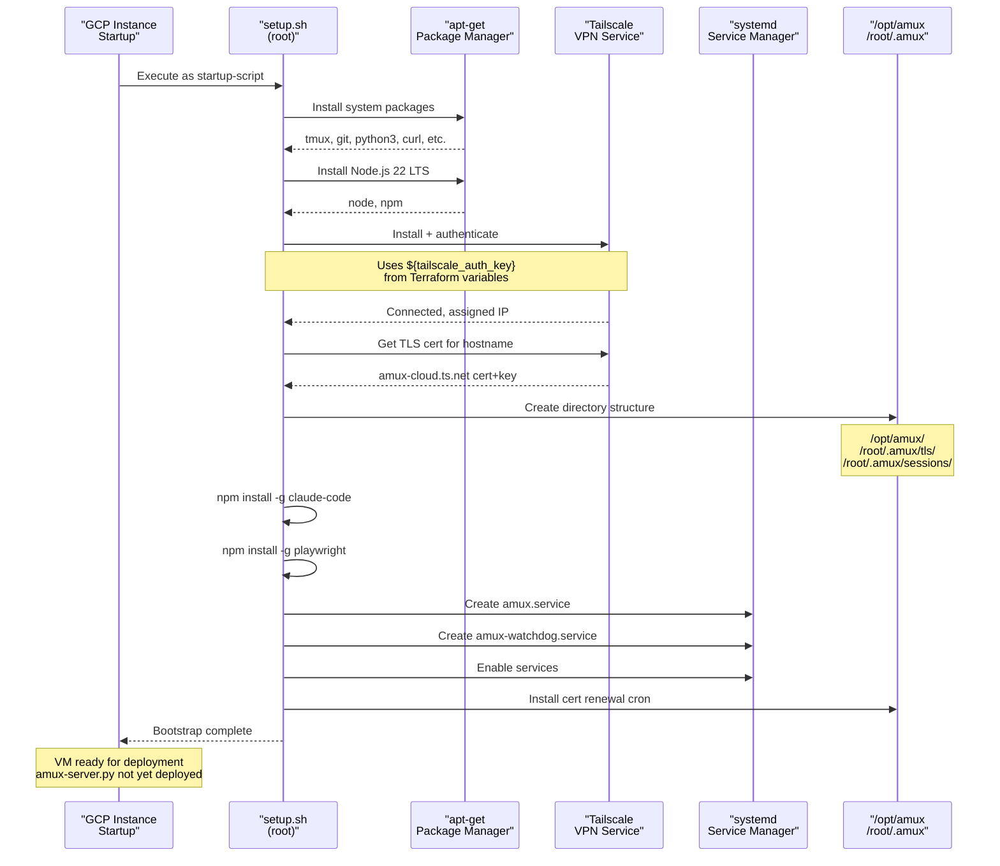
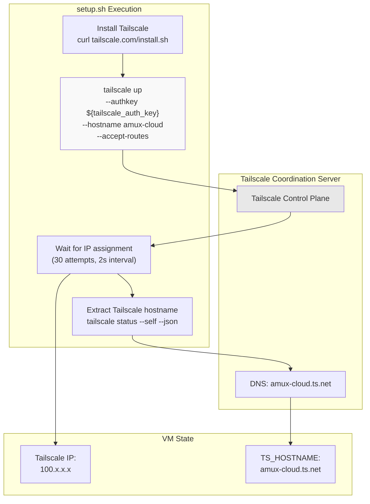
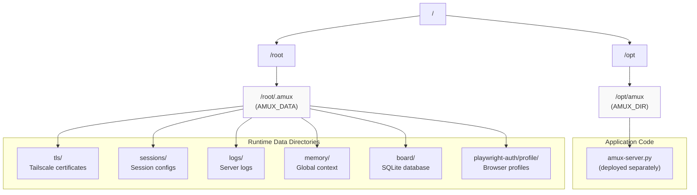
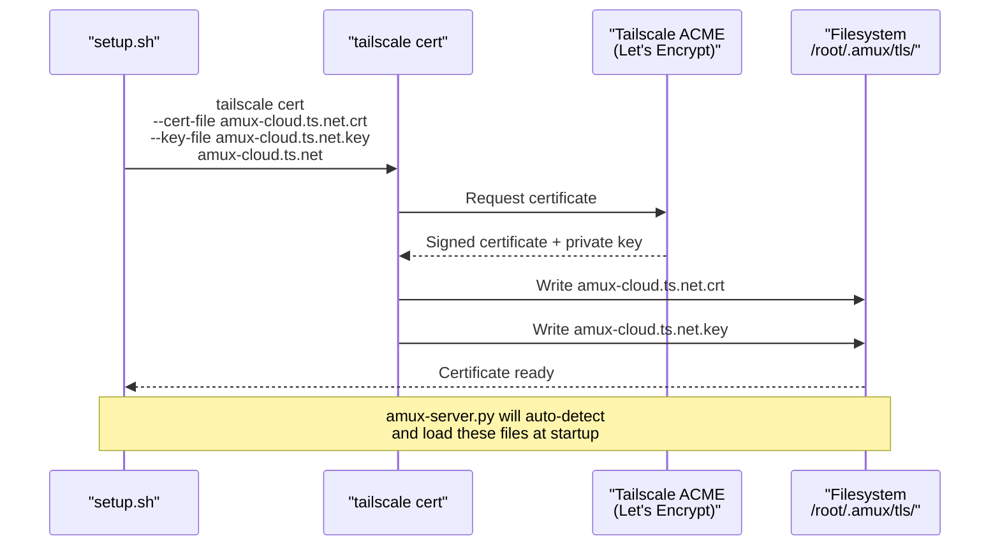
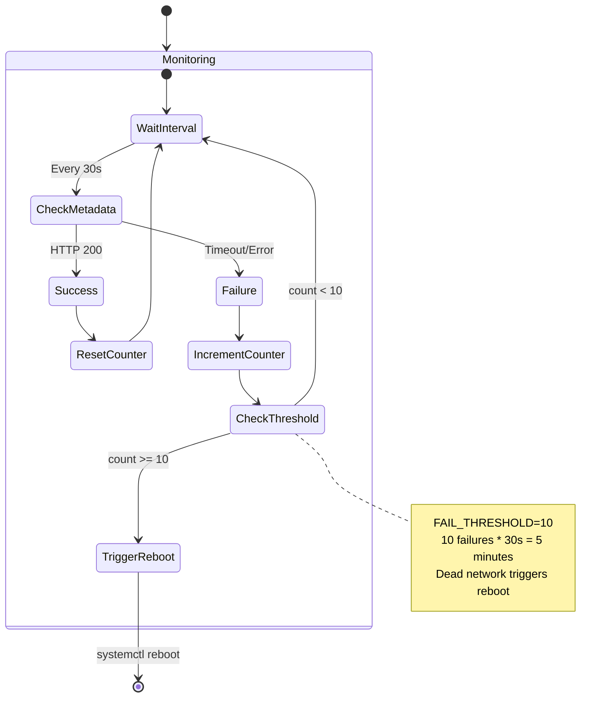
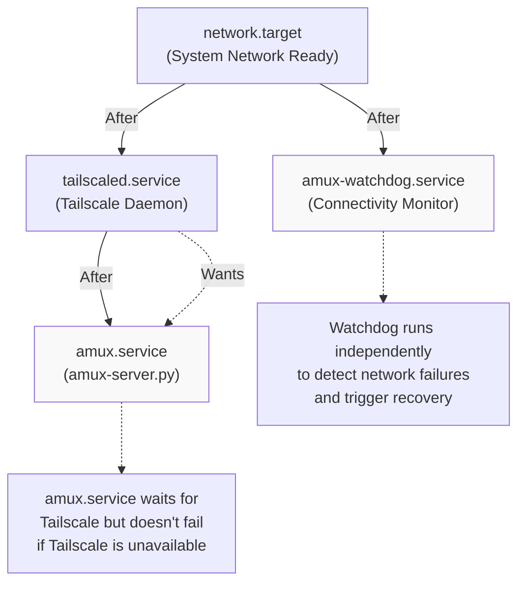

<!-- source: DeepWiki mcp.deepwiki.com · repo mixpeek/amux · page 4.2 VM Setup & Bootstrap · fetched 2026-10-26 -->

# VM Setup & Bootstrap

<details>
<summary>Relevant source files</summary>

The following files were used as context for generating this wiki page:

- [amux](amux)
- [cloud/setup.sh](cloud/setup.sh)

</details>


## Purpose and Scope

This page documents the `cloud/setup.sh` bootstrap script that prepares a fresh Google Cloud Platform VM to run amux-server.py. The script installs system dependencies, configures Tailscale networking, provisions TLS certificates, and sets up systemd services for automatic startup and monitoring. This is a one-time setup executed during VM initialization.

For Docker container orchestration performed by the gateway, see [Docker Architecture](#4.1). For Terraform infrastructure provisioning, see [Infrastructure as Code](#4.3).

---

## Bootstrap Overview

The setup script is designed to be idempotent and runs as root during GCP instance startup. It transforms a bare Debian VM into a fully configured amux host with secure Tailscale networking, automatic TLS certificate management, and self-healing watchdog monitoring.

### Bootstrap Sequence Diagram



**Sources:** [cloud/setup.sh:1-192]()

---

## System Dependencies

The bootstrap process installs packages required for running Claude Code agents, managing tmux sessions, and supporting MCP integrations.

### Package Installation Table

| Package | Purpose | Install Method |
|---------|---------|----------------|
| `tmux` | Session multiplexing for Claude Code | apt-get |
| `git`, `curl`, `wget` | Source control and HTTP requests | apt-get |
| `python3`, `python3-pip` | Runtime for amux-server.py | apt-get |
| `build-essential` | Compilation tools for native modules | apt-get |
| `nodejs` (v22 LTS) | Runtime for Claude Code CLI | NodeSource PPA |
| `@anthropic-ai/claude-code` | Claude Code CLI | npm global |
| `@playwright/mcp`, `playwright` | Browser automation MCP | npm global |
| `chromium` | Headless browser with system deps | npx playwright install |

The script checks for existing installations before proceeding to make the process idempotent:

```bash
if ! command -v node &>/dev/null; then
  log "Installing Node.js 22..."
  curl -fsSL https://deb.nodesource.com/setup_22.x | bash -
  apt-get install -y -qq nodejs
fi
```

**Sources:** [cloud/setup.sh:14-83]()

---

## Tailscale Networking

Tailscale provides secure mesh VPN connectivity and automatic TLS certificate provisioning. The setup script connects the VM to the Tailscale network using an ephemeral auth key injected by Terraform.

### Tailscale Setup Flow



**Sources:** [cloud/setup.sh:29-53]()

### Tailscale IP Assignment Loop

The script polls for Tailscale IP assignment with exponential backoff:

[cloud/setup.sh:42-46]()

This ensures the VM has network connectivity before proceeding with TLS certificate provisioning.

---

## Directory Structure

The bootstrap script creates a standardized directory layout under `/opt/amux` (application code) and `/root/.amux` (runtime data).

### Directory Hierarchy



**Sources:** [cloud/setup.sh:55-83]()

The script creates these directories:

[cloud/setup.sh:56-61]()

Note that `amux-server.py` is **not deployed** by the bootstrap script. It must be manually copied via `scp` after setup completes (see deployment instructions in log output).

---

## TLS Certificate Provisioning

Tailscale provides automatic HTTPS certificates that are trusted by all devices on the Tailscale network. The bootstrap script pre-fetches the certificate during setup so that `amux-server.py` starts with HTTPS enabled immediately.

### Certificate Fetch Process



**Sources:** [cloud/setup.sh:64-70]()

The certificate command:

[cloud/setup.sh:65-69]()

The `|| true` suffix ensures bootstrap continues even if certificate fetch fails (e.g., network issues), allowing amux-server.py to fall back to self-signed certificates.

---

## systemd Service Configuration

The bootstrap script creates two systemd services: `amux.service` (main application) and `amux-watchdog.service` (connectivity monitor).

### amux.service

The primary service runs `amux-server.py` with automatic restart on failure:

[cloud/setup.sh:101-120]()

**Key configuration details:**

| Directive | Value | Purpose |
|-----------|-------|---------|
| `After` | `network.target tailscaled.service` | Wait for network and Tailscale |
| `Wants` | `tailscaled.service` | Prefer Tailscale but don't require it |
| `User` | `root` | Required for tmux session management |
| `WorkingDirectory` | `/opt/amux` | Location of amux-server.py |
| `ExecStart` | `/usr/bin/python3 /opt/amux/amux-server.py` | Launch command |
| `Restart` | `always` | Auto-restart on crashes |
| `RestartSec` | `5` | 5 second delay between restarts |
| `Environment` | `HOME=/root` | Ensure correct home directory |
| `StandardOutput/Error` | `append:/var/log/amux.log` | Centralized logging |

The service is enabled but **not started** during bootstrap, as `amux-server.py` has not been deployed yet:

[cloud/setup.sh:122-124]()

**Sources:** [cloud/setup.sh:97-124]()

---

## Connectivity Watchdog

The watchdog service monitors GCP metadata server reachability and triggers a reboot if the network stack fails. This prevents the VM from becoming unreachable via SSH/Tailscale due to kernel network stack issues.

### Watchdog Logic Diagram



**Sources:** [cloud/setup.sh:126-168]()

### Watchdog Script

The watchdog is a simple bash script that polls the GCP metadata server:

[cloud/setup.sh:127-147]()

**Logic breakdown:**

1. Sleep 30 seconds between checks
2. Curl GCP metadata server with 5 second timeout
3. On success: reset `FAIL_COUNT` to 0
4. On failure: increment `FAIL_COUNT`
5. If `FAIL_COUNT >= 10` (5+ minutes): trigger `systemctl reboot`

The metadata server URL (`http://169.254.169.254/computeMetadata/v1/instance/hostname`) is a link-local address that should always respond if the network stack is healthy.

### Watchdog systemd Service

[cloud/setup.sh:150-164]()

The watchdog service is **enabled and started** during bootstrap:

[cloud/setup.sh:166-168]()

**Sources:** [cloud/setup.sh:126-168]()

---

## Certificate Renewal

Tailscale certificates expire periodically (typically 90 days). The bootstrap script installs a weekly cron job to automatically renew the certificate and restart `amux.service`.

### Renewal Cron Configuration

[cloud/setup.sh:170-180]()

**Execution schedule:**

- **Frequency:** Weekly (runs every Sunday at a random time set by `/etc/cron.weekly/`)
- **Action:** Fetch new certificate via `tailscale cert`
- **Post-renewal:** `systemctl restart amux` to load new certificate

The renewal is idempotent—`tailscale cert` will either renew the certificate or exit successfully if renewal isn't needed yet.

**Sources:** [cloud/setup.sh:170-180]()

---

## tmux Configuration

The bootstrap script installs a minimal tmux configuration optimized for Claude Code sessions:

[cloud/setup.sh:85-95]()

**Configuration details:**

| Setting | Value | Purpose |
|---------|-------|---------|
| `mouse` | `on` | Enable mouse scrolling/selection |
| `history-limit` | `50000` | Store 50k lines of scrollback |
| `default-terminal` | `screen-256color` | Enable 256 color support |
| `status-style` | `bg=colour235,fg=colour248` | Dark status bar |
| `status-left` | `amux-cloud` | Identify VM in status bar |
| `status-right` | `%H:%M` | Show current time |
| `base-index` | `1` | Start window numbering at 1 |
| `pane-base-index` | `1` | Start pane numbering at 1 |

This configuration provides a better experience when attaching to Claude Code sessions for debugging.

**Sources:** [cloud/setup.sh:85-95]()

---

## Bootstrap Completion

The script logs completion details with next steps for deploying `amux-server.py`:

[cloud/setup.sh:182-191]()

**Example output:**

```
=== Setup complete ===

  Tailscale hostname : amux-cloud.ts.net
  Tailscale IP       : 100.101.102.103

  Next step: deploy amux-server.py
    scp amux-server.py root@amux-cloud.ts.net:/opt/amux/amux-server.py
    ssh root@amux-cloud.ts.net systemctl start amux

  Dashboard: https://amux-cloud.ts.net:8822
```

At this point, the VM is fully configured but not running amux-server.py. Deployment is handled separately (typically via GitHub Actions or manual `scp`).

**Sources:** [cloud/setup.sh:182-192]()

---

## Environment Variables and Templating

The setup script uses Terraform variable interpolation for dynamic configuration. The `${tailscale_auth_key}` placeholder is substituted during Terraform apply:

[cloud/setup.sh:36]()

This allows the same `setup.sh` script to be used across multiple deployments without hardcoding credentials. For details on how Terraform provisions the VM and injects variables, see [Infrastructure as Code](#4.3).

**Sources:** [cloud/setup.sh:36]()

---

## Service Startup Dependencies



**Sources:** [cloud/setup.sh:97-164]()

---

## Idempotency

The setup script can be safely re-run multiple times. It checks for existing installations before attempting package installation:

- **Node.js:** [cloud/setup.sh:23]()
- **Tailscale:** [cloud/setup.sh:30]()
- **Claude Code CLI:** [cloud/setup.sh:73]()

This allows the script to be used both as a startup script (first boot) and as a manual update mechanism (re-running on an existing VM).

**Sources:** [cloud/setup.sh:23-76]()

---

## Logging

All setup actions are logged to `/var/log/amux-setup.log` with timestamps:

[cloud/setup.sh:10]()

The `log()` function is used throughout the script:

[cloud/setup.sh:12]()

After bootstrap, the amux service logs to `/var/log/amux.log` (configured in systemd unit).

**Sources:** [cloud/setup.sh:10-12](), [cloud/setup.sh:115-116]()

---

