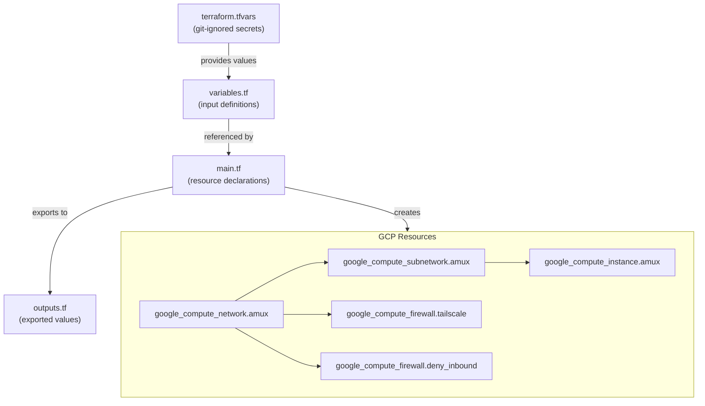
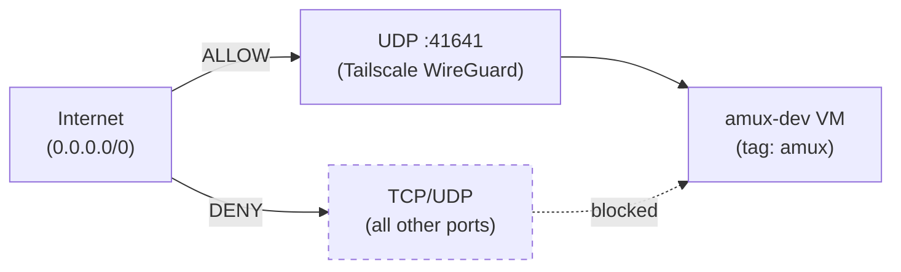
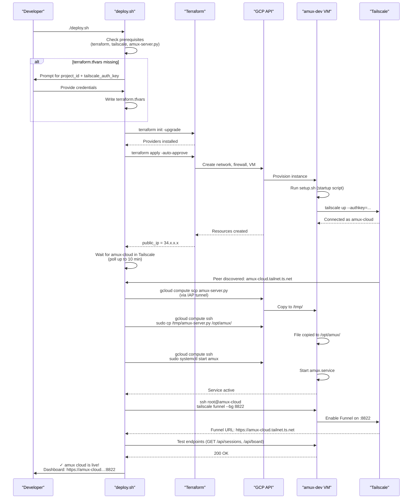
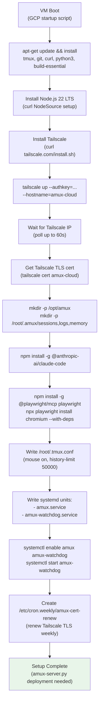

<!-- source: DeepWiki mcp.deepwiki.com · repo mixpeek/amux · page 4.3 Infrastructure as Code · fetched 2026-10-26 -->

# Infrastructure as Code

<details>
<summary>Relevant source files</summary>

The following files were used as context for generating this wiki page:

- [amux](amux)
- [cloud/.gitignore](cloud/.gitignore)
- [cloud/deploy.sh](cloud/deploy.sh)
- [cloud/main.tf](cloud/main.tf)
- [cloud/outputs.tf](cloud/outputs.tf)
- [cloud/setup.sh](cloud/setup.sh)
- [cloud/terraform.tfvars.example](cloud/terraform.tfvars.example)
- [cloud/variables.tf](cloud/variables.tf)

</details>


This page documents the Terraform configuration and deployment automation for provisioning amux on Google Cloud Platform. It covers the infrastructure resources, networking setup, firewall rules, VM configuration, and the automated deployment workflow.

For information about the Docker architecture running inside the VM, see [Docker Architecture](#4.1). For VM setup and bootstrap procedures, see [VM Setup & Bootstrap](#4.2). For backup strategies, see [Backup & Persistence](#4.4).

---

## Overview

The amux cloud infrastructure is fully codified using Terraform and automated via shell scripts. The system provisions a minimal GCP VM with Tailscale for secure access, avoiding public-facing services entirely. All infrastructure is defined in the `cloud/` directory and can be deployed or destroyed with a single command.

**Key Design Principles:**

| Principle | Implementation |
|-----------|----------------|
| **Zero Trust Networking** | No public HTTP/HTTPS ports; access only via Tailscale VPN |
| **Minimal Attack Surface** | Single VM, no load balancers, no managed services |
| **Cost Optimization** | e2-micro instance (~$7/month), standard HDD storage |
| **Idempotent Deployment** | Terraform + bash scripts can re-run safely |
| **Declarative Configuration** | All resources defined in version-controlled `.tf` files |

**Sources:** [cloud/main.tf:1-106](), [cloud/deploy.sh:1-154]()

---

## Terraform Configuration Structure

The Terraform configuration is split across four files for clarity and maintainability:



**Terraform Resource Dependency Chain**

**Sources:** [cloud/main.tf:1-106](), [cloud/variables.tf:1-35](), [cloud/outputs.tf:1-25]()

---

## Infrastructure Resources

### Network Configuration

The infrastructure creates an isolated VPC network with a single subnet:

| Resource | Name | CIDR | Purpose |
|----------|------|------|---------|
| VPC Network | `amux-net` | N/A | Isolated network for amux VM |
| Subnet | `amux-subnet` | `10.10.0.0/24` | Private IP space for VM |

**Sources:** [cloud/main.tf:19-29]()

### Firewall Rules

The firewall configuration implements a strict deny-by-default policy with a single exception:



**Firewall Rule Configuration**

| Rule Name | Priority | Direction | Protocol | Ports | Source | Target | Action |
|-----------|----------|-----------|----------|-------|--------|--------|--------|
| `amux-allow-tailscale` | Default | Ingress | UDP | 41641 | 0.0.0.0/0 | tag:amux | ALLOW |
| `amux-deny-inbound` | 1000 | Ingress | TCP, UDP | All | 0.0.0.0/0 | tag:amux | DENY |

**Key Security Points:**

- **UDP 41641 (Tailscale):** Only inbound port allowed; required for Tailscale peer-to-peer WireGuard connections
- **All Other Ports:** Explicitly denied; dashboard (8822) is only accessible via Tailscale VPN
- **Ephemeral Public IP:** Assigned for outbound internet (apt-get, npm), but inbound is blocked
- **No SSH Port 22:** SSH access via `gcloud compute ssh` with IAP tunneling only

**Sources:** [cloud/main.tf:31-60]()

---

## VM Instance Configuration

The VM is defined as `google_compute_instance.amux` with the following specifications:

| Property | Value | Rationale |
|----------|-------|-----------|
| **Machine Type** | `e2-micro` (default) | Cost: ~$7/month; sufficient for low-traffic usage |
| **Image** | `ubuntu-2204-lts` | LTS support; compatible with all dependencies |
| **Boot Disk** | 20 GB `pd-standard` | Adequate for OS + dependencies; expandable |
| **Zone** | `us-central1-a` (default) | Low latency to US users; configurable via variable |
| **Tags** | `["amux"]` | Firewall target selector |
| **Preemptible** | `false` | Always-on availability; `automatic_restart = true` |

**Service Account & Metadata:**

- **Scopes:** `cloud-platform` (required for IAP SSH)
- **OS Login:** Enabled via `enable-oslogin = TRUE` (uses gcloud identity for SSH)

**Sources:** [cloud/main.tf:64-106](), [cloud/variables.tf:17-28]()

### Startup Script Injection

The VM bootstrap is triggered via `metadata_startup_script`:

```hcl
metadata_startup_script = templatefile("${path.module}/setup.sh", {
  tailscale_auth_key = var.tailscale_auth_key
})
```

The `templatefile()` function injects the `tailscale_auth_key` variable into [cloud/setup.sh:1-192]() as `${tailscale_auth_key}`, enabling automated Tailscale authentication. See [VM Setup & Bootstrap](#4.2) for detailed execution flow.

**Sources:** [cloud/main.tf:96-98](), [cloud/setup.sh:36-39]()

---

## Terraform Variables

The following variables control infrastructure provisioning:

| Variable | Type | Default | Description | Sensitive |
|----------|------|---------|-------------|-----------|
| `project_id` | string | *(required)* | GCP project ID | No |
| `region` | string | `us-central1` | GCP region for subnet | No |
| `zone` | string | `us-central1-a` | VM zone | No |
| `machine_type` | string | `e2-micro` | VM instance size | No |
| `disk_size_gb` | number | 20 | Boot disk size (GB) | No |
| `tailscale_auth_key` | string | *(required)* | Tailscale auth key (reusable + ephemeral) | **Yes** |

**Configuration File:**

Variables are provided via `cloud/terraform.tfvars` (git-ignored):

```
project_id         = "your-gcp-project-id"
tailscale_auth_key = "tskey-auth-xxxxx"
```

An example template is provided at [cloud/terraform.tfvars.example:1-10]().

**Sources:** [cloud/variables.tf:1-35](), [cloud/terraform.tfvars.example:1-10]()

---

## Terraform Outputs

After successful `terraform apply`, the following values are exported:

| Output | Description | Example Value |
|--------|-------------|---------------|
| `public_ip` | Ephemeral public IP (for internet access) | `34.123.45.67` |
| `vm_name` | Instance name | `amux-dev` |
| `zone` | VM zone | `us-central1-a` |
| `tailscale_url` | Dashboard URL (templated) | `https://amux-cloud.<tailnet>.ts.net:8822` |
| `ssh_command` | SSH via Tailscale | `ssh root@amux-cloud` |

These outputs are used by [cloud/deploy.sh:50-51]() to retrieve the VM's IP and coordinate deployment steps.

**Sources:** [cloud/outputs.tf:1-25](), [cloud/deploy.sh:50-51]()

---

## Deployment Workflow

The [cloud/deploy.sh:1-154]() script orchestrates the complete deployment process:



**Deployment Workflow Sequence**

**Key Steps:**

1. **Prerequisites Check** ([cloud/deploy.sh:24-26]()): Verify `terraform`, `tailscale`, and `amux-server.py` are present
2. **Terraform Initialization** ([cloud/deploy.sh:45-46]()): Install/upgrade providers
3. **Infrastructure Provisioning** ([cloud/deploy.sh:48-51]()): `terraform apply -auto-approve`
4. **Tailscale Discovery** ([cloud/deploy.sh:54-76]()): Poll `tailscale status --json` until `amux-cloud` peer appears
5. **File Deployment via IAP** ([cloud/deploy.sh:79-93]()): Use `gcloud compute scp` with `--tunnel-through-iap` to copy `amux-server.py`
6. **Service Activation** ([cloud/deploy.sh:96-101]()): Start `amux.service` via `systemctl`
7. **Tailscale Funnel** ([cloud/deploy.sh:107-112]()): Enable public access for iCal endpoint
8. **Smoke Tests** ([cloud/deploy.sh:115-133]()): Verify `/api/sessions` and `/api/board` respond

**Destroy Mode:**

```bash
./deploy.sh --destroy
```

Runs `terraform destroy -auto-approve` and removes all GCP resources ([cloud/deploy.sh:15-21]()).

**Sources:** [cloud/deploy.sh:1-154]()

---

## IAP Tunneling for Deployment

Deployment uses **Identity-Aware Proxy (IAP)** instead of traditional SSH over port 22:

| Method | Command | Authentication | Firewall |
|--------|---------|----------------|----------|
| **IAP Tunnel** | `gcloud compute scp/ssh --tunnel-through-iap` | Google Cloud identity (OS Login) | No port 22 rule needed |
| **Traditional SSH** | `ssh root@34.x.x.x` | SSH keys | Requires firewall rule for port 22 |

**IAP Username Derivation:**

```bash
IAP_USER=$(gcloud config get-value account 2>/dev/null | tr '@.' '_')
# Example: user@gmail.com → user_gmail_com
```

The `enable-oslogin = TRUE` metadata ([cloud/main.tf:93]()) maps IAP usernames to POSIX users on the VM. Deploy.sh constructs the username at [cloud/deploy.sh:82]() and uses it for `gcloud compute scp/ssh` commands.

**Sources:** [cloud/deploy.sh:79-92](), [cloud/main.tf:93-94]()

---

## Bootstrap Process Overview

The [cloud/setup.sh:1-192]() script runs as root during VM first boot via `metadata_startup_script`. It is **idempotent** and can be re-run safely.

**Execution Flow:**



**Bootstrap Execution Flow**

**Key Components Installed:**

| Component | Installation Method | Purpose |
|-----------|---------------------|---------|
| **System Packages** | `apt-get install` ([cloud/setup.sh:16-20]()) | tmux, python3, build tools |
| **Node.js 22** | NodeSource setup script ([cloud/setup.sh:23-27]()) | Required for Claude Code CLI |
| **Tailscale** | Official install script ([cloud/setup.sh:30-33]()) | VPN access |
| **Claude Code** | `npm install -g` ([cloud/setup.sh:73-76]()) | AI agent runtime |
| **Playwright MCP** | `npm install -g + npx playwright install` ([cloud/setup.sh:79-82]()) | Browser automation |

**Systemd Services Created:**

1. **amux.service** ([cloud/setup.sh:101-120]()): Runs `amux-server.py` with auto-restart
2. **amux-watchdog.service** ([cloud/setup.sh:150-164]()): Reboots VM if GCP metadata server is unreachable for 5+ minutes

**Sources:** [cloud/setup.sh:1-192]()

---

## Tailscale Integration

Tailscale provides secure VPN access without exposing public ports:

**Configuration Parameters:**

| Parameter | Value | Purpose |
|-----------|-------|---------|
| `--authkey` | `${tailscale_auth_key}` | Automated authentication (injected by Terraform) |
| `--hostname` | `amux-cloud` | Fixed hostname for DNS resolution |
| `--accept-routes` | Enabled | Allow subnet router traffic |

**TLS Certificate Generation:**

```bash
tailscale cert \
  --cert-file /root/.amux/tls/amux-cloud.tailnet.ts.net.crt \
  --key-file  /root/.amux/tls/amux-cloud.tailnet.ts.net.key \
  amux-cloud.tailnet.ts.net
```

The certificate is pre-fetched during setup ([cloud/setup.sh:64-70]()) and renewed weekly via cron ([cloud/setup.sh:171-180]()). This enables HTTPS on port 8822 without public CA certificates.

**Funnel for Public iCal:**

```bash
tailscale funnel --bg 8822
```

Enabled by [cloud/deploy.sh:107-112](), this routes `https://amux-cloud.tailnet.ts.net/api/calendar.ics` through Tailscale's public edge for calendar subscriptions.

**Sources:** [cloud/setup.sh:34-70](), [cloud/deploy.sh:107-112]()

---

## Systemd Service Definitions

### amux.service

```ini
[Unit]
Description=amux server
After=network.target tailscaled.service
Wants=tailscaled.service

[Service]
Type=simple
User=root
WorkingDirectory=/opt/amux
ExecStart=/usr/bin/python3 /opt/amux/amux-server.py
Restart=always
RestartSec=5
Environment=HOME=/root
StandardOutput=append:/var/log/amux.log
StandardError=append:/var/log/amux.log
```

- **Execution:** Runs [amux-server.py]() as root from `/opt/amux`
- **Restart Policy:** Always restart with 5-second delay (handles crashes)
- **Dependencies:** Waits for `tailscaled.service` to ensure VPN is available
- **Logging:** Appends stdout/stderr to `/var/log/amux.log`

**Sources:** [cloud/setup.sh:101-120]()

### amux-watchdog.service

The watchdog detects VM network stack failures by monitoring GCP metadata server reachability:

```bash
while true; do
  sleep 30
  if ! curl -sf --max-time 5 http://169.254.169.254/...; then
    FAIL_COUNT=$((FAIL_COUNT + 1))
    if [ "$FAIL_COUNT" -ge 10 ]; then  # 10 * 30s = 5 min
      systemctl reboot
    fi
  else
    FAIL_COUNT=0
  fi
done
```

**Rationale:** GCP VMs occasionally experience kernel network failures where Tailscale/SSH stop responding, but the VM remains "running" in GCP console. Proactive reboot via metadata server check restores connectivity.

**Sources:** [cloud/setup.sh:127-168]()

---

## Configuration Management

### Terraform State

Terraform state is stored **locally** in `cloud/.terraform/` (git-ignored). For production use, consider backend configuration:

```hcl
terraform {
  backend "gcs" {
    bucket = "amux-tfstate"
    prefix = "terraform/state"
  }
}
```

### Secrets Management

| Secret | Storage | Access Pattern |
|--------|---------|----------------|
| `tailscale_auth_key` | `terraform.tfvars` (git-ignored) | Injected into VM startup script |
| `ANTHROPIC_API_KEY` | `/root/.amux/server.env` (deployed separately) | Loaded by amux-server.py |
| GCP credentials | `~/.config/gcloud/` (local machine) | Used by `gcloud` CLI |

The Terraform configuration **never stores secrets in state** because `tailscale_auth_key` is marked as `sensitive = true` ([cloud/variables.tf:33]()).

**Sources:** [cloud/variables.tf:30-34](), [cloud/.gitignore:1-6]()

---

## Cost Estimation

| Resource | Specification | Monthly Cost (USD) |
|----------|---------------|-------------------|
| **Compute** | e2-micro (2 vCPU, 1GB RAM) | ~$7.11 |
| **Storage** | 20 GB pd-standard | ~$0.80 |
| **Network** | Ephemeral IP + minimal egress | ~$1.50 |
| **Tailscale** | Free tier (1 user, 100 devices) | $0.00 |
| **Total** |  | **~$9.50/month** |

Costs calculated for `us-central1` region. To reduce costs, use preemptible VMs (`preemptible = true`) or reduce machine type to `e2-micro`.

**Sources:** [cloud/variables.tf:17-28]()

---

## Troubleshooting

### VM Not Appearing in Tailscale

**Symptom:** `deploy.sh` times out waiting for `amux-cloud` peer.

**Resolution:**
```bash
# SSH via IAP (doesn't require Tailscale)
gcloud compute ssh amux-dev --zone=us-central1-a --tunnel-through-iap

# Check Tailscale status
sudo tailscale status
sudo journalctl -u tailscaled -n 50

# Re-authenticate if needed
sudo tailscale up --authkey=<new-key> --hostname=amux-cloud
```

**Sources:** [cloud/deploy.sh:54-76]()

### Deployment Fails at gcloud compute scp

**Symptom:** `ERROR: (gcloud.compute.scp) Could not fetch resource: The resource 'projects/.../zones/.../instances/amux-dev' was not found`

**Cause:** OS Login username mismatch.

**Resolution:**
```bash
# Check your gcloud account
gcloud config get-value account
# Ensure IAP_USER derivation matches: user@example.com → user_example_com

# List authorized OS Login users on VM
gcloud compute ssh amux-dev --zone=us-central1-a --tunnel-through-iap \
  --command="getent passwd"
```

**Sources:** [cloud/deploy.sh:82-92]()

### Terraform Apply Fails with Quota Error

**Symptom:** `Error: Error waiting for instance to create: Quota 'CPUS' exceeded`

**Resolution:**
1. Check GCP quotas: `gcloud compute project-info describe --project=<PROJECT_ID>`
2. Request quota increase in GCP Console (IAM & Admin → Quotas)
3. Or use a different region with available capacity

**Sources:** [cloud/main.tf:64-66]()

---

