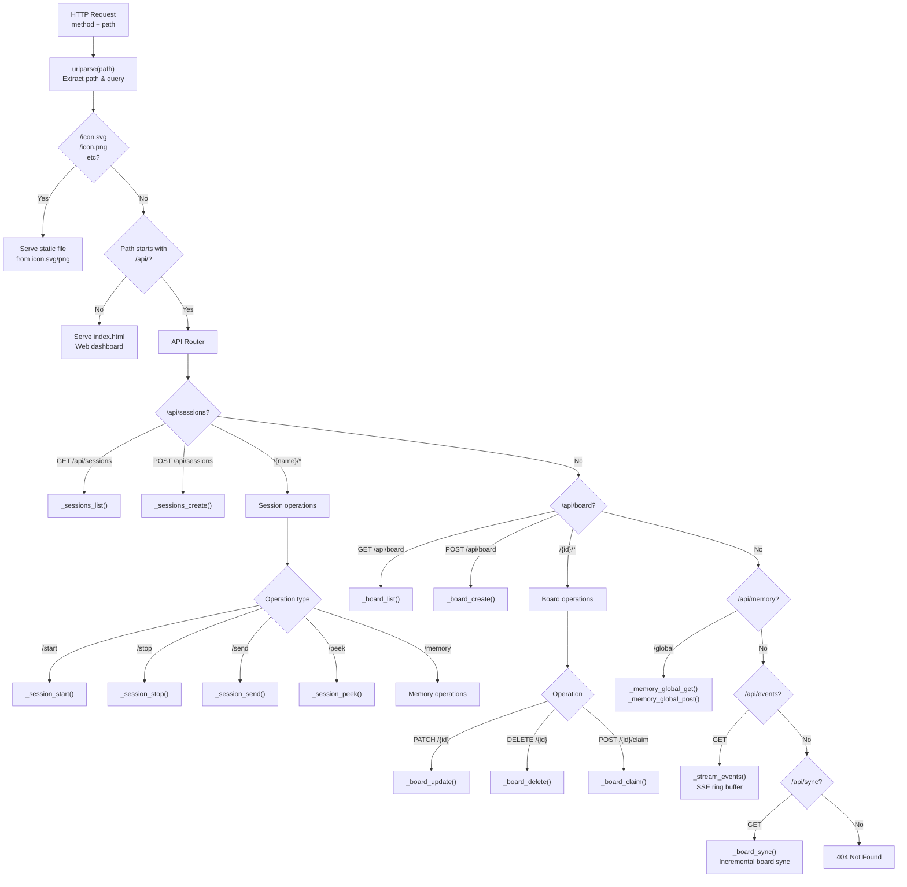
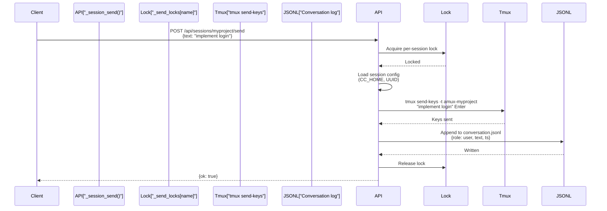
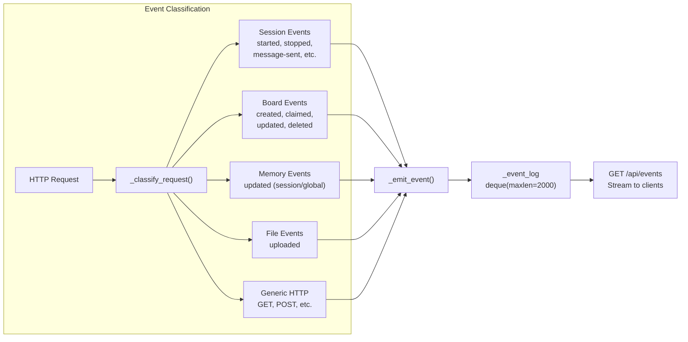

<!-- source: DeepWiki mcp.deepwiki.com · repo mixpeek/amux · page 5 REST API Reference · fetched 2026-10-26 -->

# REST API Reference

<details>
<summary>Relevant source files</summary>

The following files were used as context for generating this wiki page:

- [README.md](README.md)
- [amux-server.py](amux-server.py)
- [cloud/gateway/gateway.py](cloud/gateway/gateway.py)
- [skills/amux-board.md](skills/amux-board.md)
- [skills/amux.md](skills/amux.md)
- [skills/playwright-auth.md](skills/playwright-auth.md)
- [skills/pw-test.md](skills/pw-test.md)
- [test.mjs](test.mjs)

</details>


This document provides a complete reference for the amux HTTP API. All endpoints are exposed by `amux-server.py` and are accessible at `https://localhost:8822` for local deployments or `https://cloud.amux.io` for cloud instances.

For detailed guides on specific endpoint groups, see:
- [Session Endpoints](#5.1) — session lifecycle, message sending, terminal output
- [Board Endpoints](#5.2) — Kanban board operations, atomic claiming
- [Memory & File Endpoints](#5.3) — context management, file uploads

## API Fundamentals

### Base URL and TLS

Local deployments use self-signed TLS certificates on port 8822. All API clients must ignore certificate validation errors when making requests.

**Local:**
```
https://localhost:8822/api/*
```

**Cloud:**
```
https://cloud.amux.io/api/*
```

The server auto-generates certificates using Tailscale → mkcert → self-signed fallback. For CLI usage, always include `curl -sk` flags.

Sources: [amux-server.py:1-100](), [README.md:118-120]()

### Authentication

**Local deployments:** No authentication required. Bind to localhost or use Tailscale for remote access.

**Cloud deployments:** Gateway layer handles authentication via Clerk JWT tokens. The gateway verifies tokens and injects `X-Amux-User-Email` header before proxying to user containers. Individual containers never see raw auth tokens.

Sources: [cloud/gateway/gateway.py:316-348](), [cloud/gateway/gateway.py:396-457]()

### Response Formats

All endpoints return one of three content types:

| Content-Type | Used By | Structure |
|--------------|---------|-----------|
| `application/json` | Most endpoints | `{"ok": true, ...}` or `{"error": "message"}` |
| `text/event-stream` | `/api/events` | SSE format: `data: {...}\n\n` |
| `text/calendar` | `/api/calendar.ics` | iCalendar VEVENT format |

Error responses follow this pattern:
```json
{
  "error": "human-readable error message"
}
```

HTTP status codes: 200 (success), 201 (created), 400 (bad request), 404 (not found), 500 (server error).

Sources: [amux-server.py:1540-1640]()

## API Architecture Overview

```mermaid
graph TB
    subgraph "HTTP Server (ThreadingHTTPServer)"
        Router["_route()<br/>Request dispatcher"]
        Handler["HTTPRequestHandler"]
    end
    
    subgraph "Sessions API (/api/sessions/*)"
        SessionList["GET /api/sessions<br/>List all sessions"]
        SessionCreate["POST /api/sessions<br/>Register new"]
        SessionControl["POST /{name}/start|stop<br/>Lifecycle control"]
        SessionSend["POST /{name}/send<br/>Send message"]
        SessionPeek["POST /{name}/peek<br/>Capture output"]
        SessionMem["GET|POST /{name}/memory<br/>Session memory"]
    end
    
    subgraph "Board API (/api/board/*)"
        BoardList["GET /api/board<br/>List issues"]
        BoardCreate["POST /api/board<br/>Create issue"]
        BoardUpdate["PATCH /api/board/{id}<br/>Update fields"]
        BoardClaim["POST /api/board/{id}/claim<br/>Atomic CAS claim"]
        BoardSync["GET /api/sync<br/>Incremental sync"]
    end
    
    subgraph "Memory API (/api/memory/*)"
        GlobalMem["GET|POST /api/memory/global<br/>Shared memory"]
    end
    
    subgraph "File API (/api/uploads/*)"
        FileUpload["POST /api/uploads<br/>Upload file"]
        FileGet["GET /api/uploads/{name}<br/>Download file"]
        FileDelete["DELETE /api/uploads/{name}<br/>Remove file"]
    end
    
    subgraph "Events (/api/events)"
        SSE["GET /api/events<br/>SSE stream<br/>Ring buffer: 2000 events"]
    end
    
    Handler -->|Parse path| Router
    Router --> SessionList
    Router --> SessionCreate
    Router --> SessionControl
    Router --> SessionSend
    Router --> SessionPeek
    Router --> SessionMem
    Router --> BoardList
    Router --> BoardCreate
    Router --> BoardUpdate
    Router --> BoardClaim
    Router --> BoardSync
    Router --> GlobalMem
    Router --> FileUpload
    Router --> FileGet
    Router --> FileDelete
    Router --> SSE
    
    SessionControl -->|"tmux new-session -d"| Tmux["tmux sessions"]
    SessionSend -->|"tmux send-keys"| Tmux
    SessionPeek -->|"tmux capture-pane"| Tmux
    
    BoardList --> DB["amux.db<br/>SQLite"]
    BoardCreate --> DB
    BoardUpdate --> DB
    BoardClaim --> DB
    BoardSync --> DB
    
    SessionMem --> MemFS["~/.amux/memory/{name}/MEMORY.md"]
    GlobalMem --> GlobalMemFS["~/.amux/memory/global.md"]
    
    FileUpload --> UploadFS["~/.amux/uploads/"]
    FileGet --> UploadFS
    FileDelete --> UploadFS
```



Sources: [amux-server.py:1540-2200]()

## Request Routing Implementation

The `_route()` function dispatches all HTTP requests based on method and path pattern matching. Routes are evaluated in order, with more specific patterns checked first.



Sources: [amux-server.py:1540-1640]()

## Session Endpoints

Session endpoints control Claude Code agent lifecycle, message injection, and output monitoring. Each session corresponds to a tmux session named `amux-{name}`.

### Endpoint Table

| Method | Path | Purpose | Request Body | Response |
|--------|------|---------|--------------|----------|
| `GET` | `/api/sessions` | List all registered sessions | — | `[{name, uuid, running, ...}]` |
| `POST` | `/api/sessions` | Register new session | `{name, dir, model?, yolo?, ...}` | `{ok: true}` |
| `GET` | `/api/sessions/{name}` | Get session details | — | `{name, uuid, running, config, ...}` |
| `PATCH` | `/api/sessions/{name}` | Update session metadata | `{tags?: [...], ...}` | `{ok: true}` |
| `DELETE` | `/api/sessions/{name}` | Unregister session | — | `{ok: true}` |
| `POST` | `/api/sessions/{name}/start` | Start tmux session | — | `{ok: true}` |
| `POST` | `/api/sessions/{name}/stop` | Stop tmux session | — | `{ok: true}` |
| `POST` | `/api/sessions/{name}/send` | Send message to agent | `{text: "..."}` or `{keys: "..."}` | `{ok: true}` |
| `POST` | `/api/sessions/{name}/peek` | Capture terminal output | `{lines?: 100}` | `{output: "..."}` |
| `GET` | `/api/sessions/{name}/memory` | Get session memory | — | `{content: "...", path: "..."}` |
| `POST` | `/api/sessions/{name}/memory` | Update session memory | `{content: "..."}` | `{ok: true}` |
| `POST` | `/api/sessions/{name}/archive` | Archive session config | — | `{ok: true}` |
| `PATCH` | `/api/sessions/{name}/config` | Update session config | `{CC_AUTO_CONTINUE?: 1, ...}` | `{ok: true}` |
| `POST` | `/api/sessions/{name}/wake` | Wake idle session | — | `{ok: true}` |

### Session Object Schema

```json
{
  "name": "myproject",
  "uuid": "550e8400-e29b-41d4-a716-446655440000",
  "running": true,
  "status": "working",
  "dir": "/Users/user/Dev/myproject",
  "model": "sonnet",
  "yolo": true,
  "tags": ["backend", "api"],
  "last_message": 1704067200,
  "tokens_today": 45000,
  "input_tokens": 30000,
  "cache_read_tokens": 10000,
  "output_tokens": 15000,
  "config": {
    "CC_AUTO_CONTINUE": "1",
    "CC_AUTO_COMPACT": "1"
  }
}
```

Sources: [amux-server.py:1640-1900]()

### Session Status Detection

The server parses ANSI-stripped tmux output to determine session status. No Claude Code modifications are required.

| Status | Detection Pattern |
|--------|-------------------|
| `working` | Output contains thinking block or tool use |
| `waiting-input` | Ends with `(y/n)` or `Choice:` prompt |
| `idle` | Static output, no prompts |
| `context-low` | Context percentage < 20% |
| `error` | Corruption markers detected |

Sources: [amux-server.py:2700-2850]()

### Message Sending Flow



The per-session lock (`_send_locks`) serializes concurrent sends to prevent message interleaving. Each message is logged to `conversation.jsonl` for replay during auto-restart.

Sources: [amux-server.py:2200-2300](), [amux-server.py:194-196]()

### Peek Output Caching

Terminal output capture uses a shared cache to avoid redundant `tmux capture-pane` calls when multiple SSE clients connect simultaneously.

```python
_sse_cache = {
    "sessions": {"data": None, "json": "", "time": 0},
    "board": {"data": None, "json": "", "time": 0},
}
_SSE_CACHE_TTL = 2  # seconds
```

Cache is invalidated after 2 seconds or when a session state changes (start/stop/send).

Sources: [amux-server.py:98-102]()

## Board Endpoints

Board endpoints manage the SQLite-backed Kanban system with atomic task claiming. The database is located at `~/.amux/amux.db`.

### Endpoint Table

| Method | Path | Purpose | Request Body | Response |
|--------|------|---------|--------------|----------|
| `GET` | `/api/board` | List all issues | — | `[{id, title, status, session, ...}]` |
| `POST` | `/api/board` | Create issue | `{title, desc?, status?, session?, due?}` | `{id: "PROJ-1", ok: true}` |
| `PATCH` | `/api/board/{id}` | Update issue | `{status?, title?, desc?, session?, due?}` | `{ok: true}` |
| `DELETE` | `/api/board/{id}` | Soft-delete issue | — | `{ok: true}` |
| `POST` | `/api/board/{id}/claim` | Atomic claim | — | `{ok: true}` or `{error: "already claimed"}` |
| `POST` | `/api/board/clear-done` | Clear done items | — | `{deleted: 5}` |
| `GET` | `/api/board/statuses` | List custom statuses | — | `[{id, name, order}]` |
| `POST` | `/api/board/statuses` | Add custom status | `{name, after?}` | `{id: "custom-1", ok: true}` |
| `DELETE` | `/api/board/statuses/{id}` | Delete status | — | `{ok: true}` |
| `PATCH` | `/api/board/statuses/{id}` | Rename status | `{name}` | `{ok: true}` |
| `GET` | `/api/sync?since={ts}` | Incremental sync | — | `{issues: [...], statuses: [...], ts}` |

### Issue Object Schema

```json
{
  "id": "MYPROJECT-1",
  "title": "Implement login endpoint",
  "desc": "Add POST /api/login with email/password auth",
  "status": "doing",
  "session": "myproject",
  "created": 1704067200,
  "updated": 1704070800,
  "due": "2024-01-05",
  "tags": ["auth", "api"],
  "deleted": false
}
```

Issue IDs are auto-generated from session name: `SESSION-N` where N is the next sequential number for that session.

Sources: [amux-server.py:3200-3400]()

### Atomic Claim Operation

The claim endpoint uses SQLite's Compare-And-Swap (CAS) to prevent race conditions when multiple agents try to claim the same task.

```mermaid
sequenceDiagram
    participant A1["Agent 1"]
    participant A2["Agent 2"]
    participant API["/api/board/{id}/claim"]
    participant DB["amux.db<br/>SQLite"]
    
    Note over A1,A2: Both agents request<br/>PROJ-5 simultaneously
    
    A1->>API: POST /api/board/PROJ-5/claim
    A2->>API: POST /api/board/PROJ-5/claim
    
    API->>DB: BEGIN TRANSACTION
    API->>DB: UPDATE issues<br/>SET status='doing', session='agent1'<br/>WHERE id='PROJ-5' AND status='todo'
    DB-->>API: 1 row affected
    API->>DB: COMMIT
    API-->>A1: {ok: true}
    
    API->>DB: BEGIN TRANSACTION
    API->>DB: UPDATE issues<br/>SET status='doing', session='agent2'<br/>WHERE id='PROJ-5' AND status='todo'
    DB-->>API: 0 rows affected
    API->>DB: ROLLBACK
    API-->>A2: {error: "already claimed"}
```

The `WHERE status='todo'` clause ensures only unclaimed tasks can be acquired. Claimed tasks return an error, prompting the agent to find another task.

Sources: [amux-server.py:3500-3560]()

### Incremental Sync Protocol

The `/api/sync` endpoint supports offline-first PWA sync. Clients track the last sync timestamp and request only changes since that point.

**Request:**
```
GET /api/sync?since=1704067200
```

**Response:**
```json
{
  "issues": [
    {"id": "PROJ-1", "deleted": false, "updated": 1704070800, ...},
    {"id": "PROJ-2", "deleted": true, "updated": 1704071000}
  ],
  "statuses": [
    {"id": "custom-1", "name": "review", "order": 3, "deleted": false}
  ],
  "ts": 1704071500
}
```

Tombstones (deleted items) are included so clients can remove local copies. The `ts` field in the response becomes the `since` parameter for the next sync.

Sources: [amux-server.py:3650-3750]()

## Memory Endpoints

Memory endpoints manage context storage for sessions and global shared memory. All memory is stored as Markdown files.

### Endpoint Table

| Method | Path | Purpose | Request Body | Response |
|--------|------|---------|--------------|----------|
| `GET` | `/api/sessions/{name}/memory` | Get session memory | — | `{content: "# Notes\n...", path: "..."}` |
| `POST` | `/api/sessions/{name}/memory` | Replace session memory | `{content: "..."}` | `{ok: true}` |
| `GET` | `/api/memory/global` | Get global memory | — | `{content: "...", path: "..."}` |
| `POST` | `/api/memory/global` | Replace global memory | `{content: "..."}` | `{ok: true}` |

### File Locations

```
~/.amux/memory/
├── {session-name}/
│   └── MEMORY.md           # Session-specific context
└── global.md               # Shared by all sessions
```

Sessions automatically load their memory on startup via Claude Code's context injection. Global memory is typically used for API documentation, project conventions, and shared facts.

Sources: [amux-server.py:2500-2600]()

## File Upload Endpoints

File upload endpoints handle multipart form data and store files in `~/.amux/uploads/`.

### Endpoint Table

| Method | Path | Purpose | Request | Response |
|--------|------|---------|---------|----------|
| `POST` | `/api/uploads` | Upload file | `multipart/form-data` | `{ok: true, path: "..."}` |
| `GET` | `/api/uploads/{filename}` | Download file | — | File content (binary) |
| `DELETE` | `/api/uploads/{filename}` | Delete file | — | `{ok: true}` |
| `POST` | `/api/fs/upload` | Upload to arbitrary path | `{path: "...", content: "..."}` | `{ok: true}` |

File uploads are restricted to 20 MB (`UPLOAD_MAX_BYTES`) by default. The `UPLOAD_ALLOWED_EXTS` variable can whitelist specific extensions (default: all allowed).

Sources: [amux-server.py:65-66](), [amux-server.py:4200-4350]()

## Event Streaming (SSE)

The `/api/events` endpoint provides a Server-Sent Events stream of all system activity. Events are stored in a ring buffer with 2000-event capacity.

### Event Stream Format

```
GET /api/events

data: {"ts":1704067200,"type":"session","action":"started","target":"myproject","session":"myproject","detail":"","status":200,"ip":"127.0.0.1"}

data: {"ts":1704067201,"type":"session","action":"message-sent","target":"myproject","session":"myproject","detail":"","status":200,"ip":"127.0.0.1"}

data: {"ts":1704067205,"type":"board","action":"claimed","target":"PROJ-5","session":"myproject","detail":"","status":200,"ip":"127.0.0.1"}
```

Each event is a JSON object with these fields:

| Field | Type | Description |
|-------|------|-------------|
| `ts` | number | Unix timestamp |
| `type` | string | `session` / `board` / `memory` / `file` / `http` / `system` |
| `action` | string | Operation performed (e.g. `started`, `claimed`, `updated`) |
| `target` | string | Affected resource (session name, board ID, etc.) |
| `session` | string | Associated session (if applicable) |
| `detail` | string | Additional context |
| `status` | number | HTTP status code |
| `ip` | string | Client IP |

### Event Types



Events with HTTP status ≥ 400 are downgraded to generic `http` type to avoid spam in the semantic event log.

Sources: [amux-server.py:104-128](), [amux-server.py:129-186]()

## System Endpoints

Additional endpoints for calendar export, git operations, and health checks.

| Method | Path | Purpose | Response |
|--------|------|---------|----------|
| `GET` | `/api/calendar.ics` | iCalendar feed of board due dates | `text/calendar` (VEVENT format) |
| `POST` | `/api/pull` | Git pull latest code | `{ok: true, output: "..."}` |
| `GET` | `/health` | Health check | `{ok: true}` |

The iCalendar endpoint generates VEVENT entries for all board items with due dates, enabling subscription from external calendar apps (Apple Calendar, Google Calendar, etc.).

Sources: [amux-server.py:4500-4650]()

## Error Handling Patterns

All endpoints follow consistent error handling:

```python
try:
    # Operation
    return _json({"ok": True})
except FileNotFoundError:
    return _json({"error": "session not found"}, 404)
except ValueError as e:
    return _json({"error": str(e)}, 400)
except Exception as e:
    slog(f"ERROR: {e}")
    return _json({"error": "internal error"}, 500)
```

Common error cases:

| Status | Scenario | Response |
|--------|----------|----------|
| 400 | Invalid JSON, missing fields | `{"error": "invalid request"}` |
| 404 | Session/board item not found | `{"error": "not found"}` |
| 409 | Atomic claim failed | `{"error": "already claimed"}` |
| 500 | Unexpected server error | `{"error": "internal error"}` |

Sources: [amux-server.py:1540-2000]()

## Example API Workflows

### Creating and Coordinating Sessions

```bash
# Create two sessions
curl -sk -X POST https://localhost:8822/api/sessions \
  -H 'Content-Type: application/json' \
  -d '{"name":"backend","dir":"~/Dev/myapp","model":"sonnet","yolo":true}'

curl -sk -X POST https://localhost:8822/api/sessions \
  -H 'Content-Type: application/json' \
  -d '{"name":"frontend","dir":"~/Dev/myapp-ui","model":"sonnet"}'

# Start both
curl -sk -X POST https://localhost:8822/api/sessions/backend/start
curl -sk -X POST https://localhost:8822/api/sessions/frontend/start

# Backend claims a task
curl -sk -X POST https://localhost:8822/api/board/BACKEND-1/claim

# Backend delegates to frontend
curl -sk -X POST https://localhost:8822/api/sessions/frontend/send \
  -H 'Content-Type: application/json' \
  -d '{"text":"Build the login UI using the /api/login endpoint"}'

# Backend monitors frontend progress
curl -sk -X POST https://localhost:8822/api/sessions/frontend/peek \
  -H 'Content-Type: application/json' \
  -d '{"lines":50}'
```

### Board Sync for Offline PWA

```javascript
// Initial sync
let lastSync = parseInt(localStorage.getItem('last_sync') || '0');
const resp = await fetch(`/api/sync?since=${lastSync}`);
const {issues, statuses, ts} = await resp.json();

// Merge issues (handle tombstones)
issues.forEach(issue => {
  if (issue.deleted) {
    localDB.delete(issue.id);
  } else {
    localDB.upsert(issue);
  }
});

// Save new sync timestamp
localStorage.setItem('last_sync', ts.toString());
```

### SSE Event Monitoring

```javascript
const events = new EventSource('/api/events');
events.onmessage = (e) => {
  const evt = JSON.parse(e.data);
  if (evt.type === 'session' && evt.action === 'message-sent') {
    console.log(`${evt.session}: new message`);
    refreshSessionOutput(evt.session);
  }
  if (evt.type === 'board' && evt.action === 'claimed') {
    console.log(`Task ${evt.target} claimed by ${evt.session}`);
    refreshBoard();
  }
};
```

Sources: [README.md:63-78](), [skills/amux.md:12-64](), [test.mjs:77-91]()

---

Sources: [amux-server.py:1-5000](), [cloud/gateway/gateway.py:1-750](), [README.md:1-219](), [test.mjs:1-800](), [skills/amux.md:1-94](), [skills/amux-board.md:1-54]()

---

