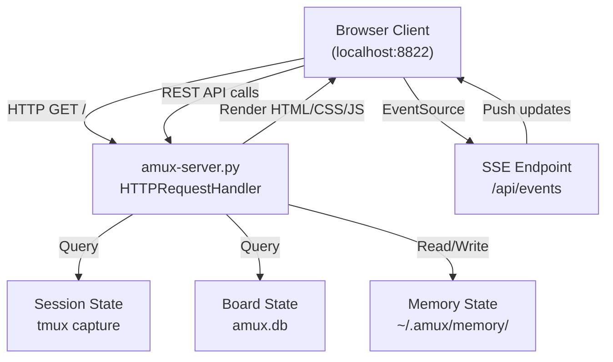
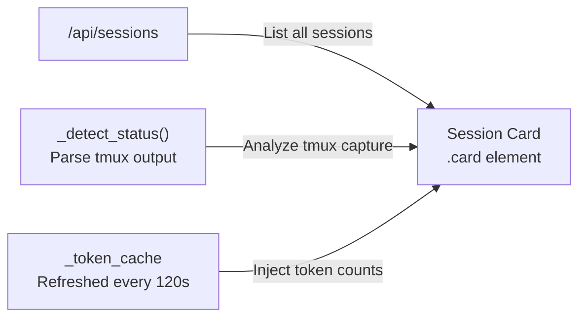
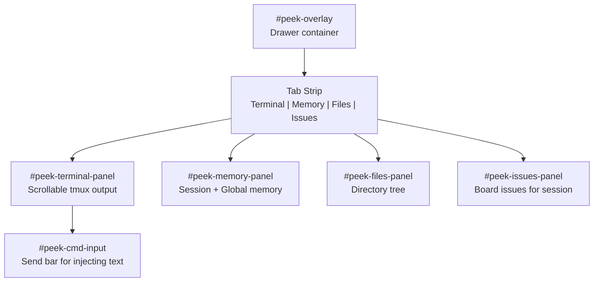
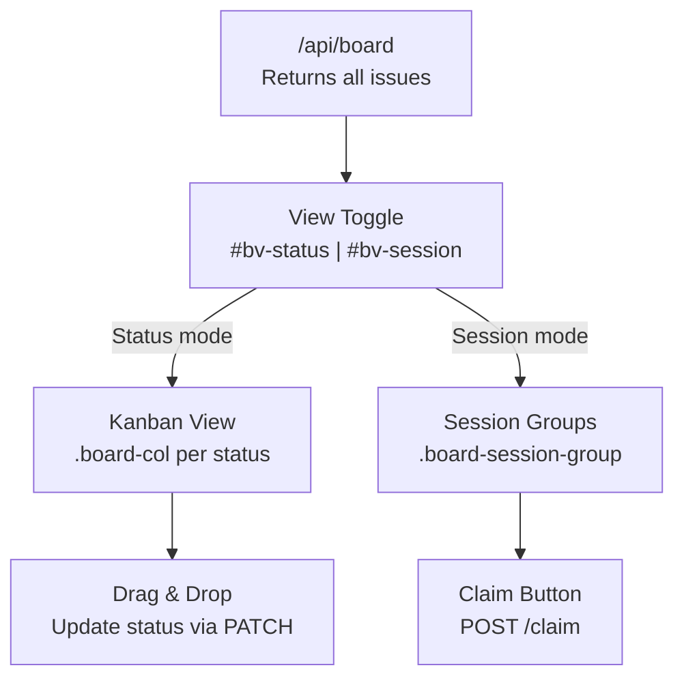
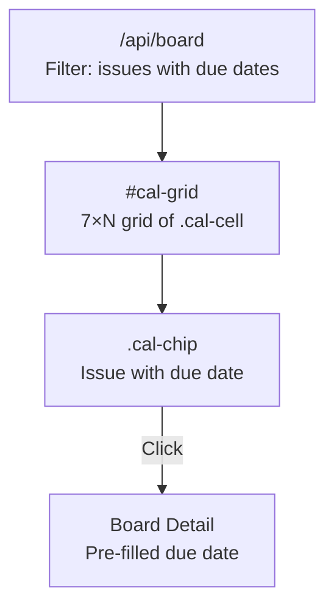
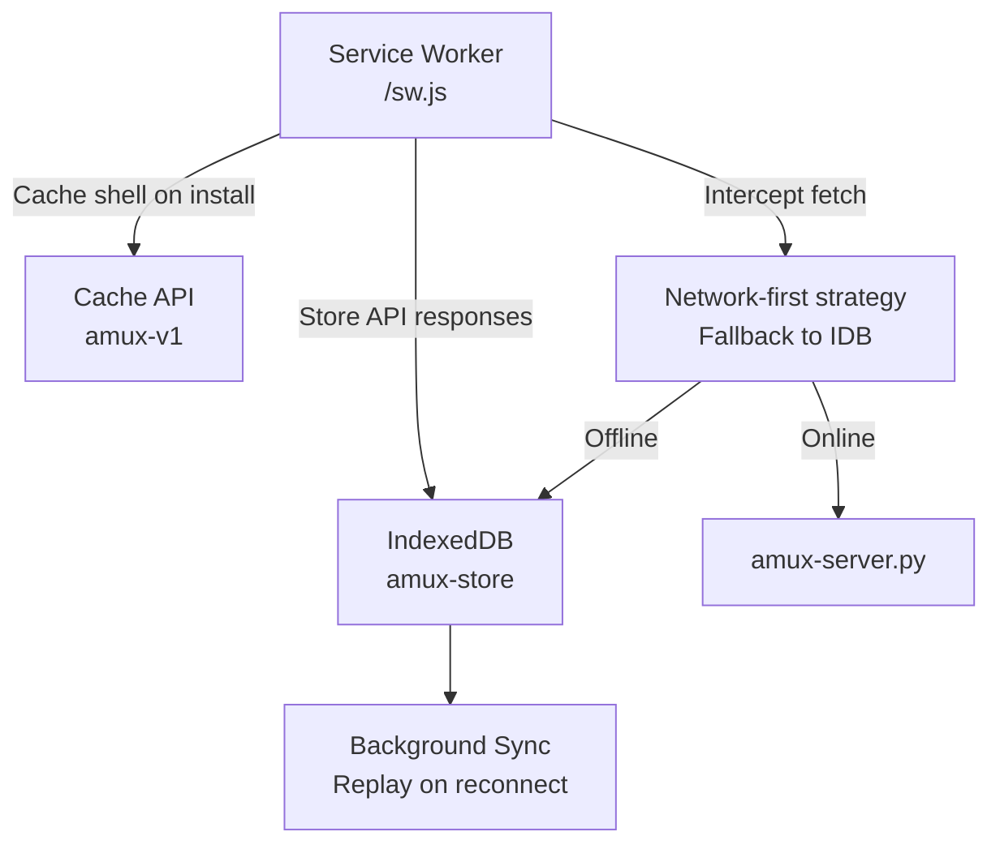
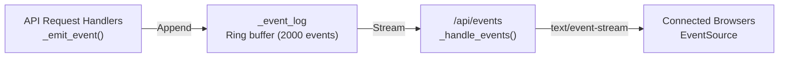

<!-- source: DeepWiki mcp.deepwiki.com · repo mixpeek/amux · page 6 Web Dashboard · fetched 2026-10-26 -->

# Web Dashboard

Relevant source files

The following files were used as context for generating this wiki page:

- [README.md](README.md)
- [amux-server.py](amux-server.py)
- [cloud/gateway/gateway.py](cloud/gateway/gateway.py)
- [docs/release-notes/notes.json](docs/release-notes/notes.json)
- [docs/release-notes/videos/crm-people-tab.mp4](docs/release-notes/videos/crm-people-tab.mp4)
- [site/index.html](site/index.html)
- [site/style.css](site/style.css)
- [test.mjs](test.mjs)

The Web Dashboard is the primary user interface for amux, served by `amux-server.py` on port 8822 (default). It provides a browser-based console for managing multiple Claude Code sessions, monitoring their status, coordinating work via a Kanban board, and viewing shared context. The dashboard is a single-page application with inline HTML/CSS/JS that supports both desktop and mobile devices, including Progressive Web App (PWA) installation for offline use.

For the REST API that powers the dashboard, see [REST API Reference](#5). For CLI commands that interact with the same backend, see [CLI Reference](#7).

---

## Architecture Overview

The dashboard is served as a monolithic HTML document with embedded styles and JavaScript, generated dynamically by Python request handlers. All UI state is managed client-side, with server communication via REST API calls and Server-Sent Events (SSE) for real-time updates.

**Sources:** [amux-server.py:1-2858](), [README.md:82-88]()

---

## Page Structure

The dashboard uses a tab-based navigation system with the following top-level views:

| Tab | Purpose | Primary Data Source |
|-----|---------|-------------------|
| **Sessions** | Monitor and control Claude Code sessions | `GET /api/sessions` |
| **Board** | Kanban task management with atomic claiming | `GET /api/board` |
| **Calendar** | Date-based issue view with iCal sync | `GET /api/board` (filtered by due date) |
| **Reports** | Token usage and spend tracking | Session JSONL logs |
| **Notifications** | Event log of system actions | In-memory ring buffer |
| **Notes** | WYSIWYG note-taking with Quill editor | `~/.amux/notes/` |
| **People** | Personal CRM with interaction log | `amux.db` `people` table |

The tab bar is rendered in [amux-server.py:3024-3040]() and uses JavaScript click handlers to toggle visibility of each tab's content panel.

**Sources:** [amux-server.py:3024-3040](), [test.mjs:142-147]()

---

## Session Monitoring

### Session Cards

The Sessions tab displays all registered sessions as cards with live status indicators. Each card shows:

- **Session name** (from `~/.amux/sessions/NAME.env`)
- **Status dot** (running, stopped, working, idle, waiting input)
- **Directory path** and Git branch (if applicable)
- **Token usage** (daily cumulative from JSONL logs)
- **Quick actions** (start, stop, send, peek, archive)

Session cards are expandable—clicking a card toggles its detail view, which includes:
- **Preview lines** from terminal output
- **Last active** timestamp
- **YOLO mode** indicator (if `CC_AUTO_CONTINUE=1`)
- **Conflict warning** (if multiple sessions share the same directory + branch)

**Sources:** [amux-server.py:789-897](), [test.mjs:149-170]()

### Status Detection

Session status is determined by parsing the last 50 lines of tmux output with ANSI codes stripped. The `_detect_status()` function [amux-server.py:898-1000]() matches patterns to classify sessions:

| Pattern | Status | Description |
|---------|--------|-------------|
| `Provide your response:` | `waiting-input` | Awaiting user approval |
| `$ ` or `# ` | `idle` | Shell prompt (no Claude running) |
| Thinking block content | `working` | Active Claude response |
| Error messages | `error` | Failed command or corruption |

The status dot color reflects this state:
- **Green** (`.running`): Claude is running
- **Yellow** (`.waiting`): Needs input
- **Red** (`.error`): Error state
- **Gray**: Stopped

**Sources:** [amux-server.py:898-1000](), [test.mjs:158-159]()

---

## Peek Mode

Peek mode provides a non-invasive view into a session's terminal output, memory, files, and issues without attaching to the tmux session. It opens as a drawer overlay on desktop or a full-screen panel on mobile.

### Peek Drawer Structure

**Sources:** [amux-server.py:3289-3580](), [test.mjs:407-520]()

### Terminal Tab

The terminal tab displays the last N lines of tmux output (default 50, configurable via dropdown). Output is fetched from `GET /api/sessions/{name}/peek?lines=N` and rendered with ANSI-to-HTML conversion. The send bar at the bottom allows sending text directly to the session via `POST /api/sessions/{name}/send`.

**Key interactions:**
- **Scroll to load more**: Fetching more lines updates the view without resetting scroll position
- **Search**: Filter visible lines client-side (no server round-trip)
- **Ctrl+V**: Native paste is allowed; image paste is blocked by `handlePeekPaste()`

**Sources:** [amux-server.py:3293-3350](), [test.mjs:437-483]()

### Memory Tab

Displays both session-specific and global memory in editable textareas. Changes are saved via:
- `POST /api/sessions/{name}/memory` for session memory
- `POST /api/memory/global` for global memory

Memory content is debounced (500ms) before saving to avoid excessive API calls during typing.

**Sources:** [amux-server.py:3351-3410](), [test.mjs:440-451]()

### Files Tab

Renders the session's working directory as a collapsible tree. Files can be:
- **Previewed** inline (syntax-highlighted)
- **Downloaded** via `GET /api/files/download?path=...`
- **Pinned** to the top of the list (stored in `.pins.json`)

The tree is built by `renderPeekFiles()` [amux-server.py:5500-5650]() which recursively walks the directory structure and applies pin sorting.

**Sources:** [amux-server.py:3411-3470](), [amux-server.py:5500-5650]()

### Issues Tab

Shows board issues filtered by the current session's assignment. Users can:
- **View** all issues assigned to this session
- **Create** new issues directly from peek
- **Update** issue status without leaving peek

**Sources:** [test.mjs:484-496]()

---

## Board Interface

The board provides two view modes: **Kanban** (status columns) and **Session Groups** (grouped by assigned session).

### Board View Modes

**Sources:** [test.mjs:186-216](), [amux-server.py:3650-3900]()

### Kanban Mode

In Kanban mode, issues are organized into columns by status. The default statuses are `todo`, `doing`, and `done`, but custom statuses can be added via `POST /api/board/statuses`.

Each column:
- Displays a **status header** with issue count
- Contains **issue cards** (`.board-card`)
- Has an **+ Add** button that pre-fills the status in the creation form

Issue cards show:
- **Title** and **ID** (e.g., `PROJ-42`)
- **Due date badge** (📅) if set, colored red for overdue or accent for upcoming
- **Session assignment** (if claimed)
- **Tags** as small chips

**Sources:** [test.mjs:204-216](), [amux-server.py:3650-3750]()

### Session Groups Mode

In Session Groups mode, issues are grouped by their assigned session. Each group:
- Shows the **session name** as a header
- Lists **all issues** assigned to that session
- Supports **atomic claiming** via a claim button that executes `POST /api/board/{id}/claim`

Unclaimed issues appear in an "Unassigned" group at the top.

**Sources:** [test.mjs:186-202](), [amux-server.py:3750-3850]()

### Board Detail Overlay

Clicking any issue card opens the detail overlay [amux-server.py:4200-4350](), which displays:

| Field | Input Type | API Endpoint |
|-------|-----------|--------------|
| **Title** | Text input | `PATCH /api/board/{id}` |
| **Description** | Textarea | `PATCH /api/board/{id}` |
| **Status** | Dropdown | `PATCH /api/board/{id}` |
| **Session** | Dropdown (all sessions) | `PATCH /api/board/{id}` |
| **Due Date** | Date input | `PATCH /api/board/{id}` |
| **Tags** | Comma-separated input | `PATCH /api/board/{id}` |

All updates are debounced (300ms) and applied optimistically in the UI before server confirmation.

**Sources:** [test.mjs:224-240](), [amux-server.py:4200-4350]()

### Board Search

The board includes a search input [amux-server.py:3620]() that filters visible cards client-side by:
- Issue title
- Issue ID
- Description (partial match)
- Tags

Search results update in real-time as the user types, with no server round-trips.

**Sources:** [test.mjs:244-262]()

---

## Calendar View

The calendar tab displays issues with due dates in a monthly grid. It supports three sub-tabs: **Month**, **Week**, and **List**.

### Month View

Each `.cal-cell` represents a day. Cells have:
- **`.today` class** for the current date
- **`.other-month` class** for padding days from adjacent months
- **`.cal-chip` elements** for issues due on that day

Clicking a chip opens the board detail overlay with the due date pre-filled.

Clicking an empty cell opens the "Add Issue" form with the clicked date pre-filled in the due date field.

**Sources:** [test.mjs:298-398](), [amux-server.py:4500-4700]()

### Calendar Navigation

- **Prev/Next** buttons: Decrement/increment `calMonth` and re-render
- **Today** button: Reset to current month and year
- **iCal Subscribe** button: Opens a modal with the `/api/calendar.ics` URL

The iCal endpoint [amux-server.py:2450-2550]() generates a `text/calendar` VCALENDAR file with VEVENT entries for each issue with a due date.

**Sources:** [test.mjs:383-398](), [amux-server.py:2450-2550]()

---

## Progressive Web App (PWA)

The dashboard is a fully installable PWA with offline support, powered by a service worker [amux-server.py:6800-7200]().

### Service Worker Features

**Sources:** [amux-server.py:6800-7200](), [README.md:145-150]()

### Offline Capabilities

When offline, the dashboard:
- **Displays cached sessions** and board state from IndexedDB
- **Queues mutations** (create session, update issue, send message) in IDB
- **Shows a banner** with the count of pending operations
- **Replays queued operations** on reconnect via Background Sync API

The offline queue is managed by the `apiCall()` function [amux-server.py:7300-7450](), which wraps all API requests and automatically queues them if `navigator.onLine` is false.

**Sources:** [docs/release-notes/notes.json:144-150](), [amux-server.py:7300-7450]()

### Installation

The dashboard serves a Web App Manifest [amux-server.py:6600-6750]() with:
- **Name**: "amux"
- **Display**: `standalone` (no browser chrome)
- **Start URL**: `/`
- **Icons**: 192×192 and 512×512 PNGs
- **Theme color**: `#0a0a0a` (dark) or `#ffffff` (light)

On iOS, the manifest triggers the "Add to Home Screen" prompt. On Android, Chrome shows an in-browser install banner.

**Sources:** [amux-server.py:6600-6750](), [README.md:145-150]()

---

## Mobile Responsiveness

The dashboard adapts to mobile viewports (≤600px) with the following changes:

### Tab Bar

On mobile, the tab bar becomes a sticky bottom bar [amux-server.py:3050-3080]() with:
- **Compact icons** instead of text labels
- **Horizontal scrolling** if more than 5 tabs
- **Touch-optimized spacing** (44px tap targets)

**Sources:** [test.mjs:526-570]()

### Session Cards

On mobile, session cards:
- **Stack vertically** (no grid layout)
- **Show abbreviated paths** (last 2 segments only)
- **Hide token stats** by default (expandable via tap)

**Sources:** [test.mjs:532-534]()

### Board Columns

In Kanban mode on mobile:
- **Columns use horizontal scroll** (`overflow-x: scroll`)
- **Column width**: Fixed at 280px
- **Swipe to navigate** between columns (native scroll behavior)

**Sources:** [test.mjs:537-540]()

### Peek Drawer

On mobile, peek mode:
- **Becomes full-screen** (no drawer animation)
- **Tabs are horizontally scrollable** if truncated
- **Send bar is sticky** at the bottom

**Sources:** [test.mjs:541-571]()

---

## Real-Time Updates

The dashboard subscribes to Server-Sent Events (SSE) on `/api/events` to receive push updates without polling.

### SSE Event Stream

Events are emitted for:
- **Session state changes** (started, stopped, message-sent)
- **Board mutations** (created, updated, deleted, claimed)
- **Memory updates** (session, global)
- **File uploads**

Each event has:
- **`ts`**: Unix timestamp
- **`type`**: Event category (session, board, memory, file, http)
- **`action`**: Verb (started, updated, created, etc.)
- **`target`**: Affected resource (session name, issue ID, etc.)
- **`status`**: HTTP status code

**Sources:** [amux-server.py:104-187](), [amux-server.py:2200-2350]()

### Client-Side Event Handling

The dashboard's `EventSource` listener [amux-server.py:7500-7650]() handles incoming events by:
1. **Parsing** the event JSON
2. **Updating IndexedDB** (for offline sync)
3. **Refreshing relevant UI panels** (sessions list, board, etc.)
4. **Playing a sound** (optional, for high-priority events)

The event stream stays open indefinitely; the server refreshes the `last_seen` timestamp every 60s to prevent container idle reaping.

**Sources:** [amux-server.py:7500-7650](), [cloud/gateway/gateway.py:418-436]()

---

## Notes Tab

The Notes tab [amux-server.py:4800-5100]() provides a WYSIWYG note-taking interface using Quill v2. Notes are stored as Markdown files in `~/.amux/notes/` with:
- **Title** extracted from the first H1 heading
- **Rich formatting** (bold, italic, lists, code blocks, links)
- **Pin support** (pinned notes appear at the top)
- **Sidebar collapse** (on desktop, saves space for editor)

On mobile, the sidebar becomes a full-width overlay that slides in from the left.

**Sources:** [docs/release-notes/notes.json:54-70](), [amux-server.py:4800-5100]()

---

## People Tab (CRM)

The People tab [amux-server.py:5200-5500]() is a lightweight personal CRM built into amux. It stores contacts in the `people` table with:
- **Name, company, role, email, LinkedIn, phone**
- **Health indicator** (green/yellow/red/never) based on days since last interaction
- **Interaction log** (calls, emails, meetings, DMs, events)
- **Follow-up queue** (surfaced at the top of the sidebar)

Contacts are auto-assigned sequential IDs (e.g., `PPL-1`, `PPL-2`) using the same sequence infrastructure as the board.

**Sources:** [docs/release-notes/notes.json:2-10](), [amux-server.py:5200-5500]()

---

## Reports Tab

The Reports tab displays token usage and spend tracking. It aggregates data from Claude JSONL logs [amux-server.py:786-860]() and presents:
- **Daily spend by session**
- **Cache read vs. input tokens** (broken out)
- **Cumulative totals**

This data is refreshed every 120 seconds via the `_token_cache` mechanism.

**Sources:** [amux-server.py:786-860](), [README.md:38]()

---

## Notifications Tab

The Notifications tab displays the event log from the in-memory ring buffer (`_event_log`) [amux-server.py:104-128](). Events are filterable by:
- **Type** (session, board, memory, file, http)
- **Session** (show only events for a specific session)
- **Date range**

This is useful for auditing system activity and debugging inter-agent coordination issues.

**Sources:** [amux-server.py:104-128](), [amux-server.py:7650-7800]()

---

## Theme Support

The dashboard supports light and dark themes, toggled via a button in the header [amux-server.py:3000-3020](). Theme preference is stored in `localStorage` and applied on page load via an inline script that runs before CSS loads to prevent flash-of-wrong-theme.

**Sources:** [amux-server.py:3000-3020](), [site/index.html:23]()

---

