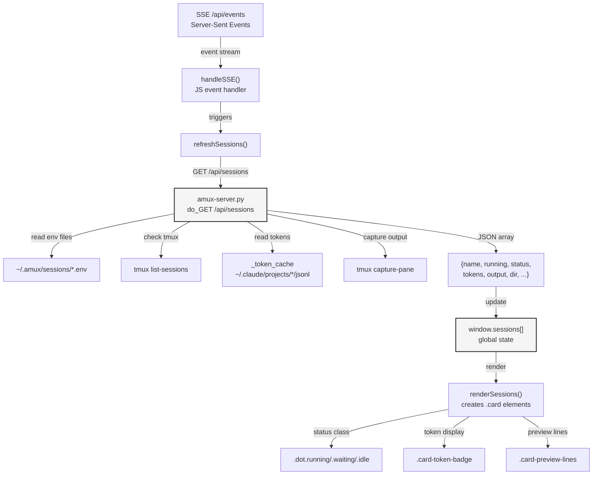
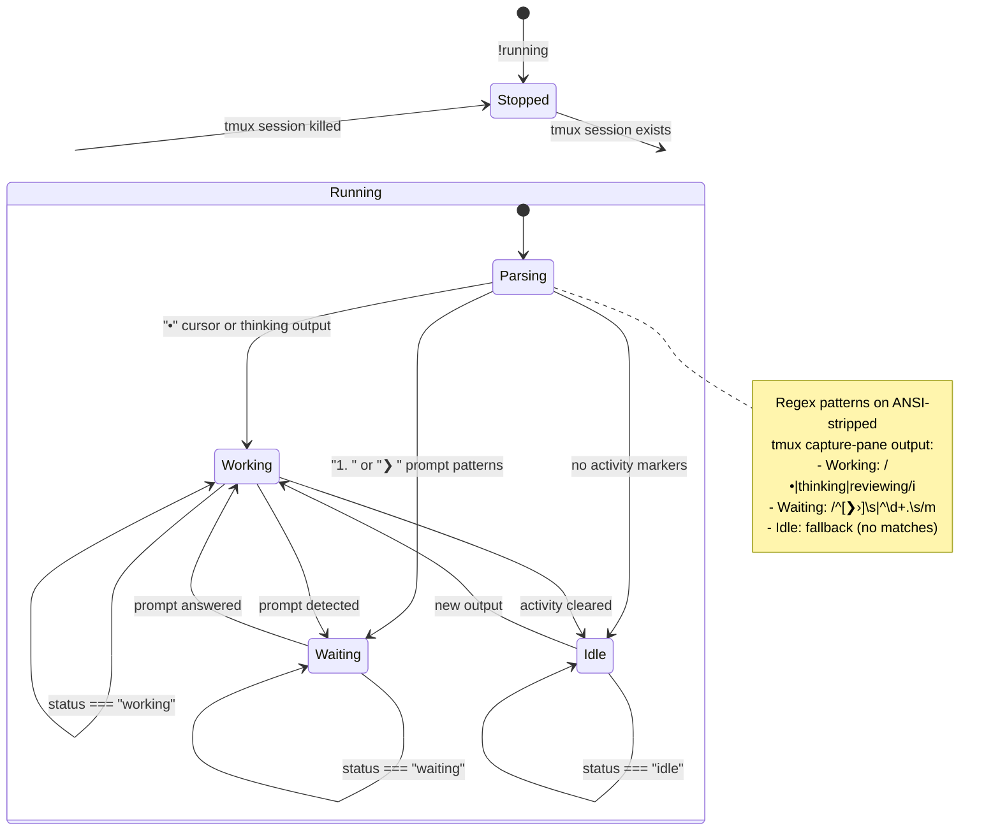
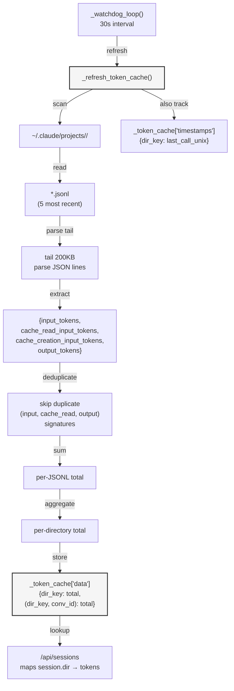
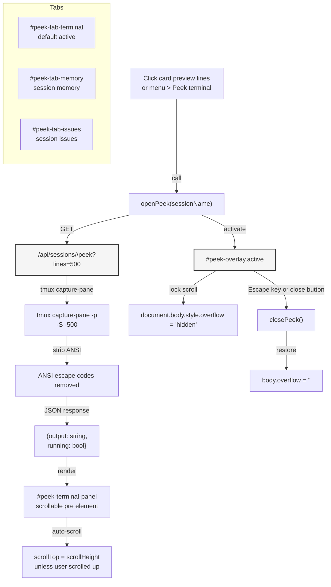
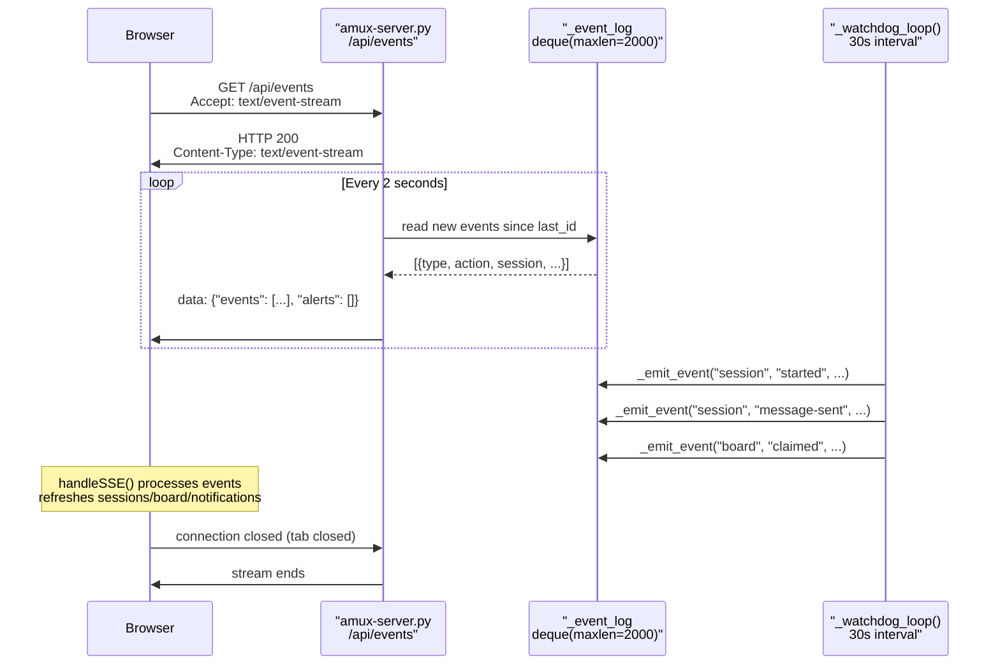

<!-- source: DeepWiki mcp.deepwiki.com · repo mixpeek/amux · page 6.1 Session Monitoring · fetched 2026-10-26 -->

# Session Monitoring

Relevant source files

The following files were used as context for generating this wiki page:

- [README.md](README.md)
- [amux-server.py](amux-server.py)
- [cloud/gateway/gateway.py](cloud/gateway/gateway.py)
- [test.mjs](test.mjs)

This page documents the web dashboard's session monitoring features: how sessions are displayed, how their status is detected and visualized, token tracking mechanisms, and the peek overlay for viewing terminal output in real-time.

For managing sessions via CLI commands, see [Session Commands](#7.1). For the REST API that powers these views, see [Session Endpoints](#5.1). For the self-healing watchdog that monitors sessions automatically, see [Self-Healing Watchdog](#2.4).

---

## Purpose and Scope

Session monitoring provides visual, real-time oversight of all running Claude Code agents. The dashboard displays each session as a card showing its current status, token usage, and recent output. Users can expand cards for detailed information, open a peek overlay to view full terminal output, and monitor multiple sessions simultaneously without attaching to tmux.

The monitoring system is read-only by default—it observes sessions without interfering. Actions like sending messages or stopping sessions are available through card menus but are separate from the monitoring display itself.

---

## Session Card Architecture

### Card Rendering Pipeline

**Session Card Data Flow**

Sessions are fetched from `/api/sessions` which returns an array of session objects. Each session combines data from multiple sources: `.env` configuration files, tmux session state, Claude JSONL logs for token counts, and captured terminal output.

**Sources:** [amux-server.py:786-883](), [amux-server.py:945-966]()

---

### Session Object Schema

Each session object returned by `/api/sessions` contains:

| Field | Type | Description |
|-------|------|-------------|
| `name` | string | Session identifier (tmux session name without prefix) |
| `running` | boolean | Whether tmux session exists |
| `status` | string | Current state: `"working"`, `"waiting"`, `"idle"`, `"stopped"` |
| `dir` | string | Working directory path |
| `model` | string | Claude model name (e.g. `"sonnet"`, `"opus"`) |
| `tokens` | number | Total tokens used (cached + non-cached, input + output) |
| `output` | string | Recent terminal output (last 30 lines, ANSI-stripped) |
| `flags` | string | Claude Code launch flags |
| `last_active` | number | Unix timestamp of last API call |
| `uuid` | string | Persistent session UUID |
| `cc_conversation_id` | string | Claude conversation ID for exact token attribution |

**Sources:** [amux-server.py:2183-2354]()

---

### Status Detection Logic

**Status Classification**

Status is determined by parsing the last 30 lines of terminal output captured from tmux. The server strips ANSI escape codes and applies regex patterns:

- **Working**: Output contains `•` (thinking indicator), `thinking`, `reviewing`, or other activity markers
- **Waiting**: Output ends with numbered prompts (`1. Yes`, `2. No`) or shell-style prompts (`❯ `, `› `)
- **Idle**: Session is running but shows no activity markers
- **Stopped**: tmux session doesn't exist

**Sources:** [amux-server.py:2183-2354](), [amux-server.py:957-966]()

---

## Token Tracking System

### Token Cache Architecture

**Token Aggregation Strategy**

Token counts are extracted from Claude's JSONL conversation logs stored in `~/.claude/projects/`. The system:

1. **Scans project directories**: Only directories used by registered sessions are scanned (optimization)
2. **Reads JSONL tails**: Reads the last 200KB of up to 5 most recent JSONL files per directory
3. **Deduplicates usage entries**: Claude writes duplicate usage objects; the cache tracks `(input_tokens, cache_read_input_tokens, output_tokens)` signatures to skip duplicates
4. **Aggregates by conversation**: When a session has a `cc_conversation_id`, it gets an exact per-conversation count
5. **Falls back to directory totals**: Sessions without conversation IDs get the sum of all JSONL files in their directory

The cache refreshes every 120 seconds to avoid excessive disk I/O.

**Sources:** [amux-server.py:786-883]()

---

### Token Display Components

| Display Location | Value Shown | Format |
|------------------|-------------|--------|
| Card badge | Total tokens (all types) | Abbreviated (e.g. `142K`, `2.3M`) |
| Card expanded details | Daily spend | Per-session, resets midnight UTC |
| Peek overlay header | Real-time total | Updated on every refresh |
| Board card (session view) | Session total | Inline on board cards when grouped by session |

**Abbreviation Rules**:
- < 1,000: show full number (`847`)
- 1K - 999K: show `K` suffix (`12.3K`)
- ≥ 1M: show `M` suffix (`1.2M`)

**Sources:** [amux-server.py:2183-2354]()

---

## Peek Mode

### Peek Overlay Architecture

**Peek Interaction Flow**

The peek overlay is a full-screen drawer (desktop) or full-page view (mobile) that displays a session's terminal output without attaching to tmux. It refreshes every 3 seconds while open, automatically scrolling to the bottom unless the user has scrolled up manually.

**Sources:** [amux-server.py:957-966](), [test.mjs:408-520]()

---

### Peek Tabs

The peek overlay contains four tabs:

#### Terminal Tab (Default)

Displays the last 500 lines of terminal output in a scrollable `<pre>` element. Output is ANSI-stripped and rendered as plain text. The terminal panel includes:

- **Auto-scroll**: Automatically scrolls to bottom on new output unless user has scrolled up
- **Search**: Browser native Ctrl+F works on the text content
- **Send input**: Text input at bottom sends messages via `/api/sessions/<name>/send`

**Sources:** [amux-server.py:2183-2354]()

#### Memory Tab

Shows per-session memory content loaded from `~/.amux/memory/<name>.md`. Provides a textarea for editing and a save button that POSTs to `/api/sessions/<name>/memory`.

Sub-tabs:
- **Session**: Per-session memory file
- **Global**: Shared `~/.amux/memory/global.md` visible to all sessions

**Sources:** [amux-server.py:2183-2354]()

#### Issues Tab

Displays issues from the board filtered by `session === currentSessionName`. Shows:
- Issue count badge
- List of issues with status, title, due date
- "New issue" button that pre-fills the session field

This tab replaces the deprecated "Tasks" tab and uses the same board database as the Board view.

**Sources:** [test.mjs:484-496]()

---

### Peek API Endpoints

| Endpoint | Method | Purpose |
|----------|--------|---------|
| `/api/sessions/<name>/peek?lines=N` | GET | Fetch last N lines of terminal output |
| `/api/sessions/<name>/send` | POST | Send text to session (injected via tmux) |
| `/api/sessions/<name>/memory` | GET | Load session memory markdown |
| `/api/sessions/<name>/memory` | POST | Save session memory markdown |
| `/api/memory/global` | GET | Load global memory markdown |
| `/api/memory/global` | POST | Save global memory markdown |

**Sources:** [amux-server.py:2183-2354]()

---

## Real-Time Updates

### SSE Event Stream

**Event-Driven UI Updates**

The dashboard subscribes to `/api/events`, a Server-Sent Events (SSE) stream that pushes structured events as they occur. The client-side `handleSSE()` function processes events and triggers targeted refreshes:

- **Session events** (`started`, `stopped`, `message-sent`): Refresh session list
- **Board events** (`created`, `updated`, `claimed`): Refresh board view
- **System events** (`pull`, `compact`): Show notification banner

Events are stored in an in-memory ring buffer (`_event_log`, max 2000 events) and streamed to all connected clients every 2 seconds.

**Sources:** [amux-server.py:104-187](), [amux-server.py:2183-2354]()

---

### Session Refresh Cadence

| Trigger | Frequency | What Refreshes |
|---------|-----------|----------------|
| SSE event | 2s polling | Targeted (sessions, board, or alerts) |
| Manual action | Immediate | Single session or board item |
| Peek overlay | 3s polling | Terminal output only (while peek is open) |
| Watchdog loop | 30s | Token cache, status detection, health checks |

**Optimization Notes**:
- Session list API includes a cache with 2s TTL to avoid redundant subprocess calls when multiple tabs are open
- Token cache refreshes every 120s (not every request) to minimize JSONL file reads
- Peek overlay uses a separate, faster polling interval (3s) only while the overlay is active

**Sources:** [amux-server.py:98-103](), [amux-server.py:786-883]()

---

## Mobile Considerations

### Session Card Layout

On mobile viewports (< 768px), session cards adapt:

- **Full-width stacking**: Cards take 100% width, no grid layout
- **Tap to expand**: Single tap expands card (no double-tap-to-peek gesture)
- **Simplified badges**: Token counts abbreviated more aggressively
- **Bottom sheet peek**: Peek overlay slides up from bottom instead of side drawer

**Sources:** [test.mjs:526-638]()

---

### Tab Bar Persistence

The tab bar remains sticky at the bottom on mobile (CSS `position: sticky; bottom: 0`). This ensures users can always switch between Sessions, Board, Calendar, and Workspace views without scrolling back to the top.

**Sources:** [test.mjs:536-549]()

---

## Status Indicators

### Status Dot Classes

| Class | Color | Meaning |
|-------|-------|---------|
| `.dot.running` | Green | Session is running and actively working |
| `.dot.waiting` | Yellow | Session is waiting for user input (prompt detected) |
| `.dot.idle` | Gray | Session is running but idle (no recent activity) |
| `.dot` (no modifier) | Gray | Session is stopped |

The status dot appears in the top-left corner of each session card and updates in real-time via SSE events.

**Sources:** [test.mjs:158-159]()

---

## Session Card Interactions

### Expand/Collapse

Clicking the outer `.card` element (not the `.card-header`) toggles the `expanded` class, revealing:

- **Full directory path**
- **Model name and flags**
- **Token usage (daily and total)**
- **UUID and last activity timestamp**
- **Quick action buttons** (Peek, Stop, Attach, Archive)

**Sources:** [test.mjs:163-170]()

---

### Preview Lines

Expanded cards show `.card-preview-lines`, a truncated view of the last 10 lines of terminal output. Clicking the preview lines opens the full peek overlay. This provides a glanceable status check without opening a full drawer.

**Sources:** [amux-server.py:2183-2354]()

---

## Performance Characteristics

### Token Cache Hit Rate

The token cache uses a 120-second TTL. For typical usage (checking the dashboard every 30-60 seconds), the cache hit rate is ~80-90%, avoiding repeated JSONL parsing.

### Session List Cache

The session list API uses a 2-second cache (`_sse_cache`) to deduplicate requests when multiple browser tabs are open. This prevents spawning dozens of `tmux list-sessions` subprocesses per second.

**Sources:** [amux-server.py:98-103](), [amux-server.py:786-883]()

---

## Error States

### Offline Session Detection

If a session's tmux process exits unexpectedly, the dashboard shows `running: false` with a gray dot. The session card remains visible (the `.env` file persists), and users can restart it via the "Start" button.

### Token Calculation Failures

If Claude's JSONL files are corrupted or missing, the token count shows `0` instead of failing. The token cache silently catches `json.JSONDecodeError` and skips malformed lines.

**Sources:** [amux-server.py:786-883]()

---

## Integration with Watchdog

The session monitoring UI displays the output of the self-healing watchdog (see [Self-Healing Watchdog](#2.4)):

- **Auto-compact notifications**: When context drops below 20%, the watchdog sends `/compact` and emits an event
- **Auto-restart indicators**: When corruption is detected, the session is restarted and marked with a `restarted` event
- **YOLO auto-responses**: When a YOLO session hits a safety prompt, the watchdog auto-answers and logs the action

These events appear in the SSE stream and trigger notification banners in the UI.

**Sources:** [amux-server.py:1019-1078]()

---

