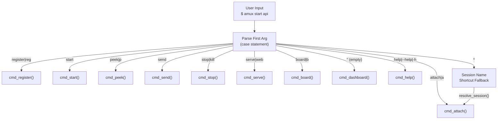
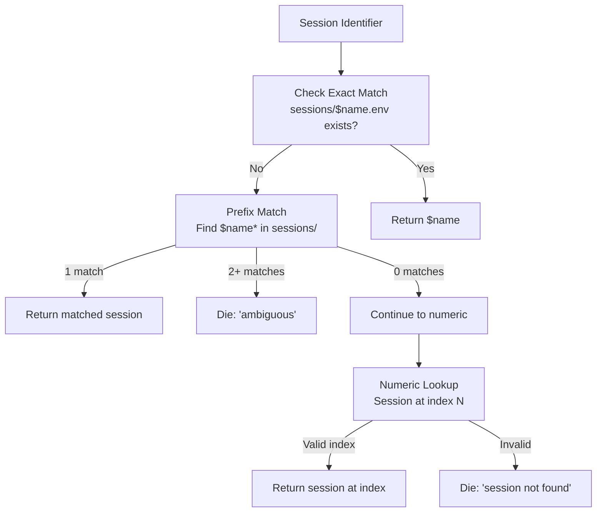
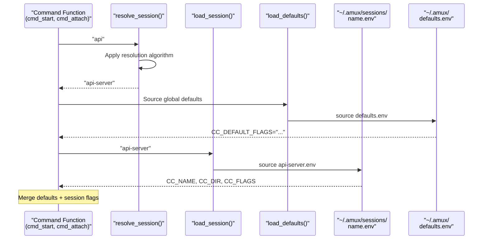
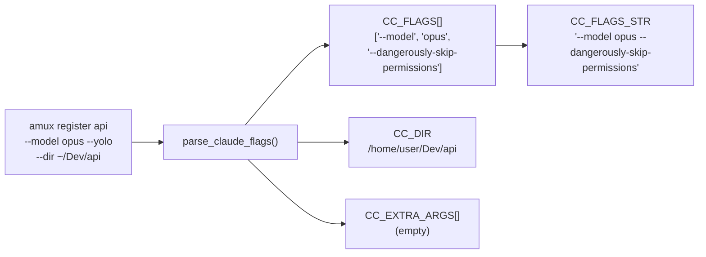
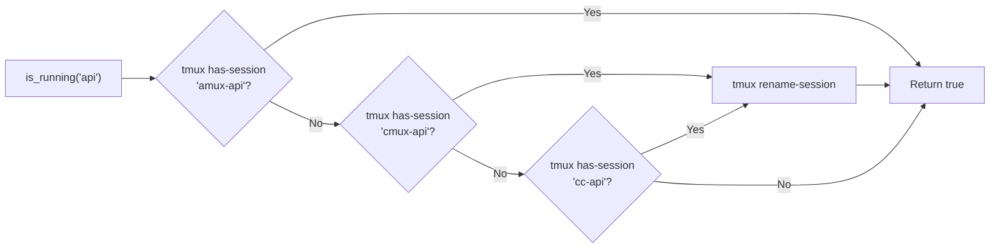
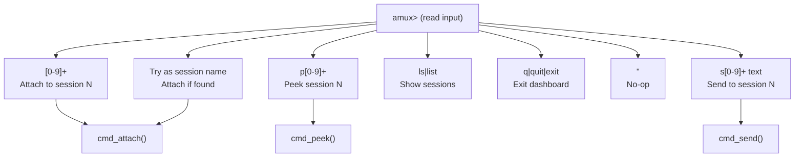
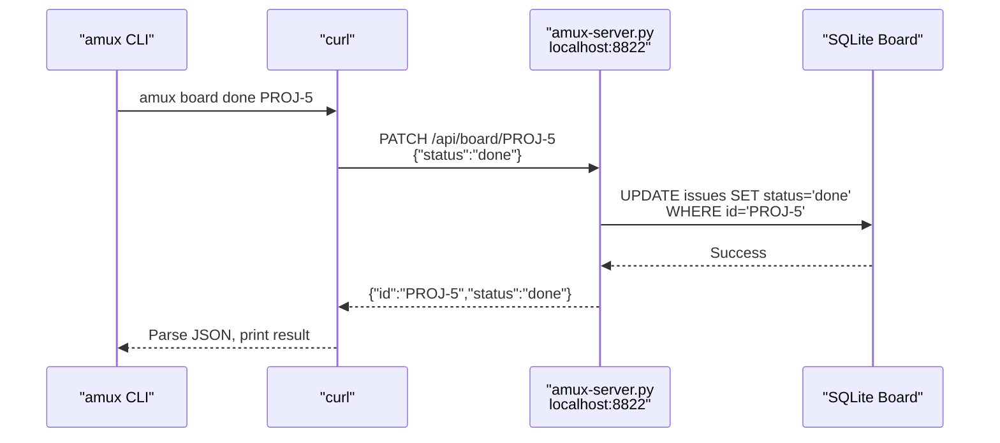
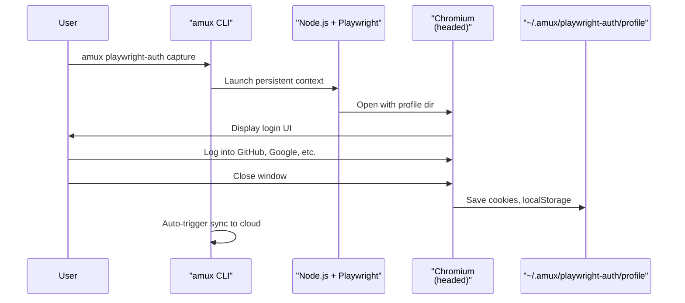

<!-- source: DeepWiki mcp.deepwiki.com · repo mixpeek/amux · page 7 CLI Reference · fetched 2026-10-26 -->

# CLI Reference

<details>
<summary>Relevant source files</summary>

The following files were used as context for generating this wiki page:

- [README.md](README.md)
- [amux](amux)
- [cloud/setup.sh](cloud/setup.sh)

</details>


The amux CLI is a bash-based command-line interface for managing Claude Code sessions. It provides session registration, lifecycle management, interaction, and integration with the web dashboard. The CLI wraps tmux sessions and stores persistent configuration in `~/.amux/sessions/` as shell environment files.

For detailed information about individual session commands, see [Session Commands](#7.1). For board-specific CLI operations, see [Board Commands](#7.2). For REST API access patterns, see [REST API Reference](#5).

---

## Installation and Setup

The amux CLI is a single bash script located at [amux:1-753](). Installation occurs via `install.sh`, which copies the script to `/usr/local/bin/amux` and creates a `cc` alias for backwards compatibility.

### Directory Structure

```
~/.amux/
├── sessions/           # Session configs (*.env files)
│   ├── api.env
│   ├── frontend.env
│   └── worker-1.env
├── defaults.env        # Global default flags
├── tls/               # TLS certificates (if using serve)
├── logs/              # Server logs
├── memory/            # Global memory store
└── playwright-auth/   # Browser auth profiles
    └── profile/
```

The CLI creates this structure automatically on first run via [amux:42-45]().

### Legacy Migration

The CLI automatically migrates from legacy directory names (`~/.cmux` or `~/.cc`) to `~/.amux` on first invocation [amux:10-19]().

**Sources:** [amux:1-45]()

---

## Command Architecture

### Command Dispatch Mechanism

The CLI uses a case-based dispatch system that maps command names to handler functions. The main dispatch logic is at [amux:724-752]().



**Diagram: Command Dispatch Flow**

Each command has one or more aliases. For example, `attach` can be invoked as `amux attach` or `amux a` [amux:728](). Commands that take session names as arguments call `resolve_session()` to handle fuzzy matching.

**Sources:** [amux:724-752]()

---

## Session Name Resolution

The CLI supports three methods for identifying sessions:

### Resolution Algorithm



**Diagram: Session Name Resolution Flow**

Implementation details:

1. **Exact Match** [amux:51-54](): Checks if `~/.amux/sessions/$name.env` exists
2. **Prefix Match** [amux:55-70](): Loops through `*.env` files, collecting names that start with the query
3. **Numeric Lookup** [amux:72-82](): If input is a number, returns the Nth session (1-indexed)

### Example Resolution Patterns

| Input | Matches | Result |
|-------|---------|--------|
| `api` | `api.env` | Exact match → `api` |
| `ap` | `api.env`, `api-server.env` | Ambiguous error |
| `api-s` | `api-server.env` | Prefix match → `api-server` |
| `3` | 3rd session in `ls` output | Numeric → session name |

**Sources:** [amux:47-84]()

---

## Configuration System

### Session Configuration Files

Each registered session has a corresponding `.env` file in `~/.amux/sessions/`. These files are sourced as bash scripts when commands load session context.

**Session File Format** [amux:176-182]():

```bash
# amux session: api-server
# registered: 2024-03-15T10:30:00Z
CC_NAME="api-server"
CC_DIR="/home/user/projects/api"
CC_FLAGS="--model opus --dangerously-skip-permissions"
```

### Configuration Loading Flow



**Diagram: Configuration Loading Sequence**

The loading order ensures session-specific flags override global defaults:

1. [amux:96-98]() - Load global defaults from `~/.amux/defaults.env`
2. [amux:87-93]() - Load session config from `~/.amux/sessions/$name.env`
3. [amux:213-223]() - Merge flags: defaults → session → inline args

**Sources:** [amux:87-98](), [amux:213-223]()

---

## Claude Code Flag Parsing

The CLI parses Claude Code flags to support `register` and `exec` commands. The parser splits arguments into flags for Claude, a working directory, and extra arguments.

### Flag Parser Implementation

Located at [amux:123-164](), the `parse_claude_flags()` function categorizes flags into:

- **Value flags** (take an argument): `--model`, `--permission-mode`, `--mcp-config`, etc. [amux:130-138]()
- **Boolean flags**: `--yolo`, `--verbose`, `--chrome`, etc. [amux:139-150]()
- **Working directory**: `--dir` resolved to absolute path [amux:151-155]()
- **Extra args**: Everything else passed to `CC_EXTRA_ARGS` [amux:156-162]()

The `--yolo` flag is automatically converted to `--dangerously-skip-permissions` [amux:144-147]().

**Flag Parser Data Flow:**



**Diagram: Claude Code Flag Parsing**

**Sources:** [amux:123-164]()

---

## tmux Integration

### Session Naming Convention

The CLI prefixes all tmux sessions with `amux-` to avoid conflicts with user sessions [amux:101](). For example, a session named `api` creates a tmux session `amux-api`.

### Legacy Session Migration

The CLI automatically renames old `cmux-*` and `cc-*` sessions to `amux-*` on first access [amux:104-113]():



**Diagram: Legacy tmux Session Migration**

### Session Lifecycle Operations

| Operation | tmux Command | Location |
|-----------|--------------|----------|
| Create | `tmux new-session -d -s amux-$name` | [amux:227]() |
| Attach | `tmux attach-session -t amux-$name` | [amux:265]() |
| Check running | `tmux has-session -t amux-$name` | [amux:118]() |
| Capture output | `tmux capture-pane -t amux-$name -p` | [amux:279]() |
| Send text | `tmux send-keys -t amux-$name "$text" Enter` | [amux:301]() |
| Send keys | `tmux send-keys -t amux-$name C-c` | [amux:296]() |
| Kill | `tmux kill-session -t amux-$name` | [amux:314]() |

**Window Name Locking:** After creating a session, the CLI disables automatic renaming to prevent Claude Code from changing the window title via ANSI escape sequences [amux:229-230]().

**Sources:** [amux:101-319]()

---

## Color and Terminal Detection

The CLI uses ANSI color codes for output but automatically disables them when output is not a TTY or when `TERM=dumb` [amux:25-32]():

```bash
if [[ -t 1 ]] && [[ "${TERM:-dumb}" != "dumb" ]]; then
  BOLD=$'\033[1m' DIM=$'\033[2m' RESET=$'\033[0m'
  RED=$'\033[31m' GREEN=$'\033[32m' YELLOW=$'\033[33m'
  # ...
else
  BOLD='' DIM='' RESET='' RED='' GREEN='' YELLOW=''
fi
```

This ensures clean output for:
- CI/CD pipelines
- Log files
- Non-interactive shells
- Text-only terminals

**Sources:** [amux:25-32]()

---

## Dashboard Mode

When invoked without arguments, the CLI enters an interactive dashboard mode optimized for phone access [amux:396-456]().

### Dashboard Command Language



**Diagram: Dashboard Command Dispatch**

**Interactive Commands:**

| Input | Action | Implementation |
|-------|--------|----------------|
| `3` | Attach to session #3 | [amux:439-441]() |
| `p2` | Peek session #2 | [amux:416-419]() |
| `s1 fix bug` | Send "fix bug" to session #1 | [amux:421-437]() |
| `api` | Attach to session named "api" | [amux:447-452]() |
| `ls` | Re-display session list | [amux:413-415]() |
| `q` | Exit dashboard | [amux:410-412]() |

**Sources:** [amux:396-456]()

---

## Integration with amux-server.py

### Serve Command

The `serve` command launches the web dashboard by executing `amux-server.py` [amux:635-646]():

```bash
cmd_serve() {
  local port="${1:-8822}"
  local script_dir="$(cd "$(dirname "$0")" && pwd)"
  local server="$script_dir/amux-server.py"
  [[ -f "$server" ]] || die "amux-server.py not found"
  exec python3 "$server" "$port"
}
```

The script resolves `amux-server.py` relative to the CLI's installation location, allowing both development and installed configurations to work.

### Board Commands

Board commands at [amux:572-633]() make HTTP requests to the local amux-server API:



**Diagram: Board Command API Flow**

Board operations require `$AMUX_API` environment variable (default: `https://localhost:8822`) [amux:573]().

**Sources:** [amux:572-646]()

---

## Playwright Authentication Commands

The CLI includes commands for capturing browser authentication sessions for use with the Playwright MCP server [amux:504-570]().

### Auth Capture Flow



**Diagram: Playwright Auth Capture**

The capture command uses a persistent browser context [amux:527-536]() that saves:
- Cookies
- localStorage/sessionStorage
- Service worker registrations
- IndexedDB data

This profile is then synced to the cloud VM via `gcloud compute scp` [amux:544-562]() for use by cloud-hosted agents.

**Sources:** [amux:504-570]()

---

## Error Handling

The CLI uses a `die()` helper for fatal errors that prints to stderr and exits [amux:36]():

```bash
die() { echo "${RED}error:${RESET} $*" >&2; exit 1; }
```

Common error patterns:

- **Session not found** [amux:83](): `die "session '$query' not found"`
- **Ambiguous match** [amux:69](): `die "ambiguous: '$query' matches ${matches[*]}"`
- **Not running** [amux:264](): `die "session '$name' is not running"`
- **Missing dependencies** [amux:39](): `die "tmux is required"`

All errors use colored output (when available) and descriptive messages.

**Sources:** [amux:36](), [amux:39](), [amux:69](), [amux:83](), [amux:264]()

---

## Version and Migration

### Version Constant

The CLI version is stored as `CC_VERSION` at [amux:7]() and displayed via:
- `amux version` / `amux --version` / `amux -v` [amux:742]()
- Dashboard header [amux:400]()
- Help output [amux:650]()

### Environment Variable Names

Historical environment variable naming:

| Version | Variable Prefix | Directory |
|---------|----------------|-----------|
| Legacy (cmux) | `CC_*` | `~/.cmux` |
| Legacy (cc) | `CC_*` | `~/.cc` |
| Current (amux) | `CC_*` (kept for compatibility) | `~/.amux` |

The `CC_*` prefix is retained for backwards compatibility even though the tool is now named `amux`.

**Sources:** [amux:7](), [amux:10-23]()

---

