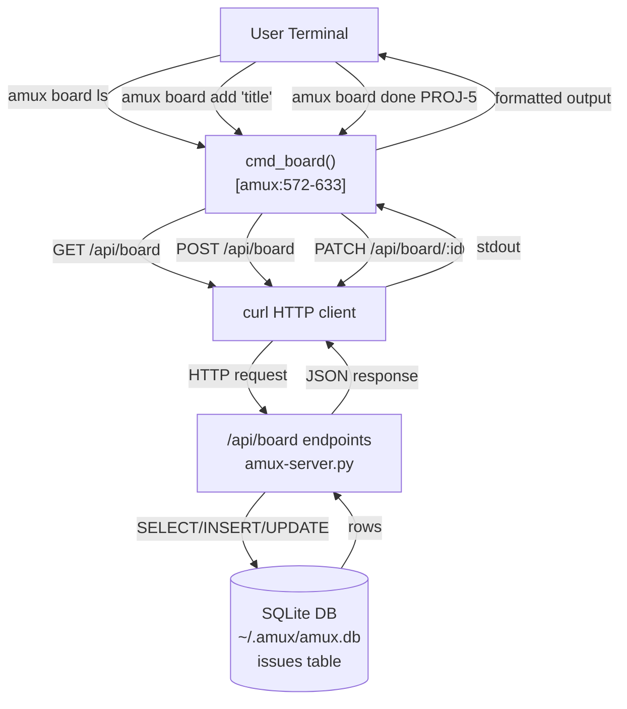
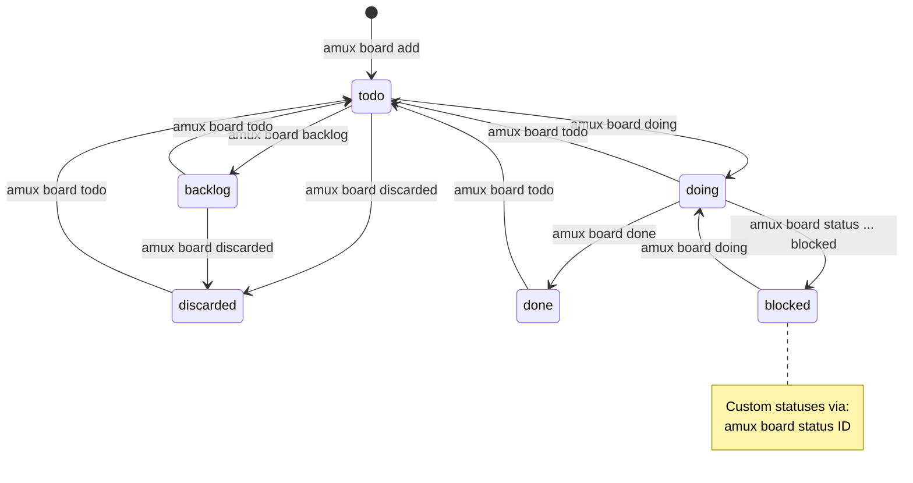

<!-- source: DeepWiki mcp.deepwiki.com · repo mixpeek/amux · page 7.2 Board Commands · fetched 2026-10-26 -->

# Board Commands

<details>
<summary>Relevant source files</summary>

The following files were used as context for generating this wiki page:

- [README.md](README.md)
- [amux](amux)
- [cloud/setup.sh](cloud/setup.sh)

</details>


## Purpose and Scope

This document covers the CLI commands for managing board issues from the command line. The board commands provide a terminal interface to the SQLite-backed Kanban board system, enabling quick task creation, status updates, and issue listing without opening the web dashboard.

For details about the underlying board system architecture and database schema, see [Board System](#2.2). For the HTTP API endpoints these commands invoke, see [Board Endpoints](#5.2). For the web-based board interface, see [Board Interface](#6.2).

---

## Overview

Board commands are invoked via `amux board <subcommand>`. All commands communicate with the amux server via HTTP REST API calls to `$AMUX_API/api/board` endpoints. The default API URL is `https://localhost:8822`, which can be overridden by setting the `AMUX_API` environment variable.

**Command Categories:**

| Category | Commands | Purpose |
|----------|----------|---------|
| **Viewing** | `ls`, `list` | Display all board issues with status indicators |
| **Creation** | `add`, `create` | Create new issues with automatic ID generation |
| **Status Updates** | `done`, `doing`, `todo`, `backlog`, `discarded` | Quick status transitions |
| **Custom Status** | `status` | Set any arbitrary status value |

**Sources:** [amux:572-633]()

---

## Command Architecture

The following diagram illustrates how board CLI commands translate to HTTP API calls:



**Sources:** [amux:572-633]()

---

## Command Reference

### List Issues

```bash
amux board ls
amux board list
```

Fetches all board issues and displays them sorted by most recently updated, with status symbols for quick visual scanning.

**HTTP Call:** `GET $AMUX_API/api/board`

**Output Format:**
```
✓ PROJ-15      Implement login endpoint [done]
▶ PROJ-12      Add unit tests [doing]
○ PROJ-8       Refactor database layer [todo]
· PROJ-3       Performance optimization [backlog]
✗ PROJ-1       Old approach [discarded]
```

**Status Symbols:**
- `✓` = done
- `▶` = doing (in progress)
- `○` = todo
- `·` = backlog
- `✗` = discarded
- `?` = unknown/custom status

**Implementation:** The command uses Python inline processing to parse JSON and format output with status symbols.

**Sources:** [amux:610-618]()

---

### Create Issues

```bash
amux board add <title>
amux board create <title>
```

Creates a new board issue with status `todo`. The server automatically generates a unique ID using the configured key format (default: `PROJ-N` where N is auto-incremented).

**HTTP Call:** `POST $AMUX_API/api/board` with JSON body:
```json
{
  "title": "<title>",
  "status": "todo"
}
```

**Example:**
```bash
$ amux board add Implement authentication middleware
Created PROJ-23 → Implement authentication middleware
```

**Sources:** [amux:601-609]()

---

### Quick Status Transitions

```bash
amux board done <issue-id>
amux board doing <issue-id>
amux board todo <issue-id>
amux board backlog <issue-id>
amux board discarded <issue-id>
```

Moves an issue to the specified status with a single command. These are convenience shortcuts for the most common status transitions.

**HTTP Call:** `PATCH $AMUX_API/api/board/<issue-id>` with JSON body:
```json
{
  "status": "<status>"
}
```

**Example:**
```bash
$ amux board doing PROJ-23
PROJ-23 → doing

$ amux board done PROJ-23
PROJ-23 → done
```

**Sources:** [amux:577-590]()

---

### Custom Status

```bash
amux board status <issue-id> <custom-status>
```

Sets an arbitrary status value not covered by the quick transition commands. Useful for custom workflow stages like `reviewing`, `testing`, `blocked`, etc.

**HTTP Call:** `PATCH $AMUX_API/api/board/<issue-id>` with JSON body:
```json
{
  "status": "<custom-status>"
}
```

**Example:**
```bash
$ amux board status PROJ-23 reviewing
PROJ-23 → reviewing
```

**Sources:** [amux:591-600]()

---

## Status Workflow

The following diagram shows common status transitions and which commands trigger them:



**Atomic Operations:** All status updates use SQL `UPDATE` statements executed through the REST API, ensuring atomic transitions even with concurrent agent access.

**Sources:** [amux:577-600]()

---

## Implementation Details

### API Communication

The board commands are thin wrappers around `curl` invocations. The implementation pattern at [amux:572-633]() follows this structure:

1. **API URL Resolution:** `AMUX_API="${AMUX_API:-https://localhost:8822}"`
2. **Subcommand Dispatch:** Case statement routes to appropriate handler
3. **HTTP Invocation:** `curl -sk -X <METHOD> -H 'Content-Type: application/json' -d '<json>' "$AMUX_API/api/board..."`
4. **Response Processing:** Python one-liner parses JSON and formats output
5. **Error Handling:** Fallback to raw output if JSON parsing fails

### Certificate Trust

The `-k` flag in `curl` commands (`-sk`) disables certificate verification. This is intentional for local development where amux uses self-signed certificates (Tailscale cert → mkcert → self-signed fallback). For production deployments with proper TLS, remove the `-k` flag.

### Python JSON Parsing

All commands use inline Python scripts for JSON parsing:

```python
python3 -c "import sys,json; d=json.load(sys.stdin); print(d['id'],'→',d['status'])"
```

This avoids dependencies on `jq` or other JSON tools, maintaining the "Python 3 + tmux only" constraint.

**Sources:** [amux:572-633]()

---

## Integration with Agent Workflows

Board commands enable CLI-driven agent orchestration workflows. Agents can use these commands in system prompts or via shell execution to coordinate work:

### Agent Task Discovery Pattern

```bash
# Agent script discovers available work
amux board ls | grep '○' | head -1 | awk '{print $2}'
# Output: PROJ-8

# Claim and start work
amux board doing PROJ-8
```

### Multi-Agent Coordination

```bash
# Agent 1: Creates tasks for team
amux board add "Implement user service"
amux board add "Write integration tests"
amux board add "Update API docs"

# Agent 2: Claims a task
TASK=$(amux board ls | grep '○' | head -1 | awk '{print $2}')
amux board doing $TASK

# Agent 2: Completes work
amux board done $TASK
```

For atomic claiming with race condition prevention, use the REST API's `POST /api/board/:id/claim` endpoint instead, as documented in [Board Endpoints](#5.2).

**Sources:** [amux:572-633]()

---

## Environment Variables

| Variable | Default | Purpose |
|----------|---------|---------|
| `AMUX_API` | `https://localhost:8822` | Base URL for amux server API |

**Example with Remote Server:**
```bash
export AMUX_API=https://amux-cloud.example.com:8822
amux board ls
```

**Sources:** [amux:573]()

---

## Error Handling

Board commands use two-stage error handling:

1. **Primary:** Attempt to parse JSON response with Python
2. **Fallback:** If parsing fails, output raw response

This ensures the user always sees feedback, even if the server returns an error message or malformed JSON.

**Example Error Scenarios:**

```bash
# Issue not found
$ amux board done PROJ-999
{"error": "Issue not found: PROJ-999"}

# Server unreachable
$ AMUX_API=https://invalid:8822 amux board ls
curl: (6) Could not resolve host: invalid
```

**Sources:** [amux:585-589](), [amux:599](), [amux:608]()

---

## Session Name Resolution

Unlike session commands (`amux start`, `amux attach`), board commands do **not** support fuzzy matching or prefix resolution. Issue IDs must be specified exactly as generated by the server.

**Correct:**
```bash
amux board done PROJ-23
```

**Incorrect:**
```bash
amux board done 23        # Won't work
amux board done proj-23   # Case-sensitive, won't work
```

**Sources:** [amux:579](), [amux:592]()

---

## Examples

### Daily Workflow

```bash
# Morning: Review pending work
amux board ls

# Claim a task
amux board doing PROJ-15

# Work on it...
amux send api-dev "implement the /login endpoint per PROJ-15"

# Mark complete
amux board done PROJ-15

# Create follow-up task
amux board add "Add rate limiting to /login"
```

### Bulk Status Update

```bash
# Move all backlog items to todo
amux board ls | grep '·' | awk '{print $2}' | while read id; do
  amux board todo "$id"
done
```

### Custom Workflow with Review Stage

```bash
# Create task
amux board add "Refactor payment processor"  # → PROJ-30

# Start work
amux board doing PROJ-30

# Complete implementation
amux board status PROJ-30 reviewing

# After review approval
amux board done PROJ-30
```

### Integration with Session Send

```bash
# Create task and delegate to agent
ID=$(amux board add "Write E2E tests for checkout" | grep -o 'PROJ-[0-9]*')
amux board doing "$ID"
amux send test-agent "complete task $ID"
```

**Sources:** [amux:572-633]()

---

