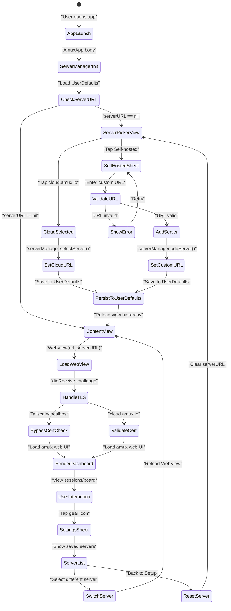
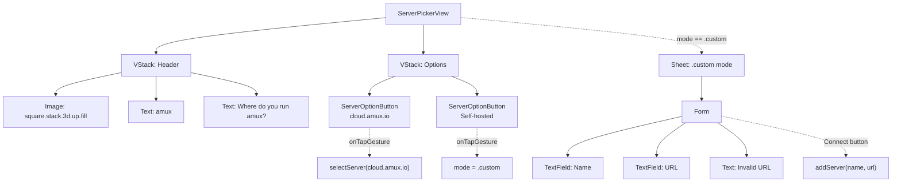
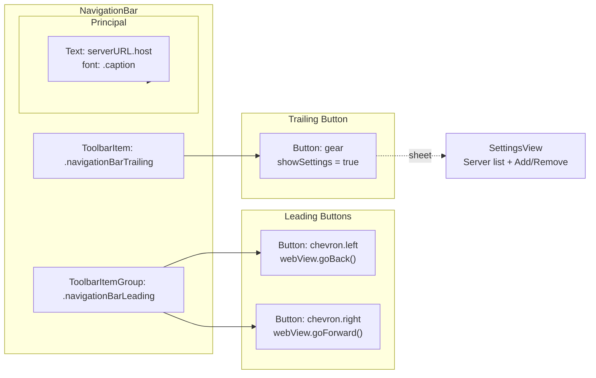
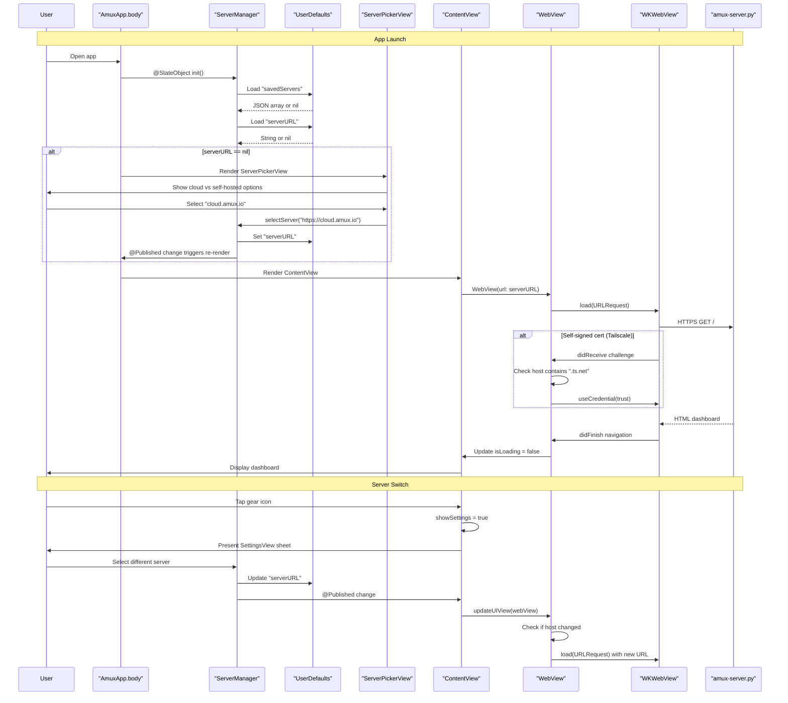

<!-- source: DeepWiki mcp.deepwiki.com · repo mixpeek/amux · page 9 iOS App · fetched 2026-10-26 -->

# iOS App

<details>
<summary>Relevant source files</summary>

The following files were used as context for generating this wiki page:

- [.github/workflows/ios.yml](.github/workflows/ios.yml)
- [ios/.ruby-version](ios/.ruby-version)
- [ios/AmuxApp/AmuxApp.entitlements](ios/AmuxApp/AmuxApp.entitlements)
- [ios/AmuxApp/Assets.xcassets/AppIcon.appiconset/Contents.json](ios/AmuxApp/Assets.xcassets/AppIcon.appiconset/Contents.json)
- [ios/AmuxApp/Assets.xcassets/Contents.json](ios/AmuxApp/Assets.xcassets/Contents.json)
- [ios/AmuxApp/Info.plist](ios/AmuxApp/Info.plist)
- [ios/AmuxApp/Sources/AmuxApp.swift](ios/AmuxApp/Sources/AmuxApp.swift)
- [ios/AmuxApp/Sources/ContentView.swift](ios/AmuxApp/Sources/ContentView.swift)
- [ios/AmuxApp/Sources/ServerManager.swift](ios/AmuxApp/Sources/ServerManager.swift)
- [ios/AmuxApp/Sources/ServerPickerView.swift](ios/AmuxApp/Sources/ServerPickerView.swift)
- [ios/AmuxApp/Sources/WebView.swift](ios/AmuxApp/Sources/WebView.swift)
- [ios/Gemfile.lock](ios/Gemfile.lock)
- [ios/fastlane/Matchfile](ios/fastlane/Matchfile)

</details>


The iOS app provides a native mobile interface to amux by wrapping the web dashboard in a WKWebView. It handles server configuration (cloud vs self-hosted), TLS certificate validation for Tailscale deployments, and navigation controls. The app is a thin client that displays the same web interface described in [Web Dashboard](#6).

For server-side deployment and multi-tenancy, see [Cloud Deployment](#4). For app deployment via TestFlight, see [iOS Deployment](#9.3).

---

## Overview

The iOS app is built with SwiftUI and consists of five main components:

| Component | File | Purpose |
|-----------|------|---------|
| `AmuxApp` | [ios/AmuxApp/Sources/AmuxApp.swift]() | App entry point, manages ServerManager lifecycle |
| `ServerManager` | [ios/AmuxApp/Sources/ServerManager.swift]() | ObservableObject that persists server configurations |
| `ServerPickerView` | [ios/AmuxApp/Sources/ServerPickerView.swift]() | Initial setup screen for selecting cloud vs self-hosted |
| `ContentView` | [ios/AmuxApp/Sources/ContentView.swift]() | Main view with WebView wrapper and navigation toolbar |
| `WebView` | [ios/AmuxApp/Sources/WebView.swift]() | UIViewRepresentable wrapper for WKWebView |

The app supports three deployment modes:
1. **Cloud** (`cloud.amux.io`) — Managed multi-tenant deployment with Clerk authentication
2. **Tailscale** — Self-hosted on a Mac accessible via Tailscale network (e.g. `https://amux.tail-xxxx.ts.net:8822`)
3. **Local Network** — Self-hosted on LAN (e.g. `https://192.168.1.10:8822`)

**Sources**: [ios/AmuxApp/Sources/AmuxApp.swift:1-18](), [ios/AmuxApp/Sources/ServerPickerView.swift:1-135]()

---

## Application Flow Diagram



**Sources**: [ios/AmuxApp/Sources/AmuxApp.swift:8-17](), [ios/AmuxApp/Sources/ServerPickerView.swift:12-100](), [ios/AmuxApp/Sources/ContentView.swift:12-64]()

---

## Server Configuration System

### ServerManager Class

`ServerManager` is an `ObservableObject` that manages server persistence using `UserDefaults`. It stores:

- **Active Server** (`serverURL: URL?`) — Currently selected server, persisted to key `"serverURL"`
- **Saved Servers** (`savedServers: [SavedServer]`) — List of configured servers, persisted to key `"savedServers"` as JSON

The class provides these operations:

| Method | Signature | Behavior |
|--------|-----------|----------|
| `init()` | `init()` | Loads `savedServers` from JSON; defaults to `[SavedServer(name: "cloud.amux.io", url: "https://cloud.amux.io")]` if none exist |
| `selectServer` | `func selectServer(_ urlString: String)` | Sets `serverURL` and persists to UserDefaults |
| `addServer` | `func addServer(name: String, urlString: String) -> Bool` | Validates URL starts with `"http"`, normalizes trailing slash, appends to `savedServers` |
| `removeServer` | `func removeServer(at offsets: IndexSet)` | Deletes servers from list |
| `resetServer` | `func resetServer()` | Clears `serverURL`, returns to setup screen |

**Sources**: [ios/AmuxApp/Sources/ServerManager.swift:1-67]()

### SavedServer Model

```swift
struct SavedServer: Codable, Identifiable {
    var id: String { url }
    let name: String
    let url: String
}
```

The `id` is derived from `url` to ensure uniqueness. When encoded to JSON, each server looks like:

```json
{
  "name": "Home Mac",
  "url": "https://amux.tail-abc123.ts.net:8822"
}
```

**Sources**: [ios/AmuxApp/Sources/ServerManager.swift:62-66]()

---

## Server Selection UI

### ServerPickerView

This view displays when `serverManager.serverURL == nil`. It presents two primary options:

1. **Cloud Option** — Immediately selects `https://cloud.amux.io` via `serverManager.selectServer()`
2. **Self-Hosted Option** — Opens a modal sheet with custom URL input

The sheet validates URLs using `serverManager.addServer()`, which rejects URLs that don't start with `"http"`. The default port `8822` is assumed but must be explicitly included in the URL.

**Sources**: [ios/AmuxApp/Sources/ServerPickerView.swift:12-101]()

### ServerPickerView Component Hierarchy



**Sources**: [ios/AmuxApp/Sources/ServerPickerView.swift:12-135]()

---

## WebView Implementation

### WKWebView Configuration

The `WebView` struct wraps `WKWebView` in a `UIViewRepresentable`. Key configurations in `makeUIView()`:

| Configuration | Value | Purpose |
|---------------|-------|---------|
| `allowsInlineMediaPlayback` | `true` | Enable video playback without fullscreen |
| `dataDetectorTypes` | `[]` | Disable phone/email auto-detection |
| `allowsBackForwardNavigationGestures` | `true` | Enable swipe navigation |
| `contentInsetAdjustmentBehavior` | `.automatic` | Respect safe areas |

A `UIRefreshControl` is attached to the scroll view for pull-to-refresh functionality.

**Sources**: [ios/AmuxApp/Sources/WebView.swift:15-35]()

### TLS Certificate Handling

The `Coordinator` class implements `WKNavigationDelegate.webView(_:didReceive:completionHandler:)` to handle TLS certificate challenges. This is required for self-hosted servers using self-signed certificates (generated by amux-server.py via Tailscale→mkcert→fallback chain).

Certificate bypass logic:

```swift
let host = challenge.protectionSpace.host
let isTailscale = host.contains(".ts.net") || host.hasSuffix(".local") || host == "localhost"
if isTailscale {
    completionHandler(.useCredential, URLCredential(trust: serverTrust))
} else {
    completionHandler(.performDefaultHandling, nil)
}
```

This **only** bypasses certificate validation for Tailscale (`.ts.net`), local (`.local`), and `localhost` hosts. Production `cloud.amux.io` uses standard certificate validation.

**Sources**: [ios/AmuxApp/Sources/WebView.swift:54-71]()

### Navigation Policy

The `decidePolicyFor navigationAction` delegate intercepts link taps. If the user taps a link that navigates away from the amux host (e.g., external documentation), it opens in Safari via `UIApplication.shared.open()` and cancels the WebView navigation:

```swift
if action.navigationType == .linkActivated && url.host != serverHost {
    UIApplication.shared.open(url)
    return .cancel
}
```

This prevents users from accidentally navigating away from the dashboard in the app.

**Sources**: [ios/AmuxApp/Sources/ContentView.swift:66-77]()

---

## ContentView Navigation

### Toolbar Structure



The back/forward buttons are disabled based on `canGoBack` and `canGoForward` bindings, which are updated by the `Coordinator` in `didFinish navigation`.

**Sources**: [ios/AmuxApp/Sources/ContentView.swift:34-58]()

### Settings Sheet

The settings sheet displays:

1. **Servers Section** — List of `savedServers` with checkmark on active server
2. **Add Server Button** — Opens `AddServerView` modal
3. **Back to Setup Button** — Calls `serverManager.resetServer()` (destructive style)

Tapping a server in the list calls `serverManager.selectServer()` and dismisses the sheet, which triggers a reload of the WebView in `ContentView` due to the `@Published` property change.

**Sources**: [ios/AmuxApp/Sources/ContentView.swift:82-143]()

---

## Data Flow Diagram



**Sources**: [ios/AmuxApp/Sources/AmuxApp.swift:8-17](), [ios/AmuxApp/Sources/ServerManager.swift:5-44](), [ios/AmuxApp/Sources/WebView.swift:37-42]()

---

## App Metadata & Permissions

The `Info.plist` configures app behavior and requested permissions:

| Key | Value | Purpose |
|-----|-------|---------|
| `CFBundleIdentifier` | `io.amux.app` | Unique app identifier for App Store |
| `ITSAppUsesNonExemptEncryption` | `false` | Exempt from export compliance (no custom crypto) |
| `NSFaceIDUsageDescription` | `"Used to protect access to your amux dashboard"` | Justification for biometric auth (unused in current version) |
| `UISupportedInterfaceOrientations` | `Portrait, PortraitUpsideDown` | iPhone locked to portrait |
| `UISupportedInterfaceOrientations~ipad` | `All orientations` | iPad supports landscape |

**Sources**: [ios/AmuxApp/Info.plist:1-43]()

---

## File Structure

```
ios/
├── AmuxApp/
│   ├── Sources/
│   │   ├── AmuxApp.swift              # @main entry point, ServerManager lifecycle
│   │   ├── ServerManager.swift        # ObservableObject for server config
│   │   ├── ServerPickerView.swift     # Initial setup UI
│   │   ├── ContentView.swift          # Main view with WebView + toolbar
│   │   └── WebView.swift              # WKWebView UIViewRepresentable wrapper
│   ├── Assets.xcassets/               # App icon and assets
│   ├── Info.plist                     # App metadata and permissions
│   └── AmuxApp.entitlements           # App capabilities (currently empty)
├── fastlane/
│   ├── Fastfile                       # Deployment automation (see §9.3)
│   └── Matchfile                      # Code signing configuration
├── Gemfile                            # Ruby dependencies (fastlane)
├── Gemfile.lock                       # Locked dependency versions
└── project.yml                        # XcodeGen project specification
```

**Sources**: [ios/AmuxApp/Sources/AmuxApp.swift:1](), [ios/AmuxApp/Sources/ServerManager.swift:1](), [ios/AmuxApp/Sources/ServerPickerView.swift:1](), [ios/AmuxApp/Sources/ContentView.swift:1](), [ios/AmuxApp/Sources/WebView.swift:1]()

---

