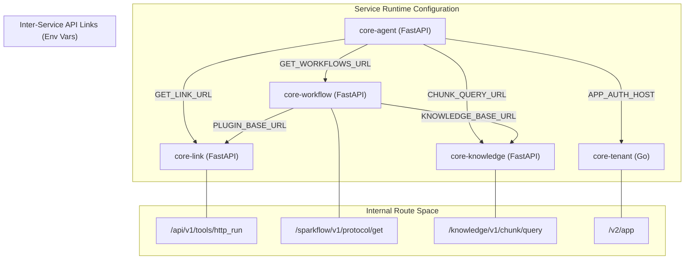

<!-- source: DeepWiki mcp.deepwiki.com · repo iflytek/astron-agent · page 1.1 System Architecture · fetched 2026-10-26 -->

# System Architecture

Relevant source files

The following files were used as context for generating this wiki page:

- [README.md](README.md)
- [console/backend/commons/src/main/java/com/iflytek/astron/console/commons/exception/BusinessException.java](console/backend/commons/src/main/java/com/iflytek/astron/console/commons/exception/BusinessException.java)
- [console/backend/commons/src/main/java/com/iflytek/astron/console/commons/response/ApiResult.java](console/backend/commons/src/main/java/com/iflytek/astron/console/commons/response/ApiResult.java)
- [console/backend/commons/src/main/java/com/iflytek/astron/console/commons/util/I18nUtil.java](console/backend/commons/src/main/java/com/iflytek/astron/console/commons/util/I18nUtil.java)
- [console/backend/hub/src/main/java/com/iflytek/astron/console/hub/config/space/EnterpriseSpaceConfig.java](console/backend/hub/src/main/java/com/iflytek/astron/console/hub/config/space/EnterpriseSpaceConfig.java)
- [console/backend/hub/src/main/resources/application.yml](console/backend/hub/src/main/resources/application.yml)
- [console/backend/toolkit/src/main/java/com/iflytek/astron/console/toolkit/tool/CommonTool.java](console/backend/toolkit/src/main/java/com/iflytek/astron/console/toolkit/tool/CommonTool.java)
- [console/backend/toolkit/src/test/java/com/iflytek/astron/console/toolkit/controller/workflow/WorkflowControllerTest.java](console/backend/toolkit/src/test/java/com/iflytek/astron/console/toolkit/controller/workflow/WorkflowControllerTest.java)
- [console/frontend/index.html](console/frontend/index.html)
- [console/frontend/public/runtime-config.js](console/frontend/public/runtime-config.js)
- [docker/astronAgent/.env.example](docker/astronAgent/.env.example)
- [docker/astronAgent/docker-compose.yaml](docker/astronAgent/docker-compose.yaml)
- [docker/astronAgent/nginx/nginx.conf](docker/astronAgent/nginx/nginx.conf)
- [docker/ragflow/docker-compose-macos.yml](docker/ragflow/docker-compose-macos.yml)
- [docs/CONFIGURATION.md](docs/CONFIGURATION.md)
- [docs/CONFIGURATION_zh.md](docs/CONFIGURATION_zh.md)
- [docs/CONTRIBUTING_CN.md](docs/CONTRIBUTING_CN.md)
- [docs/DEPLOYMENT_GUIDE.md](docs/DEPLOYMENT_GUIDE.md)
- [docs/DEPLOYMENT_GUIDE_zh.md](docs/DEPLOYMENT_GUIDE_zh.md)
- [docs/README-zh.md](docs/README-zh.md)

This document provides a detailed explanation of the Astron Agent platform's multi-tier microservices architecture, including the eight core services, infrastructure components, service dependencies, and inter-service communication patterns.

## Architectural Overview

The Astron Agent platform implements a containerized microservices architecture with clear separation of concerns across three primary tiers: infrastructure services, core application services, and console presentation services. The system is designed for Docker Compose orchestration with health-check-based startup sequencing to ensure proper initialization order.

### System Topology Diagram

The following diagram bridges the Natural Language functional requirements to the Code Entity Space by mapping system roles to specific container images and ports defined in the orchestration layer.

```mermaid
graph TB
    subgraph "Presentation Tier (Code: console/)"
        nginx["nginx:80<br/>docker/astronAgent/nginx/nginx.conf"]
        frontend["console-frontend:1881<br/>console/frontend/Dockerfile"]
        hub["console-hub:8080<br/>console/backend/hub/Dockerfile"]
    end
    
    subgraph "Core Services Tier (Code: core/)"
        tenant["core-tenant:5052<br/>core/tenant/Dockerfile"]
        database["core-database:7990<br/>core/memory/database/Dockerfile"]
        agent["core-agent:17870<br/>core/agent/Dockerfile"]
        workflow["core-workflow:7880<br/>core/workflow/Dockerfile"]
        knowledge["core-knowledge:20010<br/>core/knowledge/Dockerfile"]
        link["core-link:18888<br/>core/plugin/link/Dockerfile"]
        rpa["core-rpa:17198<br/>core/plugin/rpa/Dockerfile"]
        aitools["core-aitools:18668<br/>core/plugin/aitools/Dockerfile"]
    end
    
    subgraph "Infrastructure Tier (docker-compose.yaml)"
        postgres["postgres:5432<br/>sparkdb_manager"]
        mysql["mysql:3306<br/>Multiple Schemas"]
        redis["redis:6379<br/>Cache & Sessions"]
        minio["minio:9000<br/>S3 Storage"]
        kafka["kafka:29092<br/>(Optional)"]
    end
    
    subgraph "External Integration Space"
        casdoor["casdoor:8000<br/>OAuth2/OIDC"]
        spark["iFLYTEK Spark APIs<br/>LLM, ASR, Image"]
        ragflow["RagFlow:18080<br/>(Optional)"]
    end
    
    nginx --> frontend
    nginx --> hub
    frontend --> casdoor
    hub --> casdoor
    
    hub --> tenant
    hub --> database
    hub --> agent
    hub --> workflow
    hub --> knowledge
    hub --> link
    hub --> rpa
    hub --> aitools
    
    tenant --> postgres
    tenant --> mysql
    tenant --> redis
    tenant --> minio
    
    database --> postgres
    database --> redis
    
    agent --> mysql
    agent --> redis
    
    workflow --> mysql
    workflow --> redis
    workflow --> minio
    workflow -.-> kafka
    
    knowledge --> postgres
    knowledge --> mysql
    knowledge --> redis
    knowledge -.-> ragflow
    
    link --> mysql
    link --> redis
    
    rpa --> mysql
    rpa --> redis
    
    aitools --> minio
    
    hub --> spark
    knowledge --> spark
```

**Sources**: [docker/astronAgent/docker-compose.yaml:1-405](), [docker/astronAgent/.env.example:1-317](), [README.md:13-28]()

---

## Infrastructure Tier

The infrastructure tier provides foundational data storage, caching, and messaging services. All infrastructure services are configured with health checks that must pass before dependent services start.

### Database Systems

| Service | Image | Port | Primary Use | Health Check Command |
|---------|-------|------|-------------|----------------------|
| PostgreSQL | `postgres:14` | 5432 | `sparkdb_manager` database for structured data | `pg_isready -U spark -d sparkdb_manager` |
| MySQL | `mysql:8.4.6` | 3306 | Application data (`tenant`, `agent`, `workflow`, `spark-link`) | `mysqladmin ping -h localhost` |
| Redis | `redis:7` | 6379 | Caching, session management, distributed locking | `redis-cli ping` |

**PostgreSQL Configuration**:
- Database: `sparkdb_manager` (env: `POSTGRES_DB`) [docker/astronAgent/docker-compose.yaml:11-11]()
- User credentials: `POSTGRES_USER` and `POSTGRES_PASSWORD` [docker/astronAgent/docker-compose.yaml:12-13]()
- Data volume: `postgres_data:/var/lib/postgresql/data` [docker/astronAgent/docker-compose.yaml:16-16]()
- Initialization scripts: Mounted from `./pgsql/` directory [docker/astronAgent/docker-compose.yaml:17-17]()

**MySQL Configuration**:
- Root password: `MYSQL_ROOT_PASSWORD` [docker/astronAgent/docker-compose.yaml:32-32]()
- Connection URL pattern: `jdbc:mysql://mysql:3306/astron_console?useSSL=false&allowPublicKeyRetrieval=true&serverTimezone=Asia/Shanghai&characterEncoding=utf8&createDatabaseIfNotExist=true` [docker/astronAgent/.env.example:29-29]()
- Data volume: `mysql_data:/var/lib/mysql` [docker/astronAgent/docker-compose.yaml:34-34]()

**Redis Configuration**:
- Password-protected: `requirepass ${REDIS_PASSWORD}` (if set) [docker/astronAgent/docker-compose.yaml:54-54]()
- Supports cluster mode via `REDIS_IS_CLUSTER` flag [docker/astronAgent/.env.example:34-34]()
- Default expiration: `REDIS_EXPIRE` seconds (default: 3600) [docker/astronAgent/.env.example:36-36]()

**Sources**: [docker/astronAgent/docker-compose.yaml:6-59](), [docker/astronAgent/.env.example:15-41]()

### Object Storage and Messaging

**MinIO S3-Compatible Storage**:
- Internal endpoint: `http://minio:9000` [docker/astronAgent/.env.example:62-62]()
- Root credentials: `MINIO_ROOT_USER` / `MINIO_ROOT_PASSWORD` [docker/astronAgent/docker-compose.yaml:130-131]()
- Buckets: `workflow`, `console-oss` [docker/astronAgent/.env.example:65-65](), [docker/astronAgent/.env.example:198-198]()
- Health check: `curl -f http://localhost:9000/minio/health/live` [docker/astronAgent/docker-compose.yaml:143-143]()

**Kafka Message Queue** (Optional):
- Broker endpoint: `kafka:29092` [docker/astronAgent/.env.example:52-52]()
- Topic: `spark-agent-builder` [docker/astronAgent/.env.example:159-159]()
- Enabled via: `KAFKA_ENABLE=1` [docker/astronAgent/.env.example:47-47]()

**Sources**: [docker/astronAgent/docker-compose.yaml:125-147](), [docker/astronAgent/.env.example:54-68]()

---

## Core Services Tier

The core services tier implements business logic through eight specialized microservices.

### Service Dependency and API Mapping

This diagram maps internal environment variable names to the physical service dependencies they represent.

**Sources**: [docker/astronAgent/.env.example:161-176](), [docker/astronAgent/docker-compose.yaml:165-405]()

### Core Service Configuration Patterns

All core services follow a consistent configuration pattern:

**Common Environment Variables**:
- `SERVICE_PORT`: Listening port for the service [docker/astronAgent/.env.example:95-102]()
- `DATABASE_URL`: Connection string for the specific service database [docker/astronAgent/.env.example:125-125]()
- `LOG_PATH`: Path for service log files [docker/astronAgent/.env.example:131-131]()

**OpenTelemetry Configuration**:
- `OTLP_ENABLE`: Enable/disable telemetry [docker/astronAgent/.env.example:70-70]()
- `OTLP_ENDPOINT`: OTLP collector endpoint [docker/astronAgent/.env.example:71-71]()
- `OTLP_TRACE_MAX_QUEUE_SIZE`: Buffer size for traces [docker/astronAgent/.env.example:77-77]()

**Sources**: [docker/astronAgent/.env.example:70-131]()

### Service-Specific Roles

1.  **core-tenant**: Manages multi-tenancy, application isolation, and API key authentication. [docker/astronAgent/docker-compose.yaml:165-194]()
2.  **core-database**: A secure SQL execution layer (MemoryDB) providing schema-level isolation for tenant data. [docker/astronAgent/docker-compose.yaml:197-224]()
3.  **core-agent**: The primary runtime for intelligent agents, handling conversation flows and plugin orchestration. [docker/astronAgent/docker-compose.yaml:227-254]()
4.  **core-workflow**: Orchestrates complex Agentic Workflows using a graph-based execution engine. [docker/astronAgent/docker-compose.yaml:257-285]()
5.  **core-knowledge**: Manages RAG (Retrieval-Augmented Generation) capabilities, including embedding and chunk retrieval. [docker/astronAgent/docker-compose.yaml:288-315]()
6.  **core-link**: Executes HTTP-based tools and manages MCP (Model Context Protocol) integrations. [docker/astronAgent/docker-compose.yaml:318-345]()
7.  **core-rpa**: Bridges agents with Robotic Process Automation workflows. [docker/astronAgent/docker-compose.yaml:348-375]()
8.  **core-aitools**: Provides specialized AI utilities like translation and speech processing. [docker/astronAgent/docker-compose.yaml:378-405]()

---

## Console Services Tier

The console tier provides the user-facing web application and backend API hub.

### Nginx Reverse Proxy Configuration

The nginx container acts as the single entry point, routing to appropriate backends:

- **Static Assets**: Routes `.(js|css|png|...)` to `console-frontend:1881`. [docker/astronAgent/nginx/nginx.conf:69-78]()
- **Runtime Configuration**: `/runtime-config.js` is served without caching for dynamic env injection. [docker/astronAgent/nginx/nginx.conf:55-66]()
- **Backend API**: Routes `/console-api/` to `console-hub:8080`. [docker/astronAgent/nginx/nginx.conf:153-164]()
- **SSE Support**: Specialized handling for `/workflow/v1/chat/completions` and `/console-api/chat-message/` with `proxy_buffering off`. [docker/astronAgent/nginx/nginx.conf:81-150]()

### Console Hub (Spring Boot)

The `console-hub` service serves as the orchestration layer for the frontend.

- **Framework**: Spring Boot 3.x with MyBatis-Plus. [console/backend/hub/src/main/resources/application.yml:12-100]()
- **Security**: Acts as an OAuth2 Resource Server using Casdoor. [console/backend/hub/src/main/resources/application.yml:53-60]()
- **Database**: Connects to `astron_console` MySQL database via HikariCP. [console/backend/hub/src/main/resources/application.yml:14-35]()
- **MaaS Integration**: Communicates with the MaaS platform for workflow publishing and synchronization. [console/backend/hub/src/main/resources/application.yml:176-194]()

**Sources**: [docker/astronAgent/nginx/nginx.conf:1-188](), [console/backend/hub/src/main/resources/application.yml:1-233]()

---

## Multi-Tenancy and Data Isolation

The system implements a multi-tier isolation strategy:

1.  **Application Isolation**: `core-tenant` manages unique `app_id` and `api_key` pairs for each tenant. [docker/astronAgent/.env.example:175-176]()
2.  **Schema Isolation**: `core-database` creates separate schemas in PostgreSQL (e.g., `env_uid_dbid`) to prevent cross-tenant data leakage. [docker/astronAgent/.env.example:134-134]()
3.  **Space Isolation**: The console uses `space-id` and `enterprise-id` headers to partition user workspaces. [console/backend/hub/src/main/java/com/iflytek/astron/console/hub/config/space/EnterpriseSpaceConfig.java:16-19]()

**Sources**: [docker/astronAgent/.env.example:134-176](), [console/backend/hub/src/main/java/com/iflytek/astron/console/hub/config/space/EnterpriseSpaceConfig.java:1-31]()

---

