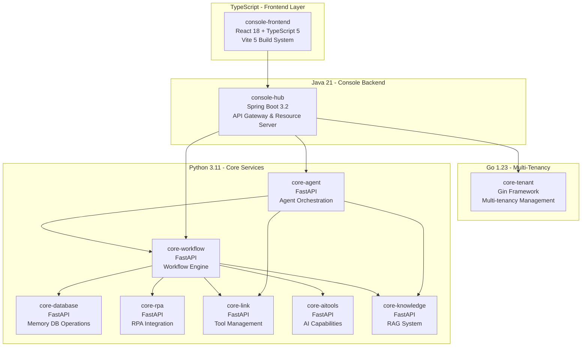
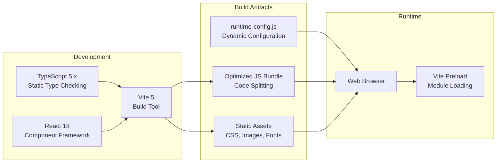
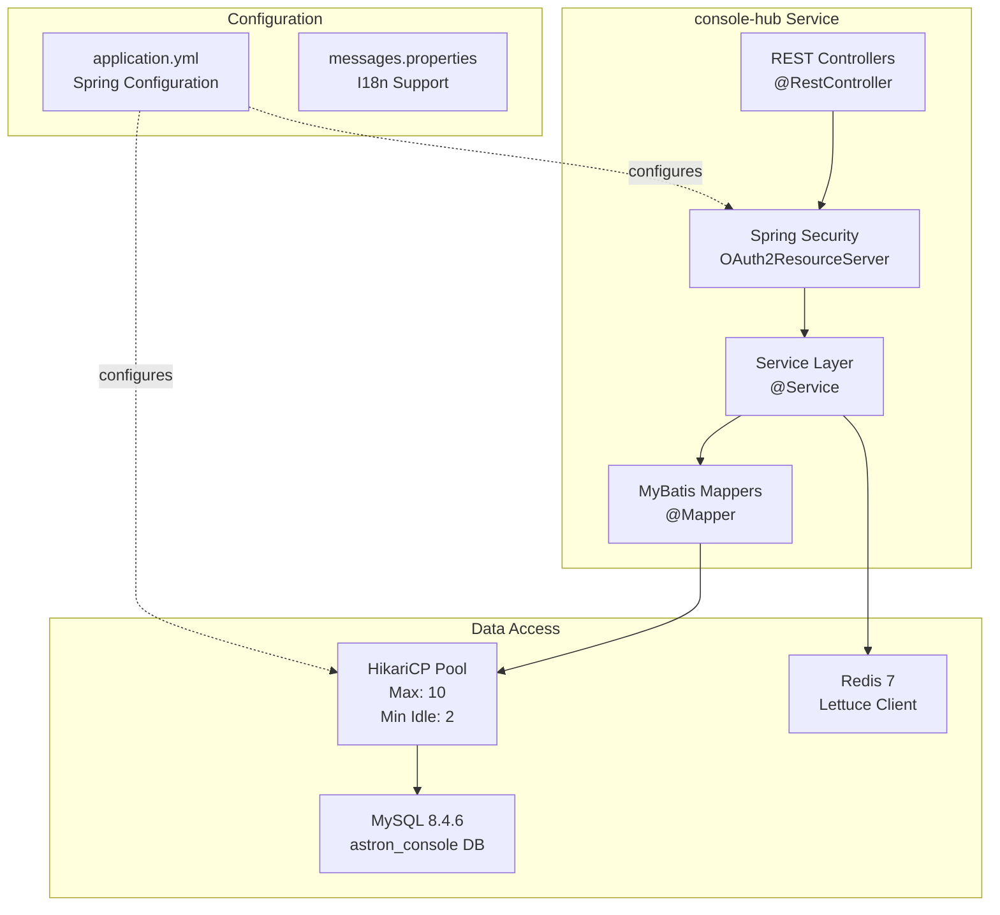
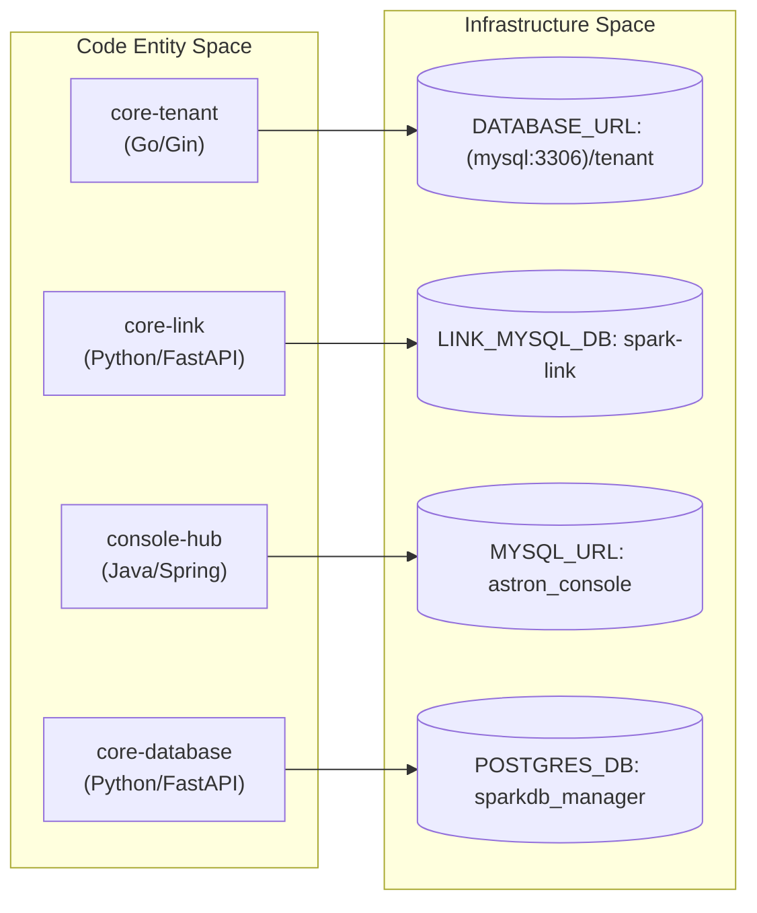

<!-- source: DeepWiki mcp.deepwiki.com · repo iflytek/astron-agent · page 1.2 Technology Stack · fetched 2026-10-26 -->

# Technology Stack

Relevant source files

The following files were used as context for generating this wiki page:

- [README.md](README.md)
- [console/backend/hub/src/main/resources/application.yml](console/backend/hub/src/main/resources/application.yml)
- [console/frontend/index.html](console/frontend/index.html)
- [console/frontend/public/runtime-config.js](console/frontend/public/runtime-config.js)
- [core/agent/Dockerfile](core/agent/Dockerfile)
- [core/agent/main.py](core/agent/main.py)
- [core/agent/pyproject.toml](core/agent/pyproject.toml)
- [core/agent/uv.lock](core/agent/uv.lock)
- [core/common/service/oss/s3_service.py](core/common/service/oss/s3_service.py)
- [core/plugin/aitools/pyproject.toml](core/plugin/aitools/pyproject.toml)
- [core/plugin/aitools/uv.lock](core/plugin/aitools/uv.lock)
- [core/workflow/alembic/README.md](core/workflow/alembic/README.md)
- [core/workflow/alembic/alembic.ini](core/workflow/alembic/alembic.ini)
- [core/workflow/alembic/env.py](core/workflow/alembic/env.py)
- [core/workflow/alembic/script.py.mako](core/workflow/alembic/script.py.mako)
- [core/workflow/alembic/versions/2026_01_23_0929-b13356244aea_init_tables.py](core/workflow/alembic/versions/2026_01_23_0929-b13356244aea_init_tables.py)
- [core/workflow/consts/engine/model_provider.py](core/workflow/consts/engine/model_provider.py)
- [core/workflow/engine/nodes/rpa/rpa_node.py](core/workflow/engine/nodes/rpa/rpa_node.py)
- [core/workflow/extensions/fastapi/lifespan/database_migration.py](core/workflow/extensions/fastapi/lifespan/database_migration.py)
- [core/workflow/extensions/fastapi/middleware/auth.py](core/workflow/extensions/fastapi/middleware/auth.py)
- [core/workflow/extensions/middleware/cache/base.py](core/workflow/extensions/middleware/cache/base.py)
- [core/workflow/infra/providers/llm/chat_ai_factory.py](core/workflow/infra/providers/llm/chat_ai_factory.py)
- [core/workflow/infra/providers/llm/google/google_chat_llm.py](core/workflow/infra/providers/llm/google/google_chat_llm.py)
- [core/workflow/main.py](core/workflow/main.py)
- [core/workflow/pyproject.toml](core/workflow/pyproject.toml)
- [core/workflow/uv.lock](core/workflow/uv.lock)
- [docker/astronAgent/.env.example](docker/astronAgent/.env.example)
- [docker/astronAgent/docker-compose.yaml](docker/astronAgent/docker-compose.yaml)
- [docker/astronAgent/nginx/nginx.conf](docker/astronAgent/nginx/nginx.conf)
- [docker/ragflow/docker-compose-macos.yml](docker/ragflow/docker-compose-macos.yml)
- [docs/CONFIGURATION.md](docs/CONFIGURATION.md)
- [docs/CONFIGURATION_zh.md](docs/CONFIGURATION_zh.md)
- [docs/CONTRIBUTING_CN.md](docs/CONTRIBUTING_CN.md)
- [docs/DEPLOYMENT_GUIDE.md](docs/DEPLOYMENT_GUIDE.md)
- [docs/DEPLOYMENT_GUIDE_zh.md](docs/DEPLOYMENT_GUIDE_zh.md)
- [docs/README-zh.md](docs/README-zh.md)

This document describes the complete technology stack used in the Astron Agent platform, including programming languages, frameworks, infrastructure components, and development tools. For information about the overall system architecture and service responsibilities, see [System Architecture]().

## Overview

Astron Agent employs a **polyglot microservices architecture** with services implemented in Java, Python, and Go, each chosen for their specific strengths. The frontend uses React/TypeScript, while infrastructure relies on Docker containerization with standard data stores (PostgreSQL, MySQL, Redis, Kafka, MinIO). The platform is designed for cloud-native deployment with comprehensive observability through OpenTelemetry.

---

## Programming Languages and Service Distribution

### Language-to-Service Mapping

**Sources:** [docker/astronAgent/docker-compose.yaml:161-280](), [docker/astronAgent/docker-compose.yaml:165-194](), [docker/astronAgent/docker-compose.yaml:198-210]()

---

## Frontend Stack

### Core Technologies

| Component | Technology | Version | Purpose |
|-----------|-----------|---------|---------|
| **Framework** | React | 18.x | UI component library |
| **Language** | TypeScript | 5.x | Type-safe JavaScript |
| **Build Tool** | Vite | 5.x | Fast development and production builds |
| **Node Runtime** | Node.js | 20.x | JavaScript runtime |

### Frontend Technology Stack Diagram

### Key Features

- **Runtime Configuration Injection**: Environment-specific configuration loaded via `window.__APP_CONFIG__` at runtime, allowing single-build deployment across environments [docker/astronAgent/nginx/nginx.conf:55-66]().
- **Nginx Proxying**: The frontend is served via Nginx, which also handles SSE (Server-Sent Events) proxying for real-time chat completions [docker/astronAgent/nginx/nginx.conf:81-106]().
- **Static Asset Optimization**: Gzip compression and immutable cache headers for static resources [docker/astronAgent/nginx/nginx.conf:33-43](), [docker/astronAgent/nginx/nginx.conf:69-78]().

**Sources:** [docker/astronAgent/nginx/nginx.conf:1-187](), [console/frontend/public/runtime-config.js:1-7]()

---

## Backend Stack - Java (Spring Boot)

### Core Technologies

| Component | Technology | Version | Purpose |
|-----------|-----------|---------|---------|
| **Framework** | Spring Boot | 3.2.x | Application framework |
| **Language** | Java | 21 (LTS) | Programming language |
| **Build Tool** | Maven | 3.9+ | Dependency management |
| **ORM** | MyBatis Plus | 3.5+ | Database persistence layer |
| **Connection Pool** | HikariCP | 5.0+ | High-performance JDBC pooling |
| **Security** | Spring Security OAuth2 | 6.x | OAuth2 resource server |
| **Database Migration** | Flyway | 9.x | Schema version control |

### Java Service Architecture

### Spring Boot Configuration Details

The `console-hub` uses `application.yml` for primary configuration, including HikariCP tuning (maximum pool size 10) and Flyway migration settings [console/backend/hub/src/main/resources/application.yml:19-39](), [console/backend/hub/src/main/resources/application.yml:67-80](). It also manages integration with iFLYTEK Spark LLM (via `SPARK_APP_ID`, `SPARK_API_KEY`) and S3 storage [console/backend/hub/src/main/resources/application.yml:117-140]().

**Sources:** [console/backend/hub/src/main/resources/application.yml:1-200]()

---

## Backend Stack - Python (FastAPI)

### Core Technologies

| Component | Technology | Purpose |
|-----------|-----------|---------|
| **Framework** | FastAPI | Async web framework [core/workflow/pyproject.toml:28-28]() |
| **Language** | Python | 3.11 [core/workflow/pyproject.toml:6-6]() |
| **Package Manager** | uv | Fast package installer and resolver [core/workflow/uv.lock:1-8]() |
| **Task Queue** | Celery | Distributed task processing [core/workflow/pyproject.toml:19-19]() |
| **LLM SDKs** | Google GenAI, OpenAI | Integration with diverse model providers [core/workflow/pyproject.toml:54-56]() |

### Python Service Structure

Python services (Workflow, Link, RPA, etc.) utilize `pyproject.toml` and `uv.lock` for strict dependency management. Key libraries include `pydantic` for data validation, `sqlalchemy` (via `alembic` for migrations), and `opentelemetry` for tracing [core/workflow/pyproject.toml:72-74](), [core/workflow/pyproject.toml:58-66](), [core/workflow/pyproject.toml:10-10]().

### LLM Integration Example (Google Gemini)

The `GoogleChatAI` class integrates with the official Google Generative AI SDK to connect with Gemini models. It handles message conversion from the internal format to the `Content` format expected by the SDK [core/workflow/infra/providers/llm/google/google_chat_llm.py:25-48](), [core/workflow/infra/providers/llm/google/google_chat_llm.py:168-185]().

**Sources:** [core/workflow/pyproject.toml:1-100](), [core/workflow/infra/providers/llm/google/google_chat_llm.py:1-200]()

---

## Infrastructure Layer

### Data Storage Technologies

| Component | Image | Health Check | Purpose |
|-----------|-------|--------------|---------|
| **PostgreSQL** | postgres:14 | `pg_isready -U spark` | Memory database with multi-tenant schemas [docker/astronAgent/docker-compose.yaml:7-26]() |
| **MySQL** | mysql:8.4.6 | `mysqladmin ping` | Relational data for tenant, agent, and console [docker/astronAgent/docker-compose.yaml:28-44]() |
| **Redis** | redis:7 | `redis-cli ping` | Caching and session management [docker/astronAgent/docker-compose.yaml:46-60]() |
| **MinIO** | minio/minio | `curl .../minio/health/live` | S3-compatible object storage [docker/astronAgent/docker-compose.yaml:126-147]() |

### Database-to-Code Mapping

### Storage Services

The platform supports both S3-compatible storage (MinIO) and iFly proprietary gateway storage.
- **S3Service**: Implements standard file upload with public read ACLs using `boto3` [core/common/service/oss/s3_service.py:17-53](). It ensures bucket existence and applies public read policies [core/common/service/oss/s3_service.py:57-94]().
- **IFlyGatewayStorageClient**: Uses HMAC-based authentication for proprietary storage, providing temporary download links [core/common/service/oss/s3_service.py:123-181]().

**Sources:** [docker/astronAgent/.env.example:125-144](), [console/backend/hub/src/main/resources/application.yml:14-17](), [docker/astronAgent/docker-compose.yaml:11-13](), [core/common/service/oss/s3_service.py:17-198]()

---

