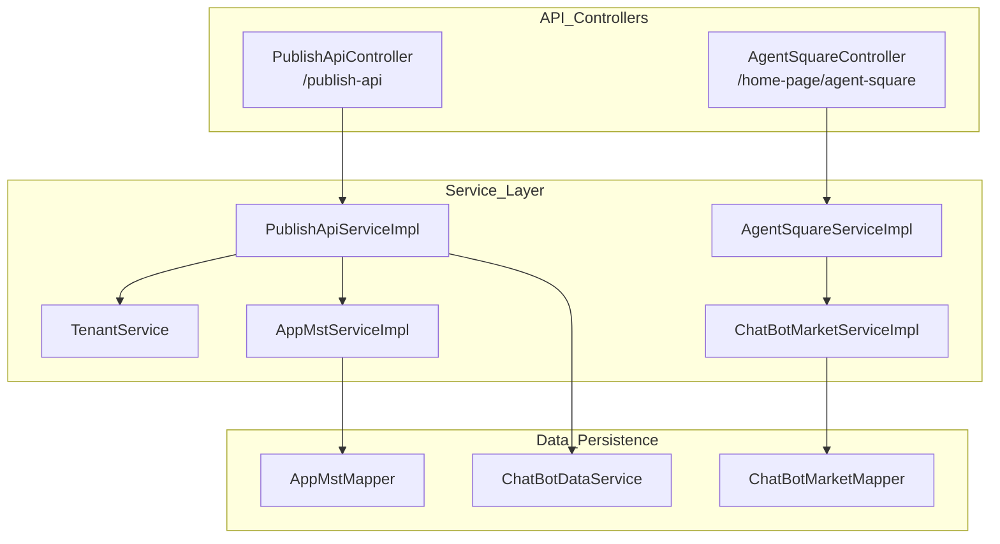
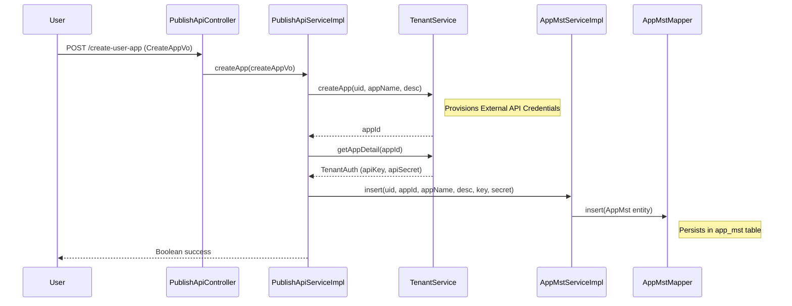

<!-- source: DeepWiki mcp.deepwiki.com · repo iflytek/astron-agent · page 10.3 Publishing and Marketplace Services · fetched 2026-10-26 -->

# Publishing and Marketplace Services

Relevant source files

The following files were used as context for generating this wiki page:

- [console/backend/commons/src/main/java/com/iflytek/astron/console/commons/entity/user/AppMst.java](console/backend/commons/src/main/java/com/iflytek/astron/console/commons/entity/user/AppMst.java)
- [console/backend/commons/src/main/java/com/iflytek/astron/console/commons/mapper/user/AppMstMapper.java](console/backend/commons/src/main/java/com/iflytek/astron/console/commons/mapper/user/AppMstMapper.java)
- [console/backend/commons/src/main/java/com/iflytek/astron/console/commons/service/bot/impl/ChatBotMarketServiceImpl.java](console/backend/commons/src/main/java/com/iflytek/astron/console/commons/service/bot/impl/ChatBotMarketServiceImpl.java)
- [console/backend/commons/src/main/java/com/iflytek/astron/console/commons/service/user/AppMstService.java](console/backend/commons/src/main/java/com/iflytek/astron/console/commons/service/user/AppMstService.java)
- [console/backend/commons/src/main/java/com/iflytek/astron/console/commons/service/user/Impl/AppMstServiceImpl.java](console/backend/commons/src/main/java/com/iflytek/astron/console/commons/service/user/Impl/AppMstServiceImpl.java)
- [console/backend/hub/src/main/java/com/iflytek/astron/console/hub/controller/homepage/AgentSquareController.java](console/backend/hub/src/main/java/com/iflytek/astron/console/hub/controller/homepage/AgentSquareController.java)
- [console/backend/hub/src/main/java/com/iflytek/astron/console/hub/controller/publish/PublishApiController.java](console/backend/hub/src/main/java/com/iflytek/astron/console/hub/controller/publish/PublishApiController.java)
- [console/backend/hub/src/main/java/com/iflytek/astron/console/hub/dto/homepage/BotInfoDto.java](console/backend/hub/src/main/java/com/iflytek/astron/console/hub/dto/homepage/BotInfoDto.java)
- [console/backend/hub/src/main/java/com/iflytek/astron/console/hub/dto/publish/AppListDTO.java](console/backend/hub/src/main/java/com/iflytek/astron/console/hub/dto/publish/AppListDTO.java)
- [console/backend/hub/src/main/java/com/iflytek/astron/console/hub/dto/publish/BotApiInfoDTO.java](console/backend/hub/src/main/java/com/iflytek/astron/console/hub/dto/publish/BotApiInfoDTO.java)
- [console/backend/hub/src/main/java/com/iflytek/astron/console/hub/dto/publish/BotApiRealTimeUsageDTO.java](console/backend/hub/src/main/java/com/iflytek/astron/console/hub/dto/publish/BotApiRealTimeUsageDTO.java)
- [console/backend/hub/src/main/java/com/iflytek/astron/console/hub/dto/publish/CreateAppVo.java](console/backend/hub/src/main/java/com/iflytek/astron/console/hub/dto/publish/CreateAppVo.java)
- [console/backend/hub/src/main/java/com/iflytek/astron/console/hub/service/homepage/Impl/AgentSquareServiceImpl.java](console/backend/hub/src/main/java/com/iflytek/astron/console/hub/service/homepage/Impl/AgentSquareServiceImpl.java)
- [console/backend/hub/src/main/java/com/iflytek/astron/console/hub/service/publish/PublishApiService.java](console/backend/hub/src/main/java/com/iflytek/astron/console/hub/service/publish/PublishApiService.java)
- [console/backend/hub/src/main/java/com/iflytek/astron/console/hub/service/publish/impl/PublishApiServiceImpl.java](console/backend/hub/src/main/java/com/iflytek/astron/console/hub/service/publish/impl/PublishApiServiceImpl.java)

This document describes the bot publishing and marketplace services within the Astron Agent platform. These services enable bot creators to publish their bots to multiple channels (Market, API, WeChat, MCP, Feishu), manage bot versions, synchronize with external MaaS (Marketplace as a Service) platforms, and generate API credentials for external consumption.

The publishing system consists of several specialized service components:

1.  **BotPublishService** - General bot publishing to marketplace channels [console/backend/hub/src/main/java/com/iflytek/astron/console/hub/service/publish/impl/PublishApiServiceImpl.java:80]().
2.  **PublishApiServiceImpl** - Manages the creation of user applications, API key generation, and bot-to-API mapping [console/backend/hub/src/main/java/com/iflytek/astron/console/hub/service/publish/impl/PublishApiServiceImpl.java:46-80]().
3.  **ChatBotMarketServiceImpl** - Handles marketplace data synchronization and bot status management [console/backend/commons/src/main/java/com/iflytek/astron/console/commons/service/bot/impl/ChatBotMarketServiceImpl.java:24-26]().
4.  **AgentSquareServiceImpl** - Provides the frontend with enriched bot data for the marketplace discovery page [console/backend/hub/src/main/java/com/iflytek/astron/console/hub/service/homepage/Impl/AgentSquareServiceImpl.java:30-46]().

## Publishing Architecture Overview

The publishing system uses a **Strategy Pattern** to support multiple publishing channels through a unified interface. The system distinguishes between internal marketplace listings and external API exposures.

### Component Architecture

Sources: [console/backend/hub/src/main/java/com/iflytek/astron/console/hub/controller/publish/PublishApiController.java:30-33](), [console/backend/hub/src/main/java/com/iflytek/astron/console/hub/service/publish/impl/PublishApiServiceImpl.java:46-80](), [console/backend/hub/src/main/java/com/iflytek/astron/console/hub/service/homepage/Impl/AgentSquareServiceImpl.java:30-46](), [console/backend/commons/src/main/java/com/iflytek/astron/console/commons/service/bot/impl/ChatBotMarketServiceImpl.java:24-26]()

## Bot API Publishing and Key Management

The `PublishApiServiceImpl` handles the lifecycle of exposing a bot as a secure web API. This involves creating a "User App" (a container for credentials) and linking a specific bot to that app.

### API Key Generation Flow

When a user creates an application, the platform interacts with the `TenantService` to provision credentials.

Sources: [console/backend/hub/src/main/java/com/iflytek/astron/console/hub/service/publish/impl/PublishApiServiceImpl.java:87-105](), [console/backend/commons/src/main/java/com/iflytek/astron/console/commons/service/user/Impl/AppMstServiceImpl.java:33-45]()

### Bot-to-API Mapping
To expose a bot, the user calls `createBotApi`. The system enforces that only the space creator can perform this action [console/backend/hub/src/main/java/com/iflytek/astron/console/hub/service/publish/impl/PublishApiServiceImpl.java:121-124](). It uses a distributed lock via `RedisUtil` (key prefix `publish_api`) to prevent concurrent creation collisions [console/backend/hub/src/main/java/com/iflytek/astron/console/hub/service/publish/impl/PublishApiServiceImpl.java:132-134](). Currently, the service primarily supports bots with `BotVersionEnum.WORKFLOW` (version 2) [console/backend/hub/src/main/java/com/iflytek/astron/console/hub/service/publish/impl/PublishApiServiceImpl.java:136-138]().

## Marketplace Services and Agent Square

Market publishing makes bots discoverable in the "Agent Square". The `ChatBotMarketServiceImpl` manages the visibility and status of these bots.

### Market Data Management
*   **Listing**: Bots are queried from the `chat_bot_market` table where `bot_status` is `ON_SHELF` (status code 1) and `is_delete` is 0 [console/backend/commons/src/main/java/com/iflytek/astron/console/commons/service/bot/impl/ChatBotMarketServiceImpl.java:33-36]().
*   **Status Updates**: When a bot's status changes (e.g., taken off-shelf), the `updateBotMarketStatus` method updates the record in the marketplace, setting `bot_status` to 4 [console/backend/commons/src/main/java/com/iflytek/astron/console/commons/service/bot/impl/ChatBotMarketServiceImpl.java:48-63]().

### Agent Square Enrichment
The `AgentSquareServiceImpl` enriches raw marketplace data for the frontend:
1.  **Categorization**: Fetches categories via `BotTypeListService` [console/backend/hub/src/main/java/com/iflytek/astron/console/hub/service/homepage/Impl/AgentSquareServiceImpl.java:48-57]().
2.  **User Context**: Identifies if the current user has "favorited" the bot using `BotFavoriteService` [console/backend/hub/src/main/java/com/iflytek/astron/console/hub/service/homepage/Impl/AgentSquareServiceImpl.java:69-70]().
3.  **Conversation Linkage**: Finds the latest active chat session for the user with that specific bot via `ChatListDataService` [console/backend/hub/src/main/java/com/iflytek/astron/console/hub/service/homepage/Impl/AgentSquareServiceImpl.java:85-86]().

Sources: [console/backend/hub/src/main/java/com/iflytek/astron/console/hub/service/homepage/Impl/AgentSquareServiceImpl.java:60-107](), [console/backend/commons/src/main/java/com/iflytek/astron/console/commons/service/bot/impl/ChatBotMarketServiceImpl.java:31-44]()

## Data Models

### AppMst (Application Master)
Stored in the `app_mst` table, this entity holds the credentials required for external API access.

| Field | Description |
| :--- | :--- |
| `appId` | Unique identifier generated by the tenant service [console/backend/commons/src/main/java/com/iflytek/astron/console/commons/entity/user/AppMst.java:37]() |
| `appKey` | Public API key used for authentication [console/backend/commons/src/main/java/com/iflytek/astron/console/commons/entity/user/AppMst.java:40]() |
| `appSecret` | Private secret for HMAC/Signature verification [console/backend/commons/src/main/java/com/iflytek/astron/console/commons/entity/user/AppMst.java:43]() |
| `uid` | Owner of the application [console/backend/commons/src/main/java/com/iflytek/astron/console/commons/entity/user/AppMst.java:28]() |

### ChatBotMarket
Represents a bot's presence in the public marketplace.

| Field | Description |
| :--- | :--- |
| `botStatus` | Status of the bot (e.g., 1 for ON_SHELF) [console/backend/commons/src/main/java/com/iflytek/astron/console/commons/service/bot/impl/ChatBotMarketServiceImpl.java:35]() |
| `botType` | Category identifier [console/backend/hub/src/main/java/com/iflytek/astron/console/hub/dto/homepage/BotInfoDto.java:27]() |
| `version` | Bot implementation version (e.g., Workflow version 2) [console/backend/hub/src/main/java/com/iflytek/astron/console/hub/dto/homepage/BotInfoDto.java:45]() |

Sources: [console/backend/commons/src/main/java/com/iflytek/astron/console/commons/entity/user/AppMst.java:19-58](), [console/backend/hub/src/main/java/com/iflytek/astron/console/hub/dto/homepage/BotInfoDto.java:15-46]()

## API Reference

### Publish API Controller (`/publish-api`)

| Endpoint | Method | Description |
| :--- | :--- | :--- |
| `/create-user-app` | POST | Creates a new application container for API keys [console/backend/hub/src/main/java/com/iflytek/astron/console/hub/controller/publish/PublishApiController.java:37-40](). |
| `/app-list` | GET | Retrieves all applications owned by the user [console/backend/hub/src/main/java/com/iflytek/astron/console/hub/controller/publish/PublishApiController.java:44-47](). |
| `/create-bot-api` | POST | Maps a bot to an application for API access [console/backend/hub/src/main/java/com/iflytek/astron/console/hub/controller/publish/PublishApiController.java:51-54](). |
| `/get-bot-api-info` | GET | Returns the endpoint URL and credentials for a bot API [console/backend/hub/src/main/java/com/iflytek/astron/console/hub/controller/publish/PublishApiController.java:58-61](). |

### Agent Square Controller (`/home-page/agent-square`)

| Endpoint | Method | Description |
| :--- | :--- | :--- |
| `/get-bot-type-list` | GET | Returns the list of categories for filtering [console/backend/hub/src/main/java/com/iflytek/astron/console/hub/controller/homepage/AgentSquareController.java:30-33](). |
| `/get-bot-page-by-type` | GET | Returns a paginated list of bots for the marketplace [console/backend/hub/src/main/java/com/iflytek/astron/console/hub/controller/homepage/AgentSquareController.java:36-43](). |

Sources: [console/backend/hub/src/main/java/com/iflytek/astron/console/hub/controller/publish/PublishApiController.java:25-63](), [console/backend/hub/src/main/java/com/iflytek/astron/console/hub/controller/homepage/AgentSquareController.java:24-44]()

---

