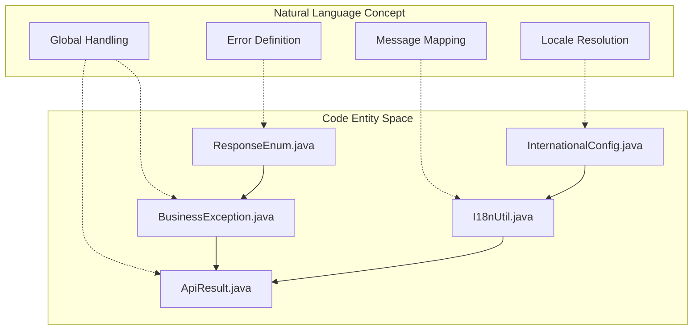
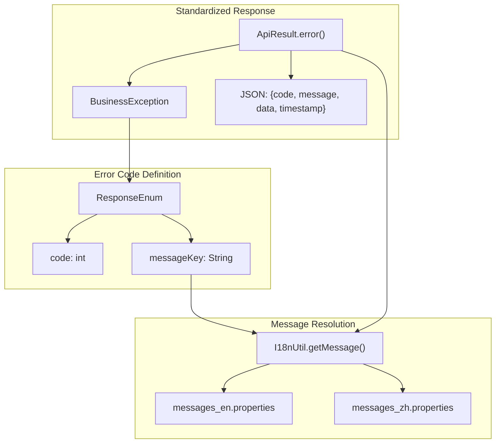
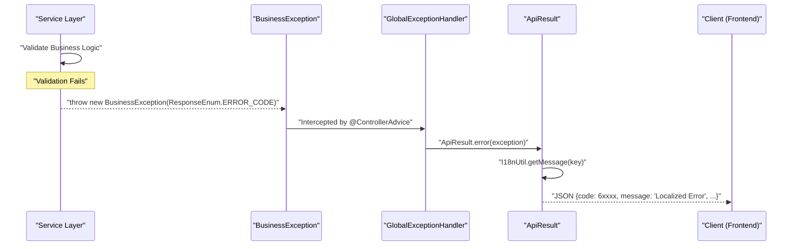

<!-- source: DeepWiki mcp.deepwiki.com · repo iflytek/astron-agent · page 10.4 Error Handling and Internationalization · fetched 2026-10-26 -->

# Error Handling and Internationalization

Relevant source files

The following files were used as context for generating this wiki page:

- [console/backend/commons/src/main/java/com/iflytek/astron/console/commons/constant/ResponseEnum.java](console/backend/commons/src/main/java/com/iflytek/astron/console/commons/constant/ResponseEnum.java)
- [console/backend/commons/src/main/java/com/iflytek/astron/console/commons/enums/bot/ReleaseTypeEnum.java](console/backend/commons/src/main/java/com/iflytek/astron/console/commons/enums/bot/ReleaseTypeEnum.java)
- [console/backend/commons/src/main/java/com/iflytek/astron/console/commons/exception/BusinessException.java](console/backend/commons/src/main/java/com/iflytek/astron/console/commons/exception/BusinessException.java)
- [console/backend/commons/src/main/java/com/iflytek/astron/console/commons/response/ApiResult.java](console/backend/commons/src/main/java/com/iflytek/astron/console/commons/response/ApiResult.java)
- [console/backend/commons/src/main/java/com/iflytek/astron/console/commons/util/BotFileParamUtil.java](console/backend/commons/src/main/java/com/iflytek/astron/console/commons/util/BotFileParamUtil.java)
- [console/backend/commons/src/main/java/com/iflytek/astron/console/commons/util/I18nUtil.java](console/backend/commons/src/main/java/com/iflytek/astron/console/commons/util/I18nUtil.java)
- [console/backend/commons/src/main/resources/messages_en.properties](console/backend/commons/src/main/resources/messages_en.properties)
- [console/backend/commons/src/main/resources/messages_zh.properties](console/backend/commons/src/main/resources/messages_zh.properties)
- [console/backend/hub/src/main/java/com/iflytek/astron/console/hub/aspect/DistributedLockAspect.java](console/backend/hub/src/main/java/com/iflytek/astron/console/hub/aspect/DistributedLockAspect.java)
- [console/backend/hub/src/main/java/com/iflytek/astron/console/hub/config/InternationalConfig.java](console/backend/hub/src/main/java/com/iflytek/astron/console/hub/config/InternationalConfig.java)
- [console/backend/hub/src/main/java/com/iflytek/astron/console/hub/config/space/EnterpriseSpaceConfig.java](console/backend/hub/src/main/java/com/iflytek/astron/console/hub/config/space/EnterpriseSpaceConfig.java)
- [console/backend/hub/src/main/java/com/iflytek/astron/console/hub/dto/publish/prepare/WechatPrepareDto.java](console/backend/hub/src/main/java/com/iflytek/astron/console/hub/dto/publish/prepare/WechatPrepareDto.java)
- [console/backend/hub/src/main/java/com/iflytek/astron/console/hub/dto/user/UserInfoResultExcelDTO.java](console/backend/hub/src/main/java/com/iflytek/astron/console/hub/dto/user/UserInfoResultExcelDTO.java)
- [console/backend/hub/src/main/java/com/iflytek/astron/console/hub/properties/InviteMessageTempProperties.java](console/backend/hub/src/main/java/com/iflytek/astron/console/hub/properties/InviteMessageTempProperties.java)
- [console/backend/hub/src/main/java/com/iflytek/astron/console/hub/service/space/impl/InviteRecordBizServiceImpl.java](console/backend/hub/src/main/java/com/iflytek/astron/console/hub/service/space/impl/InviteRecordBizServiceImpl.java)
- [console/backend/toolkit/src/main/java/com/iflytek/astron/console/toolkit/tool/CommonTool.java](console/backend/toolkit/src/main/java/com/iflytek/astron/console/toolkit/tool/CommonTool.java)
- [console/backend/toolkit/src/test/java/com/iflytek/astron/console/toolkit/controller/workflow/WorkflowControllerTest.java](console/backend/toolkit/src/test/java/com/iflytek/astron/console/toolkit/controller/workflow/WorkflowControllerTest.java)

This page documents the centralized error handling and internationalization (i18n) system in the Astron Agent platform's console backend. The system provides structured error codes with localized messages supporting multiple languages (English and Chinese).

**Related pages:**
- Authentication errors: see page 14.1 (Authentication and Authorization)
- Frontend error handling: see page 9.2 (HTTP Client and Request Interceptors)
- Console backend architecture: see page 10.1 (Console Hub Architecture)

## System Architecture

The error handling system consists of three key components:

1.  **ResponseEnum**: Centralized catalog of all error codes and message keys [console/backend/commons/src/main/java/com/iflytek/astron/console/commons/constant/ResponseEnum.java:8-132]().
2.  **ResourceBundleMessageSource**: Resolves message keys to localized text by loading base files named `messages` and `speaker` [console/backend/hub/src/main/java/com/iflytek/astron/console/hub/config/InternationalConfig.java:45-55]().
3.  **ApiResult & GlobalExceptionHandler**: Intercepts exceptions and formats standardized API responses using `I18nUtil` for message resolution [console/backend/commons/src/main/java/com/iflytek/astron/console/commons/response/ApiResult.java:9-61]().

### Natural Language to Code Entity Mapping

The following diagram bridges the gap between the natural language requirements for error handling and the specific code entities implementing them.

**Title: Error Handling Component Mapping**

**Sources:** [console/backend/commons/src/main/java/com/iflytek/astron/console/commons/constant/ResponseEnum.java:8-10]() | [console/backend/hub/src/main/java/com/iflytek/astron/console/hub/config/InternationalConfig.java:15-19]() | [console/backend/commons/src/main/java/com/iflytek/astron/console/commons/util/I18nUtil.java:21-25]() | [console/backend/commons/src/main/java/com/iflytek/astron/console/commons/exception/BusinessException.java:1-15]()

---

## Error Code System Architecture

### ResponseEnum Structure

The error code system is implemented through the `ResponseEnum` enumeration class. Each entry maps a numeric code to a translation key found in `.properties` files.

**Title: Response Processing Flow**

**Sources:** [console/backend/commons/src/main/java/com/iflytek/astron/console/commons/constant/ResponseEnum.java:8-132]() | [console/backend/commons/src/main/java/com/iflytek/astron/console/commons/response/ApiResult.java:9-16]() | [console/backend/commons/src/main/java/com/iflytek/astron/console/commons/util/I18nUtil.java:33-57]()

### Error Code Ranges

Error codes are logically grouped to provide immediate context on the error source:

| Code Range | Category | Examples |
| :--- | :--- | :--- |
| **0** | Success | `SUCCESS(0, "system.success")` [console/backend/commons/src/main/java/com/iflytek/astron/console/commons/constant/ResponseEnum.java:9]() |
| **3xxxx** | SSO/Auth | `INCORRECT_PASSWORD(30001, "auth.password.incorrect")` [console/backend/commons/src/main/java/com/iflytek/astron/console/commons/constant/ResponseEnum.java:11]() |
| **4xxxx** | Client Errors | `BAD_REQUEST(40000)`, `UNAUTHORIZED(40001)` [console/backend/commons/src/main/java/com/iflytek/astron/console/commons/constant/ResponseEnum.java:14-15]() |
| **5xxxx** | Server Errors | `INTERNAL_SERVER_ERROR(50000)`, `S3_UPLOAD_ERROR(50005)` [console/backend/commons/src/main/java/com/iflytek/astron/console/commons/constant/ResponseEnum.java:27, 30]() |
| **6xxxx** | Business Errors | `DATA_NOT_FOUND(60001)`, `BOT_NOT_EXISTS(60006)` [console/backend/commons/src/main/java/com/iflytek/astron/console/commons/constant/ResponseEnum.java:35, 40]() |
| **60040-60080**| Spark API | `SPARK_API_PARAM_ERROR(60040)`, `SPARK_API_TOKEN_LIMIT_EXCEEDED(60064)` [console/backend/commons/src/main/java/com/iflytek/astron/console/commons/constant/ResponseEnum.java:100, 124]() |

---

## Internationalization Configuration

### MessageSource and Locale Resolution

The `InternationalConfig` class configures how the system detects and handles different languages.

*   **LocaleResolver**: Uses `AcceptHeaderLocaleResolver` to inspect the `Accept-Language` header, defaulting to `Locale.CHINA` [console/backend/hub/src/main/java/com/iflytek/astron/console/hub/config/InternationalConfig.java:19-24]().
*   **LocaleChangeInterceptor**: Allows manual overrides via a `lang` request parameter (e.g., `?lang=en_US`) [console/backend/hub/src/main/java/com/iflytek/astron/console/hub/config/InternationalConfig.java:31-35]().
*   **ResourceBundleMessageSource**: Loads base files named `messages` and `speaker` with UTF-8 encoding. It is configured to use the message code as the default message if a key is missing [console/backend/hub/src/main/java/com/iflytek/astron/console/hub/config/InternationalConfig.java:46-55]().

### I18n Utility (I18nUtil)

The `I18nUtil` class provides static methods to retrieve localized strings. It uses `RequestContextHolder` to determine the current request's locale and fetches the message from the Spring `ApplicationContext` [console/backend/commons/src/main/java/com/iflytek/astron/console/commons/util/I18nUtil.java:46-57](). It falls back to `Locale.US` if no request context is available [console/backend/commons/src/main/java/com/iflytek/astron/console/commons/util/I18nUtil.java:87]().

**Sources:** [console/backend/hub/src/main/java/com/iflytek/astron/console/hub/config/InternationalConfig.java:15-56]() | [console/backend/commons/src/main/java/com/iflytek/astron/console/commons/util/I18nUtil.java:21-89]()

---

## Standardized API Responses

All backend responses are wrapped in the `ApiResult` record, ensuring a consistent contract for the frontend.

### ApiResult Structure
`ApiResult<T>(int code, String message, T data, Long timestamp)` [console/backend/commons/src/main/java/com/iflytek/astron/console/commons/response/ApiResult.java:9]()

*   **Success**: `ApiResult.success(data)` returns code 0 and the localized "Success" message resolved via `I18nUtil` [console/backend/commons/src/main/java/com/iflytek/astron/console/commons/response/ApiResult.java:19-21]().
*   **Error**: `ApiResult.error(ResponseEnum)` looks up the translation key associated with the enum [console/backend/commons/src/main/java/com/iflytek/astron/console/commons/response/ApiResult.java:29-35]().

### Exception Handling Flow

When a business rule is violated, services throw a `BusinessException` [console/backend/commons/src/main/java/com/iflytek/astron/console/commons/exception/BusinessException.java:16-22]().

**Title: Exception Propagation to Client**

**Sources:** [console/backend/commons/src/main/java/com/iflytek/astron/console/commons/exception/BusinessException.java:16-22]() | [console/backend/commons/src/main/java/com/iflytek/astron/console/commons/response/ApiResult.java:45-52]() | [console/backend/toolkit/src/test/java/com/iflytek/astron/console/toolkit/controller/workflow/WorkflowControllerTest.java:1-76]()

---

## Message Properties Files

The system maintains `messages_en.properties` and `messages_zh.properties` in the `commons` module.

### Common Keys
*   **System**: `system.success`, `system.error`, `system.s3.upload.error` [console/backend/commons/src/main/resources/messages_en.properties:2-4]().
*   **Authentication**: `auth.password.incorrect`, `token.expired`, `user.not.found` [console/backend/commons/src/main/resources/messages_en.properties:8, 14, 83]().
*   **HTTP Status**: `http.bad.request`, `http.unauthorized`, `http.forbidden` [console/backend/commons/src/main/resources/messages_en.properties:92-94]().
*   **Spark API**: Extensive error mapping for WebSocket, Engine, and Audit errors (60040-60083) [console/backend/commons/src/main/resources/messages_en.properties:43-71]() | [console/backend/commons/src/main/resources/messages_zh.properties:55-83]().

**Sources:** [console/backend/commons/src/main/resources/messages_en.properties:1-113]() | [console/backend/commons/src/main/resources/messages_zh.properties:1-125]()

---

## Specialized Error Handling

### Distributed Lock Failures
The `DistributedLockAspect` handles distributed lock logic and uses `DistributedLockException` when acquisition fails or is interrupted [console/backend/hub/src/main/java/com/iflytek/astron/console/hub/aspect/DistributedLockAspect.java:91, 113-115](). These failures correspond to `lock.error.*` keys in the properties files, such as `lock.error.acquire_timeout` [console/backend/commons/src/main/resources/messages_zh.properties:136-141]().

### Internal System Call Validation
The `CommonTool` utility provides `checkSystemCallResponse(String resp)`, which parses JSON responses from internal services and throws a `BusinessException` if the internal `code` is non-zero. It uses the `ResponseEnum.RESPONSE_FAILED` (or similar business error) to encapsulate the failure [console/backend/toolkit/src/main/java/com/iflytek/astron/console/toolkit/tool/CommonTool.java:83-89]().

### Multi-Tenancy Headers
The system uses specific header keys defined in `EnterpriseSpaceConfig` to identify context:
*   `space-id`: Resolved via `SpaceInfoUtil` [console/backend/hub/src/main/java/com/iflytek/astron/console/hub/config/space/EnterpriseSpaceConfig.java:16, 27]().
*   `enterprise-id`: Resolved via `EnterpriseInfoUtil` [console/backend/hub/src/main/java/com/iflytek/astron/console/hub/config/space/EnterpriseSpaceConfig.java:18, 28]().

**Sources:** [console/backend/hub/src/main/java/com/iflytek/astron/console/hub/aspect/DistributedLockAspect.java:113-115]() | [console/backend/toolkit/src/main/java/com/iflytek/astron/console/toolkit/tool/CommonTool.java:83-89]() | [console/backend/hub/src/main/java/com/iflytek/astron/console/hub/config/space/EnterpriseSpaceConfig.java:14-31]()

---

