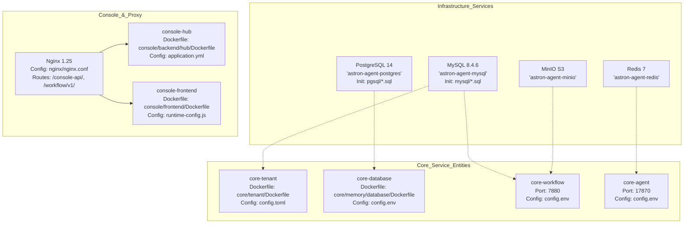
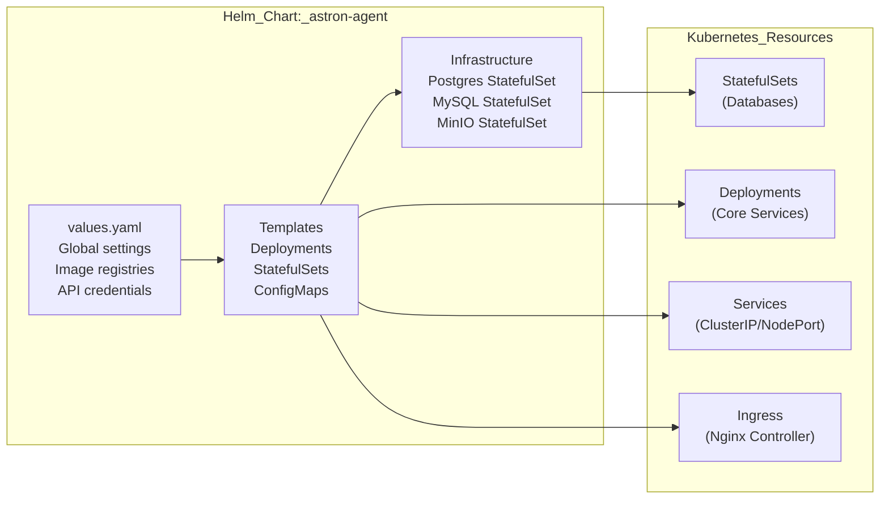

<!-- source: DeepWiki mcp.deepwiki.com · repo iflytek/astron-agent · page 11 Infrastructure and Deployment · fetched 2026-10-26 -->

# Infrastructure and Deployment

Relevant source files

The following files were used as context for generating this wiki page:

- [README.md](README.md)
- [console/backend/hub/src/main/resources/application.yml](console/backend/hub/src/main/resources/application.yml)
- [console/frontend/index.html](console/frontend/index.html)
- [console/frontend/public/runtime-config.js](console/frontend/public/runtime-config.js)
- [docker/astronAgent/.env.example](docker/astronAgent/.env.example)
- [docker/astronAgent/docker-compose.yaml](docker/astronAgent/docker-compose.yaml)
- [docker/astronAgent/nginx/nginx.conf](docker/astronAgent/nginx/nginx.conf)
- [docker/ragflow/docker-compose-macos.yml](docker/ragflow/docker-compose-macos.yml)
- [docs/CONFIGURATION.md](docs/CONFIGURATION.md)
- [docs/CONFIGURATION_zh.md](docs/CONFIGURATION_zh.md)
- [docs/CONTRIBUTING_CN.md](docs/CONTRIBUTING_CN.md)
- [docs/DEPLOYMENT_GUIDE.md](docs/DEPLOYMENT_GUIDE.md)
- [docs/DEPLOYMENT_GUIDE_zh.md](docs/DEPLOYMENT_GUIDE_zh.md)
- [docs/README-zh.md](docs/README-zh.md)
- [helm/README.md](helm/README.md)
- [helm/astron-agent/.helmignore](helm/astron-agent/.helmignore)
- [helm/astron-agent/Chart.yaml](helm/astron-agent/Chart.yaml)
- [helm/astron-agent/files/casdoor/conf/app.conf](helm/astron-agent/files/casdoor/conf/app.conf)
- [helm/astron-agent/files/casdoor/conf/init_data.json](helm/astron-agent/files/casdoor/conf/init_data.json)
- [helm/astron-agent/files/casdoor/entrypoint.sh](helm/astron-agent/files/casdoor/entrypoint.sh)
- [helm/astron-agent/files/config/agent/config.env](helm/astron-agent/files/config/agent/config.env)
- [helm/astron-agent/templates/auth/casdoor-deployment.yaml](helm/astron-agent/templates/auth/casdoor-deployment.yaml)
- [helm/astron-agent/templates/configmaps.yaml](helm/astron-agent/templates/configmaps.yaml)
- [helm/astron-agent/templates/console/console-hub-deployment.yaml](helm/astron-agent/templates/console/console-hub-deployment.yaml)
- [helm/astron-agent/templates/core/core-services.yaml](helm/astron-agent/templates/core/core-services.yaml)
- [helm/astron-agent/templates/infrastructure/mysql-statefulset.yaml](helm/astron-agent/templates/infrastructure/mysql-statefulset.yaml)
- [helm/astron-agent/values.yaml](helm/astron-agent/values.yaml)

This document describes the infrastructure components and deployment architecture of the Astron Agent platform. It covers Docker Compose orchestration, database systems (PostgreSQL and MySQL), storage services (MinIO and Redis), message queue configuration (Kafka), and the Kubernetes Helm deployment strategy.

For service-specific configuration details, see [Environment Configuration](#2.3). For observability and telemetry setup, see [Observability and Telemetry](#12.4). For authentication infrastructure, see [Authentication and Authorization](#14.1).

---

## Deployment Architecture Overview

The Astron Agent platform uses Docker Compose or Kubernetes Helm to orchestrate a multi-tier architecture consisting of infrastructure services, eight core microservices, and console services. All components run in a unified network with explicit health checks and dependency chains to ensure proper startup sequencing.

### Infrastructure to Code Mapping

The following diagram bridges the high-level infrastructure components with their corresponding code entities and configuration files.

**Sources**: [docker/astronAgent/docker-compose.yaml:7-201](), [console/backend/hub/src/main/resources/application.yml:12-14](), [docker/astronAgent/.env.example:125-186]()

---

## Docker Compose Orchestration

The platform is primarily orchestrated using Docker Compose for development and standalone production environments. The `docker-compose.yaml` file defines the core services with strict health checks and dependency management.

### Health Check Implementation
All infrastructure services implement health checks to prevent core services from starting prematurely.

| Service | Health Check Command | Source |
|---------|---------------------|--------|
| `postgres` | `pg_isready -U ${POSTGRES_USER:-spark} -d sparkdb_manager` | [docker/astronAgent/docker-compose.yaml:22-22]() |
| `mysql` | `mysqladmin ping -h localhost` | [docker/astronAgent/docker-compose.yaml:40-40]() |
| `redis` | `redis-cli ${REDIS_PASSWORD:+-a "$REDIS_PASSWORD"} ping \| grep PONG` | [docker/astronAgent/docker-compose.yaml:56-56]() |
| `minio` | `curl -f http://localhost:9000/minio/health/live` | [docker/astronAgent/docker-compose.yaml:143-143]() |

For details on service definitions, dependency chains, and volume management, see [Docker Compose Orchestration](#11.1).

---

## Database Architecture and Configuration

The platform uses a polyglot persistence strategy. PostgreSQL is utilized by the memory database service for multi-tenant data isolation, while MySQL handles application metadata and configuration for the remaining services.

### Connection and Schema Management
- **PostgreSQL**: Used by `core-database` to manage tenant schemas. Default database is `sparkdb_manager` [docker/astronAgent/docker-compose.yaml:11-13]().
- **MySQL**: Hosts separate databases for `tenant`, `agent`, `spark-link`, and `workflow` services [docker/astronAgent/.env.example:125-186]().
- **Migrations**: The `console-hub` uses Flyway for automated schema migrations defined in `classpath:db/migration` [console/backend/hub/src/main/resources/application.yml:67-80]().
- **Pooling**: Java services utilize HikariCP with specific `maximum-pool-size` (default 10) and `idle-timeout` settings [console/backend/hub/src/main/resources/application.yml:19-29]().

For details on schema design, connection pooling, and migration strategies, see [Database Architecture and Configuration](#11.2).

---

## Storage and Caching Services

### MinIO S3 Object Storage
MinIO provides S3-compatible storage for workflow files and console assets.
- **Buckets**: `workflow` (core services) and `console-oss` (frontend assets) [docker/astronAgent/.env.example:65-198]().
- **Persistence**: Data is persisted in the `minio_data` volume [docker/astronAgent/docker-compose.yaml:137-137]().

### Redis Cache
Redis serves as a distributed cache and session store.
- **Console Hub**: Uses `REDIS_DATABASE_CONSOLE=1` with a Lettuce connection pool [console/backend/hub/src/main/resources/application.yml:44-52]().
- **Core Services**: Use `REDIS_DATABASE=0` for general caching and session management [docker/astronAgent/.env.example:33-33]().

For details on S3 configuration and Redis session management, see [Storage and Caching Services](#11.3).

---

## Message Queue and Event Streaming

Kafka is utilized for asynchronous event streaming, specifically for telemetry and agent execution traces.
- **Topic**: `spark-agent-builder` is the primary topic for agent and workflow events [docker/astronAgent/.env.example:159-187]().
- **KRaft Mode**: The deployment configuration supports Kafka 3.7.0 in KRaft mode, which simplifies architecture by removing the dependency on Zookeeper [docker/astronAgent/docker-compose.yaml:99-113]().

For details on Kafka topic setup and producer/consumer patterns, see [Message Queue and Event Streaming](#11.4).

---

## Kubernetes Helm Deployment

For production-grade environments, the platform provides a comprehensive Helm chart located in `helm/astron-agent`.

### Helm Resource Structure

### Key Features
- **StatefulSets**: Used for PostgreSQL, MySQL, Redis, and MinIO to ensure stable network identifiers and persistent storage [helm/astron-agent/values.yaml:39-130]().
- **Init Containers**: Services like `console-hub` use init containers to wait for infrastructure readiness via `nslookup` for MySQL, Redis, and MinIO before attempting to connect [helm/astron-agent/templates/console/console-hub-deployment.yaml:25-39]().
- **Ingress**: Configurable Ingress hosts for external access to the console and API, typically mapped to the `hostBaseAddress` [helm/README.md:43-51]().

For details on Helm chart structure, Ingress setup, and values configuration, see [Kubernetes Helm Deployment](#11.5).

**Sources**: [helm/astron-agent/values.yaml:1-306](), [helm/README.md:1-96](), [docker/astronAgent/docker-compose.yaml:7-158](), [helm/astron-agent/templates/console/console-hub-deployment.yaml:25-39]()

---

