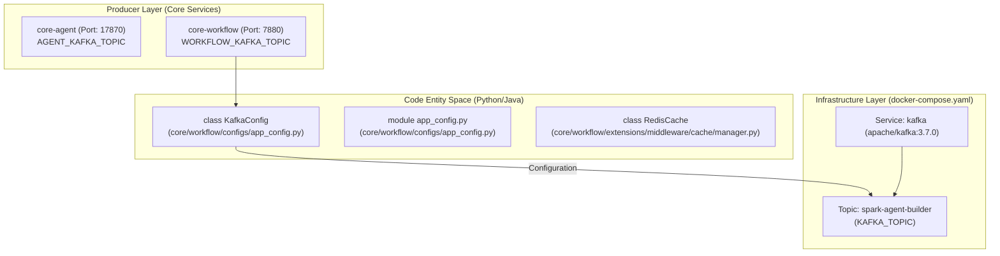
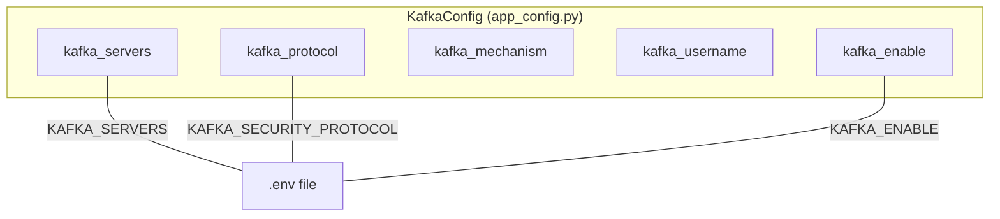

<!-- source: DeepWiki mcp.deepwiki.com · repo iflytek/astron-agent · page 11.4 Message Queue and Event Streaming · fetched 2026-10-26 -->

# Message Queue and Event Streaming

<details>
<summary>Relevant source files</summary>

The following files were used as context for generating this wiki page:

- [README.md](README.md)
- [console/backend/hub/src/main/resources/application.yml](console/backend/hub/src/main/resources/application.yml)
- [console/frontend/index.html](console/frontend/index.html)
- [console/frontend/public/runtime-config.js](console/frontend/public/runtime-config.js)
- [core/workflow/configs/app_config.py](core/workflow/configs/app_config.py)
- [core/workflow/consts/database.py](core/workflow/consts/database.py)
- [core/workflow/domain/entities/flow.py](core/workflow/domain/entities/flow.py)
- [core/workflow/domain/entities/response.py](core/workflow/domain/entities/response.py)
- [core/workflow/engine/nodes/code/executor/ifly/ifly_executor.py](core/workflow/engine/nodes/code/executor/ifly/ifly_executor.py)
- [core/workflow/engine/nodes/code/executor/ifly/ifly_executor_v2.py](core/workflow/engine/nodes/code/executor/ifly/ifly_executor_v2.py)
- [core/workflow/exception/errors/err_code.py](core/workflow/exception/errors/err_code.py)
- [core/workflow/extensions/middleware/cache/manager.py](core/workflow/extensions/middleware/cache/manager.py)
- [core/workflow/extensions/middleware/database/factory.py](core/workflow/extensions/middleware/database/factory.py)
- [core/workflow/extensions/middleware/database/manager.py](core/workflow/extensions/middleware/database/manager.py)
- [core/workflow/extensions/middleware/manager.py](core/workflow/extensions/middleware/manager.py)
- [core/workflow/extensions/middleware/oss/factory.py](core/workflow/extensions/middleware/oss/factory.py)
- [core/workflow/extensions/otlp/metric/metric.py](core/workflow/extensions/otlp/metric/metric.py)
- [core/workflow/extensions/otlp/trace/trace.py](core/workflow/extensions/otlp/trace/trace.py)
- [core/workflow/repository/flow_dao.py](core/workflow/repository/flow_dao.py)
- [core/workflow/repository/license_dao.py](core/workflow/repository/license_dao.py)
- [core/workflow/service/publish_service.py](core/workflow/service/publish_service.py)
- [docker/astronAgent/.env.example](docker/astronAgent/.env.example)
- [docker/astronAgent/docker-compose.yaml](docker/astronAgent/docker-compose.yaml)
- [docker/astronAgent/nginx/nginx.conf](docker/astronAgent/nginx/nginx.conf)
- [docker/ragflow/docker-compose-macos.yml](docker/ragflow/docker-compose-macos.yml)
- [docs/CONFIGURATION.md](docs/CONFIGURATION.md)
- [docs/CONFIGURATION_zh.md](docs/CONFIGURATION_zh.md)
- [docs/CONTRIBUTING_CN.md](docs/CONTRIBUTING_CN.md)
- [docs/DEPLOYMENT_GUIDE.md](docs/DEPLOYMENT_GUIDE.md)
- [docs/DEPLOYMENT_GUIDE_zh.md](docs/DEPLOYMENT_GUIDE_zh.md)
- [docs/README-zh.md](docs/README-zh.md)

</details>


## Purpose and Scope

This document describes the message queue and event streaming infrastructure in the Astron Agent platform, implemented using Apache Kafka. The platform uses Kafka as an optional, asynchronous message broker for publishing operational events, telemetry data, and execution traces across core microservices. This enables a decoupled event-driven architecture for monitoring, auditing, and analytics systems.

The message queue system supports:
- **Operational Event Streaming**: Workflow execution events, agent invocations, and tool executions.
- **Telemetry Data Publishing**: Metrics, traces, and performance data from OTLP-instrumented services.
- **Audit Trail Generation**: Historical records of system operations for compliance and debugging.
- **Analytics Data Pipeline**: Real-time event feeds for downstream analytics and dashboarding.

For OpenTelemetry-based observability, see page 12.4. For Redis-based caching and distributed locking, see page 11.3.

---

## Kafka Integration Overview

Kafka integration is **optional** and disabled by default. When enabled, multiple core microservices publish events to a shared Kafka cluster for downstream consumption. The platform primarily utilizes a single-topic architecture with the default topic `spark-agent-builder`.

### Key Characteristics

| Feature | Value |
|---------|-------|
| **Default State** | Disabled (`KAFKA_ENABLE=0`) [docker/astronAgent/.env.example:47]() |
| **Topic Name** | `spark-agent-builder` [docker/astronAgent/.env.example:159]() |
| **Replication Factor** | 1 (default) [docker/astronAgent/.env.example:48]() |
| **Timeout** | 60 seconds (default) [docker/astronAgent/.env.example:50]() |
| **Security Protocols** | PLAINTEXT, SASL_PLAINTEXT, SSL, SASL_SSL [core/workflow/configs/app_config.py:179-179]() |
| **Supported Services** | `core-workflow`, `core-agent`, `core-link` |

**Sources:** [docker/astronAgent/.env.example:46-52](), [docker/astronAgent/docker-compose.yaml:97-123](), [core/workflow/configs/app_config.py:172-215]()

---

## Kafka Deployment Architecture

The following diagram bridges the logical event flow to the specific code entities and infrastructure components defined in the deployment configuration.

### System Event Flow to Code Entities



**Kafka Deployment Configuration**
The Kafka service is configured to run in KRaft mode (Kafka without ZooKeeper) as a single-node broker in the `docker-compose.yaml`. It uses internal listener `PLAINTEXT://kafka:29092` for service-to-service communication within the Docker network [docker/astronAgent/docker-compose.yaml:104-105]().

**Sources:** [docker/astronAgent/docker-compose.yaml:97-123](), [core/workflow/configs/app_config.py:172-215]()

---

## Configuration

### Environment Variables

Kafka is configured through environment variables defined in the `.env` file and consumed by the `KafkaConfig` model in core services:

| Variable | Default | Description |
|----------|---------|-------------|
| `KAFKA_ENABLE` | `0` | Enable (1) or disable (0) Kafka integration [docker/astronAgent/.env.example:47]() |
| `KAFKA_SERVERS` | `kafka:29092` | Kafka broker addresses (comma-separated) [docker/astronAgent/.env.example:52]() |
| `KAFKA_TIMEOUT` | `60` | Connection and operation timeout in seconds [docker/astronAgent/.env.example:50]() |
| `KAFKA_SECURITY_PROTOCOL` | `SASL_PLAINTEXT` | Security protocol for Kafka [core/workflow/configs/app_config.py:198-199]() |
| `KAFKA_SASL_MECHANISM` | `PLAIN` | SASL authentication mechanism [core/workflow/configs/app_config.py:204-205]() |

**Sources:** [docker/astronAgent/.env.example:46-52](), [core/workflow/configs/app_config.py:172-215]()

### Service-Specific Overrides

Individual services can override the default topic or enable Kafka independently:

- **Agent Service**: Uses `AGENT_KAFKA_TOPIC` for bot-related events [docker/astronAgent/.env.example:159]().
- **Workflow Service**: Uses `WORKFLOW_KAFKA_TOPIC` for node execution events [docker/astronAgent/.env.example:187]().
- **Link Service**: Integrates Kafka for tool telemetry [docker/astronAgent/.env.example:161-163]().

---

## Implementation Patterns

### Configuration Modeling (core-workflow)

The `KafkaConfig` class in `core-workflow` provides a structured Pydantic model for Kafka settings, supporting environment variable injection and validation.



**Key Code Entities:**
- `KafkaConfig`: Defined in `core/workflow/configs/app_config.py`, represents the configuration schema for Kafka producers [core/workflow/configs/app_config.py:172-215]().
- `SettingsConfigDict`: Used to map environment variables to class attributes [core/workflow/configs/app_config.py:186-188]().

**Sources:** [core/workflow/configs/app_config.py:172-215]()

---

## Service-Specific Kafka Configuration

### core-workflow and core-agent Services

These services are the primary producers of execution traces for AI interactions. They use specific variables to route data to the unified topic.

- **core-workflow**: Uses `WORKFLOW_KAFKA_TOPIC` (default: `spark-agent-builder`) [docker/astronAgent/.env.example:187]().
- **core-agent**: Uses `AGENT_KAFKA_TOPIC` (default: `spark-agent-builder`) [docker/astronAgent/.env.example:159]().

### core-link Service

The Link service manages tool execution and uses Kafka for both management (CRUD) and execution telemetry. Telemetry is often paired with OTLP settings:
- **Telemetry Controls**: `UPLOAD_NODE_TRACE=true` and `UPLOAD_METRICS=true` must be set in the service config for full instrumentation [docker/astronAgent/.env.example:156-157]().

**Sources:** [docker/astronAgent/.env.example:155-160](), [docker/astronAgent/.env.example:186-188]()

---

## Troubleshooting

### Debugging the Stream

1. **Verify Connectivity**: Check if the service can reach the broker on the configured `KAFKA_SERVERS` port (default `29092`).
2. **Check Health**: The Kafka container includes a healthcheck that monitors the listener port [docker/astronAgent/docker-compose.yaml:119-123]().
3. **Topic Inspection**: Use Kafka CLI tools inside the container to verify message arrival:
   ```bash
   docker exec astron-agent-kafka /opt/kafka/bin/kafka-console-consumer.sh --bootstrap-server localhost:29092 --topic spark-agent-builder --from-beginning
   ```
4. **Environment Check**: Confirm `KAFKA_ENABLE=1` is set in the specific service's environment, as global `.env` settings may be overridden [docker/astronAgent/.env.example:47]().
5. **Redis Dependency**: Some services use Redis for caching event metadata before streaming. Ensure `RedisCache` is healthy [core/workflow/extensions/middleware/cache/manager.py:11-17]().

**Sources:** [docker/astronAgent/docker-compose.yaml:119-123](), [docker/astronAgent/.env.example:47](), [core/workflow/extensions/middleware/cache/manager.py:77-90]()

---

