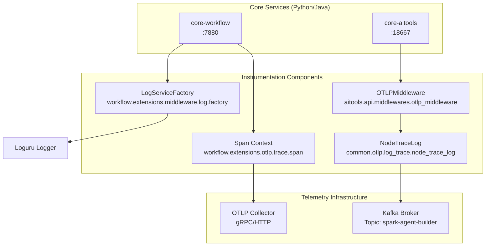
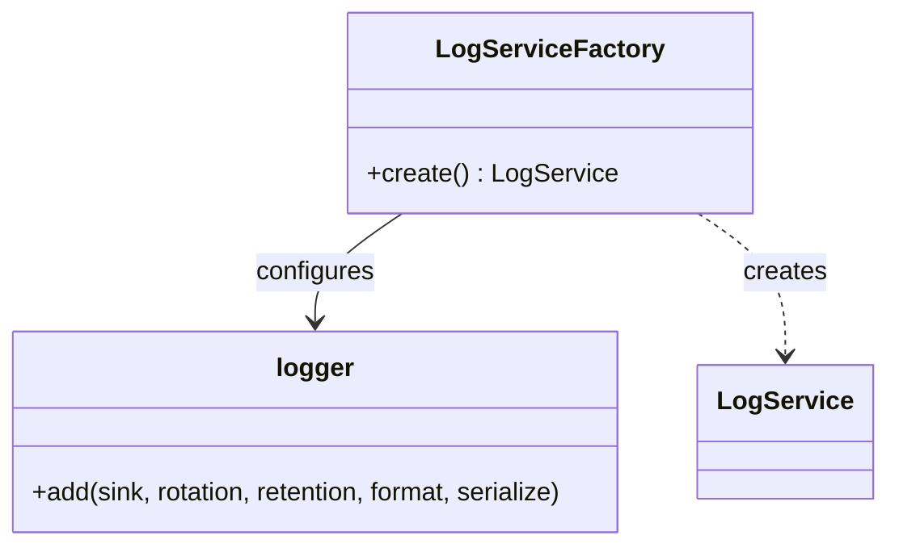

<!-- source: DeepWiki mcp.deepwiki.com · repo iflytek/astron-agent · page 12.4 Observability and Telemetry · fetched 2026-10-26 -->

# Observability and Telemetry

Relevant source files

The following files were used as context for generating this wiki page:

- [console/backend/hub/src/main/resources/db/migration/V1.24__add_multi_mode_to_model_table.sql](console/backend/hub/src/main/resources/db/migration/V1.24__add_multi_mode_to_model_table.sql)
- [core/common/audit_system/audit_api/iflytek/ifly_audit_api.py](core/common/audit_system/audit_api/iflytek/ifly_audit_api.py)
- [core/common/audit_system/orchestrator.py](core/common/audit_system/orchestrator.py)
- [core/common/audit_system/strategy/base_strategy.py](core/common/audit_system/strategy/base_strategy.py)
- [core/common/audit_system/strategy/text_strategy.py](core/common/audit_system/strategy/text_strategy.py)
- [core/common/otlp/log_trace/node_log.py](core/common/otlp/log_trace/node_log.py)
- [core/common/otlp/log_trace/node_trace_log.py](core/common/otlp/log_trace/node_trace_log.py)
- [core/common/otlp/metrics/metric.py](core/common/otlp/metrics/metric.py)
- [core/common/otlp/trace/span.py](core/common/otlp/trace/span.py)
- [core/common/otlp/trace/trace.py](core/common/otlp/trace/trace.py)
- [core/common/service/__init__.py](core/common/service/__init__.py)
- [core/common/service/log/factory.py](core/common/service/log/factory.py)
- [core/plugin/aitools/api/decorators/api_meta.py](core/plugin/aitools/api/decorators/api_meta.py)
- [core/plugin/aitools/api/decorators/api_service.py](core/plugin/aitools/api/decorators/api_service.py)
- [core/plugin/aitools/api/middlewares/otlp_middleware.py](core/plugin/aitools/api/middlewares/otlp_middleware.py)
- [core/plugin/aitools/api/routes/endpoint_factory.py](core/plugin/aitools/api/routes/endpoint_factory.py)
- [core/plugin/aitools/api/routes/register.py](core/plugin/aitools/api/routes/register.py)
- [core/plugin/aitools/common/clients/hooks.py](core/plugin/aitools/common/clients/hooks.py)
- [core/plugin/aitools/common/exceptions/exceptions.py](core/plugin/aitools/common/exceptions/exceptions.py)
- [core/plugin/aitools/service/ase_image_generator/req_ase_ability_image_generate_service.py](core/plugin/aitools/service/ase_image_generator/req_ase_ability_image_generate_service.py)
- [core/plugin/aitools/service/image_understanding/image_understanding_service.py](core/plugin/aitools/service/image_understanding/image_understanding_service.py)
- [core/plugin/aitools/service/ise/ise_evaluate_service.py](core/plugin/aitools/service/ise/ise_evaluate_service.py)
- [core/plugin/aitools/service/ocr_llm/req_ase_ability_ocr_service.py](core/plugin/aitools/service/ocr_llm/req_ase_ability_ocr_service.py)
- [core/plugin/aitools/service/smart_tts/smart_tts_service.py](core/plugin/aitools/service/smart_tts/smart_tts_service.py)
- [core/plugin/aitools/service/translation/translation_service.py](core/plugin/aitools/service/translation/translation_service.py)
- [core/plugin/aitools/utils/otlp_utils.py](core/plugin/aitools/utils/otlp_utils.py)
- [core/workflow/api/v1/chat/open.py](core/workflow/api/v1/chat/open.py)
- [core/workflow/config.env](core/workflow/config.env)
- [core/workflow/engine/nodes/decision/decision_node.py](core/workflow/engine/nodes/decision/decision_node.py)
- [core/workflow/engine/nodes/knowledge_pro/knowledge_pro_node.py](core/workflow/engine/nodes/knowledge_pro/knowledge_pro_node.py)
- [core/workflow/extensions/fastapi/middleware/otlp.py](core/workflow/extensions/fastapi/middleware/otlp.py)
- [core/workflow/extensions/middleware/log/factory.py](core/workflow/extensions/middleware/log/factory.py)
- [core/workflow/extensions/otlp/log_trace/workflow_log.py](core/workflow/extensions/otlp/log_trace/workflow_log.py)
- [core/workflow/extensions/otlp/metric/meter.py](core/workflow/extensions/otlp/metric/meter.py)
- [core/workflow/extensions/otlp/trace/span.py](core/workflow/extensions/otlp/trace/span.py)
- [core/workflow/infra/providers/llm/chat_ai.py](core/workflow/infra/providers/llm/chat_ai.py)
- [core/workflow/infra/providers/llm/iflytek_spark/spark_chat_llm.py](core/workflow/infra/providers/llm/iflytek_spark/spark_chat_llm.py)
- [core/workflow/infra/providers/llm/iflytek_spark/spark_fc_llm.py](core/workflow/infra/providers/llm/iflytek_spark/spark_fc_llm.py)
- [core/workflow/infra/providers/llm/openai/openai_chat_llm.py](core/workflow/infra/providers/llm/openai/openai_chat_llm.py)
- [docker/astronAgent/config/workflow/config.env](docker/astronAgent/config/workflow/config.env)

This document describes the observability and telemetry infrastructure of the Astron Agent platform. The system implements distributed tracing, metrics collection, and structured logging using OpenTelemetry Protocol (OTLP), Elasticsearch, and Apache Kafka for telemetry data transport. This page covers the telemetry architecture, configuration options, data flow patterns, and instrumentation approaches across all core services.

---

## Telemetry Architecture Overview

The Astron Agent platform implements a multi-tier telemetry system that supports synchronous OTLP exports, asynchronous Kafka-based telemetry streaming, and persistent storage in Elasticsearch for frontend trace visualization.

### High-Level Telemetry Flow

**Sources**: [core/workflow/extensions/otlp/trace/span.py:26-67](), [core/plugin/aitools/api/middlewares/otlp_middleware.py:60-84](), [core/workflow/extensions/middleware/log/factory.py:10-46](), [docker/astronAgent/config/workflow/config.env:63-88]()

---

## OpenTelemetry Protocol (OTLP) Integration

All core services support OpenTelemetry instrumentation with configurable OTLP exports for distributed tracing and metrics collection. Configuration is managed via environment variables in `config.env`.

### OTLP Configuration Parameters
The `core-workflow` service utilizes the following OTLP settings:
- `OTLP_ENDPOINT`: The target collector address (default `127.0.0.1:4317`) [core/workflow/config.env:66]().
- `OTLP_ENABLE`: Toggle for telemetry reporting [core/workflow/config.env:68]().
- `OTLP_METRIC_EXPORT_INTERVAL_MILLIS`: Interval for reporting metrics, typically `3000ms` [core/workflow/config.env:72]().
- `OTLP_TRACE_MAX_QUEUE_SIZE`: Buffer size for `BatchSpanProcessor` [core/workflow/config.env:84]().

### Distributed Tracing with Span Context
The `Span` class provides distributed tracing capabilities with hierarchical span creation. In the `core-aitools` service, `OTLPMiddleware` manages the lifecycle of these spans for every incoming HTTP request [core/plugin/aitools/api/middlewares/otlp_middleware.py:86-114]().

Key span operations include:
- **Span Initialization**: `_init_span_instance` creates a `SpanInstance`. It generates a unique Session ID (`sid`) using `SidGenerator2` [core/plugin/aitools/api/middlewares/otlp_middleware.py:154-173]().
- **Context Management**: The `OTLPMiddleware.dispatch` method wraps the request execution, capturing user input and initializing node traces [core/plugin/aitools/api/middlewares/otlp_middleware.py:86-105]().
- **Input Capture**: User queries and POST bodies are captured and attached to the span. Large inputs are truncated to `SPAN_SIZE_LIMIT` (10 KB) [core/plugin/aitools/api/middlewares/otlp_middleware.py:175-196](), [core/workflow/extensions/otlp/trace/span.py:23]().
- **Trace Upload**: The `upload_trace` utility sends the final `NodeTraceLog` and `Meter` metrics to Kafka for downstream processing [core/plugin/aitools/utils/otlp_utils.py:38-56]().

**Sources**: [core/workflow/config.env:60-90](), [core/plugin/aitools/api/middlewares/otlp_middleware.py:60-173](), [core/plugin/aitools/utils/otlp_utils.py:16-56](), [core/workflow/extensions/otlp/trace/span.py:23-40]()

---

## Kafka Telemetry and Node Logs

The system uses Apache Kafka as a high-throughput buffer for telemetry data, specifically for `NodeTraceLog` events.

### Node Logging (NodeLog)
The `NodeTraceLog` class tracks individual node execution details within a workflow:
- **Timing**: Tracks `start_time`, `end_time`, and `duration` [core/common/otlp/log_trace/node_trace_log.py:31-33]().
- **LLM Metrics**: Captures `first_frame_duration` for streaming responses [core/common/otlp/log_trace/node_trace_log.py:34]().
- **Data Container**: The `NodeTraceLog` stores aggregated token counts in the `usage` field [core/common/otlp/log_trace/node_trace_log.py:39]().

### Data Flow to Kafka
Telemetry data is aggregated into a `NodeTraceLog` and serialized:
1. `NodeTraceLog` collects multiple `NodeLog` entries in the `trace` list [core/common/otlp/log_trace/node_trace_log.py:41]().
2. The `to_json` method handles large fields by optionally uploading them to MinIO/S3 via `BaseOSSService` if they exceed 5KB [core/common/otlp/log_trace/node_trace_log.py:93-137]().
3. Kafka configuration in `config.env` (e.g., `KAFKA_TOPIC=spark-agent-builder`) defines the destination for these logs [core/workflow/config.env:112-117]().

**Sources**: [core/common/otlp/log_trace/node_trace_log.py:18-42](), [core/common/otlp/log_trace/node_trace_log.py:93-137](), [core/workflow/config.env:112-117]()

---

## LLM Instrumentation

Telemetry is deeply integrated into LLM provider interactions to monitor performance and token usage.

### Spark and OpenAI Tracing
- **URL Assembly**: Both `OpenAIChatAI` and `SparkChatAi` add the base URL to the span context during the `assemble_url` phase [core/workflow/infra/providers/llm/openai/openai_chat_llm.py:65](), [core/workflow/infra/providers/llm/iflytek_spark/spark_chat_llm.py:83]().
- **First Token Latency**: In `_process_stream`, the system calculates the time to the first chunk and logs it as `llm first token cost` [core/workflow/infra/providers/llm/openai/openai_chat_llm.py:171-174]().
- **Token Usage**: Response decoding extracts usage statistics (prompt, completion, and total tokens) which are then appended to the telemetry record [core/workflow/infra/providers/llm/openai/openai_chat_llm.py:88-89](), [core/workflow/infra/providers/llm/iflytek_spark/spark_chat_llm.py:152]().

**Sources**: [core/workflow/infra/providers/llm/openai/openai_chat_llm.py:153-186](), [core/workflow/infra/providers/llm/iflytek_spark/spark_chat_llm.py:134-153](), [core/workflow/infra/providers/llm/chat_ai.py:30-32]()

---

## Structured Logging

The platform uses `loguru` for structured application logging, managed by `LogServiceFactory`.

### Log Configuration
The `LogServiceFactory.create()` method initializes the logging subsystem:
- **Log Rotation**: Files are rotated at 100 MB and retained for 10 days [core/workflow/extensions/middleware/log/factory.py:57-58]().
- **Serialization**: Logs are serialized to JSON format for easier ingestion by log collectors [core/workflow/extensions/middleware/log/factory.py:61]().
- **Levels**: Controlled via `LOG_LEVEL` environment variable (default: `ERROR`) [core/workflow/extensions/middleware/log/factory.py:46]().

**Sources**: [core/workflow/extensions/middleware/log/factory.py:10-76](), [core/common/service/log/factory.py:10-54](), [core/workflow/config.env:12-17]()

---

