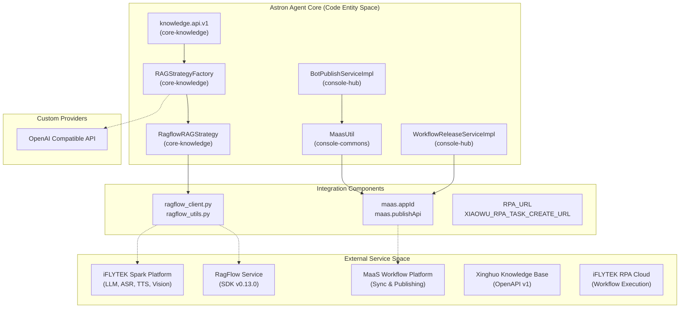
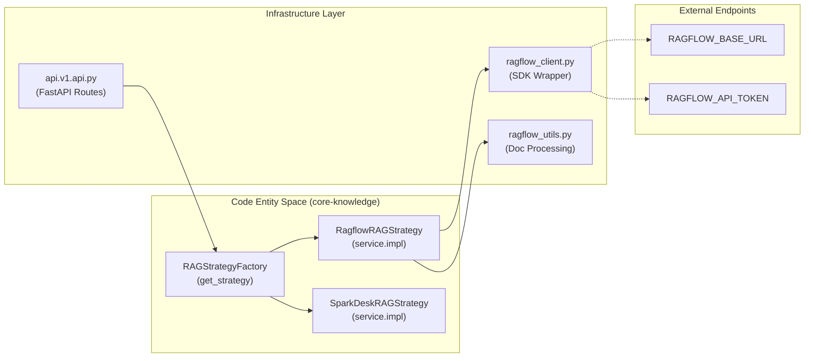

<!-- source: DeepWiki mcp.deepwiki.com · repo iflytek/astron-agent · page 13 External Service Integrations · fetched 2026-10-26 -->

# External Service Integrations

Relevant source files

The following files were used as context for generating this wiki page:

- [console/backend/commons/src/main/java/com/iflytek/astron/console/commons/util/MaasUtil.java](console/backend/commons/src/main/java/com/iflytek/astron/console/commons/util/MaasUtil.java)
- [console/backend/hub/src/main/java/com/iflytek/astron/console/hub/controller/publish/BotPublishController.java](console/backend/hub/src/main/java/com/iflytek/astron/console/hub/controller/publish/BotPublishController.java)
- [console/backend/hub/src/main/java/com/iflytek/astron/console/hub/entity/BotConversationStats.java](console/backend/hub/src/main/java/com/iflytek/astron/console/hub/entity/BotConversationStats.java)
- [console/backend/hub/src/main/java/com/iflytek/astron/console/hub/listener/WorkflowBotPublishListener.java](console/backend/hub/src/main/java/com/iflytek/astron/console/hub/listener/WorkflowBotPublishListener.java)
- [console/backend/hub/src/main/java/com/iflytek/astron/console/hub/mapper/BotConversationStatsMapper.java](console/backend/hub/src/main/java/com/iflytek/astron/console/hub/mapper/BotConversationStatsMapper.java)
- [console/backend/hub/src/main/java/com/iflytek/astron/console/hub/service/publish/BotPublishService.java](console/backend/hub/src/main/java/com/iflytek/astron/console/hub/service/publish/BotPublishService.java)
- [console/backend/hub/src/main/java/com/iflytek/astron/console/hub/service/publish/McpService.java](console/backend/hub/src/main/java/com/iflytek/astron/console/hub/service/publish/McpService.java)
- [console/backend/hub/src/main/java/com/iflytek/astron/console/hub/service/publish/impl/BotPublishServiceImpl.java](console/backend/hub/src/main/java/com/iflytek/astron/console/hub/service/publish/impl/BotPublishServiceImpl.java)
- [console/backend/hub/src/main/java/com/iflytek/astron/console/hub/service/workflow/impl/WorkflowReleaseServiceImpl.java](console/backend/hub/src/main/java/com/iflytek/astron/console/hub/service/workflow/impl/WorkflowReleaseServiceImpl.java)
- [console/backend/hub/src/main/java/com/iflytek/astron/console/hub/strategy/publish/PublishStrategy.java](console/backend/hub/src/main/java/com/iflytek/astron/console/hub/strategy/publish/PublishStrategy.java)
- [console/backend/hub/src/main/java/com/iflytek/astron/console/hub/strategy/publish/PublishStrategyFactory.java](console/backend/hub/src/main/java/com/iflytek/astron/console/hub/strategy/publish/PublishStrategyFactory.java)
- [console/backend/hub/src/main/java/com/iflytek/astron/console/hub/strategy/publish/impl/ApiPublishStrategy.java](console/backend/hub/src/main/java/com/iflytek/astron/console/hub/strategy/publish/impl/ApiPublishStrategy.java)
- [console/backend/hub/src/main/java/com/iflytek/astron/console/hub/strategy/publish/impl/FeishuPublishStrategy.java](console/backend/hub/src/main/java/com/iflytek/astron/console/hub/strategy/publish/impl/FeishuPublishStrategy.java)
- [console/backend/hub/src/main/java/com/iflytek/astron/console/hub/strategy/publish/impl/MarketPublishStrategy.java](console/backend/hub/src/main/java/com/iflytek/astron/console/hub/strategy/publish/impl/MarketPublishStrategy.java)
- [console/backend/hub/src/main/java/com/iflytek/astron/console/hub/strategy/publish/impl/McpPublishStrategy.java](console/backend/hub/src/main/java/com/iflytek/astron/console/hub/strategy/publish/impl/McpPublishStrategy.java)
- [console/backend/hub/src/main/java/com/iflytek/astron/console/hub/strategy/publish/impl/WechatPublishStrategy.java](console/backend/hub/src/main/java/com/iflytek/astron/console/hub/strategy/publish/impl/WechatPublishStrategy.java)
- [console/backend/hub/src/main/resources/mapper/BotConversationStatsMapper.xml](console/backend/hub/src/main/resources/mapper/BotConversationStatsMapper.xml)
- [core/knowledge/api/v1/api.py](core/knowledge/api/v1/api.py)
- [core/knowledge/consts/error_code.py](core/knowledge/consts/error_code.py)
- [core/knowledge/domain/entity/chunk_dto.py](core/knowledge/domain/entity/chunk_dto.py)
- [core/knowledge/infra/ragflow/__init__.py](core/knowledge/infra/ragflow/__init__.py)
- [core/knowledge/infra/ragflow/ragflow_client.py](core/knowledge/infra/ragflow/ragflow_client.py)
- [core/knowledge/infra/ragflow/ragflow_utils.py](core/knowledge/infra/ragflow/ragflow_utils.py)
- [core/knowledge/service/impl/ragflow_strategy.py](core/knowledge/service/impl/ragflow_strategy.py)
- [core/knowledge/service/impl/sparkdesk_strategy.py](core/knowledge/service/impl/sparkdesk_strategy.py)
- [core/knowledge/tests/infra/ragflow/ragflow_client_error_propagation_test.py](core/knowledge/tests/infra/ragflow/ragflow_client_error_propagation_test.py)
- [core/knowledge/tests/infra/ragflow/ragflow_client_pagination_test.py](core/knowledge/tests/infra/ragflow/ragflow_client_pagination_test.py)
- [core/knowledge/tests/infra/ragflow/ragflow_utils_test.py](core/knowledge/tests/infra/ragflow/ragflow_utils_test.py)
- [core/knowledge/tests/service/impl/ragflow_strategy_error_propagation_test.py](core/knowledge/tests/service/impl/ragflow_strategy_error_propagation_test.py)
- [core/knowledge/tests/service/impl/ragflow_strategy_pagination_test.py](core/knowledge/tests/service/impl/ragflow_strategy_pagination_test.py)
- [core/knowledge/tests/service/impl/ragflow_strategy_upsert_test.py](core/knowledge/tests/service/impl/ragflow_strategy_upsert_test.py)

The Astron Agent platform is designed as an extensible ecosystem that integrates with a wide variety of external AI, automation, and knowledge platforms. This page provides a high-level overview of the integration patterns used to connect with iFLYTEK Spark, RagFlow, MaaS, and RPA services.

## Overview of External Service Architecture

The platform leverages a microservices architecture where specific core services act as gateways to external providers. These integrations allow the platform to bridge "Natural Language Space" (user intent) to "Action Space" (external API execution).

### System Integration Map

The following diagram illustrates how internal services (Code Entity Space) map to external platforms and the components that govern their connectivity.

**Sources:** [console/backend/commons/src/main/java/com/iflytek/astron/console/commons/util/MaasUtil.java:43-86](), [core/knowledge/api/v1/api.py:35-38](), [core/knowledge/service/impl/ragflow_strategy.py:25-41](), [console/backend/hub/src/main/java/com/iflytek/astron/console/hub/service/publish/impl/BotPublishServiceImpl.java:68-87](), [console/backend/hub/src/main/java/com/iflytek/astron/console/hub/service/workflow/impl/WorkflowReleaseServiceImpl.java:44-55]()

## Integration Categories

### iFLYTEK Spark Platform Integration
The platform natively integrates with the iFLYTEK Spark ecosystem to provide core AI capabilities. This includes Large Language Models (LLM), Real-time Automatic Speech Recognition (RTASR), and image generation. Authentication typically uses a HMAC-SHA256 signature algorithm. The `core-knowledge` service utilizes Spark-based backends for RAG operations via strategies like `SparkDeskRAGStrategy`.

For details, see [iFLYTEK Spark Platform Integration](#13.1).

**Sources:** [console/backend/commons/src/main/java/com/iflytek/astron/console/commons/util/MaasUtil.java:171-180](), [core/knowledge/service/impl/sparkdesk_strategy.py:1-10]()

### RagFlow Knowledge Base Integration
For advanced Retrieval-Augmented Generation (RAG), the platform supports integration with RagFlow as an optional knowledge engine. The `core-knowledge` service implements `RagflowRAGStrategy` which interacts with the `ragflow_client`. It manages dataset lifecycle through `RagflowUtils.ensure_dataset` [core/knowledge/infra/ragflow/ragflow_utils.py:109-121]() and handles document parsing status tracking via `RagflowUtils.wait_for_parsing` [core/knowledge/service/impl/ragflow_strategy.py:185-188](). The integration also supports "blue-green" upsert patterns to ensure data consistency [core/knowledge/tests/service/impl/ragflow_strategy_upsert_test.py:73-82]().

For details, see [RagFlow Knowledge Base Integration](#13.2).

**Sources:** [core/knowledge/service/impl/ragflow_strategy.py:25-100](), [core/knowledge/infra/ragflow/ragflow_client.py:44-67](), [core/knowledge/tests/service/impl/ragflow_strategy_upsert_test.py:1-21]()

### MaaS Workflow Platform Integration
The platform synchronizes workflow definitions and publishing statuses with an external Model-as-a-Service (MaaS) platform. This is handled primarily by `MaasUtil`. Key operations include workflow synchronization via `synchronizeWorkFlow` [console/backend/commons/src/main/java/com/iflytek/astron/console/commons/util/MaasUtil.java:169-180]() and API publishing via `publishApi` [console/backend/commons/src/main/java/com/iflytek/astron/console/commons/util/MaasUtil.java:75-76](). The `WorkflowReleaseServiceImpl` handles versioning and audit result synchronization [console/backend/hub/src/main/java/com/iflytek/astron/console/hub/service/workflow/impl/WorkflowReleaseServiceImpl.java:103-126]().

For details, see [MaaS Workflow Platform Integration](#13.3).

**Sources:** [console/backend/commons/src/main/java/com/iflytek/astron/console/commons/util/MaasUtil.java:54-86](), [console/backend/hub/src/main/java/com/iflytek/astron/console/hub/service/workflow/impl/WorkflowReleaseServiceImpl.java:76-137]()

### Custom Provider Integrations
To ensure flexibility, the platform supports various publishing channels and AI providers. This includes support for OpenAI-compatible APIs and integration with external RPA cloud platforms. The architecture utilizes a Strategy Pattern for publishing to different channels like WeChat, MCP (Model Context Protocol), and API markets. Special listeners like `WorkflowBotPublishListener` ensure that workflow-specific publishing logic is triggered upon status changes [console/backend/hub/src/main/java/com/iflytek/astron/console/hub/listener/WorkflowBotPublishListener.java:35-42]().

For details, see [Custom Provider Integrations](#13.4).

**Sources:** [console/backend/hub/src/main/java/com/iflytek/astron/console/hub/strategy/publish/impl/McpPublishStrategy.java:18-38](), [console/backend/hub/src/main/java/com/iflytek/astron/console/hub/strategy/publish/impl/MarketPublishStrategy.java:32-38](), [console/backend/hub/src/main/java/com/iflytek/astron/console/hub/listener/WorkflowBotPublishListener.java:59-71]()

## Knowledge Service Strategy Mapping

The `core-knowledge` service implements a Strategy Pattern to switch between different external RAG providers at runtime via the `RAGStrategyFactory`.

**Sources:** [core/knowledge/service/impl/ragflow_strategy.py:25-41](), [core/knowledge/infra/ragflow/ragflow_utils.py:42-45](), [core/knowledge/api/v1/api.py:168-183](), [core/knowledge/infra/ragflow/ragflow_client.py:54-64]()

## Summary of Integration Components

| Platform | Key Code Entities | Primary Responsibility |
| :--- | :--- | :--- |
| **iFLYTEK Spark** | `MaasUtil`, `SparkDeskRAGStrategy` | LLM Inference, Speech (ASR/TTS), Workflow Domain Resolution |
| **RagFlow** | `RagflowRAGStrategy`, `ragflow_client.py` | Advanced RAG, Document Parsing, Blue-Green Upsert |
| **MaaS Platform** | `MaasUtil`, `WorkflowReleaseServiceImpl` | Workflow Sync, Versioning, API Publishing |
| **MCP** | `McpPublishStrategy`, `McpService` | Model Context Protocol integration for external tools |

**Sources:** [core/knowledge/service/impl/ragflow_strategy.py:25-31](), [console/backend/commons/src/main/java/com/iflytek/astron/console/commons/util/MaasUtil.java:43-86](), [console/backend/hub/src/main/java/com/iflytek/astron/console/hub/service/workflow/impl/WorkflowReleaseServiceImpl.java:76-137](), [console/backend/hub/src/main/java/com/iflytek/astron/console/hub/strategy/publish/impl/McpPublishStrategy.java:18-38]()

---

