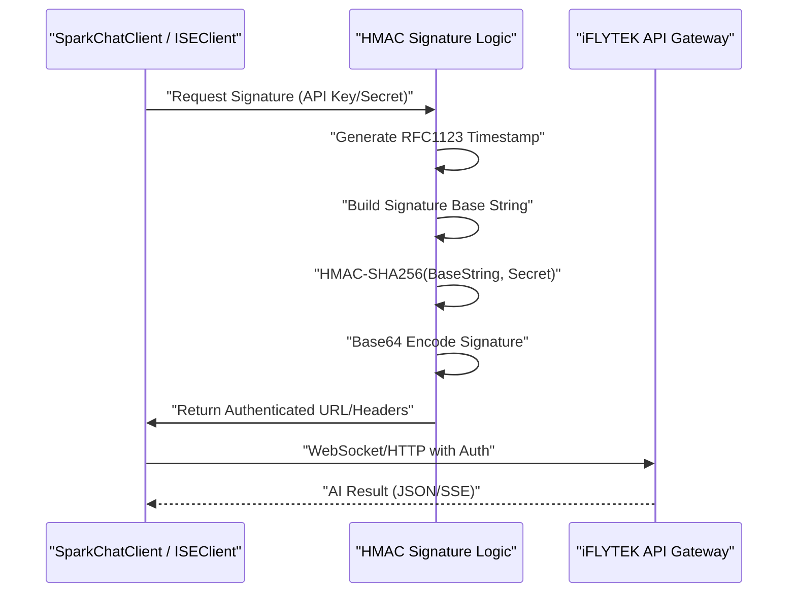
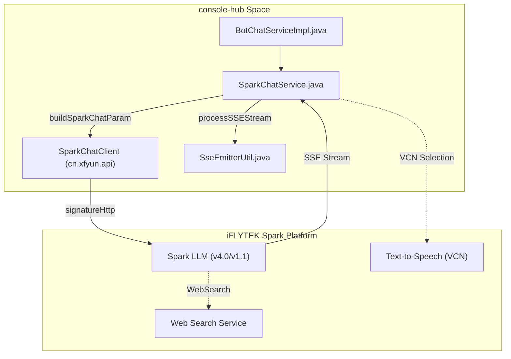

<!-- source: DeepWiki mcp.deepwiki.com · repo iflytek/astron-agent · page 13.1 iFLYTEK Spark Platform Integration · fetched 2026-10-26 -->

# iFLYTEK Spark Platform Integration

Relevant source files

The following files were used as context for generating this wiki page:

- [console/backend/commons/src/main/java/com/iflytek/astron/console/commons/util/SseEmitterUtil.java](console/backend/commons/src/main/java/com/iflytek/astron/console/commons/util/SseEmitterUtil.java)
- [console/backend/commons/src/main/java/com/iflytek/astron/console/commons/workflow/WorkflowClient.java](console/backend/commons/src/main/java/com/iflytek/astron/console/commons/workflow/WorkflowClient.java)
- [console/backend/commons/src/main/java/com/iflytek/astron/console/commons/workflow/WorkflowListener.java](console/backend/commons/src/main/java/com/iflytek/astron/console/commons/workflow/WorkflowListener.java)
- [console/backend/commons/src/test/java/com/iflytek/astron/console/commons/data/impl/UserInfoDataServiceImplUnitTest.java](console/backend/commons/src/test/java/com/iflytek/astron/console/commons/data/impl/UserInfoDataServiceImplUnitTest.java)
- [console/backend/commons/src/test/java/com/iflytek/astron/console/commons/service/data/impl/ChatListDataServiceImplTest.java](console/backend/commons/src/test/java/com/iflytek/astron/console/commons/service/data/impl/ChatListDataServiceImplTest.java)
- [console/backend/commons/src/test/java/com/iflytek/astron/console/commons/service/data/impl/UserLangChainInfoDataServiceImplTest.java](console/backend/commons/src/test/java/com/iflytek/astron/console/commons/service/data/impl/UserLangChainInfoDataServiceImplTest.java)
- [console/backend/commons/src/test/java/com/iflytek/astron/console/commons/service/space/impl/ApplyRecordServiceImplTest.java](console/backend/commons/src/test/java/com/iflytek/astron/console/commons/service/space/impl/ApplyRecordServiceImplTest.java)
- [console/backend/hub/src/main/java/com/iflytek/astron/console/hub/controller/chat/ChatEnhanceController.java](console/backend/hub/src/main/java/com/iflytek/astron/console/hub/controller/chat/ChatEnhanceController.java)
- [console/backend/hub/src/main/java/com/iflytek/astron/console/hub/controller/chat/ChatListController.java](console/backend/hub/src/main/java/com/iflytek/astron/console/hub/controller/chat/ChatListController.java)
- [console/backend/hub/src/main/java/com/iflytek/astron/console/hub/controller/extra/RtasrController.java](console/backend/hub/src/main/java/com/iflytek/astron/console/hub/controller/extra/RtasrController.java)
- [console/backend/hub/src/main/java/com/iflytek/astron/console/hub/service/SparkChatService.java](console/backend/hub/src/main/java/com/iflytek/astron/console/hub/service/SparkChatService.java)
- [console/backend/hub/src/main/java/com/iflytek/astron/console/hub/service/WorkflowChatService.java](console/backend/hub/src/main/java/com/iflytek/astron/console/hub/service/WorkflowChatService.java)
- [console/frontend/src/components/config-page-component/config-base/components/CapabilityDevelopment.tsx](console/frontend/src/components/config-page-component/config-base/components/CapabilityDevelopment.tsx)
- [console/frontend/src/components/config-page-component/config-base/types.ts](console/frontend/src/components/config-page-component/config-base/types.ts)
- [console/frontend/src/components/speaker-modal/index.tsx](console/frontend/src/components/speaker-modal/index.tsx)
- [console/frontend/src/components/speaker-modal/voice-training.tsx](console/frontend/src/components/speaker-modal/voice-training.tsx)
- [console/frontend/src/locales/en-En/openPlatform-En/space.ts](console/frontend/src/locales/en-En/openPlatform-En/space.ts)
- [console/frontend/src/locales/en.js](console/frontend/src/locales/en.js)
- [console/frontend/src/locales/zh-ZH/openPlatform-ZH/space.ts](console/frontend/src/locales/zh-ZH/openPlatform-ZH/space.ts)
- [console/frontend/src/locales/zh.js](console/frontend/src/locales/zh.js)
- [console/frontend/src/pages/bot-api/app-list.module.scss](console/frontend/src/pages/bot-api/app-list.module.scss)
- [console/frontend/src/pages/space/team-create/index.tsx](console/frontend/src/pages/space/team-create/index.tsx)
- [core/plugin/aitools/service/dial_test/dial_test.py](core/plugin/aitools/service/dial_test/dial_test.py)
- [core/plugin/aitools/service/dial_test/dial_test_client.py](core/plugin/aitools/service/dial_test/dial_test_client.py)
- [core/plugin/aitools/service/ise/ise_client.py](core/plugin/aitools/service/ise/ise_client.py)
- [core/plugin/aitools/service/translation/translation_client.py](core/plugin/aitools/service/translation/translation_client.py)

The Astron Agent platform integrates with iFLYTEK's Spark platform to provide AI capabilities including large language model inference, real-time speech recognition (RTASR), image generation, and virtual avatar services. This document describes the integration architecture, authentication mechanisms, and configuration requirements for each Spark service.

For information about custom LLM provider integrations, see [Custom Provider Integrations](). For RAG-specific knowledge base integration, see [RagFlow Knowledge Base Integration]().

---

## Overview

The iFLYTEK Spark platform provides several primary AI services that are integrated into Astron Agent:

| Service | Purpose | Primary Consumer Services |
|---------|---------|---------------------------|
| **Spark LLM** | Large language model for chat, generation, and reasoning | `core-workflow`, `console-hub` |
| **RTASR** | Real-time Automatic Speech Recognition | `console-hub` |
| **Image Generation** | AI-powered image creation for bot avatars | `core-aitools`, `console-hub` |
| **Virtual Avatar** | Digital human voice and speaker training | `console-frontend`, `console-hub` |
| **ISE/TTS/ITS** | Evaluation, Speech Synthesis, and Translation | `core-aitools` |

All Spark services require authentication credentials obtained from the iFLYTEK Open Platform.

**Sources:** [console/backend/hub/src/main/java/com/iflytek/astron/console/hub/service/SparkChatService.java:39-41](), [core/plugin/aitools/service/ise/ise_client.py:7-12](), [console/frontend/src/components/speaker-modal/index.tsx:13-17]()

---

## Authentication Architecture

### HMAC-SHA256 Authentication Flow

The platform primarily uses HMAC-SHA256 signature verification for Spark services. In the Java-based `console-hub` and Python-based `core-aitools`, this is handled by specialized clients.

**HMAC Signature Process:**
1. Generate an RFC1123 format timestamp.
2. Build a signature base string using the request URL, method, and date.
3. Apply HMAC-SHA256 using the `apiPassword` (Java) or `AI_API_SECRET` (Python).
4. Base64 encode the resulting signature.

In the `SparkChatService`, the `SparkChatClient` uses the `apiPassword` to sign HTTP requests for the Spark LLM. [console/backend/hub/src/main/java/com/iflytek/astron/console/hub/service/SparkChatService.java:75-76]()

**HMAC Authentication Data Flow**

**Sources:** [console/backend/hub/src/main/java/com/iflytek/astron/console/hub/service/SparkChatService.java:75-81](), [core/plugin/aitools/service/ise/ise_client.py:7-12]()

---

## AI Tools Integration (core-aitools)

The `core-aitools` service provides specialized AI capabilities through a plugin architecture.

### Speech Evaluation (ISE)

The `ISE` client provides intelligent speech assessment. It includes an `AudioConverter` to ensure audio files meet the required specifications for iFLYTEK's processing engine:
- **Format**: WAV (16kHz, 16bit, Mono). [core/plugin/aitools/service/ise/ise_client.py:126-129]()
- **Detection**: Supports `mp3`, `wav`, `ogg`, `flac`, and `amr` detection via magic numbers. [core/plugin/aitools/service/ise/ise_client.py:30-47]()
- **Parsing**: The `ISEResultParser` extracts structured scores from the XML results returned by the evaluation service. [core/plugin/aitools/service/ise/ise_client.py:166-182]()

### Translation and Dial Test

- **Translation**: Bidirectional translation between languages using the `TranslationClient`.
- **Dial Test**: The `dial_test_servic` (decorated with `@api_service`) provides health checks and service availability monitoring for external AI endpoints. [core/plugin/aitools/service/dial_test/dial_test.py:44-63]()

**Sources:** [core/plugin/aitools/service/ise/ise_client.py:26-30](), [core/plugin/aitools/service/dial_test/dial_test.py:74-81]()

---

## Console Hub & Frontend Integration

The `console-hub` service utilizes Spark APIs for real-time chat, AI-assisted bot generation, and virtual avatar management.

### Spark LLM Streaming (SparkChatService)

The `SparkChatService` handles streaming chat requests using Server-Sent Events (SSE). It supports:
- **Web Search**: Optional integration for real-time information retrieval using `WebSearch` parameters. [console/backend/hub/src/main/java/com/iflytek/astron/console/hub/service/SparkChatService.java:159-165]()
- **Model Selection**: Maps user requests to specific Spark versions, defaulting to `SPARK_X1` or specific high-performance models like `SPARK_4_0_ULTRA`. [console/backend/hub/src/main/java/com/iflytek/astron/console/hub/service/SparkChatService.java:134-137]()

### AI-Assisted Configuration

The `CapabilityDevelopment` component uses Spark APIs to automate bot configuration:
- **Input Example Generation**: Uses `generateInputExample` to create sample user queries. [console/frontend/src/components/config-page-component/config-base/components/CapabilityDevelopment.tsx:212-213]()
- **Prologue Generation**: Uses `generatePrologue` to create opening remarks based on the bot's personality. [console/frontend/src/components/config-page-component/config-base/components/CapabilityDevelopment.tsx:16-17]()

### Virtual Avatar & Speaker Training

The `SpeakerModal` component in the frontend allows users to select official Spark voices or create custom ones.
- **Voice Training**: Users can create custom speakers via the `VoiceTraining` component which triggers the `createMyVCN` flow. [console/frontend/src/components/speaker-modal/index.tsx:74-76]()
- **Management**: Integration with `getMySpeakerList`, `updateMySpeaker`, and `deleteMySpeaker` APIs. [console/frontend/src/components/speaker-modal/index.tsx:13-17]()

**Bot Chat to Spark Integration Mapping**

**Sources:** [console/backend/hub/src/main/java/com/iflytek/astron/console/hub/service/SparkChatService.java:54-59](), [console/backend/hub/src/main/java/com/iflytek/astron/console/hub/service/SparkChatService.java:75-78](), [console/frontend/src/components/speaker-modal/index.tsx:171-181](), [console/frontend/src/components/config-page-component/config-base/components/CapabilityDevelopment.tsx:157-161]()

---

## Workflow Integration

The `WorkflowListener` processes SSE streams from the workflow engine (which often uses Spark as the backbone LLM).

- **Thinking Process**: Captures `reasoning_content` from the stream to display AI "thinking" steps to the user. [console/backend/commons/src/main/java/com/iflytek/astron/console/commons/workflow/WorkflowListener.java:101-104]()
- **Interruption Handling**: Detects if a stream is stopped or interrupted and ensures partial results are persisted to `chat_reason` and response tables before closing the connection. [console/backend/commons/src/main/java/com/iflytek/astron/console/commons/workflow/WorkflowListener.java:66-70]()
- **Data Integrity**: Even if the client disconnects, the listener continues processing the stream to ensure the database record is complete. [console/backend/commons/src/main/java/com/iflytek/astron/console/commons/workflow/WorkflowListener.java:85-87]()

**Sources:** [console/backend/commons/src/main/java/com/iflytek/astron/console/commons/workflow/WorkflowListener.java:32-41](), [console/backend/commons/src/main/java/com/iflytek/astron/console/commons/workflow/WorkflowListener.java:114-116]()

---

## Configuration

The integration requires the following keys typically configured in the `console-hub` application properties or environment variables:

| Property | Description |
|----------|-------------|
| `spark.api.password` | The API Secret used for HMAC signing of LLM requests. |
| `spark.app-id` | The global Application ID for iFLYTEK services. |
| `ISE_URL_KEY` | Endpoint for the Speech Evaluation service. |

**Sources:** [console/backend/hub/src/main/java/com/iflytek/astron/console/hub/service/SparkChatService.java:39-40](), [core/plugin/aitools/service/ise/ise_client.py:22]()

---

