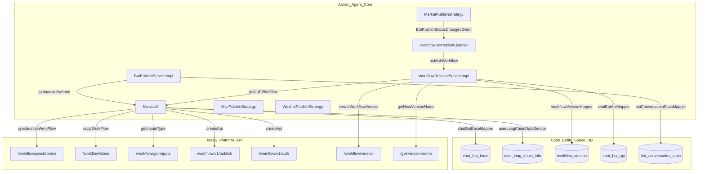
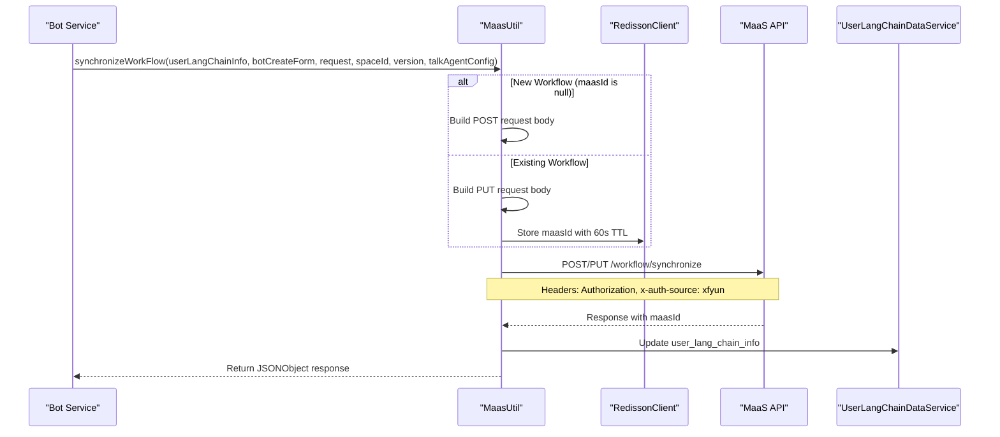
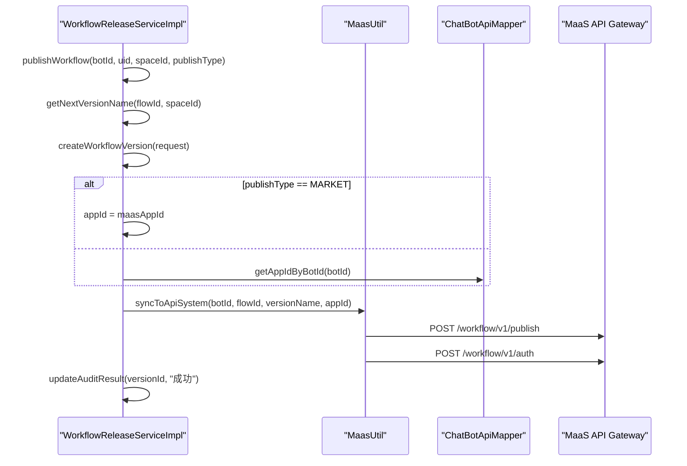
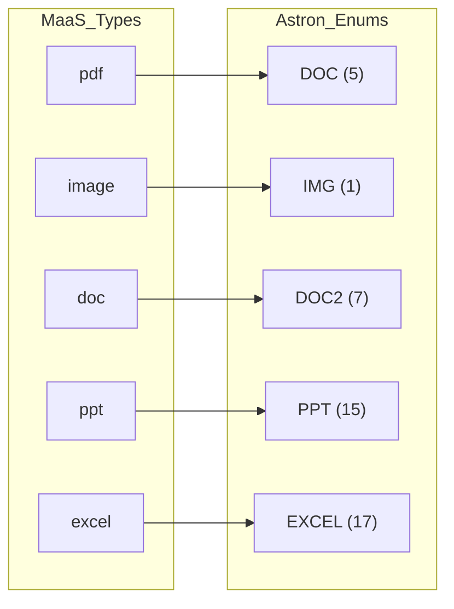

<!-- source: DeepWiki mcp.deepwiki.com · repo iflytek/astron-agent · page 13.3 MaaS Workflow Platform Integration · fetched 2026-10-26 -->

# MaaS Workflow Platform Integration

Relevant source files

The following files were used as context for generating this wiki page:

- [console/backend/commons/src/main/java/com/iflytek/astron/console/commons/util/MaasUtil.java](console/backend/commons/src/main/java/com/iflytek/astron/console/commons/util/MaasUtil.java)
- [console/backend/commons/src/test/java/com/iflytek/astron/console/commons/util/BotFileParamUtilTest.java](console/backend/commons/src/test/java/com/iflytek/astron/console/commons/util/BotFileParamUtilTest.java)
- [console/backend/commons/src/test/java/com/iflytek/astron/console/commons/util/MaasUtilTest.java](console/backend/commons/src/test/java/com/iflytek/astron/console/commons/util/MaasUtilTest.java)
- [console/backend/commons/src/test/java/com/iflytek/astron/console/commons/util/SseEmitterUtilTest.java](console/backend/commons/src/test/java/com/iflytek/astron/console/commons/util/SseEmitterUtilTest.java)
- [console/backend/hub/src/main/java/com/iflytek/astron/console/hub/controller/publish/BotPublishController.java](console/backend/hub/src/main/java/com/iflytek/astron/console/hub/controller/publish/BotPublishController.java)
- [console/backend/hub/src/main/java/com/iflytek/astron/console/hub/data/impl/ShareDataServiceImpl.java](console/backend/hub/src/main/java/com/iflytek/astron/console/hub/data/impl/ShareDataServiceImpl.java)
- [console/backend/hub/src/main/java/com/iflytek/astron/console/hub/entity/BotConversationStats.java](console/backend/hub/src/main/java/com/iflytek/astron/console/hub/entity/BotConversationStats.java)
- [console/backend/hub/src/main/java/com/iflytek/astron/console/hub/listener/WorkflowBotPublishListener.java](console/backend/hub/src/main/java/com/iflytek/astron/console/hub/listener/WorkflowBotPublishListener.java)
- [console/backend/hub/src/main/java/com/iflytek/astron/console/hub/mapper/BotConversationStatsMapper.java](console/backend/hub/src/main/java/com/iflytek/astron/console/hub/mapper/BotConversationStatsMapper.java)
- [console/backend/hub/src/main/java/com/iflytek/astron/console/hub/service/publish/BotPublishService.java](console/backend/hub/src/main/java/com/iflytek/astron/console/hub/service/publish/BotPublishService.java)
- [console/backend/hub/src/main/java/com/iflytek/astron/console/hub/service/publish/McpService.java](console/backend/hub/src/main/java/com/iflytek/astron/console/hub/service/publish/McpService.java)
- [console/backend/hub/src/main/java/com/iflytek/astron/console/hub/service/publish/impl/BotPublishServiceImpl.java](console/backend/hub/src/main/java/com/iflytek/astron/console/hub/service/publish/impl/BotPublishServiceImpl.java)
- [console/backend/hub/src/main/java/com/iflytek/astron/console/hub/service/workflow/impl/WorkflowReleaseServiceImpl.java](console/backend/hub/src/main/java/com/iflytek/astron/console/hub/service/workflow/impl/WorkflowReleaseServiceImpl.java)
- [console/backend/hub/src/main/java/com/iflytek/astron/console/hub/strategy/publish/PublishStrategy.java](console/backend/hub/src/main/java/com/iflytek/astron/console/hub/strategy/publish/PublishStrategy.java)
- [console/backend/hub/src/main/java/com/iflytek/astron/console/hub/strategy/publish/PublishStrategyFactory.java](console/backend/hub/src/main/java/com/iflytek/astron/console/hub/strategy/publish/PublishStrategyFactory.java)
- [console/backend/hub/src/main/java/com/iflytek/astron/console/hub/strategy/publish/impl/ApiPublishStrategy.java](console/backend/hub/src/main/java/com/iflytek/astron/console/hub/strategy/publish/impl/ApiPublishStrategy.java)
- [console/backend/hub/src/main/java/com/iflytek/astron/console/hub/strategy/publish/impl/FeishuPublishStrategy.java](console/backend/hub/src/main/java/com/iflytek/astron/console/hub/strategy/publish/impl/FeishuPublishStrategy.java)
- [console/backend/hub/src/main/java/com/iflytek/astron/console/hub/strategy/publish/impl/MarketPublishStrategy.java](console/backend/hub/src/main/java/com/iflytek/astron/console/hub/strategy/publish/impl/MarketPublishStrategy.java)
- [console/backend/hub/src/main/java/com/iflytek/astron/console/hub/strategy/publish/impl/McpPublishStrategy.java](console/backend/hub/src/main/java/com/iflytek/astron/console/hub/strategy/publish/impl/McpPublishStrategy.java)
- [console/backend/hub/src/main/java/com/iflytek/astron/console/hub/strategy/publish/impl/WechatPublishStrategy.java](console/backend/hub/src/main/java/com/iflytek/astron/console/hub/strategy/publish/impl/WechatPublishStrategy.java)
- [console/backend/hub/src/main/resources/mapper/BotConversationStatsMapper.xml](console/backend/hub/src/main/resources/mapper/BotConversationStatsMapper.xml)
- [console/backend/hub/src/test/java/com/iflytek/astron/console/hub/service/SparkChatServiceTest.java](console/backend/hub/src/test/java/com/iflytek/astron/console/hub/service/SparkChatServiceTest.java)

This document describes the integration between Astron Agent and the MaaS (Model as a Service) Workflow Platform. MaaS serves as a centralized workflow registry and API gateway that manages workflow versions, publishes workflows as callable APIs, and provides workflow lifecycle management capabilities.

This page focuses specifically on the MaaS platform integration layer. For information about workflow execution within Astron Agent itself, see [Workflow Architecture and MaaS Integration (4.1)](). For bot publishing workflows including MaaS synchronization, see [Bot Publishing Lifecycle (4.2)]().

## MaaS Platform Overview

MaaS is an external workflow management platform that provides:

- **Workflow Registry**: Central repository for storing workflow definitions and metadata. [[console/backend/commons/src/main/java/com/iflytek/astron/console/commons/util/MaasUtil.java:169-180]]()
- **Version Management**: Tracking workflow versions with audit trails. [[console/backend/hub/src/main/java/com/iflytek/astron/console/hub/service/workflow/impl/WorkflowReleaseServiceImpl.java:76-137]]()
- **API Gateway**: Publishing workflows as REST APIs with authentication. [[console/backend/commons/src/main/java/com/iflytek/astron/console/commons/util/MaasUtil.java:376-420]]()
- **Input Schema Management**: Defining and validating workflow input parameters. [[console/backend/commons/src/main/java/com/iflytek/astron/console/commons/util/MaasUtil.java:524-555]]()
- **Tag Management**: Categorizing workflows based on their node composition. [[console/backend/commons/src/main/java/com/iflytek/astron/console/commons/util/MaasUtil.java:309-367]]()

The Astron Agent platform synchronizes workflow definitions to MaaS when bots are created, updated, or published, enabling workflows to be invoked through MaaS APIs and managed through MaaS administrative interfaces.

**Sources**: 
- [[console/backend/commons/src/main/java/com/iflytek/astron/console/commons/util/MaasUtil.java:43-106]]()

## Integration Architecture

The following diagram illustrates how Astron Agent components interact with the MaaS platform:

Title: MaaS Integration Data Flow

**Sources**: 
- [[console/backend/commons/src/main/java/com/iflytek/astron/console/commons/util/MaasUtil.java:43-103]]()
- [[console/backend/hub/src/main/java/com/iflytek/astron/console/hub/service/workflow/impl/WorkflowReleaseServiceImpl.java:36-73]]()
- [[console/backend/hub/src/main/java/com/iflytek/astron/console/hub/service/publish/impl/BotPublishServiceImpl.java:68-90]]()
- [[console/backend/hub/src/main/java/com/iflytek/astron/console/hub/strategy/publish/impl/MarketPublishStrategy.java:32-38]]()
- [[console/backend/hub/src/main/java/com/iflytek/astron/console/hub/listener/WorkflowBotPublishListener.java:24-40]]()

## Configuration Properties

MaaS integration requires the following configuration properties defined in the application configuration:

| Property | Description | Used By |
|----------|-------------|---------|
| `maas.synchronizeWorkFlow` | Endpoint for workflow synchronization (POST/PUT/DELETE) | `MaasUtil.synchronizeUrl` [[console/backend/commons/src/main/java/com/iflytek/astron/console/commons/util/MaasUtil.java:54-55]]() |
| `maas.cloneWorkFlow` | Endpoint for cloning workflows | `MaasUtil.cloneWorkFlowUrl` [[console/backend/commons/src/main/java/com/iflytek/astron/console/commons/util/MaasUtil.java:57-58]]() |
| `maas.getInputs` | Endpoint for retrieving workflow input schema | `MaasUtil.getInputsUrl` [[console/backend/commons/src/main/java/com/iflytek/astron/console/commons/util/MaasUtil.java:60-61]]() |
| `maas.publishApi` | Endpoint for publishing workflows as APIs | `MaasUtil.publishApi` [[console/backend/commons/src/main/java/com/iflytek/astron/console/commons/util/MaasUtil.java:75-76]]() |
| `maas.authApi` | Endpoint for binding API authentication | `MaasUtil.authApi` [[console/backend/commons/src/main/java/com/iflytek/astron/console/commons/util/MaasUtil.java:78-79]]() |
| `maas.appId` | Default MaaS application ID | `BotPublishServiceImpl`, `WorkflowReleaseServiceImpl`, `MaasUtil` [[console/backend/hub/src/main/java/com/iflytek/astron/console/hub/service/publish/impl/BotPublishServiceImpl.java:88-89]]() |
| `maas.consumerId` | Consumer identifier for API requests | `MaasUtil.consumerId` [[console/backend/commons/src/main/java/com/iflytek/astron/console/commons/util/MaasUtil.java:66-67]]() |
| `maas.consumerKey` | Consumer key for authentication | `MaasUtil.consumerKey` [[console/backend/commons/src/main/java/com/iflytek/astron/console/commons/util/MaasUtil.java:72-73]]() |
| `maas.consumerSecret` | Consumer secret for authentication | `MaasUtil.consumerSecret` [[console/backend/commons/src/main/java/com/iflytek/astron/console/commons/util/MaasUtil.java:69-70]]() |
| `maas.workflowVersion` | Base URL for version management API | `WorkflowReleaseServiceImpl.baseUrl` [[console/backend/hub/src/main/java/com/iflytek/astron/console/hub/service/workflow/impl/WorkflowReleaseServiceImpl.java:44-45]]() |

**Sources**: 
- [[console/backend/commons/src/main/java/com/iflytek/astron/console/commons/util/MaasUtil.java:54-86]]()
- [[console/backend/hub/src/main/java/com/iflytek/astron/console/hub/service/publish/impl/BotPublishServiceImpl.java:88-89]]()
- [[console/backend/hub/src/main/java/com/iflytek/astron/console/hub/service/workflow/impl/WorkflowReleaseServiceImpl.java:44-49]]()

## Workflow Synchronization

### Create and Update Workflow

The `synchronizeWorkFlow()` method synchronizes bot workflow definitions to MaaS. It determines whether to create a new workflow or update an existing one based on the presence of a `maasId` in the `UserLangChainInfo` entity.

Title: Workflow Sync Sequence

**Key Request Parameters**:

| Field | Type | Source | Description |
|-------|------|--------|-------------|
| `id` | Long | `userLangChainInfo.getMaasId()` | MaaS workflow ID (PUT only) [[console/backend/commons/src/main/java/com/iflytek/astron/console/commons/util/MaasUtil.java:199-201]]() |
| `flowId` | String | `userLangChainInfo.getFlowId()` | Internal workflow ID (PUT only) [[console/backend/commons/src/main/java/com/iflytek/astron/console/commons/util/MaasUtil.java:202-202]]() |
| `name` | String | `botCreateForm.getName()` | Bot name [[console/backend/commons/src/main/java/com/iflytek/astron/console/commons/util/MaasUtil.java:179-179]]() |
| `description` | String | `botCreateForm.getBotDesc()` | Bot description [[console/backend/commons/src/main/java/com/iflytek/astron/console/commons/util/MaasUtil.java:175-175]]() |
| `avatarIcon` | String | `botCreateForm.getAvatar()` | Bot avatar URL [[console/backend/commons/src/main/java/com/iflytek/astron/console/commons/util/MaasUtil.java:173-173]]() |
| `appId` | String | `maasAppId` | MaaS application ID [[console/backend/commons/src/main/java/com/iflytek/astron/console/commons/util/MaasUtil.java:177-177]]() |
| `spaceId` | Long | Parameter | Space/tenant identifier [[console/backend/commons/src/main/java/com/iflytek/astron/console/commons/util/MaasUtil.java:180-180]]() |

**Sources**: 
- [[console/backend/commons/src/main/java/com/iflytek/astron/console/commons/util/MaasUtil.java:169-249]]()

### Delete Workflow

The `deleteSynchronize()` method removes a workflow from MaaS when a bot is deleted. It validates the bot version (must be version 3) and ensures a `maasId` exists before calling the DELETE endpoint of `synchronizeUrl`. [[console/backend/commons/src/main/java/com/iflytek/astron/console/commons/util/MaasUtil.java:115-131]]()

**Sources**: 
- [[console/backend/commons/src/main/java/com/iflytek/astron/console/commons/util/MaasUtil.java:108-167]]()

## Workflow Publishing and API Management

### Publishing Workflow as API

When a workflow bot is published, it triggers the `publishWorkflow` logic. The `WorkflowReleaseServiceImpl` registers the workflow in MaaS as a callable API and manages the lifecycle of the release. This is often triggered by `WorkflowBotPublishListener` which reacts to `BotPublishStatusChangedEvent`. [[console/backend/hub/src/main/java/com/iflytek/astron/console/hub/listener/WorkflowBotPublishListener.java:35-71]]()

Title: API Publishing Logic

**Sources**: 
- [[console/backend/hub/src/main/java/com/iflytek/astron/console/hub/service/workflow/impl/WorkflowReleaseServiceImpl.java:76-137]]()
- [[console/backend/hub/src/main/java/com/iflytek/astron/console/hub/service/workflow/impl/WorkflowReleaseServiceImpl.java:320-341]]()
- [[console/backend/commons/src/main/java/com/iflytek/astron/console/commons/util/MaasUtil.java:376-420]]()

### Multi-Channel Publishing Strategies

The system uses a Strategy pattern to handle different publishing channels via `PublishStrategy` implementations.

| Strategy Class | Channel | Description |
|----------------|---------|-------------|
| `MarketPublishStrategy` | MARKET | Handles bot publishing to the marketplace. Triggers `BotPublishStatusChangedEvent` to create workflow versions. [[console/backend/hub/src/main/java/com/iflytek/astron/console/hub/strategy/publish/impl/MarketPublishStrategy.java:32-141]]() |
| `WechatPublishStrategy` | WECHAT | Generates authorization URLs for WeChat official account binding via `BotPublishService.getWechatAuthUrl`. [[console/backend/hub/src/main/java/com/iflytek/astron/console/hub/strategy/publish/impl/WechatPublishStrategy.java:20-48]]() |
| `McpPublishStrategy` | MCP | Strategy for Model Context Protocol publishing (Implementation pending). [[console/backend/hub/src/main/java/com/iflytek/astron/console/hub/strategy/publish/impl/McpPublishStrategy.java:18-38]]() |
| `ApiPublishStrategy` | BOT_API | Handles publishing workflows as direct APIs (Implementation pending). [[console/backend/hub/src/main/java/com/iflytek/astron/console/hub/strategy/publish/impl/ApiPublishStrategy.java:16-52]]() |
| `FeishuPublishStrategy` | FEISHU | Handles bot publishing to Feishu channel (Implementation pending). [[console/backend/hub/src/main/java/com/iflytek/astron/console/hub/strategy/publish/impl/FeishuPublishStrategy.java:16-52]]() |

## Version Management

### Workflow Version Creation

The `WorkflowReleaseServiceImpl` manages workflow versions. It fetches the next version name from MaaS using the `GET_VERSION_NAME_URL` and creates a local `WorkflowVersion` record via `WorkflowVersionMapper`. [[console/backend/hub/src/main/java/com/iflytek/astron/console/hub/service/workflow/impl/WorkflowReleaseServiceImpl.java:143-163]]()

**Version Number Generation**:
A unique `versionNum` is generated using a timestamp and random component: `System.currentTimeMillis() + new Random().nextInt(900000) + 100000`. [[console/backend/hub/src/main/java/com/iflytek/astron/console/hub/service/workflow/impl/WorkflowReleaseServiceImpl.java:280-285]]()

**Sources**: 
- [[console/backend/hub/src/main/java/com/iflytek/astron/console/hub/service/workflow/impl/WorkflowReleaseServiceImpl.java:234-260]]()
- [[console/backend/hub/src/main/java/com/iflytek/astron/console/hub/service/workflow/impl/WorkflowReleaseServiceImpl.java:143-163]]()

## Statistics and Monitoring

The `BotPublishServiceImpl` provides integration for tracking bot usage metrics which are stored in the `bot_conversation_stats` table. [[console/backend/hub/src/main/java/com/iflytek/astron/console/hub/entity/BotConversationStats.java:17-18]]()

- **Summary Stats**: `BotConversationStatsMapper.selectSummaryStats` aggregates total tokens, chats, users, and messages. [[console/backend/hub/src/main/resources/mapper/BotConversationStatsMapper.xml:6-21]]()
- **Time Series Stats**: `BotConversationStatsMapper.selectTimeSeriesStats` provides daily trends of bot activity. [[console/backend/hub/src/main/resources/mapper/BotConversationStatsMapper.xml:24-45]]()

**Sources**:
- [[console/backend/hub/src/main/java/com/iflytek/astron/console/hub/service/publish/impl/BotPublishServiceImpl.java:82-83]]()
- [[console/backend/hub/src/main/resources/mapper/BotConversationStatsMapper.xml:1-47]]()

## Input Parameter Management

The `MaasUtil.getInputsType()` method retrieves input parameter schemas from MaaS. It filters out fixed parameters like `AGENT_USER_INPUT` and maps MaaS types to Astron Agent's `BotUploadEnum`. [[console/backend/commons/src/main/java/com/iflytek/astron/console/commons/util/MaasUtil.java:524-555]]()

Title: Parameter Type Mapping Logic

**Sources**: 
- [[console/backend/commons/src/main/java/com/iflytek/astron/console/commons/util/MaasUtil.java:524-555]]()
- [[console/backend/commons/src/main/java/com/iflytek/astron/console/commons/util/MaasUtil.java:617-640]]()

## Tag Management

The `setBotTag()` method in `MaasUtil` categorizes bots by analyzing their workflow node composition. It maps node types (e.g., Knowledge Base, Tool) to human-readable tags stored in `chat_bot_tag`. [[console/backend/commons/src/main/java/com/iflytek/astron/console/commons/util/MaasUtil.java:309-367]]()

1. **Analysis**: Parses workflow nodes from `TalkAgentConfigDto` and counts occurrences.
2. **Mapping**: Matches nodes against a list retrieved from Redis (`bot_tag_list`).
3. **Persistence**: Disables existing tags and inserts up to 3 new tags for the bot using `ChatBotTagService`.

**Sources**: 
- [[console/backend/commons/src/main/java/com/iflytek/astron/console/commons/util/MaasUtil.java:309-367]]()

---

