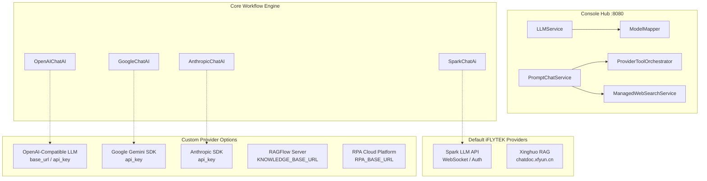
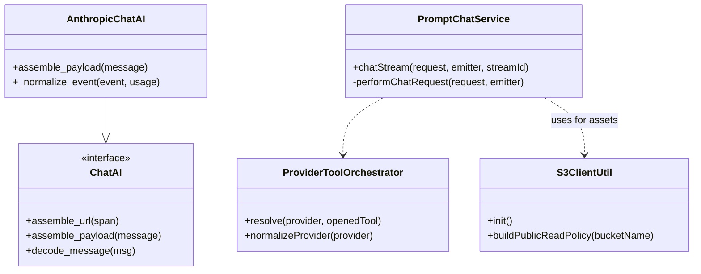

<!-- source: DeepWiki mcp.deepwiki.com · repo iflytek/astron-agent · page 13.4 Custom Provider Integrations · fetched 2026-10-26 -->

# Custom Provider Integrations

Relevant source files

The following files were used as context for generating this wiki page:

- [console/backend/commons/src/main/java/com/iflytek/astron/console/commons/util/S3ClientUtil.java](console/backend/commons/src/main/java/com/iflytek/astron/console/commons/util/S3ClientUtil.java)
- [console/backend/commons/src/main/java/com/iflytek/astron/console/commons/util/space/SpaceInfoUtil.java](console/backend/commons/src/main/java/com/iflytek/astron/console/commons/util/space/SpaceInfoUtil.java)
- [console/backend/commons/src/test/java/com/iflytek/astron/console/commons/util/S3ClientUtilTest.java](console/backend/commons/src/test/java/com/iflytek/astron/console/commons/util/S3ClientUtilTest.java)
- [console/backend/hub/src/main/java/com/iflytek/astron/console/hub/converter/BotPublishConverter.java](console/backend/hub/src/main/java/com/iflytek/astron/console/hub/converter/BotPublishConverter.java)
- [console/backend/hub/src/main/java/com/iflytek/astron/console/hub/service/ManagedWebSearchService.java](console/backend/hub/src/main/java/com/iflytek/astron/console/hub/service/ManagedWebSearchService.java)
- [console/backend/hub/src/main/java/com/iflytek/astron/console/hub/service/PromptChatService.java](console/backend/hub/src/main/java/com/iflytek/astron/console/hub/service/PromptChatService.java)
- [console/backend/hub/src/main/java/com/iflytek/astron/console/hub/service/chat/impl/ProviderToolOrchestrator.java](console/backend/hub/src/main/java/com/iflytek/astron/console/hub/service/chat/impl/ProviderToolOrchestrator.java)
- [console/backend/hub/src/test/java/com/iflytek/astron/console/hub/service/PromptChatServiceTest.java](console/backend/hub/src/test/java/com/iflytek/astron/console/hub/service/PromptChatServiceTest.java)
- [console/backend/hub/src/test/java/com/iflytek/astron/console/hub/service/chat/impl/BotChatServiceImplUnitTest.java](console/backend/hub/src/test/java/com/iflytek/astron/console/hub/service/chat/impl/BotChatServiceImplUnitTest.java)
- [console/backend/pom.xml](console/backend/pom.xml)
- [console/backend/toolkit/src/main/java/com/iflytek/astron/console/toolkit/service/model/LLMService.java](console/backend/toolkit/src/main/java/com/iflytek/astron/console/toolkit/service/model/LLMService.java)
- [console/backend/toolkit/src/main/java/com/iflytek/astron/console/toolkit/service/workflow/WorkflowExportService.java](console/backend/toolkit/src/main/java/com/iflytek/astron/console/toolkit/service/workflow/WorkflowExportService.java)
- [core/memory/database/domain/entity/database_meta.py](core/memory/database/domain/entity/database_meta.py)
- [core/memory/database/domain/entity/schema_meta.py](core/memory/database/domain/entity/schema_meta.py)
- [core/workflow/engine/nodes/util/frame_processor.py](core/workflow/engine/nodes/util/frame_processor.py)
- [core/workflow/infra/providers/llm/anthropic/anthropic_chat_llm.py](core/workflow/infra/providers/llm/anthropic/anthropic_chat_llm.py)
- [core/workflow/tests/engine/nodes/util/test_frame_processor.py](core/workflow/tests/engine/nodes/util/test_frame_processor.py)
- [core/workflow/tests/infra/providers/llm/test_chat_ai_factory.py](core/workflow/tests/infra/providers/llm/test_chat_ai_factory.py)

This document describes the custom provider integration capabilities of the Astron Agent platform, enabling organizations to substitute external services with their own infrastructure. The platform supports custom integrations for LLM providers (OpenAI-compatible), Google Gemini (via official SDK), Anthropic Claude, knowledge base systems (RAGFlow), RPA platforms, and local model services through standardized configuration patterns.

## Integration Architecture Overview

The Astron Agent platform uses a provider abstraction pattern that allows external services to be swapped without code changes. Each integration point follows a consistent configuration approach using environment variables for endpoints, authentication credentials, and service-specific parameters.

Title: Provider Integration Data Flow

Sources: [console/backend/toolkit/src/main/java/com/iflytek/astron/console/toolkit/service/model/LLMService.java:60-90](), [console/backend/hub/src/main/java/com/iflytek/astron/console/hub/service/PromptChatService.java:30-45](), [console/backend/hub/src/main/java/com/iflytek/astron/console/hub/service/ManagedWebSearchService.java:28-40](), [core/workflow/infra/providers/llm/anthropic/anthropic_chat_llm.py:29-67]()

## Multi-Provider LLM Management

The platform supports a wide array of LLM providers through standardized interfaces. This is managed by the `LLMService` which handles model authorization and filtering [console/backend/toolkit/src/main/java/com/iflytek/astron/console/toolkit/service/model/LLMService.java:51-57]().

### Supported Providers
The `LLMService` handles specific logic for providers including:
* **Global Providers**: `openai`, `anthropic`, `google`, `chatgpt` [console/backend/toolkit/src/main/java/com/iflytek/astron/console/toolkit/service/model/LLMService.java:61-69]().
* **Regional Providers**: `deepseek`, `minimax`, `zhipu`, `qwen`, `moonshot`, `doubao` [console/backend/toolkit/src/main/java/com/iflytek/astron/console/toolkit/service/model/LLMService.java:64-70]().

### Authorization and Filtering
* **Authorization**: The `getLlmAuthList` method retrieves available models grouped by categories like "My Models" (fine-tuned) and "Custom Models" [console/backend/toolkit/src/main/java/com/iflytek/astron/console/toolkit/service/model/LLMService.java:105-148]().
* **Provider Normalization**: The system uses `ProviderToolOrchestrator.normalizeProvider` to ensure consistent handling of provider strings, converting to lowercase and defaulting to `openai` if blank [console/backend/hub/src/main/java/com/iflytek/astron/console/hub/service/chat/impl/ProviderToolOrchestrator.java:74-80]().

Sources: [console/backend/toolkit/src/main/java/com/iflytek/astron/console/toolkit/service/model/LLMService.java:60-148](), [console/backend/hub/src/main/java/com/iflytek/astron/console/hub/service/chat/impl/ProviderToolOrchestrator.java:74-80]()

## Chat Execution and Tool Orchestration

The `PromptChatService` manages the execution of chat requests for custom providers using an `OkHttpClient` [console/backend/hub/src/main/java/com/iflytek/astron/console/hub/service/PromptChatService.java:36-95]().

### Tool Capability Matrix
The `ProviderToolOrchestrator` resolves how capabilities like web search are handled across different providers [console/backend/hub/src/main/java/com/iflytek/astron/console/hub/service/chat/impl/ProviderToolOrchestrator.java:14-21]().

| Web Search Mode | Providers | Implementation Mechanism |
|:---|:---|:---|
| `SPARK_NATIVE` | `spark` | Uses `SparkChatRequest.enableWebSearch` [console/backend/hub/src/main/java/com/iflytek/astron/console/hub/service/chat/impl/ProviderToolOrchestrator.java:50]() |
| `GOOGLE_NATIVE` | `google` | Injects `google_search` into the tools array [console/backend/hub/src/main/java/com/iflytek/astron/console/hub/service/chat/impl/ProviderToolOrchestrator.java:58]() |
| `ANTHROPIC_NATIVE` | `anthropic` | Injects `web_search` tool and `anthropic-beta` header [console/backend/hub/src/main/java/com/iflytek/astron/console/hub/service/chat/impl/ProviderToolOrchestrator.java:59-62]() |
| `OPENAI_FUNCTION` | Others | Uses `ManagedWebSearchService` with `ifly_search` function [console/backend/hub/src/main/java/com/iflytek/astron/console/hub/service/chat/impl/ProviderToolOrchestrator.java:63-66]() |

### Managed Web Search
For providers without native search, `ManagedWebSearchService` performs a search via Spark's search mode ("deep") and augments the user prompt with a factual summary [console/backend/hub/src/main/java/com/iflytek/astron/console/hub/service/ManagedWebSearchService.java:104-116]().

Sources: [console/backend/hub/src/main/java/com/iflytek/astron/console/hub/service/chat/impl/ProviderToolOrchestrator.java:22-142](), [console/backend/hub/src/main/java/com/iflytek/astron/console/hub/service/ManagedWebSearchService.java:42-102]()

## Python Workflow Provider Implementation

In the `core-workflow` service, LLM integrations are implemented as subclasses of `ChatAI` [core/workflow/infra/providers/llm/anthropic/anthropic_chat_llm.py:29]().

### AnthropicChatAI Implementation
The `AnthropicChatAI` class utilizes the official Anthropic SDK for Claude models [core/workflow/infra/providers/llm/anthropic/anthropic_chat_llm.py:30-35]().
* **Payload Assembly**: Separates `system` messages from the main conversation and handles `image` content types by converting them to base64 blocks [core/workflow/infra/providers/llm/anthropic/anthropic_chat_llm.py:81-111]().
* **Event Normalization**: The `_normalize_event` method converts Anthropic stream events (like `RawContentBlockDeltaEvent`) into an OpenAI-compatible structure for the frontend [core/workflow/infra/providers/llm/anthropic/anthropic_chat_llm.py:178-200]().

### Unified Frame Processing
The `FrameProcessor` hierarchy ensures that various LLM response formats are unified into a `UnionFrame` [core/workflow/engine/nodes/util/frame_processor.py:102-123]().
* **AgentFrameProcessor**: Specifically handles tool calls and reasoning content from agent nodes [core/workflow/engine/nodes/util/frame_processor.py:166-190]().
* **AIPaaSFrameProcessor**: Standardizes responses from the AI Platform as a Service [core/workflow/engine/nodes/util/frame_processor.py:144-163]().

Sources: [core/workflow/infra/providers/llm/anthropic/anthropic_chat_llm.py:29-200](), [core/workflow/engine/nodes/util/frame_processor.py:102-190]()

## Storage and Infrastructure Integration

Custom providers often require specific infrastructure settings for data persistence.

### Object Storage (S3/MinIO)
The platform uses an S3-compatible interface (via `MinioClient`) for object storage, managed by `S3ClientUtil` [console/backend/commons/src/main/java/com/iflytek/astron/console/commons/util/S3ClientUtil.java:38-63]().
* **Initialization**: Validates configuration for `endpoint`, `accessKey`, `secretKey`, and `bucket` [console/backend/commons/src/main/java/com/iflytek/astron/console/commons/util/S3ClientUtil.java:118-143]().
* **Presigned URLs**: Uses a separate `presignClient` configured with a `remoteEndpoint` to generate accessible URLs for the frontend [console/backend/commons/src/main/java/com/iflytek/astron/console/commons/util/S3ClientUtil.java:79-84]().
* **Public Access**: Can apply a `s3:GetObject` policy to the bucket if `enablePublicRead` is true [console/backend/commons/src/main/java/com/iflytek/astron/console/commons/util/S3ClientUtil.java:152-169]().

Title: Provider Integration Code Relationships

| Component | Code Entity | Responsibility |
|-----------|-------------|----------------|
| **LLM Provider** | `LLMService` | Manages model authorization and provider categorization [console/backend/toolkit/src/main/java/com/iflytek/astron/console/toolkit/service/model/LLMService.java:60]() |
| **Anthropic Integration** | `AnthropicChatAI` | Python implementation for Claude interaction via SDK [core/workflow/infra/providers/llm/anthropic/anthropic_chat_llm.py:29]() |
| **Tool Orchestration** | `ProviderToolOrchestrator` | Resolves capability differences (like web search) between providers [console/backend/hub/src/main/java/com/iflytek/astron/console/hub/service/chat/impl/ProviderToolOrchestrator.java:22]() |
| **Storage Utility** | `S3ClientUtil` | MinIO/S3 client for persistent file storage and presigning [console/backend/commons/src/main/java/com/iflytek/astron/console/commons/util/S3ClientUtil.java:38]() |
| **Search Augmentation** | `ManagedWebSearchService` | Provides web search results for providers without native support [console/backend/hub/src/main/java/com/iflytek/astron/console/hub/service/ManagedWebSearchService.java:28]() |

Sources: [console/backend/toolkit/src/main/java/com/iflytek/astron/console/toolkit/service/model/LLMService.java:60-148](), [console/backend/hub/src/main/java/com/iflytek/astron/console/hub/service/PromptChatService.java:30-132](), [core/workflow/infra/providers/llm/anthropic/anthropic_chat_llm.py:29-200](), [console/backend/commons/src/main/java/com/iflytek/astron/console/commons/util/S3ClientUtil.java:38-169]()

---

