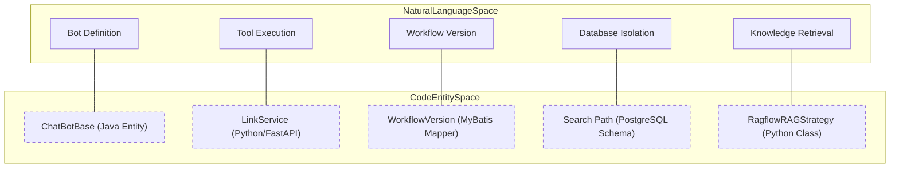
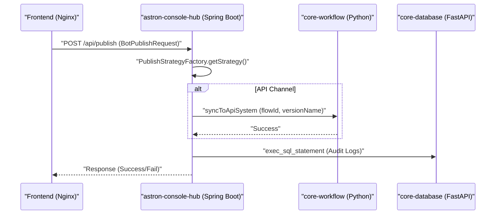

<!-- source: DeepWiki mcp.deepwiki.com · repo iflytek/astron-agent · page 15 Glossary · fetched 2026-10-26 -->

# Glossary

Relevant source files

The following files were used as context for generating this wiki page:

- [README.md](README.md)
- [console/backend/commons/src/main/java/com/iflytek/astron/console/commons/util/MaasUtil.java](console/backend/commons/src/main/java/com/iflytek/astron/console/commons/util/MaasUtil.java)
- [console/backend/hub/src/main/java/com/iflytek/astron/console/hub/controller/publish/BotPublishController.java](console/backend/hub/src/main/java/com/iflytek/astron/console/hub/controller/publish/BotPublishController.java)
- [console/backend/hub/src/main/java/com/iflytek/astron/console/hub/entity/BotConversationStats.java](console/backend/hub/src/main/java/com/iflytek/astron/console/hub/entity/BotConversationStats.java)
- [console/backend/hub/src/main/java/com/iflytek/astron/console/hub/listener/WorkflowBotPublishListener.java](console/backend/hub/src/main/java/com/iflytek/astron/console/hub/listener/WorkflowBotPublishListener.java)
- [console/backend/hub/src/main/java/com/iflytek/astron/console/hub/mapper/BotConversationStatsMapper.java](console/backend/hub/src/main/java/com/iflytek/astron/console/hub/mapper/BotConversationStatsMapper.java)
- [console/backend/hub/src/main/java/com/iflytek/astron/console/hub/service/publish/BotPublishService.java](console/backend/hub/src/main/java/com/iflytek/astron/console/hub/service/publish/BotPublishService.java)
- [console/backend/hub/src/main/java/com/iflytek/astron/console/hub/service/publish/McpService.java](console/backend/hub/src/main/java/com/iflytek/astron/console/hub/service/publish/McpService.java)
- [console/backend/hub/src/main/java/com/iflytek/astron/console/hub/service/publish/impl/BotPublishServiceImpl.java](console/backend/hub/src/main/java/com/iflytek/astron/console/hub/service/publish/impl/BotPublishServiceImpl.java)
- [console/backend/hub/src/main/java/com/iflytek/astron/console/hub/service/workflow/impl/WorkflowReleaseServiceImpl.java](console/backend/hub/src/main/java/com/iflytek/astron/console/hub/service/workflow/impl/WorkflowReleaseServiceImpl.java)
- [console/backend/hub/src/main/java/com/iflytek/astron/console/hub/strategy/publish/PublishStrategy.java](console/backend/hub/src/main/java/com/iflytek/astron/console/hub/strategy/publish/PublishStrategy.java)
- [console/backend/hub/src/main/java/com/iflytek/astron/console/hub/strategy/publish/PublishStrategyFactory.java](console/backend/hub/src/main/java/com/iflytek/astron/console/hub/strategy/publish/PublishStrategyFactory.java)
- [console/backend/hub/src/main/java/com/iflytek/astron/console/hub/strategy/publish/impl/ApiPublishStrategy.java](console/backend/hub/src/main/java/com/iflytek/astron/console/hub/strategy/publish/impl/ApiPublishStrategy.java)
- [console/backend/hub/src/main/java/com/iflytek/astron/console/hub/strategy/publish/impl/FeishuPublishStrategy.java](console/backend/hub/src/main/java/com/iflytek/astron/console/hub/strategy/publish/impl/FeishuPublishStrategy.java)
- [console/backend/hub/src/main/java/com/iflytek/astron/console/hub/strategy/publish/impl/MarketPublishStrategy.java](console/backend/hub/src/main/java/com/iflytek/astron/console/hub/strategy/publish/impl/MarketPublishStrategy.java)
- [console/backend/hub/src/main/java/com/iflytek/astron/console/hub/strategy/publish/impl/McpPublishStrategy.java](console/backend/hub/src/main/java/com/iflytek/astron/console/hub/strategy/publish/impl/McpPublishStrategy.java)
- [console/backend/hub/src/main/java/com/iflytek/astron/console/hub/strategy/publish/impl/WechatPublishStrategy.java](console/backend/hub/src/main/java/com/iflytek/astron/console/hub/strategy/publish/impl/WechatPublishStrategy.java)
- [console/backend/hub/src/main/resources/application.yml](console/backend/hub/src/main/resources/application.yml)
- [console/backend/hub/src/main/resources/mapper/BotConversationStatsMapper.xml](console/backend/hub/src/main/resources/mapper/BotConversationStatsMapper.xml)
- [console/frontend/index.html](console/frontend/index.html)
- [console/frontend/public/runtime-config.js](console/frontend/public/runtime-config.js)
- [core/knowledge/api/v1/api.py](core/knowledge/api/v1/api.py)
- [core/knowledge/consts/error_code.py](core/knowledge/consts/error_code.py)
- [core/knowledge/domain/entity/chunk_dto.py](core/knowledge/domain/entity/chunk_dto.py)
- [core/knowledge/infra/ragflow/__init__.py](core/knowledge/infra/ragflow/__init__.py)
- [core/knowledge/infra/ragflow/ragflow_client.py](core/knowledge/infra/ragflow/ragflow_client.py)
- [core/knowledge/infra/ragflow/ragflow_utils.py](core/knowledge/infra/ragflow/ragflow_utils.py)
- [core/knowledge/service/impl/ragflow_strategy.py](core/knowledge/service/impl/ragflow_strategy.py)
- [core/knowledge/service/impl/sparkdesk_strategy.py](core/knowledge/service/impl/sparkdesk_strategy.py)
- [core/knowledge/tests/infra/ragflow/ragflow_client_error_propagation_test.py](core/knowledge/tests/infra/ragflow/ragflow_client_error_propagation_test.py)
- [core/knowledge/tests/infra/ragflow/ragflow_client_pagination_test.py](core/knowledge/tests/infra/ragflow/ragflow_client_pagination_test.py)
- [core/knowledge/tests/infra/ragflow/ragflow_utils_test.py](core/knowledge/tests/infra/ragflow/ragflow_utils_test.py)
- [core/knowledge/tests/service/impl/ragflow_strategy_error_propagation_test.py](core/knowledge/tests/service/impl/ragflow_strategy_error_propagation_test.py)
- [core/knowledge/tests/service/impl/ragflow_strategy_pagination_test.py](core/knowledge/tests/service/impl/ragflow_strategy_pagination_test.py)
- [core/knowledge/tests/service/impl/ragflow_strategy_upsert_test.py](core/knowledge/tests/service/impl/ragflow_strategy_upsert_test.py)
- [core/memory/database/api/router.py](core/memory/database/api/router.py)
- [core/memory/database/api/v1/__init__.py](core/memory/database/api/v1/__init__.py)
- [core/memory/database/api/v1/common.py](core/memory/database/api/v1/common.py)
- [core/memory/database/api/v1/db_operator.py](core/memory/database/api/v1/db_operator.py)
- [core/memory/database/api/v1/exec_ddl.py](core/memory/database/api/v1/exec_ddl.py)
- [core/memory/database/api/v1/exec_dml.py](core/memory/database/api/v1/exec_dml.py)
- [core/memory/database/main.py](core/memory/database/main.py)
- [core/memory/database/repository/middleware/database/db_factory.py](core/memory/database/repository/middleware/database/db_factory.py)
- [core/memory/database/repository/middleware/mid_utils.py](core/memory/database/repository/middleware/mid_utils.py)
- [core/workflow/engine/callbacks/callback_handler.py](core/workflow/engine/callbacks/callback_handler.py)
- [core/workflow/engine/dsl_engine.py](core/workflow/engine/dsl_engine.py)
- [core/workflow/engine/entities/chains.py](core/workflow/engine/entities/chains.py)
- [core/workflow/engine/entities/variable_pool.py](core/workflow/engine/entities/variable_pool.py)
- [core/workflow/engine/entities/workflow_dsl.py](core/workflow/engine/entities/workflow_dsl.py)
- [core/workflow/engine/node.py](core/workflow/engine/node.py)
- [core/workflow/engine/nodes/base_node.py](core/workflow/engine/nodes/base_node.py)
- [core/workflow/engine/nodes/code/executor/local/local_executor.py](core/workflow/engine/nodes/code/executor/local/local_executor.py)
- [core/workflow/engine/nodes/if_else/if_else_node.py](core/workflow/engine/nodes/if_else/if_else_node.py)
- [core/workflow/engine/nodes/iteration/iteration_node.py](core/workflow/engine/nodes/iteration/iteration_node.py)
- [core/workflow/engine/nodes/llm/spark_llm_node.py](core/workflow/engine/nodes/llm/spark_llm_node.py)
- [core/workflow/service/chat_service.py](core/workflow/service/chat_service.py)
- [core/workflow/service/flow_service.py](core/workflow/service/flow_service.py)
- [docker/astronAgent/.env.example](docker/astronAgent/.env.example)
- [docker/astronAgent/docker-compose.yaml](docker/astronAgent/docker-compose.yaml)
- [docker/astronAgent/nginx/nginx.conf](docker/astronAgent/nginx/nginx.conf)
- [docker/ragflow/docker-compose-macos.yml](docker/ragflow/docker-compose-macos.yml)
- [docs/CONFIGURATION.md](docs/CONFIGURATION.md)
- [docs/CONFIGURATION_zh.md](docs/CONFIGURATION_zh.md)
- [docs/CONTRIBUTING_CN.md](docs/CONTRIBUTING_CN.md)
- [docs/DEPLOYMENT_GUIDE.md](docs/DEPLOYMENT_GUIDE.md)
- [docs/DEPLOYMENT_GUIDE_zh.md](docs/DEPLOYMENT_GUIDE_zh.md)
- [docs/README-zh.md](docs/README-zh.md)

This page provides definitions for codebase-specific terms, jargon, and domain concepts used throughout the Astron Agent platform. It serves as a technical reference for onboarding engineers to understand the mapping between high-level concepts and their implementation in code.

## 1. Core Platform Concepts

| Term | Definition | Code Reference |
|:---|:---|:---|
| **Agentic Workflow** | A structured sequence of AI operations, tool calls, and logic gates that define how an Agent performs complex tasks. | `core-workflow` service |
| **MaaS (Model as a Service)** | The underlying platform providing LLM capabilities, workflow versioning, and API synchronization. | [console/backend/hub/src/main/resources/application.yml:176-194]() |
| **MCP (Model Context Protocol)** | A standard protocol for integrating external tools and data sources into LLM applications. | [console/backend/hub/src/main/java/com/iflytek/astron/console/hub/strategy/publish/impl/McpPublishStrategy.java:13-18]() |
| **RPA (Robotic Process Automation)** | Integration with automation scripts (e.g., iFLYTEK RPA) to perform UI-based tasks. | [docker/astronAgent/.env.example:136-142]() |
| **Space ID** | A multi-tenancy identifier used to isolate resources (bots, databases, workflows) within a specific organizational context. | [console/backend/hub/src/main/java/com/iflytek/astron/console/hub/service/publish/impl/BotPublishServiceImpl.java:95-100]() |
| **Knowledge RAG** | Retrieval-Augmented Generation using either Xinghuo RAG or RagFlow for document-based QA. | [core/knowledge/service/impl/ragflow_strategy.py:24-30]() |

### System Entity Mapping
The following diagram bridges Natural Language concepts to the specific Code Entities that manage them.

**Diagram: Concept to Code Entity Mapping**

**Sources:** [console/backend/hub/src/main/java/com/iflytek/astron/console/hub/service/publish/impl/BotPublishServiceImpl.java:70-80](), [core/memory/database/api/v1/exec_dml.py:24-24](), [console/backend/commons/src/main/java/com/iflytek/astron/console/commons/util/MaasUtil.java:13-15](), [core/knowledge/service/impl/ragflow_strategy.py:24-30]()

---

## 2. Service-Specific Jargon

### Core-Database (Memory Database)
*   **DML Rewriting**: The process of intercepting SQL (INSERT/UPDATE/SELECT) and automatically injecting `uid` filters or `LIMIT` clauses to ensure tenant isolation.
    *   *Implementation*: Uses `sqlglot` to parse AST and modify expressions via `_build_insert_literal_map` and similar functions. [core/memory/database/api/v1/exec_dml.py:11-43]()
*   **Search Path**: A PostgreSQL mechanism used by `core-database` to switch between tenant schemas dynamically based on `space_id`. [core/memory/database/api/v1/exec_dml.py:24-25]()
*   **AST-based Reconstruction**: The process of using Abstract Syntax Trees (via `sqlglot` or `sqlparse`) to validate and rebuild SQL queries before execution to prevent injection. [core/memory/database/api/v1/exec_dml.py:11-32]()

### Core-Link (Toolbox)
*   **HTTP Run**: The execution endpoint for standard OpenAPI-defined tools. [docker/astronAgent/.env.example:163-163]()
*   **ToolBox**: The internal registry managing tool metadata, versions, and OpenAPI schemas. [docker/astronAgent/.env.example:161-161]()

### Core-Knowledge (RAG)
*   **RAGFlow Strategy**: A strategy pattern implementation for document retrieval using the RagFlow API. [core/knowledge/service/impl/ragflow_strategy.py:24-30]()
*   **Chunk Query**: The process of retrieving specific text segments from the vector database. [docker/astronAgent/.env.example:168-168]()

### Console Hub (Backend)
*   **Bot Marketplace (Market)**: A channel for publishing bots to a shared directory within the enterprise, managed by `MarketPublishStrategy`. [console/backend/hub/src/main/java/com/iflytek/astron/console/hub/service/publish/impl/BotPublishServiceImpl.java:70-71]()
*   **Workflow Release**: The process of creating a `WorkflowVersion` and syncing it to the API system. [console/backend/hub/src/main/java/com/iflytek/astron/console/hub/service/workflow/impl/WorkflowReleaseServiceImpl.java:30-36]()
*   **Publish Strategy**: A pattern implementation for handling different output channels (Market, API, WeChat, MCP). [console/backend/hub/src/main/java/com/iflytek/astron/console/hub/strategy/publish/PublishStrategy.java:1-30]()

---

## 3. Data Flow and Architecture

The platform relies on a distributed architecture where the `Console Hub` orchestrates requests to specialized `Core` services.

**Diagram: Service Interaction & Data Flow**

**Sources:** [console/backend/hub/src/main/java/com/iflytek/astron/console/hub/service/publish/impl/BotPublishServiceImpl.java:120-149](), [console/backend/hub/src/main/java/com/iflytek/astron/console/hub/service/workflow/impl/WorkflowReleaseServiceImpl.java:116-123](), [core/memory/database/api/v1/exec_dml.py:23-23]()

---

## 4. Abbreviations Table

| Abbreviation | Full Term | Context |
|:---|:---|:---|
| **OTLP** | OpenTelemetry Protocol | Used for tracing and metrics across services. [docker/astronAgent/.env.example:70-80]() |
| **RTASR** | Real-Time Automatic Speech Recognition | iFLYTEK capability for voice agents. [console/backend/hub/src/main/resources/application.yml:133-134]() |
| **DML** | Data Manipulation Language | SQL operations (Insert, Update, Delete) managed by `core-database`. [core/memory/database/api/v1/exec_dml.py:1-5]() |
| **DDL** | Data Definition Language | SQL operations (Create, Drop, Alter) for schema management. [core/memory/database/api/v1/exec_ddl.py:1-5]() |
| **OSS** | Object Storage Service | Abstraction for MinIO or S3 used for file storage. [docker/astronAgent/.env.example:60-68]() |
| **SSE** | Server-Sent Events | Used for streaming LLM responses and workflow execution logs. [docker/astronAgent/.env.example:166-166]() |
| **DSL** | Domain Specific Language | The internal JSON structure defining workflow nodes and connections. [core/workflow/engine/dsl_engine.py:1-20]() |

---

## 5. Deployment & Infrastructure Terms

*   **Casdoor**: The centralized OAuth2/OIDC provider used for all authentication flows. [docker/astronAgent/.env.example:108-111]()
*   **RagFlow**: An optional RAG engine integration for deep document understanding and retrieval. [docs/DEPLOYMENT_GUIDE_zh.md:46-48]()
*   **Flyway**: The database migration tool used in the Console Hub to manage MySQL schema versions. [console/backend/hub/src/main/resources/application.yml:67-80]()
*   **Nginx**: The reverse proxy serving the frontend and routing requests to backend services. [docker/astronAgent/docker-compose.yaml:241-241]()
*   **Spark LLM**: The primary iFLYTEK large language model provider integrated via API. [console/backend/hub/src/main/resources/application.yml:127-140]()

**Sources:**
- [docker/astronAgent/.env.example:1-200]()
- [console/backend/hub/src/main/java/com/iflytek/astron/console/hub/service/publish/impl/BotPublishServiceImpl.java:65-150]()
- [core/memory/database/api/v1/exec_dml.py:1-100]()
- [console/backend/hub/src/main/resources/application.yml:1-190]()
- [docs/DEPLOYMENT_GUIDE_zh.md:1-160]()
- [core/knowledge/service/impl/ragflow_strategy.py:24-90]()