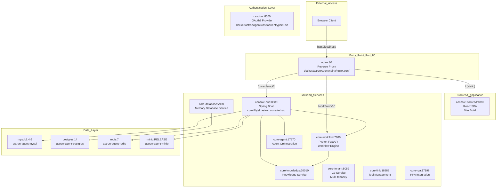
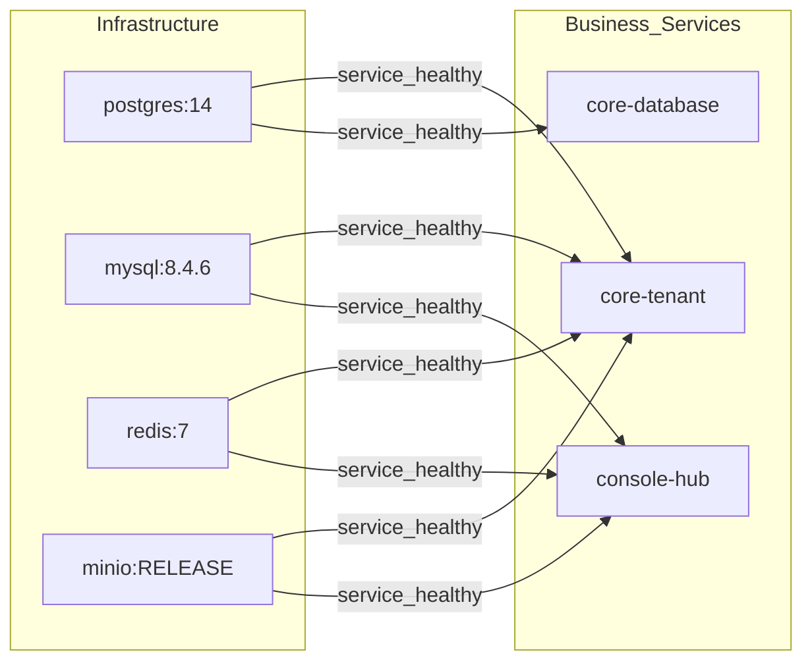

<!-- source: DeepWiki mcp.deepwiki.com · repo iflytek/astron-agent · page 2.2 Quick Start with Docker Compose · fetched 2026-10-26 -->

# Quick Start with Docker Compose

<details>
<summary>Relevant source files</summary>

The following files were used as context for generating this wiki page:

- [README.md](README.md)
- [console/backend/hub/src/main/resources/application.yml](console/backend/hub/src/main/resources/application.yml)
- [console/frontend/index.html](console/frontend/index.html)
- [console/frontend/public/runtime-config.js](console/frontend/public/runtime-config.js)
- [docker/astronAgent/.env.example](docker/astronAgent/.env.example)
- [docker/astronAgent/casdoor/conf/app.conf](docker/astronAgent/casdoor/conf/app.conf)
- [docker/astronAgent/casdoor/conf/init_data.json](docker/astronAgent/casdoor/conf/init_data.json)
- [docker/astronAgent/casdoor/conf/init_data.json.template](docker/astronAgent/casdoor/conf/init_data.json.template)
- [docker/astronAgent/casdoor/entrypoint.sh](docker/astronAgent/casdoor/entrypoint.sh)
- [docker/astronAgent/docker-compose-auth.yml](docker/astronAgent/docker-compose-auth.yml)
- [docker/astronAgent/docker-compose-with-auth.yaml](docker/astronAgent/docker-compose-with-auth.yaml)
- [docker/astronAgent/docker-compose.yaml](docker/astronAgent/docker-compose.yaml)
- [docker/astronAgent/nginx/nginx.conf](docker/astronAgent/nginx/nginx.conf)
- [docker/ragflow/docker-compose-macos.yml](docker/ragflow/docker-compose-macos.yml)
- [docker/ragflow/docker-compose.yml](docker/ragflow/docker-compose.yml)
- [docs/CONFIGURATION.md](docs/CONFIGURATION.md)
- [docs/CONFIGURATION_zh.md](docs/CONFIGURATION_zh.md)
- [docs/CONTRIBUTING_CN.md](docs/CONTRIBUTING_CN.md)
- [docs/DEPLOYMENT_GUIDE.md](docs/DEPLOYMENT_GUIDE.md)
- [docs/DEPLOYMENT_GUIDE_WITH_AUTH.md](docs/DEPLOYMENT_GUIDE_WITH_AUTH.md)
- [docs/DEPLOYMENT_GUIDE_WITH_AUTH_RPA.md](docs/DEPLOYMENT_GUIDE_WITH_AUTH_RPA.md)
- [docs/DEPLOYMENT_GUIDE_WITH_AUTH_RPA_zh.md](docs/DEPLOYMENT_GUIDE_WITH_AUTH_RPA_zh.md)
- [docs/DEPLOYMENT_GUIDE_WITH_AUTH_zh.md](docs/DEPLOYMENT_GUIDE_WITH_AUTH_zh.md)
- [docs/DEPLOYMENT_GUIDE_zh.md](docs/DEPLOYMENT_GUIDE_zh.md)
- [docs/README-zh.md](docs/README-zh.md)

</details>


This page provides a step-by-step guide for deploying the Astron Agent platform using Docker Compose. This deployment method is recommended for quick evaluation, development environments, and small-scale production deployments on a single host.

**Scope**: This guide covers the complete deployment sequence including Casdoor authentication (required), optional RagFlow knowledge base, and all core services. It specifically details the usage of `docker-compose.yaml` and integrated configurations like `docker-compose-with-auth.yaml`.

---

## Deployment Architecture Overview

The Docker Compose deployment uses a single-host architecture where all services run as containers orchestrated through Docker Compose. Services communicate via a dedicated Docker bridge network (`astron-agent-network`), and Nginx serves as the entry point reverse proxy.

### System Components and Code Entities

The following diagram maps high-level system components to their corresponding code entities and service definitions.



**Sources**: [docker/astronAgent/docker-compose.yaml:1-200](), [docs/DEPLOYMENT_GUIDE_zh.md:5-11](), [docker/astronAgent/nginx/nginx.conf:45-186]()

---

## Step 1: Prepare Environment Configuration

The platform relies on a central `.env` file for orchestration. Copy the provided example to get started.

```bash
cd docker/astronAgent
cp .env.example .env
```

### Key Environment Variables
The `.env` file controls service versions, middleware credentials, and inter-service URLs.

| Variable | Default Value | Description |
|----------|---------------|-------------|
| `ASTRON_AGENT_VERSION` | `latest` | Image tag for all core services [docker/astronAgent/.env.example:9-9]() |
| `HOST_BASE_ADDRESS` | `http://localhost` | Base URL for external access [docker/astronAgent/.env.example:85-85]() |
| `MYSQL_URL` | `jdbc:mysql://mysql:3306/...` | Connection string for the console backend [docker/astronAgent/.env.example:29-29]() |
| `OSS_ENDPOINT` | `http://minio:9000` | Internal endpoint for S3 storage [docker/astronAgent/.env.example:62-62]() |
| `CONSOLE_CASDOOR_URL` | `${HOST_BASE_ADDRESS}:${CASDOOR_PORT}` | Auth server endpoint for frontend [docker/astronAgent/.env.example:108-108]() |
| `SPARK_APP_ID` | `xxx` | iFLYTEK Spark LLM credentials [console/backend/hub/src/main/resources/application.yml:128-128]() |

**Sources**: [docker/astronAgent/.env.example:1-202](), [docs/DEPLOYMENT_GUIDE_zh.md:178-194](), [console/backend/hub/src/main/resources/application.yml:126-140]()

---

## Step 2: Deploy Infrastructure and Core Services

The deployment is modular. You can choose to deploy the core platform or include the integrated Auth module.

### Option A: Standard Deployment
Includes core services and middleware (MySQL, PostgreSQL, Redis, MinIO).
```bash
docker compose up -d
```

### Option B: Integrated Deployment (Auth Included)
Includes Casdoor for authentication using the `include` mechanism or a combined YAML file.
```bash
docker compose -f docker-compose-with-auth.yaml up -d
```

### Service Dependency Flow
The platform uses Docker `healthcheck` and `depends_on` to ensure correct startup order.



**Sources**: [docker/astronAgent/docker-compose.yaml:178-186](), [docker/astronAgent/docker-compose.yaml:222-226](), [docs/DEPLOYMENT_GUIDE_zh.md:159-252]()

---

## Step 3: Configure Casdoor Authentication

When using the auth-integrated deployment, the Casdoor service initializes with a custom `entrypoint.sh` that injects environment variables into the Casdoor configuration.

1. **Initialization**: The script `docker/astronAgent/casdoor/entrypoint.sh` replaces placeholders in `init_data.json.template` with the `CONSOLE_DOMAIN` and `HOST_BASE_ADDRESS` defined in your `.env` [docker/astronAgent/casdoor/entrypoint.sh:14-18]().
2. **Access**: Navigate to `http://localhost:8000` (or your configured `CASDOOR_PORT`).
3. **Default App**: The system pre-configures `astron-agent-client` and `astron-agent-app` within the `built-in` organization [docker/astronAgent/.env.example:109-111]().
4. **Login**: Default administrator credentials are `admin / 123` [docs/DEPLOYMENT_GUIDE_zh.md:131-131]().

**Sources**: [docker/astronAgent/casdoor/entrypoint.sh:1-25](), [docker/astronAgent/.env.example:108-112](), [docs/DEPLOYMENT_GUIDE_zh.md:129-148](), [docker/astronAgent/docker-compose-auth.yml:1-42]()

---

## Step 4: Optional RagFlow Setup

For advanced RAG capabilities, you can deploy RagFlow alongside Astron Agent.

1. **Deployment**: Run the RagFlow compose file in its directory:
   ```bash
   cd docker/ragflow
   chmod +x *.sh
   docker compose up -d
   ```
   [docs/DEPLOYMENT_GUIDE_zh.md:52-61]()
2. **Configuration**: Set `RAGFLOW_BASE_URL` and `RAGFLOW_API_TOKEN` in your `.env` file [docker/astronAgent/.env.example:179-180]().
3. **Integration**: The `core-knowledge` service uses these credentials to communicate with the RagFlow API for document chunking and retrieval [docker/astronAgent/.env.example:101-101]().

**Sources**: [docs/DEPLOYMENT_GUIDE_zh.md:46-74](), [docker/astronAgent/.env.example:178-184]()

---

## Verification and Health Checks

To verify the deployment, check the health status of the containers:

```bash
docker ps --format "table {{.Names}}\t{{.Status}}\t{{.Ports}}"
```

### Key Health Check Implementations
- **PostgreSQL**: Uses `pg_isready -U ${POSTGRES_USER} -d sparkdb_manager` [docker/astronAgent/docker-compose.yaml:22-25]().
- **MySQL**: Uses `mysqladmin ping` [docker/astronAgent/docker-compose.yaml:40-43]().
- **Redis**: Uses `redis-cli ping` with optional password [docker/astronAgent/docker-compose.yaml:56-59]().
- **MinIO**: Checks the `/minio/health/live` endpoint [docker/astronAgent/docker-compose.yaml:143-146]().

**Sources**: [docker/astronAgent/docker-compose.yaml:1-150]()

---

