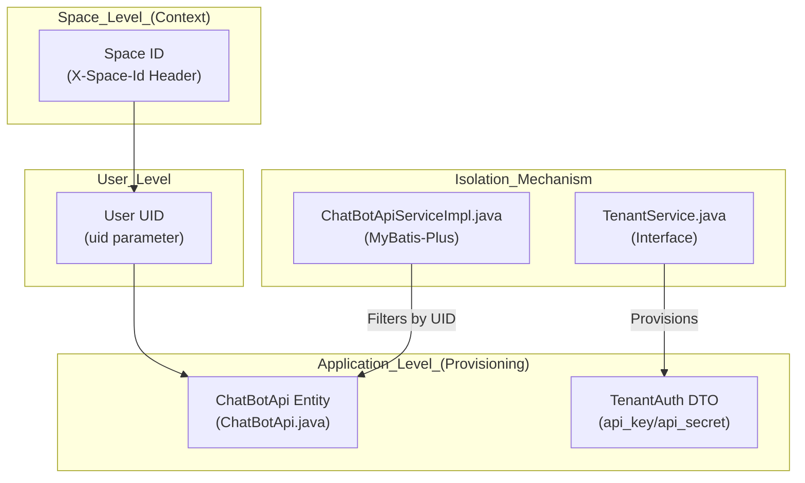
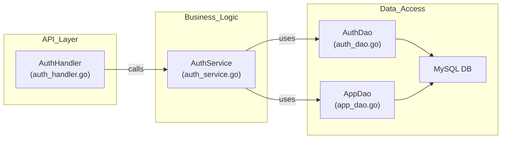

<!-- source: DeepWiki mcp.deepwiki.com · repo iflytek/astron-agent · page 3.2 Tenant and Multi-Tenancy Management · fetched 2026-10-26 -->

# Tenant and Multi-Tenancy Management

<details>
<summary>Relevant source files</summary>

The following files were used as context for generating this wiki page:

- [console/backend/commons/src/main/java/com/iflytek/astron/console/commons/dto/bot/ChatBotApi.java](console/backend/commons/src/main/java/com/iflytek/astron/console/commons/dto/bot/ChatBotApi.java)
- [console/backend/hub/pom.xml](console/backend/hub/pom.xml)
- [console/backend/hub/src/main/java/com/iflytek/astron/console/hub/dto/publish/cbm/AssistantInfo.java](console/backend/hub/src/main/java/com/iflytek/astron/console/hub/dto/publish/cbm/AssistantInfo.java)
- [console/backend/hub/src/main/java/com/iflytek/astron/console/hub/dto/publish/cbm/CbmBody.java](console/backend/hub/src/main/java/com/iflytek/astron/console/hub/dto/publish/cbm/CbmBody.java)
- [console/backend/hub/src/main/java/com/iflytek/astron/console/hub/dto/publish/cbm/CbmForm.java](console/backend/hub/src/main/java/com/iflytek/astron/console/hub/dto/publish/cbm/CbmForm.java)
- [console/backend/hub/src/main/java/com/iflytek/astron/console/hub/dto/publish/cbm/CbmResponse.java](console/backend/hub/src/main/java/com/iflytek/astron/console/hub/dto/publish/cbm/CbmResponse.java)
- [console/backend/hub/src/main/java/com/iflytek/astron/console/hub/dto/publish/cbm/Options.java](console/backend/hub/src/main/java/com/iflytek/astron/console/hub/dto/publish/cbm/Options.java)
- [console/backend/hub/src/main/java/com/iflytek/astron/console/hub/dto/user/TenantAuth.java](console/backend/hub/src/main/java/com/iflytek/astron/console/hub/dto/user/TenantAuth.java)
- [console/backend/hub/src/main/java/com/iflytek/astron/console/hub/service/chat/ChatBotApiService.java](console/backend/hub/src/main/java/com/iflytek/astron/console/hub/service/chat/ChatBotApiService.java)
- [console/backend/hub/src/main/java/com/iflytek/astron/console/hub/service/chat/impl/ChatBotApiServiceImpl.java](console/backend/hub/src/main/java/com/iflytek/astron/console/hub/service/chat/impl/ChatBotApiServiceImpl.java)
- [console/backend/hub/src/main/java/com/iflytek/astron/console/hub/service/publish/TenantService.java](console/backend/hub/src/main/java/com/iflytek/astron/console/hub/service/publish/TenantService.java)
- [console/backend/hub/src/main/java/com/iflytek/astron/console/hub/service/publish/impl/TenantServiceImpl.java](console/backend/hub/src/main/java/com/iflytek/astron/console/hub/service/publish/impl/TenantServiceImpl.java)
- [core/tenant/Dockerfile](core/tenant/Dockerfile)
- [core/tenant/config.toml](core/tenant/config.toml)
- [core/tenant/config/config.go](core/tenant/config/config.go)
- [core/tenant/config/config_test.go](core/tenant/config/config_test.go)
- [core/tenant/config/env_loader.go](core/tenant/config/env_loader.go)
- [core/tenant/config/env_loader_test.go](core/tenant/config/env_loader_test.go)
- [core/tenant/config/loader_test.go](core/tenant/config/loader_test.go)
- [core/tenant/config/local_loader_test.go](core/tenant/config/local_loader_test.go)
- [core/tenant/internal/dao/app_dao_test.go](core/tenant/internal/dao/app_dao_test.go)
- [core/tenant/internal/dao/auth_dao_test.go](core/tenant/internal/dao/auth_dao_test.go)
- [core/tenant/internal/dao/base_test.go](core/tenant/internal/dao/base_test.go)
- [core/tenant/internal/handler/app_handler_test.go](core/tenant/internal/handler/app_handler_test.go)
- [core/tenant/internal/handler/auth_handler.go](core/tenant/internal/handler/auth_handler.go)
- [core/tenant/internal/handler/auth_handler_test.go](core/tenant/internal/handler/auth_handler_test.go)
- [core/tenant/internal/handler/resp_test.go](core/tenant/internal/handler/resp_test.go)
- [core/tenant/internal/handler/router.go](core/tenant/internal/handler/router.go)
- [core/tenant/internal/handler/router_test.go](core/tenant/internal/handler/router_test.go)
- [core/tenant/internal/service/app_service_test.go](core/tenant/internal/service/app_service_test.go)
- [core/tenant/internal/service/auth_service.go](core/tenant/internal/service/auth_service.go)
- [core/tenant/internal/service/auth_service_test.go](core/tenant/internal/service/auth_service_test.go)
- [core/tenant/tools/database/database_test.go](core/tenant/tools/database/database_test.go)
- [core/tenant/tools/generator/sid_test.go](core/tenant/tools/generator/sid_test.go)

</details>


## Purpose and Scope

This document describes the multi-tenancy architecture of the Astron Agent platform, implemented through the `core-tenant` service and space-based access control. The system supports organizational hierarchies with isolated workspaces called "spaces." Each space provides data isolation and resource management. The platform manages application provisioning, API key generation, and cross-service authentication to ensure tenant isolation.

---

## Multi-Tenancy Architecture Overview

The Astron Agent platform implements a multi-tenancy model where **Enterprises** contain multiple **Spaces**, and each space contains **Users** with associated resources (bots, workflows, apps).

**Diagram: Multi-Tenancy Hierarchy and Code Entities**



**Sources**: [console/backend/hub/src/main/java/com/iflytek/astron/console/hub/service/chat/impl/ChatBotApiServiceImpl.java:31-33](), [console/backend/hub/src/main/java/com/iflytek/astron/console/hub/dto/user/TenantAuth.java:16-21](), [console/backend/commons/src/main/java/com/iflytek/astron/console/commons/dto/bot/ChatBotApi.java:1-20]()

Data access is strictly filtered by `uid` (user ID). This ensures that users only interact with resources they own or have been granted access to within their space.

**Sources**: [console/backend/hub/src/main/java/com/iflytek/astron/console/hub/service/chat/impl/ChatBotApiServiceImpl.java:61-67]()

---

## Core Tenant Service Implementation

### Service Architecture

The `core-tenant` service is a Go-based microservice responsible for application registration and API credential management. It uses a layered architecture consisting of Handlers, Services, and DAOs.

**Diagram: core-tenant Internal Service Structure**



**Sources**: [core/tenant/internal/handler/auth_handler.go:15-26](), [core/tenant/internal/service/app_service_test.go:8-10]()

### Application Provisioning

When a user creates an "App" for API publishing, the system performs the following steps:
1.  **Remote Provisioning**: The `TenantServiceImpl` in the console hub calls the `core-tenant` service via `createApp` to generate a unique `app_id`. It includes a `request_id` generated from the user `uid` and a UUID [console/backend/hub/src/main/java/com/iflytek/astron/console/hub/service/publish/impl/TenantServiceImpl.java:38-50]().
2.  **Credential Retrieval**: The `getAppDetail` method retrieves the `auth_list` for a specific `appId`, which contains the `api_key` and `api_secret` [console/backend/hub/src/main/java/com/iflytek/astron/console/hub/service/publish/impl/TenantServiceImpl.java:73-99]().
3.  **Persistence**: The `ChatBotApiServiceImpl` manages the local lifecycle of these credentials, using `insertOrUpdate` to ensure the bot's API configuration is stored against the user's `uid` [console/backend/hub/src/main/java/com/iflytek/astron/console/hub/service/chat/impl/ChatBotApiServiceImpl.java:46-58]().

**Sources**: [console/backend/hub/src/main/java/com/iflytek/astron/console/hub/service/publish/impl/TenantServiceImpl.java:38-70](), [console/backend/hub/src/main/java/com/iflytek/astron/console/hub/service/publish/impl/TenantServiceImpl.java:73-99](), [console/backend/hub/src/main/java/com/iflytek/astron/console/hub/service/chat/impl/ChatBotApiServiceImpl.java:46-58]()

---

## API Key Generation and Management

The platform manages API keys generated per application created by users in the console.

### Key Generation Logic

The `AuthHandler` in the `core-tenant` service handles the lifecycle of these credentials. During the `SaveAuth` operation, it generates timestamps and delegates the logic to the `AuthService`.

*   **Creation**: Handled by `AuthHandler.SaveAuth` [core/tenant/internal/handler/auth_handler.go:68-101]().
*   **Deletion**: Handled by `AuthHandler.DeleteAuth`, which requires both `app_id` and `api_key` [core/tenant/internal/handler/auth_handler.go:103-129]().

**Sources**: [core/tenant/internal/handler/auth_handler.go:68-101](), [core/tenant/internal/handler/auth_handler.go:103-129]()

### Credential Retrieval and Validation

The `AuthHandler` provides endpoints to list credentials for an app or find an application by its API key.

| Function | Code Entity | Description |
|----------|-------------|-------------|
| List Credentials | `AuthHandler.ListAuth` | Returns all API keys/secrets for a given `app_id` [core/tenant/internal/handler/auth_handler.go:28-66](). |
| Find App by Key | `AuthHandler.GetAppByAPIKey` | Look up application metadata (name, dev_id, channel_id) using an API key [core/tenant/internal/handler/auth_handler.go:131-162](). |

**Sources**: [core/tenant/internal/handler/auth_handler.go:28-66](), [core/tenant/internal/handler/auth_handler.go:131-162]()

---

## Tenant Isolation in Bot API Publishing

Multi-tenancy is enforced during the bot publishing process to ensure users can only access their own API configurations.

### Isolation at the Mapper Level

The `ChatBotApiServiceImpl` uses MyBatis-Plus wrappers to ensure every query includes a `uid` equality check. For example, when retrieving a specific bot's API configuration, the system filters by both `botId` and `uid`.

```java
// From ChatBotApiServiceImpl.java
public ChatBotApi getOneByUidAndBotId(String uid, Long botId) {
    return chatBotApiMapper.selectOne(Wrappers.lambdaQuery(ChatBotApi.class)
            .eq(ChatBotApi::getBotId, botId)
            .eq(ChatBotApi::getUid, uid)
            .orderByDesc(ChatBotApi::getId)
            .last("limit 1"));
}
```

**Sources**: [console/backend/hub/src/main/java/com/iflytek/astron/console/hub/service/chat/impl/ChatBotApiServiceImpl.java:61-67]()

---

## Configuration and Environment

The `core-tenant` service is configured via environment variables, loaded by an `EnvLoader` [core/tenant/config/env_loader.go:8-12]().

### Core Tenant Service Settings (Go)

| Environment Variable | Config Mapping Function | Description |
|----------------------|-------------------------|-------------|
| `SERVICE_PORT` | `setServicePort` | Port for the HTTP server [core/tenant/config/env_loader.go:43-48](). |
| `DATABASE_URL` | `setDatabaseURL` | Connection string for the database [core/tenant/config/env_loader.go:70-73](). |
| `DATABASE_USERNAME`| `setDatabaseUsername` | Database user [core/tenant/config/env_loader.go:60-63](). |
| `DATABASE_PASSWORD`| `setDatabasePassword` | Database password [core/tenant/config/env_loader.go:64-67](). |
| `LOG_PATH` | `setLogPath` | Path to the log file [core/tenant/config/env_loader.go:89-92](). |

**Sources**: [core/tenant/config/env_loader.go:20-30](), [core/tenant/config/env_loader.go:43-92]()

### Console Hub Integration

The Console Hub connects to the `core-tenant` service using endpoints configured via Spring `@Value` annotations. It uses a dedicated `OkHttpClient` with a connection pool to manage these inter-service requests.

**Sources**: [console/backend/hub/src/main/java/com/iflytek/astron/console/hub/service/publish/impl/TenantServiceImpl.java:24-35]()

---

