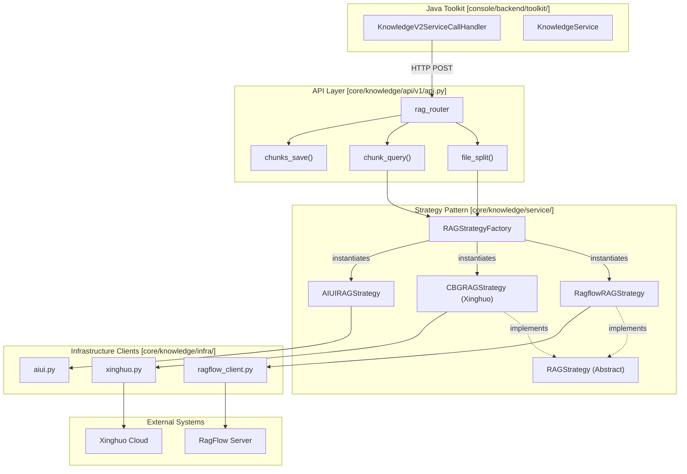
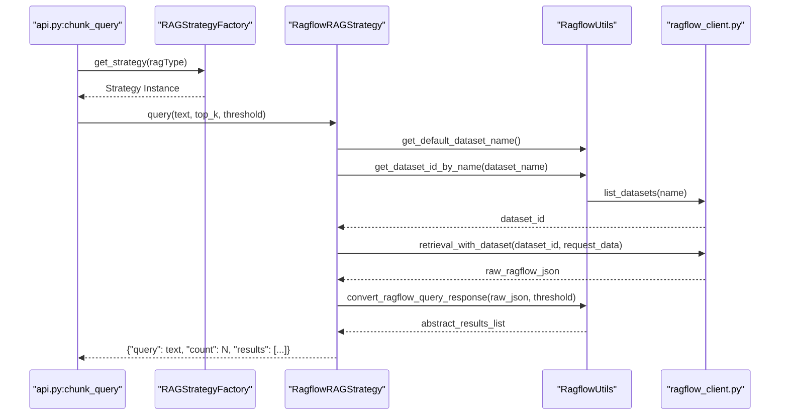

<!-- source: DeepWiki mcp.deepwiki.com · repo iflytek/astron-agent · page 3.4 Knowledge Service and RAG · fetched 2026-10-26 -->

# Knowledge Service and RAG

Relevant source files

The following files were used as context for generating this wiki page:

- [core/knowledge/Dockerfile](core/knowledge/Dockerfile)
- [core/knowledge/README.md](core/knowledge/README.md)
- [core/knowledge/api/v1/api.py](core/knowledge/api/v1/api.py)
- [core/knowledge/config.env](core/knowledge/config.env)
- [core/knowledge/consts/error_code.py](core/knowledge/consts/error_code.py)
- [core/knowledge/domain/entity/chunk_dto.py](core/knowledge/domain/entity/chunk_dto.py)
- [core/knowledge/domain/entity/rag_do.py](core/knowledge/domain/entity/rag_do.py)
- [core/knowledge/domain/response.py](core/knowledge/domain/response.py)
- [core/knowledge/infra/aiui/aiui.py](core/knowledge/infra/aiui/aiui.py)
- [core/knowledge/infra/desk/sparkdesk.py](core/knowledge/infra/desk/sparkdesk.py)
- [core/knowledge/infra/ragflow/__init__.py](core/knowledge/infra/ragflow/__init__.py)
- [core/knowledge/infra/ragflow/ragflow_client.py](core/knowledge/infra/ragflow/ragflow_client.py)
- [core/knowledge/infra/ragflow/ragflow_utils.py](core/knowledge/infra/ragflow/ragflow_utils.py)
- [core/knowledge/infra/xinghuo/xinghuo.py](core/knowledge/infra/xinghuo/xinghuo.py)
- [core/knowledge/llm/__init__.py](core/knowledge/llm/__init__.py)
- [core/knowledge/llm/base.py](core/knowledge/llm/base.py)
- [core/knowledge/llm/openai_llm.py](core/knowledge/llm/openai_llm.py)
- [core/knowledge/main.py](core/knowledge/main.py)
- [core/knowledge/pyproject.toml](core/knowledge/pyproject.toml)
- [core/knowledge/service/impl/aiui_strategy.py](core/knowledge/service/impl/aiui_strategy.py)
- [core/knowledge/service/impl/cbg_strategy.py](core/knowledge/service/impl/cbg_strategy.py)
- [core/knowledge/service/impl/ragflow_strategy.py](core/knowledge/service/impl/ragflow_strategy.py)
- [core/knowledge/service/impl/sparkdesk_strategy.py](core/knowledge/service/impl/sparkdesk_strategy.py)
- [core/knowledge/service/rag_strategy.py](core/knowledge/service/rag_strategy.py)
- [core/knowledge/service/rq/__init__.py](core/knowledge/service/rq/__init__.py)
- [core/knowledge/service/rq/rewrite_query.py](core/knowledge/service/rq/rewrite_query.py)
- [core/knowledge/tests/infra/ragflow/ragflow_client_error_propagation_test.py](core/knowledge/tests/infra/ragflow/ragflow_client_error_propagation_test.py)
- [core/knowledge/tests/infra/ragflow/ragflow_client_pagination_test.py](core/knowledge/tests/infra/ragflow/ragflow_client_pagination_test.py)
- [core/knowledge/tests/infra/ragflow/ragflow_utils_test.py](core/knowledge/tests/infra/ragflow/ragflow_utils_test.py)
- [core/knowledge/tests/service/impl/ragflow_strategy_error_propagation_test.py](core/knowledge/tests/service/impl/ragflow_strategy_error_propagation_test.py)
- [core/knowledge/tests/service/impl/ragflow_strategy_pagination_test.py](core/knowledge/tests/service/impl/ragflow_strategy_pagination_test.py)
- [core/knowledge/tests/service/impl/ragflow_strategy_upsert_test.py](core/knowledge/tests/service/impl/ragflow_strategy_upsert_test.py)
- [core/knowledge/uv.lock](core/knowledge/uv.lock)

## Purpose and Scope

The **core-knowledge** service is a Python FastAPI microservice that provides knowledge base management and Retrieval-Augmented Generation (RAG) capabilities. It acts as an abstraction layer over multiple RAG backends, including **RagFlow**, **iFLYTEK Xinghuo RAG (CBG)**, and **AIUI**. The service handles document parsing, semantic chunking, embedding-based retrieval, and knowledge base synchronization. [core/knowledge/api/v1/api.py:1-6]()

This page details the internal implementation of the knowledge service, its strategy-based architecture, and how it integrates with external retrieval engines to provide context for AI agents.

---

## Service Architecture

The service is built on a strategy pattern, allowing it to swap between different RAG implementations (RagFlow, Xinghuo, AIUI) while exposing a unified API to the rest of the Astron platform via the `RAGStrategyFactory`. [core/knowledge/service/rag_strategy_factory.py:35-35]()

### Component Interaction Diagram

This diagram maps the logical RAG flow to specific code entities within the `core-knowledge` service and their counterparts in the Java `console-toolkit`.

**Sources:**
- [core/knowledge/api/v1/api.py:38-168]()
- [core/knowledge/service/rag_strategy_factory.py:1-40]()
- [core/knowledge/service/impl/cbg_strategy.py:39-41]()
- [core/knowledge/service/impl/ragflow_strategy.py:24-27]()

---

## RAG Backend Implementations

### 1. RagFlow Integration
RagFlow is integrated via the `RagflowRAGStrategy`. It utilizes a module-level session management system in `ragflow_client.py` to maintain persistent connections to the RagFlow API. [core/knowledge/infra/ragflow/ragflow_client.py:112-150]()

*   **Dataset Management**: The service uses a "Double-Check Locking" pattern with `asyncio.Lock` to ensure datasets exist or are created safely under concurrent requests. [core/knowledge/infra/ragflow/ragflow_utils.py:109-163]()
*   **Retrieval**: Queries are sent to the RagFlow retrieval API with configurable `top_k` and `similarity_threshold`. [core/knowledge/service/impl/ragflow_strategy.py:69-85]()
*   **Format Conversion**: The `RagflowUtils.convert_ragflow_query_response` method maps RagFlow's specific chunk format into the Astron platform's abstract interface format. [core/knowledge/infra/ragflow/ragflow_utils.py:72-106]()
*   **Pagination & Fetching**: To handle large documents, `ragflow_client` implements `fetch_all_document_chunks`, which iterates through pages until the `total` count reported by the server is reached. [core/knowledge/tests/infra/ragflow/ragflow_client_pagination_test.py:6-9]()
*   **Blue-Green Upsert**: `RagflowRAGStrategy` implements an atomic `_upsert_document` method that uploads a new version, waits for parsing, and only deletes the old document ID (`old_doc_id`) if the new one is successfully processed. [core/knowledge/tests/service/impl/ragflow_strategy_upsert_test.py:77-128]()

**Sources:**
- [core/knowledge/infra/ragflow/ragflow_client.py:37-150]()
- [core/knowledge/infra/ragflow/ragflow_utils.py:38-163]()
- [core/knowledge/service/impl/ragflow_strategy.py:32-104]()
- [core/knowledge/tests/infra/ragflow/ragflow_client_pagination_test.py:29-70]()

### 2. Xinghuo (CBG) RAG
The `CBGRAGStrategy` interfaces with iFLYTEK's Xinghuo knowledge base. It supports advanced features like hybrid search and image reference extraction. [core/knowledge/service/impl/cbg_strategy.py:39-41]()

*   **Hybrid Search**: Uses the `new_topk_search` interface for improved retrieval performance. [core/knowledge/infra/xinghuo/xinghuo.py:217-233]()
*   **Context Rebuilding**: Unlike simple chunking, the `CBGRAGStrategy` processes "overlap" chunks and sorts them by `dataIndex` to reconstruct the full context surrounding a retrieved segment. [core/knowledge/service/impl/cbg_strategy.py:120-150]()
*   **Signature Auth**: All requests to Xinghuo are signed using HMAC-SHA256 via `get_signature`. [core/knowledge/infra/xinghuo/xinghuo.py:20-21]()
*   **Chunk Retrieval**: The `get_chunks` function handles the polling logic for document splitting status, retrying until the file status moves from `spliting` to a terminal state. [core/knowledge/infra/xinghuo/xinghuo.py:146-214]()

**Sources:**
- [core/knowledge/service/impl/cbg_strategy.py:42-118]()
- [core/knowledge/infra/xinghuo/xinghuo.py:146-250]()

---

## Data Flow: Knowledge Retrieval

This diagram tracks a query from the entry point through the strategy layer to the final response, highlighting the interaction between the API router and the RagFlow strategy.

**Sources:**
- [core/knowledge/api/v1/api.py:35-38]()
- [core/knowledge/service/impl/ragflow_strategy.py:32-104]()
- [core/knowledge/infra/ragflow/ragflow_utils.py:41-70]()

---

## Core Operations and Implementation

### Document Splitting and Chunking
The `file_split` operation is the first step in populating a knowledge base. [core/knowledge/api/v1/api.py:146-159]()

1.  **Request Handling**: The `rag_router` receives a `FileSplitReq`. [core/knowledge/api/v1/api.py:146-149]()
2.  **Parameter Parsing**: Length ranges and separators are parsed from JSON strings into usable lists via `_parse_form_data_parameters`. [core/knowledge/service/impl/ragflow_strategy.py:125-154]()
3.  **Parsing/Splitting**:
    *   **AIUI**: Performs a two-step `document_parse` followed by `chunk_split`. [core/knowledge/service/impl/aiui_strategy.py:119-132]()
    *   **Xinghuo**: Uses `upload` and then `split` with Base64 encoded separators. [core/knowledge/infra/xinghuo/xinghuo.py:23-107]()
    *   **RagFlow**: Handles document upload via `_process_document_upload` and triggers parsing with `_handle_document_parsing`, which waits for completion. [core/knowledge/service/impl/ragflow_strategy.py:156-190]()

### Knowledge Persistence and Mapping
The service maintains a mapping of existing chunks to prevent duplicates. For RagFlow, `_get_existing_chunks` builds a dictionary keyed by both `chunkId` and `dataIndex` (if available) to ensure idempotent updates. [core/knowledge/tests/service/impl/ragflow_strategy_pagination_test.py:150-183]()

### Knowledge Query Rewriting
Before retrieval, the service can optionally rewrite the user's query to improve search accuracy. This is handled by the `rewrite_query` utility, which leverages an LLM to generate search-optimized variations of the original question. [core/knowledge/service/rq/rewrite_query.py:1-20]()

### LLM Integration
The service includes a generic LLM wrapper for tasks like query rewriting. The `OpenAI` class in `openai_llm.py` provides an asynchronous `stream_chat` implementation compatible with OpenAI-style APIs, including Spark LLM via its OpenAI-compatible endpoint. [core/knowledge/llm/openai_llm.py:12-108]()

**Sources:**
- [core/knowledge/service/rq/rewrite_query.py:1-20]()
- [core/knowledge/llm/openai_llm.py:56-108]()
- [core/knowledge/service/impl/ragflow_strategy.py:125-190]()

---

## Monitoring and Traceability

The service uses OpenTelemetry (OTLP) for distributed tracing and metrics. Every RAG operation is wrapped in a `handle_rag_operation` helper which: [core/knowledge/api/v1/api.py:60-81]()

1.  Starts a span for the operation using `get_span_and_metric`. [core/knowledge/api/v1/api.py:47-56]()
2.  Records the user input and final output in the span events as `usr_output`. [core/knowledge/api/v1/api.py:89-102]()
3.  Increments success or error counters in the OTLP `Meter`. [core/knowledge/api/v1/api.py:104-112]()

The application initialization logic in `main.py` sets up the OTLP services including `otlp_span_service` and `otlp_metric_service`. [core/knowledge/main.py:28-37]()

**Sources:**
- [core/knowledge/api/v1/api.py:60-143]()
- [core/knowledge/main.py:28-37]()

---

