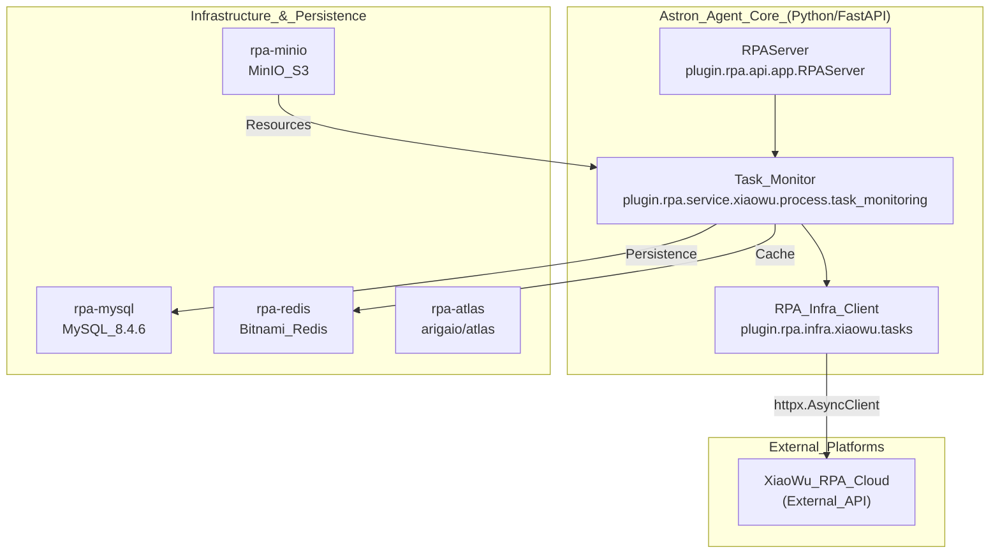
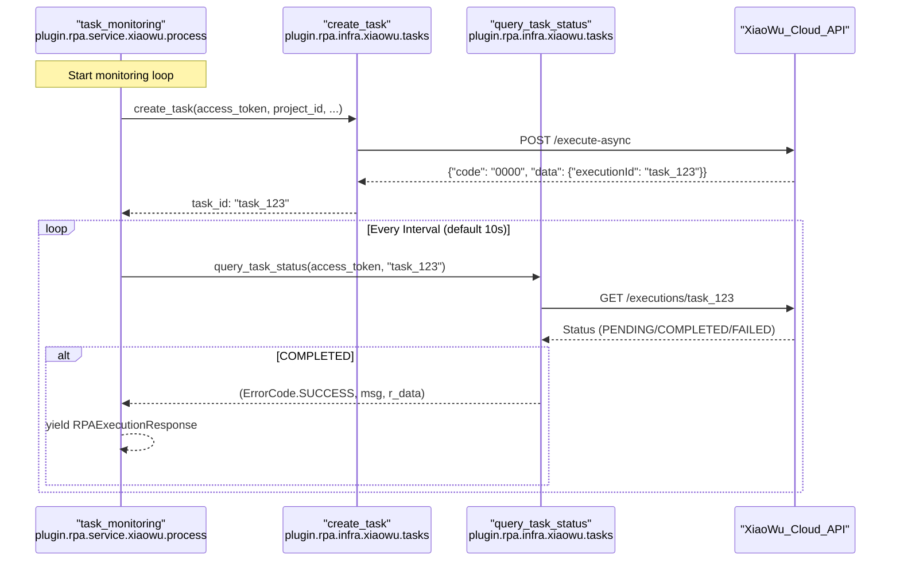

<!-- source: DeepWiki mcp.deepwiki.com · repo iflytek/astron-agent · page 3.5 RPA and Automation Service · fetched 2026-10-26 -->

# RPA and Automation Service

Relevant source files

The following files were used as context for generating this wiki page:

- [core/plugin/rpa/api/app.py](core/plugin/rpa/api/app.py)
- [core/plugin/rpa/api/router.py](core/plugin/rpa/api/router.py)
- [core/plugin/rpa/api/schemas/execution_schema.py](core/plugin/rpa/api/schemas/execution_schema.py)
- [core/plugin/rpa/api/v1/execution.py](core/plugin/rpa/api/v1/execution.py)
- [core/plugin/rpa/config.env](core/plugin/rpa/config.env)
- [core/plugin/rpa/consts/const.py](core/plugin/rpa/consts/const.py)
- [core/plugin/rpa/consts/otlp/otlp_keys.py](core/plugin/rpa/consts/otlp/otlp_keys.py)
- [core/plugin/rpa/doc/API_EXAMPLES.md](core/plugin/rpa/doc/API_EXAMPLES.md)
- [core/plugin/rpa/doc/DEPLOYMENT.md](core/plugin/rpa/doc/DEPLOYMENT.md)
- [core/plugin/rpa/errors/error_code.py](core/plugin/rpa/errors/error_code.py)
- [core/plugin/rpa/infra/xiaowu/tasks.py](core/plugin/rpa/infra/xiaowu/tasks.py)
- [core/plugin/rpa/main.py](core/plugin/rpa/main.py)
- [core/plugin/rpa/service/xiaowu/process.py](core/plugin/rpa/service/xiaowu/process.py)
- [core/plugin/rpa/tests/conftest.py](core/plugin/rpa/tests/conftest.py)
- [core/plugin/rpa/tests/integration/test_api_integration.py](core/plugin/rpa/tests/integration/test_api_integration.py)
- [core/plugin/rpa/tests/unit/api/schemas/test_execution_schema.py](core/plugin/rpa/tests/unit/api/schemas/test_execution_schema.py)
- [core/plugin/rpa/tests/unit/api/v1/test_execution.py](core/plugin/rpa/tests/unit/api/v1/test_execution.py)
- [core/plugin/rpa/tests/unit/errors/test_error_code.py](core/plugin/rpa/tests/unit/errors/test_error_code.py)
- [core/plugin/rpa/tests/unit/infra/xiaowu/test_tasks.py](core/plugin/rpa/tests/unit/infra/xiaowu/test_tasks.py)
- [core/plugin/rpa/tests/unit/service/xiaowu/test_process.py](core/plugin/rpa/tests/unit/service/xiaowu/test_process.py)
- [core/plugin/rpa/utils/log/logger.py](core/plugin/rpa/utils/log/logger.py)
- [docker/astronAgent/.env.with-rpa](docker/astronAgent/.env.with-rpa)
- [docker/astronAgent/astronRPA/.env](docker/astronAgent/astronRPA/.env)
- [docker/astronAgent/astronRPA/docker-compose.yml](docker/astronAgent/astronRPA/docker-compose.yml)
- [docker/astronAgent/astronRPA/volumes/atlas/atlas.hcl](docker/astronAgent/astronRPA/volumes/atlas/atlas.hcl)
- [docker/astronAgent/astronRPA/volumes/atlas/schema.hcl](docker/astronAgent/astronRPA/volumes/atlas/schema.hcl)
- [docker/astronAgent/astronRPA/volumes/mysql/init_app_market_dict_data.sql](docker/astronAgent/astronRPA/volumes/mysql/init_app_market_dict_data.sql)
- [docker/astronAgent/astronRPA/volumes/mysql/init_c_atom_meta_data.sql](docker/astronAgent/astronRPA/volumes/mysql/init_c_atom_meta_data.sql)
- [docker/astronAgent/astronRPA/volumes/mysql/init_c_atom_meta_new_data.sql](docker/astronAgent/astronRPA/volumes/mysql/init_c_atom_meta_new_data.sql)
- [docker/astronAgent/astronRPA/volumes/mysql/init_his_data_enum_data.sql](docker/astronAgent/astronRPA/volumes/mysql/init_his_data_enum_data.sql)
- [docker/astronAgent/astronRPA/volumes/mysql/init_sample_template_data.sql](docker/astronAgent/astronRPA/volumes/mysql/init_sample_template_data.sql)
- [docker/astronAgent/astronRPA/volumes/mysql/schema.sql](docker/astronAgent/astronRPA/volumes/mysql/schema.sql)
- [docker/astronAgent/astronRPA/volumes/nginx/default.conf](docker/astronAgent/astronRPA/volumes/nginx/default.conf)
- [docker/astronAgent/astronRPA/volumes/nginx/lua/auth_handler.lua](docker/astronAgent/astronRPA/volumes/nginx/lua/auth_handler.lua)
- [docker/astronAgent/docker-compose-with-auth-rpa.yaml](docker/astronAgent/docker-compose-with-auth-rpa.yaml)

## Purpose and Scope

The **core-rpa** service provides robotic process automation (RPA) capabilities within the Astron Agent platform. It acts as an integration adapter between the workflow engine and external RPA cloud platforms, primarily the **XiaoWu RPA** (iFLYTEK RPA) system. The service manages the complete lifecycle of RPA tasks, including assistant configuration, task creation, status polling, and result retrieval.

Implemented as a FastAPI application in Python, it handles the bridging of "Natural Language Space" (workflow parameters) to "Code Entity Space" (RPA project executions and task monitoring).

---

## Service Architecture

### Component Overview

The `core-rpa` service is a Python-based microservice. It is designed to be highly concurrent, utilizing `uvicorn` with multiple workers to handle simultaneous RPA task monitoring loops.

**Natural Language to Code Entity Mapping**
| Concept | Code Entity | File Path |
| :--- | :--- | :--- |
| **RPA Service Entry** | `RPAServer` | [core/plugin/rpa/api/app.py:21-26]() |
| **Task Monitor** | `task_monitoring` | [core/plugin/rpa/service/xiaowu/process.py:23-31]() |
| **External Client** | `create_task`, `query_task_status` | [core/plugin/rpa/infra/xiaowu/tasks.py:16-177]() |
| **Execution Schema** | `RPAExecutionResponse` | [core/plugin/rpa/api/schemas/execution_schema.py:1-20]() |

### System Integration Diagram

**Deployment Characteristics:**

| Attribute | Value |
|-----------|-------|
| **Container Name** | `rpa-opensource-ai-service` |
| **Database** | `rpa` (MySQL) |
| **Storage** | `rpa-resource` (MinIO Bucket) |
| **Internal Proxy** | `openresty-nginx` |
| **Orchestration** | `docker-compose-with-auth-rpa.yaml` |

Sources: [core/plugin/rpa/api/app.py:21-34](), [core/plugin/rpa/service/xiaowu/process.py:23-31](), [docker/astronAgent/astronRPA/docker-compose.yml:4-214](), [docker/astronAgent/astronRPA/.env:23-42](), [docker/astronAgent/docker-compose-with-auth-rpa.yaml:1-35]()

---

## Task Creation and Execution

The core execution logic follows an asynchronous "Fire and Poll" pattern, bridging the platform's workflow requests to the external RPA engine.

### Task Creation Flow
Tasks are initiated via `create_task` in the `infra` layer [core/plugin/rpa/infra/xiaowu/tasks.py:16-23]().

1. **Endpoint Resolution**: The service retrieves the `XIAOWU_RPA_TASK_CREATE_URL_KEY` from environment variables [core/plugin/rpa/infra/xiaowu/tasks.py:28-31]().
2. **Request Assembly**: It builds a JSON body containing `project_id`, `exec_position`, and `params` [core/plugin/rpa/infra/xiaowu/tasks.py:37-41]().
3. **Authentication**: Injects the `access_token` into the `Authorization` header as a Bearer token [core/plugin/rpa/infra/xiaowu/tasks.py:33-36]().
4. **ID Extraction**: Captures the `executionId` from the `data` field of the cloud response for subsequent polling [core/plugin/rpa/infra/xiaowu/tasks.py:60-78]().

### Status Monitoring (Polling)
The `task_monitoring` function implements an asynchronous generator to track task progress [core/plugin/rpa/service/xiaowu/process.py:31-32]().

**Execution Parameters:**
- **Timeout**: Configured via `XIAOWU_RPA_TIMEOUT` (default 300s) [core/plugin/rpa/service/xiaowu/process.py:105-106]().
- **Polling Interval**: Configured via `XIAOWU_RPA_TASK_QUERY_INTERVAL` (default 10s) [core/plugin/rpa/service/xiaowu/process.py:109-110]().
- **Schema**: Uses `RPAExecutionResponse` for standardizing output across the API [core/plugin/rpa/api/schemas/execution_schema.py:1-20]().

Sources: [core/plugin/rpa/service/xiaowu/process.py:23-184](), [core/plugin/rpa/infra/xiaowu/tasks.py:16-177](), [core/plugin/rpa/config.env:79-83]()

---

## Data Schema and Persistence

The RPA service utilizes a dedicated MySQL database (`rpa`) initialized via `schema.sql` [docker/astronAgent/astronRPA/volumes/mysql/schema.sql:13-15]().

| Table Name | Purpose |
|------------|---------|
| `agent_table` | Stores RPA Agent configurations and unique `agent_id` [docker/astronAgent/astronRPA/volumes/mysql/schema.sql:18-29]() |
| `app_application` | Manages robot publishing status (pending, approved, rejected) [docker/astronAgent/astronRPA/volumes/mysql/schema.sql:70-93]() |
| `app_market` | Defines the marketplace for sharing RPA capabilities [docker/astronAgent/astronRPA/volumes/mysql/schema.sql:110-126]() |
| `alarm_rule` | Configuration for execution monitoring and alerts [docker/astronAgent/astronRPA/volumes/mysql/schema.sql:34-53]() |

Sources: [docker/astronAgent/astronRPA/volumes/mysql/schema.sql:1-126]()

---

## Error Handling and Status Codes

The service uses a structured `ErrorCode` mapping to handle various failure scenarios during the RPA lifecycle.

| Code | Message | Description |
|------|---------|-------------|
| `0000` | Success | Task completed successfully [core/plugin/rpa/infra/xiaowu/tasks.py:141]() |
| `5001` | Create task error | Failed to initiate task on cloud platform [core/plugin/rpa/service/xiaowu/process.py:92-93]() |
| `5002` | Query task error | Failed to retrieve status from cloud platform [core/plugin/rpa/service/xiaowu/process.py:138-139]() |
| `5003` | Task exec failed | Cloud platform reported internal execution failure [core/plugin/rpa/infra/xiaowu/tasks.py:151-163]() |
| `5004` | Timeout error | Task exceeded the monitoring TTL [core/plugin/rpa/service/xiaowu/process.py:173-174]() |

Sources: [core/plugin/rpa/service/xiaowu/process.py:72-184](), [core/plugin/rpa/infra/xiaowu/tasks.py:135-167]()

---

## Infrastructure and Integration

### Networking and Proxy
The service is integrated into the platform via `docker-compose-with-auth-rpa.yaml`, which includes the `astronRPA` project directory [docker/astronAgent/docker-compose-with-auth-rpa.yaml:19-27](). All traffic is routed through `openresty-nginx`, which provides internal URL mapping for task creation and querying [docker/astronAgent/.env.with-rpa:4-6]().

### Telemetry and Observability
- **Service Initialization**: `RPAServer` initializes OTLP and Kafka services via `initialize_services` [core/plugin/rpa/api/app.py:37-47]().
- **OTLP Tracing**: `setup_span_and_trace` initializes spans for every task execution, allowing observability of long-running RPA processes [core/plugin/rpa/service/xiaowu/process.py:50-55]().
- **Metrics**: `Meter` objects record execution statistics, exported via OpenTelemetry [core/plugin/rpa/service/xiaowu/process.py:56-58]().
- **Watchdog**: A gateway watchdog is set up during server startup to monitor service health [core/plugin/rpa/api/app.py:52-54]().

### Configuration Management
The service supports remote configuration via **Polaris**. If `USE_POLARIS` is enabled, it pulls configuration from the remote center and overrides local environment variables [core/plugin/rpa/api/app.py:61-97]().

Sources: [docker/astronAgent/docker-compose-with-auth-rpa.yaml:1-35](), [docker/astronAgent/.env.with-rpa:1-6](), [core/plugin/rpa/service/xiaowu/process.py:50-58](), [core/plugin/rpa/api/app.py:61-97]()

---

