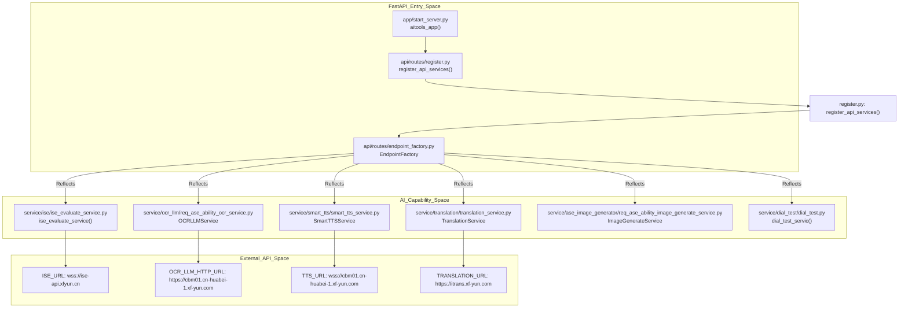
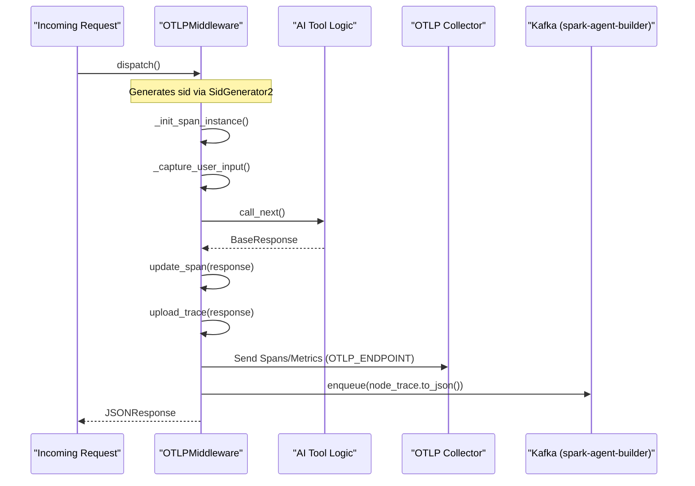

<!-- source: DeepWiki mcp.deepwiki.com · repo iflytek/astron-agent · page 3.6 AI Tools Service · fetched 2026-10-26 -->

# AI Tools Service

Relevant source files

The following files were used as context for generating this wiki page:

- [core/plugin/aitools/api/decorators/api_meta.py](core/plugin/aitools/api/decorators/api_meta.py)
- [core/plugin/aitools/api/decorators/api_service.py](core/plugin/aitools/api/decorators/api_service.py)
- [core/plugin/aitools/api/middlewares/otlp_middleware.py](core/plugin/aitools/api/middlewares/otlp_middleware.py)
- [core/plugin/aitools/api/routes/endpoint_factory.py](core/plugin/aitools/api/routes/endpoint_factory.py)
- [core/plugin/aitools/api/routes/register.py](core/plugin/aitools/api/routes/register.py)
- [core/plugin/aitools/app/start_server.py](core/plugin/aitools/app/start_server.py)
- [core/plugin/aitools/common/clients/hooks.py](core/plugin/aitools/common/clients/hooks.py)
- [core/plugin/aitools/common/clients/websockets_client.py](core/plugin/aitools/common/clients/websockets_client.py)
- [core/plugin/aitools/common/exceptions/exceptions.py](core/plugin/aitools/common/exceptions/exceptions.py)
- [core/plugin/aitools/common/log/logger.py](core/plugin/aitools/common/log/logger.py)
- [core/plugin/aitools/config.env](core/plugin/aitools/config.env)
- [core/plugin/aitools/const/const.py](core/plugin/aitools/const/const.py)
- [core/plugin/aitools/main.py](core/plugin/aitools/main.py)
- [core/plugin/aitools/service/ase_image_generator/req_ase_ability_image_generate_service.py](core/plugin/aitools/service/ase_image_generator/req_ase_ability_image_generate_service.py)
- [core/plugin/aitools/service/dial_test/dial_test.py](core/plugin/aitools/service/dial_test/dial_test.py)
- [core/plugin/aitools/service/dial_test/dial_test_client.py](core/plugin/aitools/service/dial_test/dial_test_client.py)
- [core/plugin/aitools/service/image_understanding/image_understanding_service.py](core/plugin/aitools/service/image_understanding/image_understanding_service.py)
- [core/plugin/aitools/service/ise/ise_client.py](core/plugin/aitools/service/ise/ise_client.py)
- [core/plugin/aitools/service/ise/ise_evaluate_service.py](core/plugin/aitools/service/ise/ise_evaluate_service.py)
- [core/plugin/aitools/service/ocr_llm/req_ase_ability_ocr_service.py](core/plugin/aitools/service/ocr_llm/req_ase_ability_ocr_service.py)
- [core/plugin/aitools/service/smart_tts/smart_tts_service.py](core/plugin/aitools/service/smart_tts/smart_tts_service.py)
- [core/plugin/aitools/service/translation/translation_client.py](core/plugin/aitools/service/translation/translation_client.py)
- [core/plugin/aitools/service/translation/translation_service.py](core/plugin/aitools/service/translation/translation_service.py)
- [core/plugin/aitools/utils/otlp_utils.py](core/plugin/aitools/utils/otlp_utils.py)
- [core/plugin/link/app/start_server.py](core/plugin/link/app/start_server.py)
- [core/plugin/link/main.py](core/plugin/link/main.py)
- [core/plugin/link/tests/unit/test_main.py](core/plugin/link/tests/unit/test_main.py)
- [core/plugin/rpa/tests/unit/api/test_app.py](core/plugin/rpa/tests/unit/api/test_app.py)
- [core/plugin/rpa/tests/unit/test_main.py](core/plugin/rpa/tests/unit/test_main.py)

## Purpose and Scope

The AI Tools Service (`core-aitools`) is a high-performance FastAPI microservice designed to unify diverse AI capabilities into a standardized interface. It serves as the integration layer for iFLYTEK's Spark ecosystem, providing services for:
- **Intelligent Speech Evaluation (ISE)**: Assessment of pronunciation and fluency using WebSocket connections [core/plugin/aitools/service/ise/ise_client.py:2-21]().
- **OCR LLM**: Document layout analysis and text extraction from PDFs/images, including complex table reconstruction [core/plugin/aitools/config.env:128-133]().
- **Smart Text-to-Speech (TTS)**: High-quality voice synthesis via WebSocket streaming [core/plugin/aitools/config.env:142-144]().
- **Image Generation & Understanding**: Vision-to-text and text-to-vision capabilities [core/plugin/aitools/config.env:134-140]().
- **Machine Translation**: Bidirectional multi-language text translation supporting 44+ languages [core/plugin/aitools/config.env:150-152]().

The service handles complex authentication (HMAC-SHA256), websocket streaming for real-time AI tasks, and provides comprehensive observability via OpenTelemetry (OTLP) and Kafka.

---

## Service Architecture

The service follows a modular architecture where capabilities are registered as individual providers through a central manager.

### Code Entity to System Space Mapping

The following diagram bridges the logical AI services to their specific implementation classes and routes.

**Sources:** [core/plugin/aitools/app/start_server.py:106-126](), [core/plugin/aitools/api/routes/register.py:1-13](), [core/plugin/aitools/config.env:127-152](), [core/plugin/aitools/const/const.py:93-122](), [core/plugin/aitools/service/dial_test/dial_test.py:44-61]()

---

## Core Implementation Details

### 1. Server Lifecycle and Initialization
The service uses a FastAPI `lifespan` context manager to initialize shared resources and background watchers.

- **ConfigWatcher**: Monitors `config.env` for changes and triggers `aitools_service_manager.hot_load_callback` to refresh service configurations without restarts [core/plugin/aitools/app/start_server.py:81-90]().
- **AIOHTTP Session**: Manages a global `ClientSession` with specific connection limits (200 total, 50 per host) for efficient HTTP connection pooling [core/plugin/aitools/app/start_server.py:14-17](), [core/plugin/aitools/config.env:48-58]().
- **Kafka Producer**: If `KAFKA_ENABLE` is set to `1`, initializes a producer to stream telemetry data to the `spark-agent-builder` topic [core/plugin/aitools/app/start_server.py:96-100](), [core/plugin/aitools/config.env:71-82]().
- **Gateway Watchdog**: Optionally sets up a watchdog for gateway synchronization during startup via `setup_watchdog()` [core/plugin/aitools/app/start_server.py:44-59]().

### 2. Intelligent Speech Evaluation (ISE)
The ISE implementation handles complex audio processing and XML result parsing for assessment tasks.

- **AudioConverter**: Detects formats (WAV, MP3, OGG, FLAC) and normalizes them to the required 16kHz, 16-bit, mono WAV format using `pydub` [core/plugin/aitools/service/ise/ise_client.py:26-165]().
- **ISEResultParser**: Uses `xml.etree.ElementTree` to transform raw iFLYTEK XML responses into structured JSON including `overall_score`, `detailed_scores`, and pronunciation warnings [core/plugin/aitools/service/ise/ise_client.py:166-200]().

### 3. Service Entry Points
The service provides a standardized entry point for development and production environments.
- **Main Entry**: `main.py` handles Python path setup via `setup_python_path()` and environment variable loading before spawning the FastAPI server via `subprocess` [core/plugin/aitools/main.py:15-79]().
- **Uvicorn Configuration**: The server runs with 20 workers and binds to port `18668` by default [core/plugin/aitools/app/start_server.py:61-79](), [core/plugin/aitools/config.env:28-28]().

---

## Observability and Middleware

The service integrates a robust OTLP (OpenTelemetry) pipeline for distributed tracing and metrics.

### OTLP Data Flow

**Key Observability Entities:**
- **`OTLPMiddleware`**: Intercepts every request to generate a unique `sid` (Session ID) and track execution time. It captures request bodies (truncated at `SPAN_SIZE_LIMIT`) [core/plugin/aitools/api/middlewares/otlp_middleware.py:60-115]().
- **`SidGenerator2`**: Generates unique session identifiers based on service metadata (sub, location, IP, port) [core/plugin/aitools/api/middlewares/otlp_middleware.py:77-84]().
- **`NodeTraceLog`**: Encapsulates tracing data for export to OTLP and Kafka [core/plugin/aitools/api/middlewares/otlp_middleware.py:17-21]().
- **`Meter`**: Handles metrics collection for function calls and application performance [core/plugin/aitools/api/middlewares/otlp_middleware.py:207-211]().

**Sources:** [core/plugin/aitools/api/middlewares/otlp_middleware.py:1-115](), [core/plugin/aitools/const/const.py:73-86]()

---

## Configuration Reference

The service is configured via `core/plugin/aitools/config.env`.

| Category | Key | Default | Description |
| :--- | :--- | :--- | :--- |
| **Service** | `SERVICE_PORT` | 18668 | Internal port for the AI Tools API [core/plugin/aitools/config.env:28]() |
| **Auth** | `AI_APP_ID` | - | iFLYTEK Platform Application ID [core/plugin/aitools/config.env:123]() |
| **Auth** | `AI_API_KEY` | - | iFLYTEK Platform API Key [core/plugin/aitools/config.env:124]() |
| **Auth** | `AI_API_SECRET` | - | iFLYTEK Platform API Secret [core/plugin/aitools/config.env:125]() |
| **Observability** | `OTLP_ENABLE` | 0 | Toggle for OpenTelemetry tracing [core/plugin/aitools/config.env:97]() |
| **Observability** | `KAFKA_ENABLE` | 0 | Toggle for Kafka telemetry logging [core/plugin/aitools/config.env:73]() |
| **Timeout** | `AIOHTTP_CLIENT_TOTAL_TIMEOUT` | 300.0 | Global timeout for upstream AI calls [core/plugin/aitools/config.env:50]() |
| **Hot Reload** | `HOT_RELOAD_ENABLE` | 0 | Toggle for configuration hot loading [core/plugin/aitools/config.env:16]() |

**Sources:** [core/plugin/aitools/config.env:1-152](), [core/plugin/aitools/const/const.py:1-123]()

---

## Error Handling

The service uses a centralized exception hierarchy to ensure consistent API responses across all AI capabilities.

- **`ServiceException`**: Base class for all internal errors. Produces standard responses with `code` and `message` [core/plugin/aitools/api/middlewares/otlp_middleware.py:28-28]().
- **`CodeEnums`**: Centralized registry of error codes used to categorize failures [core/plugin/aitools/api/middlewares/otlp_middleware.py:27-27]().
- **`OTLPMiddleware` Handlers**: The middleware includes specific handlers for `ServiceException`, `HTTPException`, and generic Python exceptions to ensure telemetry is captured even during failures [core/plugin/aitools/api/middlewares/otlp_middleware.py:107-112]().
- **`ErrorResponse`**: Standard schema for error payloads [core/plugin/aitools/api/middlewares/otlp_middleware.py:25-25]().

**Sources:** [core/plugin/aitools/api/middlewares/otlp_middleware.py:86-115](), [core/plugin/aitools/common/exceptions/exceptions.py:1-10]()

---

