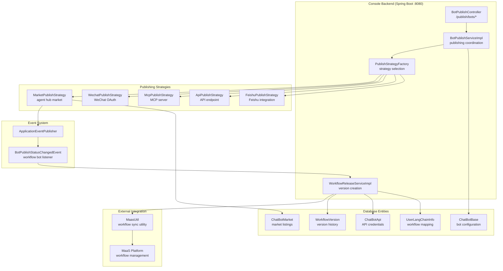
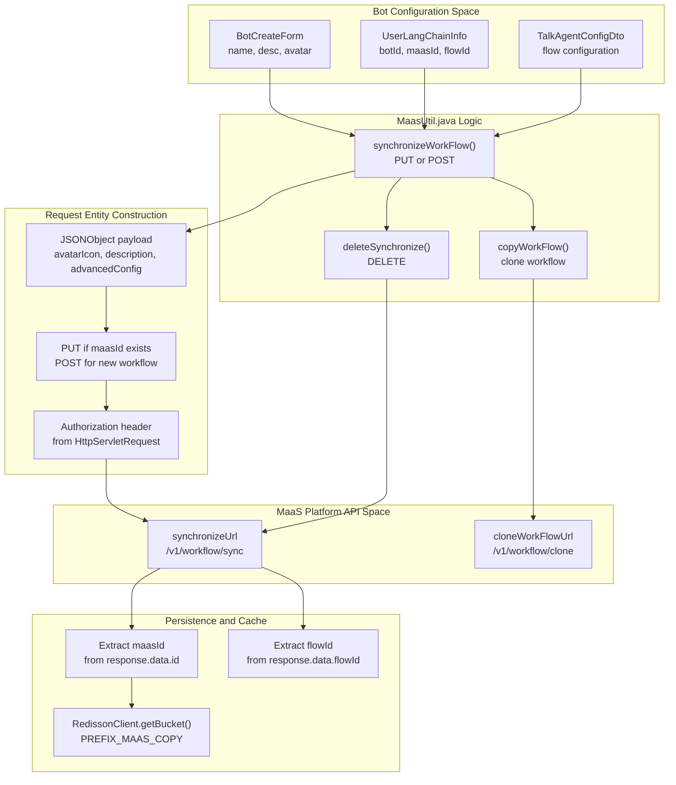
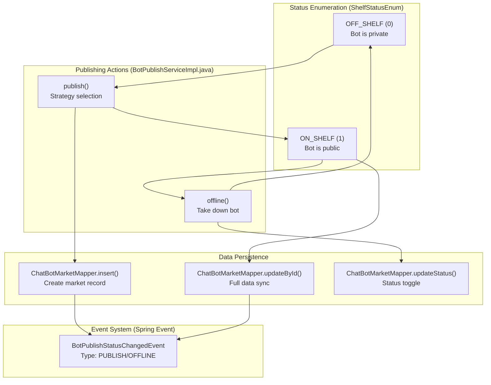
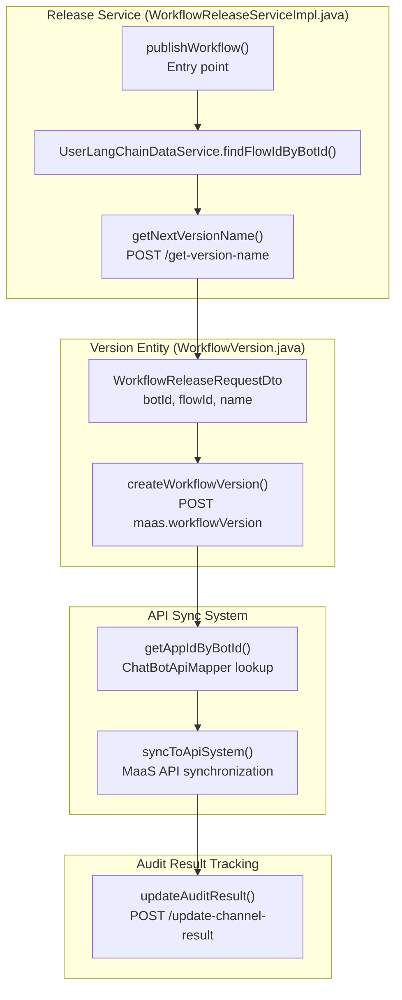

<!-- source: DeepWiki mcp.deepwiki.com · repo iflytek/astron-agent · page 4 Workflow and Publishing System · fetched 2026-10-26 -->

# Workflow and Publishing System

Relevant source files

The following files were used as context for generating this wiki page:

- [console/backend/commons/src/main/java/com/iflytek/astron/console/commons/util/MaasUtil.java](console/backend/commons/src/main/java/com/iflytek/astron/console/commons/util/MaasUtil.java)
- [console/backend/hub/src/main/java/com/iflytek/astron/console/hub/controller/publish/BotPublishController.java](console/backend/hub/src/main/java/com/iflytek/astron/console/hub/controller/publish/BotPublishController.java)
- [console/backend/hub/src/main/java/com/iflytek/astron/console/hub/entity/BotConversationStats.java](console/backend/hub/src/main/java/com/iflytek/astron/console/hub/entity/BotConversationStats.java)
- [console/backend/hub/src/main/java/com/iflytek/astron/console/hub/listener/WorkflowBotPublishListener.java](console/backend/hub/src/main/java/com/iflytek/astron/console/hub/listener/WorkflowBotPublishListener.java)
- [console/backend/hub/src/main/java/com/iflytek/astron/console/hub/mapper/BotConversationStatsMapper.java](console/backend/hub/src/main/java/com/iflytek/astron/console/hub/mapper/BotConversationStatsMapper.java)
- [console/backend/hub/src/main/java/com/iflytek/astron/console/hub/service/publish/BotPublishService.java](console/backend/hub/src/main/java/com/iflytek/astron/console/hub/service/publish/BotPublishService.java)
- [console/backend/hub/src/main/java/com/iflytek/astron/console/hub/service/publish/McpService.java](console/backend/hub/src/main/java/com/iflytek/astron/console/hub/service/publish/McpService.java)
- [console/backend/hub/src/main/java/com/iflytek/astron/console/hub/service/publish/impl/BotPublishServiceImpl.java](console/backend/hub/src/main/java/com/iflytek/astron/console/hub/service/publish/impl/BotPublishServiceImpl.java)
- [console/backend/hub/src/main/java/com/iflytek/astron/console/hub/service/workflow/impl/WorkflowReleaseServiceImpl.java](console/backend/hub/src/main/java/com/iflytek/astron/console/hub/service/workflow/impl/WorkflowReleaseServiceImpl.java)
- [console/backend/hub/src/main/java/com/iflytek/astron/console/hub/strategy/publish/PublishStrategy.java](console/backend/hub/src/main/java/com/iflytek/astron/console/hub/strategy/publish/PublishStrategy.java)
- [console/backend/hub/src/main/java/com/iflytek/astron/console/hub/strategy/publish/PublishStrategyFactory.java](console/backend/hub/src/main/java/com/iflytek/astron/console/hub/strategy/publish/PublishStrategyFactory.java)
- [console/backend/hub/src/main/java/com/iflytek/astron/console/hub/strategy/publish/impl/ApiPublishStrategy.java](console/backend/hub/src/main/java/com/iflytek/astron/console/hub/strategy/publish/impl/ApiPublishStrategy.java)
- [console/backend/hub/src/main/java/com/iflytek/astron/console/hub/strategy/publish/impl/FeishuPublishStrategy.java](console/backend/hub/src/main/java/com/iflytek/astron/console/hub/strategy/publish/impl/FeishuPublishStrategy.java)
- [console/backend/hub/src/main/java/com/iflytek/astron/console/hub/strategy/publish/impl/MarketPublishStrategy.java](console/backend/hub/src/main/java/com/iflytek/astron/console/hub/strategy/publish/impl/MarketPublishStrategy.java)
- [console/backend/hub/src/main/java/com/iflytek/astron/console/hub/strategy/publish/impl/McpPublishStrategy.java](console/backend/hub/src/main/java/com/iflytek/astron/console/hub/strategy/publish/impl/McpPublishStrategy.java)
- [console/backend/hub/src/main/java/com/iflytek/astron/console/hub/strategy/publish/impl/WechatPublishStrategy.java](console/backend/hub/src/main/java/com/iflytek/astron/console/hub/strategy/publish/impl/WechatPublishStrategy.java)
- [console/backend/hub/src/main/resources/mapper/BotConversationStatsMapper.xml](console/backend/hub/src/main/resources/mapper/BotConversationStatsMapper.xml)
- [core/workflow/engine/callbacks/callback_handler.py](core/workflow/engine/callbacks/callback_handler.py)
- [core/workflow/engine/dsl_engine.py](core/workflow/engine/dsl_engine.py)
- [core/workflow/engine/entities/chains.py](core/workflow/engine/entities/chains.py)
- [core/workflow/engine/entities/variable_pool.py](core/workflow/engine/entities/variable_pool.py)
- [core/workflow/engine/entities/workflow_dsl.py](core/workflow/engine/entities/workflow_dsl.py)
- [core/workflow/engine/node.py](core/workflow/engine/node.py)
- [core/workflow/engine/nodes/base_node.py](core/workflow/engine/nodes/base_node.py)
- [core/workflow/engine/nodes/code/executor/local/local_executor.py](core/workflow/engine/nodes/code/executor/local/local_executor.py)
- [core/workflow/engine/nodes/if_else/if_else_node.py](core/workflow/engine/nodes/if_else/if_else_node.py)
- [core/workflow/engine/nodes/iteration/iteration_node.py](core/workflow/engine/nodes/iteration/iteration_node.py)
- [core/workflow/engine/nodes/llm/spark_llm_node.py](core/workflow/engine/nodes/llm/spark_llm_node.py)
- [core/workflow/service/chat_service.py](core/workflow/service/chat_service.py)
- [core/workflow/service/flow_service.py](core/workflow/service/flow_service.py)

The Workflow and Publishing System manages the complete lifecycle of bot publishing across multiple channels (Market, WeChat, MCP, API, Feishu). It coordinates workflow version management, synchronization with the external MaaS platform, multi-channel publishing strategies, and API credential provisioning. The system uses an event-driven architecture with the Strategy pattern to handle channel-specific publishing logic.

For bot creation and configuration prior to publishing, see [Bot Lifecycle Management](#5). For publishing UI components, see [Release Management and Publishing UI](#9.5).

## System Architecture

The publishing system spans multiple services with the console backend (`console-hub`) orchestrating publishing operations and the workflow service (`core-workflow`) managing workflow execution. The system integrates with the external MaaS platform for workflow version management and API publishing.

### Publishing System Components

**Sources:** [console/backend/hub/src/main/java/com/iflytek/astron/console/hub/service/publish/impl/BotPublishServiceImpl.java:68-87](), [console/backend/hub/src/main/java/com/iflytek/astron/console/hub/strategy/publish/impl/McpPublishStrategy.java:18-38](), [console/backend/hub/src/main/java/com/iflytek/astron/console/hub/service/workflow/impl/WorkflowReleaseServiceImpl.java:36-42](), [console/backend/hub/src/main/java/com/iflytek/astron/console/hub/service/publish/impl/BotPublishServiceImpl.java:70-87]()

## Workflow Architecture and MaaS Integration

The system integrates with an external MaaS (Model-as-a-Service) platform for workflow version management and API publishing. The `MaasUtil` class provides the integration layer, handling HTTP communication with the MaaS platform via `OkHttpClient` [console/backend/commons/src/main/java/com/iflytek/astron/console/commons/util/MaasUtil.java:44-49]().

### MaaS Synchronization Flow

The `synchronizeWorkFlow()` method performs bidirectional workflow synchronization between the Astron platform and the external MaaS engine.

**Sources:** [console/backend/commons/src/main/java/com/iflytek/astron/console/commons/util/MaasUtil.java:108-167](), [console/backend/commons/src/main/java/com/iflytek/astron/console/commons/util/MaasUtil.java:169-249]()

The `synchronizeWorkFlow()` method at [console/backend/commons/src/main/java/com/iflytek/astron/console/commons/util/MaasUtil.java:169-249]() performs bidirectional workflow synchronization:

1. **Request Preparation** - Builds `JSONObject` payload with bot metadata including `avatarIcon`, `description`, and `advancedConfig` (prologue, inputExample, text-to-speech settings) [console/backend/commons/src/main/java/com/iflytek/astron/console/commons/util/MaasUtil.java:170-181]().
2. **HTTP Method Selection** - Uses `PUT` if `UserLangChainInfo.maasId` exists (update), `POST` for new workflows [console/backend/commons/src/main/java/com/iflytek/astron/console/commons/util/MaasUtil.java:214-221]().
3. **Authorization** - Extracts Authorization header from `HttpServletRequest` via `getAuthorizationHeader()` [console/backend/commons/src/main/java/com/iflytek/astron/console/commons/util/MaasUtil.java:131]().
4. **Redis Caching** - Stores maasId in Redis with key pattern `maas_copy_{botId}` using `redissonClient` [console/backend/commons/src/main/java/com/iflytek/astron/console/commons/util/MaasUtil.java:94-96]().

For more details on integration patterns, see [Workflow Architecture and MaaS Integration](#4.1).

## Bot Publishing Lifecycle

The publishing lifecycle uses an event-driven architecture with status transitions managed through the `BotPublishServiceImpl` and channel-specific strategies.

### Publishing Status Flow

**Sources:** [console/backend/hub/src/main/java/com/iflytek/astron/console/hub/service/publish/impl/BotPublishServiceImpl.java:68-150](), [console/backend/hub/src/main/java/com/iflytek/astron/console/hub/strategy/publish/impl/MarketPublishStrategy.java:40-93](), [console/backend/hub/src/main/java/com/iflytek/astron/console/hub/event/BotPublishStatusChangedEvent.java:1-49]()

The `BotPublishServiceImpl` implements the core publishing flow by validating permissions, coordinating with the `PublishStrategyFactory`, and emitting a `BotPublishStatusChangedEvent` [console/backend/hub/src/main/java/com/iflytek/astron/console/hub/service/publish/impl/BotPublishServiceImpl.java:75](). For a deep dive into status transitions, see [Bot Publishing Lifecycle](#4.2).

## Multi-Channel Publishing Strategy

The system uses the Strategy pattern to handle channel-specific publishing logic. The `PublishStrategyFactory` manages strategy selection based on the `ReleaseTypeEnum`.

### Strategy Pattern Implementation

The `PublishStrategy` interface defines the contract for all publishing channels.

- **Market Strategy**: Handles publishing to the platform's internal agent marketplace via `MarketPublishStrategy` [console/backend/hub/src/main/java/com/iflytek/astron/console/hub/strategy/publish/impl/MarketPublishStrategy.java:32]().
- **WeChat Strategy**: Manages bot deployment to WeChat via `WechatPublishStrategy`.
- **MCP Strategy**: Handles bot publishing to Model Context Protocol servers [console/backend/hub/src/main/java/com/iflytek/astron/console/hub/strategy/publish/impl/McpPublishStrategy.java:18-38]().
- **API Strategy**: Provisions dedicated API endpoints and credentials via `ApiPublishStrategy`.

For channel-specific logic, see [Multi-Channel Publishing Strategy](#4.3).

## Workflow Versioning and Release Management

The `WorkflowReleaseServiceImpl` manages workflow version creation and release to the MaaS platform. It ensures that every publication is associated with a specific, immutable version of the workflow DSL.

### Version Creation Flow

**Sources:** [console/backend/hub/src/main/java/com/iflytek/astron/console/hub/service/workflow/impl/WorkflowReleaseServiceImpl.java:76-137](), [console/backend/hub/src/main/java/com/iflytek/astron/console/hub/service/workflow/impl/WorkflowReleaseServiceImpl.java:143-203]()

The `publishWorkflow()` method orchestrates the release by fetching the `flowId`, generating a version name via MaaS APIs, and creating a record in the `workflow_version` table [console/backend/hub/src/main/java/com/iflytek/astron/console/hub/service/workflow/impl/WorkflowReleaseServiceImpl.java:103-111](). For more on version management, see [Workflow Versioning and Release Management](#4.4).

## Bot API Publishing Service

The API publishing system provisions tenant applications with credentials and publishes workflow APIs through the MaaS platform. It uses the `ChatBotApi` entity to track application bindings.

### API Publishing Architecture

1. **Persistence**: Stores binding in the `chat_bot_api` table via `ChatBotApiMapper` [console/backend/hub/src/main/java/com/iflytek/astron/console/hub/service/workflow/impl/WorkflowReleaseServiceImpl.java:40]().
2. **MaaS Registration**: Calls `publishApi` and `authApi` endpoints defined in `MaasUtil` to expose the workflow as a RESTful service [console/backend/commons/src/main/java/com/iflytek/astron/console/commons/util/MaasUtil.java:75-79]().
3. **App ID Resolution**: Resolves the target `appId` for the API based on whether the bot is published to the marketplace (using `maas.appId`) or a custom tenant app [console/backend/hub/src/main/java/com/iflytek/astron/console/hub/service/workflow/impl/WorkflowReleaseServiceImpl.java:117-122]().

For details on credential management and API lifecycles, see [Bot API Publishing Service](#4.5).

---

