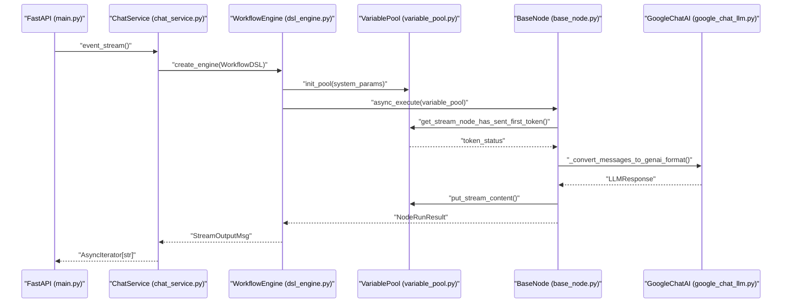

<!-- source: DeepWiki mcp.deepwiki.com · repo iflytek/astron-agent · page 4.1 Workflow Architecture and MaaS Integration · fetched 2026-10-26 -->

# Workflow Architecture and MaaS Integration

<details>
<summary>Relevant source files</summary>

The following files were used as context for generating this wiki page:

- [console/backend/hub/src/main/resources/db/migration/V1.24__add_multi_mode_to_model_table.sql](console/backend/hub/src/main/resources/db/migration/V1.24__add_multi_mode_to_model_table.sql)
- [core/workflow/alembic/README.md](core/workflow/alembic/README.md)
- [core/workflow/alembic/alembic.ini](core/workflow/alembic/alembic.ini)
- [core/workflow/alembic/env.py](core/workflow/alembic/env.py)
- [core/workflow/alembic/script.py.mako](core/workflow/alembic/script.py.mako)
- [core/workflow/alembic/versions/2026_01_23_0929-b13356244aea_init_tables.py](core/workflow/alembic/versions/2026_01_23_0929-b13356244aea_init_tables.py)
- [core/workflow/api/v1/chat/open.py](core/workflow/api/v1/chat/open.py)
- [core/workflow/config.env](core/workflow/config.env)
- [core/workflow/configs/app_config.py](core/workflow/configs/app_config.py)
- [core/workflow/consts/database.py](core/workflow/consts/database.py)
- [core/workflow/consts/engine/model_provider.py](core/workflow/consts/engine/model_provider.py)
- [core/workflow/domain/entities/flow.py](core/workflow/domain/entities/flow.py)
- [core/workflow/domain/entities/response.py](core/workflow/domain/entities/response.py)
- [core/workflow/engine/callbacks/callback_handler.py](core/workflow/engine/callbacks/callback_handler.py)
- [core/workflow/engine/dsl_engine.py](core/workflow/engine/dsl_engine.py)
- [core/workflow/engine/entities/chains.py](core/workflow/engine/entities/chains.py)
- [core/workflow/engine/entities/variable_pool.py](core/workflow/engine/entities/variable_pool.py)
- [core/workflow/engine/entities/workflow_dsl.py](core/workflow/engine/entities/workflow_dsl.py)
- [core/workflow/engine/node.py](core/workflow/engine/node.py)
- [core/workflow/engine/nodes/base_node.py](core/workflow/engine/nodes/base_node.py)
- [core/workflow/engine/nodes/code/executor/ifly/ifly_executor.py](core/workflow/engine/nodes/code/executor/ifly/ifly_executor.py)
- [core/workflow/engine/nodes/code/executor/ifly/ifly_executor_v2.py](core/workflow/engine/nodes/code/executor/ifly/ifly_executor_v2.py)
- [core/workflow/engine/nodes/code/executor/local/local_executor.py](core/workflow/engine/nodes/code/executor/local/local_executor.py)
- [core/workflow/engine/nodes/decision/decision_node.py](core/workflow/engine/nodes/decision/decision_node.py)
- [core/workflow/engine/nodes/if_else/if_else_node.py](core/workflow/engine/nodes/if_else/if_else_node.py)
- [core/workflow/engine/nodes/iteration/iteration_node.py](core/workflow/engine/nodes/iteration/iteration_node.py)
- [core/workflow/engine/nodes/knowledge_pro/knowledge_pro_node.py](core/workflow/engine/nodes/knowledge_pro/knowledge_pro_node.py)
- [core/workflow/engine/nodes/llm/spark_llm_node.py](core/workflow/engine/nodes/llm/spark_llm_node.py)
- [core/workflow/engine/nodes/rpa/rpa_node.py](core/workflow/engine/nodes/rpa/rpa_node.py)
- [core/workflow/exception/errors/err_code.py](core/workflow/exception/errors/err_code.py)
- [core/workflow/extensions/fastapi/lifespan/database_migration.py](core/workflow/extensions/fastapi/lifespan/database_migration.py)
- [core/workflow/extensions/fastapi/middleware/auth.py](core/workflow/extensions/fastapi/middleware/auth.py)
- [core/workflow/extensions/fastapi/middleware/otlp.py](core/workflow/extensions/fastapi/middleware/otlp.py)
- [core/workflow/extensions/middleware/cache/base.py](core/workflow/extensions/middleware/cache/base.py)
- [core/workflow/extensions/middleware/cache/manager.py](core/workflow/extensions/middleware/cache/manager.py)
- [core/workflow/extensions/middleware/database/factory.py](core/workflow/extensions/middleware/database/factory.py)
- [core/workflow/extensions/middleware/database/manager.py](core/workflow/extensions/middleware/database/manager.py)
- [core/workflow/extensions/middleware/log/factory.py](core/workflow/extensions/middleware/log/factory.py)
- [core/workflow/extensions/middleware/manager.py](core/workflow/extensions/middleware/manager.py)
- [core/workflow/extensions/middleware/oss/factory.py](core/workflow/extensions/middleware/oss/factory.py)
- [core/workflow/extensions/otlp/log_trace/workflow_log.py](core/workflow/extensions/otlp/log_trace/workflow_log.py)
- [core/workflow/extensions/otlp/metric/meter.py](core/workflow/extensions/otlp/metric/meter.py)
- [core/workflow/extensions/otlp/metric/metric.py](core/workflow/extensions/otlp/metric/metric.py)
- [core/workflow/extensions/otlp/trace/span.py](core/workflow/extensions/otlp/trace/span.py)
- [core/workflow/extensions/otlp/trace/trace.py](core/workflow/extensions/otlp/trace/trace.py)
- [core/workflow/infra/providers/llm/chat_ai.py](core/workflow/infra/providers/llm/chat_ai.py)
- [core/workflow/infra/providers/llm/chat_ai_factory.py](core/workflow/infra/providers/llm/chat_ai_factory.py)
- [core/workflow/infra/providers/llm/google/google_chat_llm.py](core/workflow/infra/providers/llm/google/google_chat_llm.py)
- [core/workflow/infra/providers/llm/iflytek_spark/spark_chat_llm.py](core/workflow/infra/providers/llm/iflytek_spark/spark_chat_llm.py)
- [core/workflow/infra/providers/llm/iflytek_spark/spark_fc_llm.py](core/workflow/infra/providers/llm/iflytek_spark/spark_fc_llm.py)
- [core/workflow/infra/providers/llm/openai/openai_chat_llm.py](core/workflow/infra/providers/llm/openai/openai_chat_llm.py)
- [core/workflow/main.py](core/workflow/main.py)
- [core/workflow/pyproject.toml](core/workflow/pyproject.toml)
- [core/workflow/repository/flow_dao.py](core/workflow/repository/flow_dao.py)
- [core/workflow/repository/license_dao.py](core/workflow/repository/license_dao.py)
- [core/workflow/service/chat_service.py](core/workflow/service/chat_service.py)
- [core/workflow/service/flow_service.py](core/workflow/service/flow_service.py)
- [core/workflow/service/publish_service.py](core/workflow/service/publish_service.py)
- [core/workflow/uv.lock](core/workflow/uv.lock)
- [docker/astronAgent/config/workflow/config.env](docker/astronAgent/config/workflow/config.env)

</details>


## Purpose and Scope

This document describes the workflow architecture and integration with the external MaaS (Model-as-a-Service) platform in the Astron Agent platform. The workflow system is built on three layers:

1.  **console-hub** (Java Spring Boot): Bot management and MaaS integration layer.
2.  **MaaS Platform** (External Service): Centralized workflow version management and API publishing.
3.  **core-workflow** (Python FastAPI): Workflow execution engine providing high-performance DAG orchestration and multi-provider LLM support.

The MaaS integration enables centralized workflow lifecycle management, version control, and multi-channel API publishing. When a bot is created or published, the `console-hub` service synchronizes workflow definitions with the MaaS platform, which handles version generation, API provisioning, and authentication binding.

---

## System Architecture Overview

The workflow system architecture involves three main components with distinct responsibilities:

**Three-Layer Workflow Architecture:**

```mermaid
graph TB
    subgraph "Frontend Layer"
        ["console-frontend"]
    end
    
    subgraph "Backend Layer - console-hub"
        ["WorkflowService"]
        ["ModelService"]
        ["S3Util"]
    end
    
    subgraph "External MaaS Platform"
        ["maas_workflow_api"]
        ["maas_version_api"]
        ["maas_publish_api"]
    end
    
    subgraph "Workflow Execution Layer (core-workflow)"
        ["main.py:128"] -- "uvicorn.run" --> ["create_app"]
        ["dsl_engine.py:49"] -- "WorkflowEngineCtx" --> ["WorkflowEngine"]
        ["base_node.py:91"] -- "async_execute" --> ["BaseNode"]
        ["variable_pool.py:57"] -- "VariablePool" --> ["ParamKey"]
    end
    
    subgraph "Infrastructure"
        ["mysql_workflow"]
        ["REDIS_ADDR"]
        ["OSS_ENDPOINT"]
    end
    
    ["console-frontend"] --> ["WorkflowService"]
    
    ["WorkflowService"] --> ["maas_workflow_api"]
    ["WorkflowService"] --> ["maas_publish_api"]
    ["WorkflowService"] --> ["maas_version_api"]
    
    ["maas_workflow_api"] -.-> ["main.py:128"]
    ["create_app"] --> ["WorkflowEngine"]
    ["WorkflowEngine"] --> ["BaseNode"]
    ["WorkflowEngine"] --> ["VariablePool"]
    
    ["create_app"] --> ["mysql_workflow"]
    ["create_app"] --> ["REDIS_ADDR"]
    ["create_app"] --> ["OSS_ENDPOINT"]
```

**Component Responsibilities:**

| Component | Code Reference | Primary Responsibilities |
| :--- | :--- | :--- |
| `core-workflow` | [core/workflow/main.py:36-116]() | FastAPI service entry point, lifecycle management, and middleware orchestration. |
| `WorkflowEngine` | [core/workflow/engine/dsl_engine.py:38-95]() | Orchestrates the execution of nodes defined in the DSL, handling concurrency and retries. |
| `VariablePool` | [core/workflow/engine/entities/variable_pool.py:57-110]() | Manages state, variable resolution, and mapping between node inputs/outputs. |
| `BaseNode` | [core/workflow/engine/nodes/base_node.py:56-111]() | Abstract base class defining the execution interface for all node types (LLM, Code, RPA). |
| `LogService` | [core/workflow/extensions/middleware/log/factory.py:26-76]() | Configures `loguru` for asynchronous logging, rotation, and serialization. |

**Sources:** [core/workflow/main.py:36-116](), [core/workflow/engine/dsl_engine.py:38-95](), [core/workflow/engine/nodes/base_node.py:56-111](), [core/workflow/extensions/middleware/log/factory.py:26-76]()

---

## Workflow Execution and Node Architecture

The execution engine in `core-workflow` processes DSL definitions and orchestrates node execution. It utilizes an asynchronous model to handle long-running LLM calls and tool executions.

### Core Execution Flow
The `event_stream` function [core/workflow/service/chat_service.py:60-112]() serves as the primary entry point for chat-based workflow execution. It:
1.  Initializes the `WorkflowLog` [core/workflow/service/chat_service.py:115-139]() for tracing.
2.  Builds or retrieves a cached `WorkflowEngine` using `WorkflowEngineFactory` [core/workflow/service/chat_service.py:163-185]().
3.  Launches an asynchronous task to run the engine and pipes results into a `response_queue` [core/workflow/service/chat_service.py:87-101]().

### Node System and Multi-Provider Integration
The engine supports diverse node types through a standardized `BaseNode` interface. A critical part of the architecture is the `ChatAI` abstraction [core/workflow/infra/providers/llm/chat_ai.py:15](), allowing the workflow to interact with various MaaS providers:

*   **Google Gemini**: Integration using the official `google.genai` SDK [core/workflow/infra/providers/llm/google/google_chat_llm.py:12-47](). It handles message conversion to `Content` and `Part` objects [core/workflow/infra/providers/llm/google/google_chat_llm.py:183-210]().
*   **iFLYTEK Spark**: Primary integration for Spark models via `SparkLLMNode` [core/workflow/engine/nodes/llm/spark_llm_node.py:1-50]().
*   **OpenAI**: Standard integration for OpenAI-compatible models [core/workflow/infra/providers/llm/openai/openai_chat_llm.py:1-40]().

### Data Flow within the Engine



**Sources:** [core/workflow/service/chat_service.py:60-112](), [core/workflow/engine/dsl_engine.py:49-95](), [core/workflow/infra/providers/llm/google/google_chat_llm.py:24-44](), [core/workflow/engine/entities/variable_pool.py:146-154]()

---

## Infrastructure and Configuration

The workflow service relies on a specific environment configuration to integrate with the broader platform and external MaaS providers.

### Environment Configuration and Initialization
The `create_app` function [core/workflow/main.py:36-116]() initializes critical services via `initialize_services` [core/workflow/main.py:51-62]():
*   **Database Service**: Handles persistence via MySQL/PostgreSQL [core/workflow/main.py:55]().
*   **OSS Service**: Manages file artifacts via S3/MinIO [core/workflow/main.py:59]().
*   **OTLP Service**: Configures distributed tracing and metrics [core/workflow/main.py:60]().

### Storage Integration (S3/MinIO)
The service configuration defines S3/MinIO endpoints and credentials [core/workflow/config.env:96-102]():
*   **OSS_TYPE**: Supports `s3` or `ifly_gateway_storage` [core/workflow/config.env:98]().
*   **OSS_BUCKET_NAME**: Default bucket is `workflow` [core/workflow/config.env:102]().

### Authentication Middleware
The `AuthMiddleware` [core/workflow/extensions/fastapi/middleware/auth.py:23-93]() ensures secure communication. It intercepts requests to protected paths [core/workflow/extensions/fastapi/middleware/auth.py:35](), validates tokens against the `APP_MANAGE_PLAT_BASE_URL` [core/workflow/extensions/fastapi/middleware/auth.py:125](), and caches `app_id` to reduce latency [core/workflow/extensions/fastapi/middleware/auth.py:179-198]().

**Sources:** [core/workflow/main.py:36-116](), [core/workflow/config.env:96-102](), [core/workflow/extensions/fastapi/middleware/auth.py:23-93]()

---

## Workflow Versioning and MaaS Synchronization

The platform manages workflow versions through the interaction between the backend services and the `core-workflow` runtime.

### Version Management Logic
1.  **DSL Persistence**: Workflows are defined as JSON DSLs validated by the `WorkflowDSL` model [core/workflow/engine/entities/workflow_dsl.py:1-50]().
2.  **Runtime Sync**: The `core-workflow` service initializes its engine context from these DSLs [core/workflow/service/chat_service.py:163-185]().
3.  **Variable Isolation**: Each execution instance uses a unique `VariablePool` [core/workflow/engine/dsl_engine.py:58](), ensuring that concurrent executions of different versions do not interfere.
4.  **Graceful Shutdown**: The service handles lifecycle transitions using `GracefulShutdown` [core/workflow/main.py:83-87](), ensuring that running executions complete before the service terminates.

### Error Handling and Retries
The engine implements a Chain of Responsibility for exception handling [core/workflow/engine/dsl_engine.py:97-103]():
*   **TimeoutErrorHandler**: Specifically manages `asyncio.TimeoutError` [core/workflow/engine/dsl_engine.py:140-174]().
*   **CustomExceptionInterruptHandler**: Handles domain-specific interrupts [core/workflow/engine/dsl_engine.py:177-192]().
*   **Retry Logic**: Node-level retries are configured via `RetryConfig` [core/workflow/engine/entities/retry_config.py:1-20]().

**Sources:** [core/workflow/service/chat_service.py:163-185](), [core/workflow/engine/dsl_engine.py:97-174](), [core/workflow/main.py:83-87](), [core/workflow/engine/entities/workflow_dsl.py:1-50]()

---

