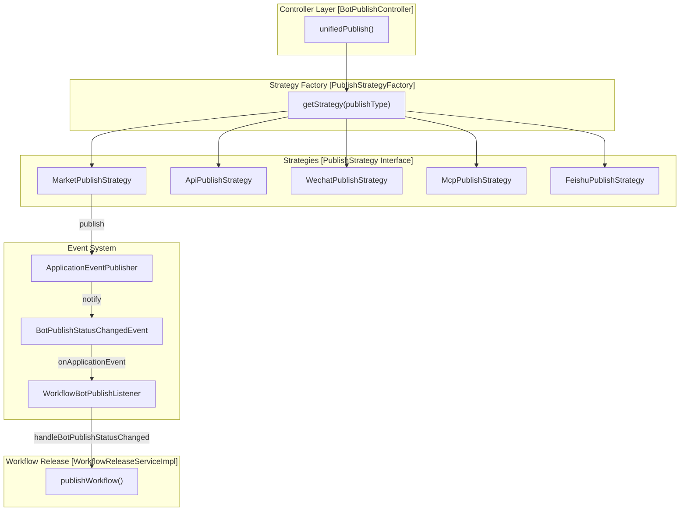
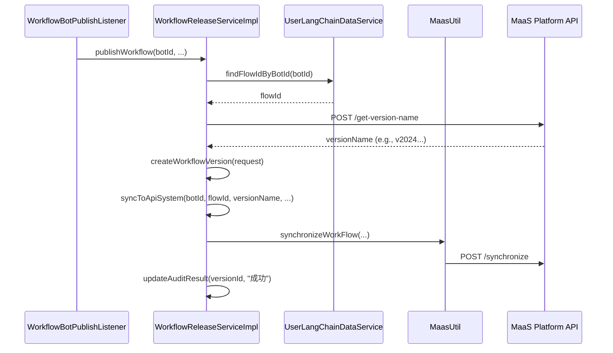

<!-- source: DeepWiki mcp.deepwiki.com · repo iflytek/astron-agent · page 4.2 Bot Publishing Lifecycle · fetched 2026-10-26 -->

# Bot Publishing Lifecycle

Relevant source files

The following files were used as context for generating this wiki page:

- [console/backend/commons/src/main/java/com/iflytek/astron/console/commons/util/MaasUtil.java](console/backend/commons/src/main/java/com/iflytek/astron/console/commons/util/MaasUtil.java)
- [console/backend/hub/src/main/java/com/iflytek/astron/console/hub/controller/publish/BotPublishController.java](console/backend/hub/src/main/java/com/iflytek/astron/console/hub/controller/publish/BotPublishController.java)
- [console/backend/hub/src/main/java/com/iflytek/astron/console/hub/dto/publish/ReleaseBotReqDto.java](console/backend/hub/src/main/java/com/iflytek/astron/console/hub/dto/publish/ReleaseBotReqDto.java)
- [console/backend/hub/src/main/java/com/iflytek/astron/console/hub/dto/publish/ReleaseBotRespDto.java](console/backend/hub/src/main/java/com/iflytek/astron/console/hub/dto/publish/ReleaseBotRespDto.java)
- [console/backend/hub/src/main/java/com/iflytek/astron/console/hub/entity/BotConversationStats.java](console/backend/hub/src/main/java/com/iflytek/astron/console/hub/entity/BotConversationStats.java)
- [console/backend/hub/src/main/java/com/iflytek/astron/console/hub/listener/WorkflowBotPublishListener.java](console/backend/hub/src/main/java/com/iflytek/astron/console/hub/listener/WorkflowBotPublishListener.java)
- [console/backend/hub/src/main/java/com/iflytek/astron/console/hub/mapper/BotConversationStatsMapper.java](console/backend/hub/src/main/java/com/iflytek/astron/console/hub/mapper/BotConversationStatsMapper.java)
- [console/backend/hub/src/main/java/com/iflytek/astron/console/hub/service/publish/BotPublishService.java](console/backend/hub/src/main/java/com/iflytek/astron/console/hub/service/publish/BotPublishService.java)
- [console/backend/hub/src/main/java/com/iflytek/astron/console/hub/service/publish/McpService.java](console/backend/hub/src/main/java/com/iflytek/astron/console/hub/service/publish/McpService.java)
- [console/backend/hub/src/main/java/com/iflytek/astron/console/hub/service/publish/ReleaseManageClientService.java](console/backend/hub/src/main/java/com/iflytek/astron/console/hub/service/publish/ReleaseManageClientService.java)
- [console/backend/hub/src/main/java/com/iflytek/astron/console/hub/service/publish/impl/BotPublishServiceImpl.java](console/backend/hub/src/main/java/com/iflytek/astron/console/hub/service/publish/impl/BotPublishServiceImpl.java)
- [console/backend/hub/src/main/java/com/iflytek/astron/console/hub/service/publish/impl/ReleaseManageClientServiceImpl.java](console/backend/hub/src/main/java/com/iflytek/astron/console/hub/service/publish/impl/ReleaseManageClientServiceImpl.java)
- [console/backend/hub/src/main/java/com/iflytek/astron/console/hub/service/workflow/impl/WorkflowReleaseServiceImpl.java](console/backend/hub/src/main/java/com/iflytek/astron/console/hub/service/workflow/impl/WorkflowReleaseServiceImpl.java)
- [console/backend/hub/src/main/java/com/iflytek/astron/console/hub/strategy/publish/PublishStrategy.java](console/backend/hub/src/main/java/com/iflytek/astron/console/hub/strategy/publish/PublishStrategy.java)
- [console/backend/hub/src/main/java/com/iflytek/astron/console/hub/strategy/publish/PublishStrategyFactory.java](console/backend/hub/src/main/java/com/iflytek/astron/console/hub/strategy/publish/PublishStrategyFactory.java)
- [console/backend/hub/src/main/java/com/iflytek/astron/console/hub/strategy/publish/impl/ApiPublishStrategy.java](console/backend/hub/src/main/java/com/iflytek/astron/console/hub/strategy/publish/impl/ApiPublishStrategy.java)
- [console/backend/hub/src/main/java/com/iflytek/astron/console/hub/strategy/publish/impl/FeishuPublishStrategy.java](console/backend/hub/src/main/java/com/iflytek/astron/console/hub/strategy/publish/impl/FeishuPublishStrategy.java)
- [console/backend/hub/src/main/java/com/iflytek/astron/console/hub/strategy/publish/impl/MarketPublishStrategy.java](console/backend/hub/src/main/java/com/iflytek/astron/console/hub/strategy/publish/impl/MarketPublishStrategy.java)
- [console/backend/hub/src/main/java/com/iflytek/astron/console/hub/strategy/publish/impl/McpPublishStrategy.java](console/backend/hub/src/main/java/com/iflytek/astron/console/hub/strategy/publish/impl/McpPublishStrategy.java)
- [console/backend/hub/src/main/java/com/iflytek/astron/console/hub/strategy/publish/impl/WechatPublishStrategy.java](console/backend/hub/src/main/java/com/iflytek/astron/console/hub/strategy/publish/impl/WechatPublishStrategy.java)
- [console/backend/hub/src/main/resources/mapper/BotConversationStatsMapper.xml](console/backend/hub/src/main/resources/mapper/BotConversationStatsMapper.xml)

## Purpose and Scope

The Bot Publishing Lifecycle documents the end-to-end process of transitioning a bot from a development/draft state to a live, multi-channel deployment. This system utilizes an event-driven architecture to coordinate between the core platform, the MaaS (Modeling as a Service) workflow engine, and various publishing channels (Market, API, WeChat, MCP, Feishu).

**Key Components:**
- **Strategy Pattern:** Decouples channel-specific publishing logic (Market, API, etc.) via the `PublishStrategy` interface [[console/backend/hub/src/main/java/com/iflytek/astron/console/hub/strategy/publish/PublishStrategy.java:7-7]]().
- **Event-Driven Coordination:** Uses `BotPublishStatusChangedEvent` to trigger secondary actions like workflow versioning [[console/backend/hub/src/main/java/com/iflytek/astron/console/hub/event/BotPublishStatusChangedEvent.java:48-48]]().
- **MaaS Synchronization:** Ensures the underlying LLM workflow is synchronized and versioned on the execution platform using `MaasUtil` [[console/backend/commons/src/main/java/com/iflytek/astron/console/commons/util/MaasUtil.java:43-43]]().

**Sources:**
- [[console/backend/hub/src/main/java/com/iflytek/astron/console/hub/strategy/publish/PublishStrategy.java:7-7]]()
- [[console/backend/hub/src/main/java/com/iflytek/astron/console/hub/service/publish/impl/BotPublishServiceImpl.java:48-48]]()
- [[console/backend/commons/src/main/java/com/iflytek/astron/console/commons/util/MaasUtil.java:43-43]]()

---

## Publishing System Architecture

The publishing system is centered around the `BotPublishController` which acts as the entry point, delegating to `BotPublishService` and various strategy implementations coordinated by `PublishStrategyFactory` [[console/backend/hub/src/main/java/com/iflytek/astron/console/hub/controller/publish/BotPublishController.java:50-55]]().

### Publishing Logic Flow

Title: Publishing Architecture and Strategy Dispatch

**Sources:**
- [[console/backend/hub/src/main/java/com/iflytek/astron/console/hub/controller/publish/BotPublishController.java:136-160]]()
- [[console/backend/hub/src/main/java/com/iflytek/astron/console/hub/strategy/publish/impl/MarketPublishStrategy.java:82-84]]()
- [[console/backend/hub/src/main/java/com/iflytek/astron/console/hub/listener/WorkflowBotPublishListener.java:35-43]]()

---

## Publishing Channels and Strategies

The platform supports multiple release types defined in `ReleaseTypeEnum`. Each type is handled by a specific implementation of the `PublishStrategy` interface.

| Channel | ReleaseTypeEnum | Strategy Implementation | Description |
| :--- | :--- | :--- | :--- |
| **Market** | `MARKET` | `MarketPublishStrategy` | Publishes the bot to the internal Agent Hub [[console/backend/hub/src/main/java/com/iflytek/astron/console/hub/strategy/publish/impl/MarketPublishStrategy.java:32-32]](). |
| **Bot API** | `BOT_API` | `ApiPublishStrategy` | Generates external API endpoints and credentials [[console/backend/hub/src/main/java/com/iflytek/astron/console/hub/strategy/publish/impl/ApiPublishStrategy.java:16-16]](). |
| **WeChat** | `WECHAT` | `WechatPublishStrategy` | Integrates with WeChat Official Accounts via OAuth2 binding [[console/backend/hub/src/main/java/com/iflytek/astron/console/hub/strategy/publish/impl/WechatPublishStrategy.java:20-20]](). |
| **MCP** | `MCP` | `McpPublishStrategy` | Publishes as a Model Context Protocol server [[console/backend/hub/src/main/java/com/iflytek/astron/console/hub/strategy/publish/impl/McpPublishStrategy.java:18-18]](). |
| **Feishu** | `FEISHU` | `FeishuPublishStrategy` | Handles bot publishing to Feishu channel [[console/backend/hub/src/main/java/com/iflytek/astron/console/hub/strategy/publish/impl/FeishuPublishStrategy.java:16-16]](). |

**Sources:**
- [[console/backend/hub/src/main/java/com/iflytek/astron/console/hub/strategy/publish/impl/MarketPublishStrategy.java:139-139]]()
- [[console/backend/hub/src/main/java/com/iflytek/astron/console/hub/strategy/publish/impl/McpPublishStrategy.java:35-37]]()
- [[console/backend/hub/src/main/java/com/iflytek/astron/console/hub/strategy/publish/impl/FeishuPublishStrategy.java:50-50]]()
- [[console/backend/hub/src/main/java/com/iflytek/astron/console/hub/strategy/publish/impl/ApiPublishStrategy.java:49-51]]()
- [[console/backend/hub/src/main/java/com/iflytek/astron/console/hub/strategy/publish/impl/WechatPublishStrategy.java:73-75]]()

---

## Event-Driven Architecture

The publishing process uses `BotPublishStatusChangedEvent` to decouple the core status update from workflow-specific release logic.

### Status Transition and Event Propagation

1. **Validation:** `MarketPublishStrategy` validates the bot exists and the user has permissions via `chatBotBaseMapper.checkBotPermission` [[console/backend/hub/src/main/java/com/iflytek/astron/console/hub/strategy/publish/impl/MarketPublishStrategy.java:45-48]]().
2. **State Update:** The bot's status and channels in `chat_bot_market` are updated via `handleBotMarketSync` [[console/backend/hub/src/main/java/com/iflytek/astron/console/hub/strategy/publish/impl/MarketPublishStrategy.java:79-80]]().
3. **Event Publication:** Upon successful status change, the `ApplicationEventPublisher` broadcasts the `BotPublishStatusChangedEvent` [[console/backend/hub/src/main/java/com/iflytek/astron/console/hub/strategy/publish/impl/MarketPublishStrategy.java:82-84]]().
4. **Asynchronous Handling:** `WorkflowBotPublishListener` filters events. If the bot is a `WORKFLOW_BOT` or `TALK_BOT`, it triggers `WorkflowReleaseService.publishWorkflow` [[console/backend/hub/src/main/java/com/iflytek/astron/console/hub/listener/WorkflowBotPublishListener.java:52-71]]().

**Sources:**
- [[console/backend/hub/src/main/java/com/iflytek/astron/console/hub/service/publish/impl/BotPublishServiceImpl.java:48-48]]()
- [[console/backend/hub/src/main/java/com/iflytek/astron/console/hub/listener/WorkflowBotPublishListener.java:35-55]]()
- [[console/backend/hub/src/main/java/com/iflytek/astron/console/hub/strategy/publish/impl/MarketPublishStrategy.java:145-146]]()

---

## Workflow Release and MaaS Sync

For workflow bots, publishing requires creating a fixed version of the workflow and synchronizing it with the MaaS platform.

### Release Sequence Diagram

Title: Workflow Bot Publishing Sequence

**Sources:**
- [[console/backend/hub/src/main/java/com/iflytek/astron/console/hub/service/workflow/impl/WorkflowReleaseServiceImpl.java:76-137]]()
- [[console/backend/hub/src/main/java/com/iflytek/astron/console/hub/service/workflow/impl/WorkflowReleaseServiceImpl.java:143-163]]()
- [[console/backend/commons/src/main/java/com/iflytek/astron/console/commons/util/MaasUtil.java:169-180]]()

### MaaS Integration Details

`MaasUtil` handles the low-level HTTP communication with the MaaS platform using `OkHttpClient` [[console/backend/commons/src/main/java/com/iflytek/astron/console/commons/util/MaasUtil.java:44-49]]().
- **Workflow Synchronization:** `synchronizeWorkFlow` updates bot metadata like `avatarIcon`, `description`, and `advancedConfig` (prologue, input examples) [[console/backend/commons/src/main/java/com/iflytek/astron/console/commons/util/MaasUtil.java:172-177]]().
- **Version Management:** `WorkflowReleaseServiceImpl` fetches the next version name using the `GET_VERSION_NAME_URL` endpoint [[console/backend/hub/src/main/java/com/iflytek/astron/console/hub/service/workflow/impl/WorkflowReleaseServiceImpl.java:54-54]]().
- **Audit Update:** Once published, the system calls `updateAuditResult` to set the workflow version status to "成功" (Success) [[console/backend/hub/src/main/java/com/iflytek/astron/console/hub/service/workflow/impl/WorkflowReleaseServiceImpl.java:126-126]]().

**Sources:**
- [[console/backend/commons/src/main/java/com/iflytek/astron/console/commons/util/MaasUtil.java:102-102]]()
- [[console/backend/hub/src/main/java/com/iflytek/astron/console/hub/service/workflow/impl/WorkflowReleaseServiceImpl.java:54-54]]()

---

## Data Model and Statistics

The lifecycle involves persistence of status changes and tracking of bot performance post-publication.

| Entity | Table | Responsibility |
| :--- | :--- | :--- |
| `ChatBotBase` | `chat_bot_base` | Core bot definition and version type [[console/backend/hub/src/main/java/com/iflytek/astron/console/hub/service/publish/impl/BotPublishServiceImpl.java:71-71]](). |
| `ChatBotMarket` | `chat_bot_market` | Stores publishing status and active channels [[console/backend/hub/src/main/java/com/iflytek/astron/console/hub/strategy/publish/impl/MarketPublishStrategy.java:35-35]](). |
| `WorkflowVersion` | `workflow_version` | Stores immutable versions of published workflows [[console/backend/hub/src/main/java/com/iflytek/astron/console/hub/service/workflow/impl/WorkflowReleaseServiceImpl.java:8-9]](). |
| `BotConversationStats` | `bot_conversation_stats` | Tracks token usage and conversation counts [[console/backend/hub/src/main/java/com/iflytek/astron/console/hub/entity/BotConversationStats.java:17-18]](). |

### Performance Tracking
After publication, the `BotConversationStatsMapper` provides insights into bot usage:
- **Summary Stats:** Aggregates conversation metrics (tokens, chats, users) for the published bot via `selectSummaryStats` [[console/backend/hub/src/main/resources/mapper/BotConversationStatsMapper.xml:6-21]]().
- **Time Series Stats:** Retrieves historical usage trends via `selectTimeSeriesStats` [[console/backend/hub/src/main/resources/mapper/BotConversationStatsMapper.xml:24-45]]().
- **Conversation Logging:** `recordDashboardCountLog` persists conversation metadata for analytics [[console/backend/hub/src/main/java/com/iflytek/astron/console/hub/service/publish/impl/BotPublishServiceImpl.java:231-255]]().

**Sources:**
- [[console/backend/hub/src/main/java/com/iflytek/astron/console/hub/service/publish/impl/BotPublishServiceImpl.java:83-83]]()
- [[console/backend/hub/src/main/java/com/iflytek/astron/console/hub/service/workflow/impl/WorkflowReleaseServiceImpl.java:8-9]]()
- [[console/backend/hub/src/main/resources/mapper/BotConversationStatsMapper.xml:6-45]]()
- [[console/backend/hub/src/main/java/com/iflytek/astron/console/hub/entity/BotConversationStats.java:17-18]]()

---

