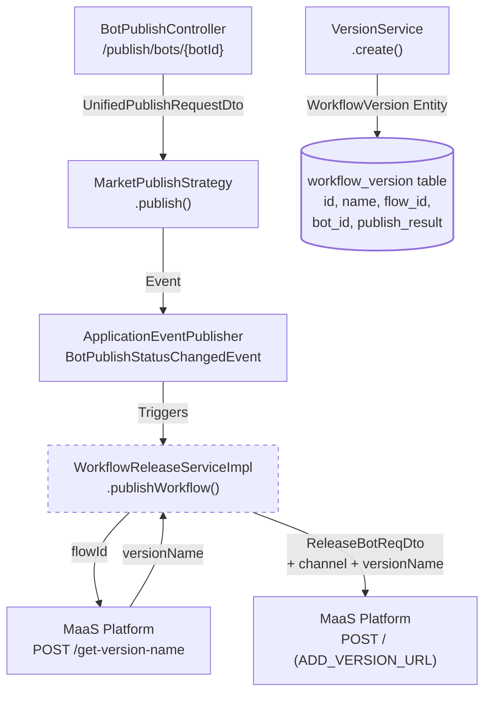
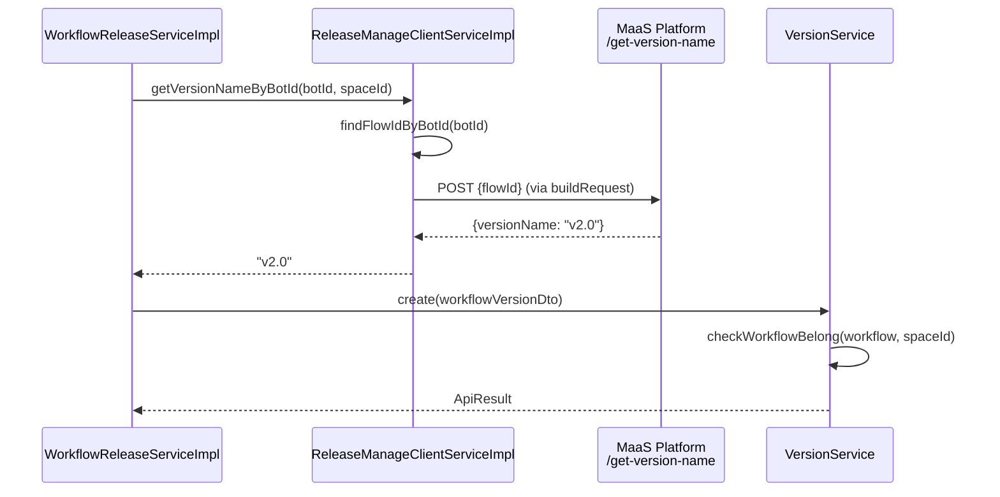
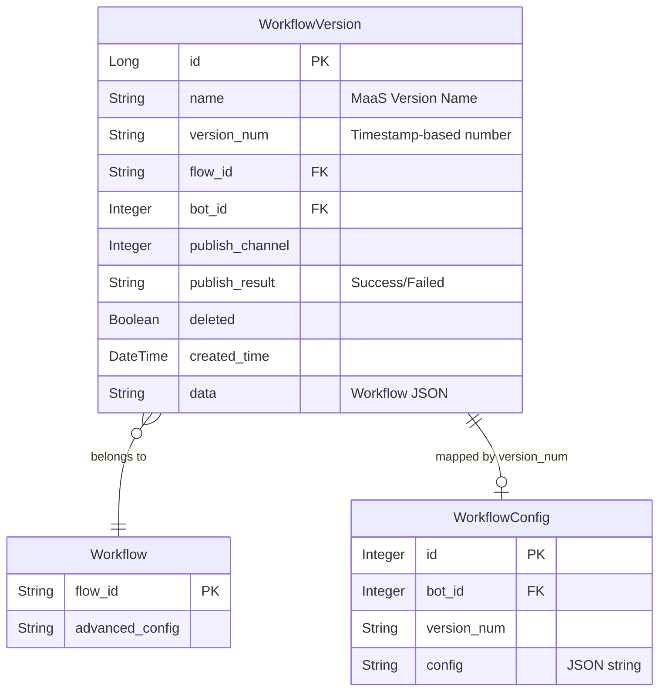
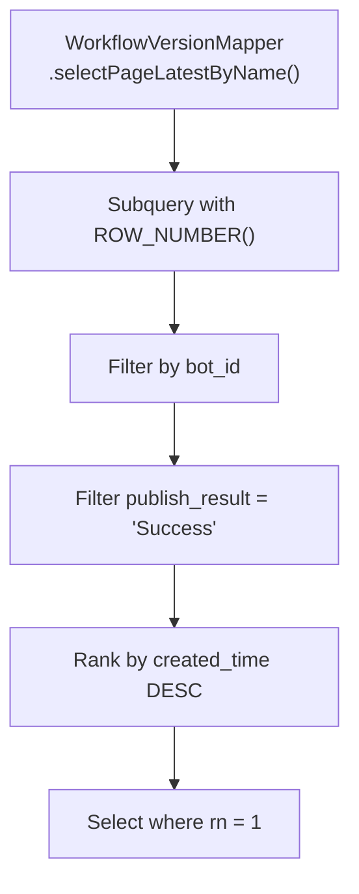

<!-- source: DeepWiki mcp.deepwiki.com · repo iflytek/astron-agent · page 4.4 Workflow Versioning and Release Management · fetched 2026-10-26 -->

# Workflow Versioning and Release Management

Relevant source files

The following files were used as context for generating this wiki page:

- [console/backend/commons/src/main/resources/mapper/BotDatasetMaasMapper.xml](console/backend/commons/src/main/resources/mapper/BotDatasetMaasMapper.xml)
- [console/backend/toolkit/src/main/java/com/iflytek/astron/console/toolkit/handler/McpServerHandler.java](console/backend/toolkit/src/main/java/com/iflytek/astron/console/toolkit/handler/McpServerHandler.java)
- [console/backend/toolkit/src/main/java/com/iflytek/astron/console/toolkit/mapper/workflow/WorkflowVersionMapper.java](console/backend/toolkit/src/main/java/com/iflytek/astron/console/toolkit/mapper/workflow/WorkflowVersionMapper.java)
- [console/backend/toolkit/src/main/java/com/iflytek/astron/console/toolkit/service/model/ModelService.java](console/backend/toolkit/src/main/java/com/iflytek/astron/console/toolkit/service/model/ModelService.java)
- [console/backend/toolkit/src/main/java/com/iflytek/astron/console/toolkit/service/repo/FileInfoV2Service.java](console/backend/toolkit/src/main/java/com/iflytek/astron/console/toolkit/service/repo/FileInfoV2Service.java)
- [console/backend/toolkit/src/main/java/com/iflytek/astron/console/toolkit/service/workflow/VersionService.java](console/backend/toolkit/src/main/java/com/iflytek/astron/console/toolkit/service/workflow/VersionService.java)
- [console/backend/toolkit/src/main/java/com/iflytek/astron/console/toolkit/service/workflow/WorkflowService.java](console/backend/toolkit/src/main/java/com/iflytek/astron/console/toolkit/service/workflow/WorkflowService.java)
- [console/backend/toolkit/src/main/java/com/iflytek/astron/console/toolkit/tool/UrlCheckTool.java](console/backend/toolkit/src/main/java/com/iflytek/astron/console/toolkit/tool/UrlCheckTool.java)
- [console/backend/toolkit/src/main/resources/mybatis/mapper/mysql/WorkflowVersionMapper.xml](console/backend/toolkit/src/main/resources/mybatis/mapper/mysql/WorkflowVersionMapper.xml)
- [console/backend/toolkit/src/test/java/com/iflytek/astron/console/toolkit/service/extra/OpenPlatformServiceTest.java](console/backend/toolkit/src/test/java/com/iflytek/astron/console/toolkit/service/extra/OpenPlatformServiceTest.java)
- [console/backend/toolkit/src/test/java/com/iflytek/astron/console/toolkit/service/group/GroupVisibilityServiceTest.java](console/backend/toolkit/src/test/java/com/iflytek/astron/console/toolkit/service/group/GroupVisibilityServiceTest.java)

This document describes the workflow versioning and release management system, which tracks workflow bot deployments across different channels. When a workflow bot is published to Market, API, or other channels, the system creates immutable version records that capture the workflow configuration at that point in time. This enables version history tracking, rollback capabilities, and audit trails.

For information about the initial workflow synchronization with MaaS platform, see [Workflow Architecture and MaaS Integration](4.1). For the overall bot publishing lifecycle, see [Bot Publishing Lifecycle](4.2). For channel-specific publishing logic, see [Multi-Channel Publishing Strategy](4.3).

## Version Creation Architecture

The workflow versioning system operates as part of the publishing pipeline. When a workflow bot is published, `WorkflowReleaseServiceImpl` and `ReleaseManageClientServiceImpl` orchestrate version creation, naming, and synchronization with the external MaaS platform. The `VersionService` handles the persistence and retrieval of these version records within the toolkit module.

Title: Workflow Versioning Data Flow

**Sources:** [console/backend/hub/src/main/java/com/iflytek/astron/console/hub/service/publish/impl/ReleaseManageClientServiceImpl.java:38-42](), [console/backend/toolkit/src/main/java/com/iflytek/astron/console/toolkit/service/workflow/VersionService.java:152-162](), [console/backend/hub/src/main/java/com/iflytek/astron/console/hub/service/publish/impl/ReleaseManageClientServiceImpl.java:90-105]()

## Version Creation Flow

The version creation process follows a pipeline executed by `WorkflowReleaseServiceImpl` (orchestrator) and `ReleaseManageClientServiceImpl` (HTTP client):

| Step | Operation | Implementation | Purpose |
|------|-----------|----------------|---------|
| 1 | Resolve IDs | `userLangChainDataService.findFlowIdByBotId()` | Map the internal `botId` to the MaaS `flowId`. |
| 2 | Get Version Name | `getVersionNameByBotId()` | Call external MaaS service to get the next sequential version name. |
| 3 | Create Record | `releaseBot()` | Notify MaaS platform to create a new version record for the specific channel. |
| 4 | Execute Request | `executeRequestForReleaseBot()` | Perform the actual OkHttp POST call with `ReleaseBotReqDto`. |
| 5 | Internal Persistence | `VersionService.create()` | Save the `WorkflowVersion` entity to the local database for history tracking. |

**Sources:** [console/backend/hub/src/main/java/com/iflytek/astron/console/hub/service/publish/impl/ReleaseManageClientServiceImpl.java:60-75](), [console/backend/hub/src/main/java/com/iflytek/astron/console/hub/service/publish/impl/ReleaseManageClientServiceImpl.java:90-105](), [console/backend/toolkit/src/main/java/com/iflytek/astron/console/toolkit/service/workflow/VersionService.java:152-180]()

### Version Naming Strategy

Version names are retrieved from the MaaS platform via the `/get-version-name` endpoint. The system queries this endpoint with the `flowId` and receives a sequential version name based on existing history in the MaaS environment. Locally, `VersionService` may generate internal version numbers or descriptions based on the provided `WorkflowVersion` DTO.

Title: Version Naming Sequence

**Sources:** [console/backend/hub/src/main/java/com/iflytek/astron/console/hub/service/publish/impl/ReleaseManageClientServiceImpl.java:142-152](), [console/backend/toolkit/src/main/java/com/iflytek/astron/console/toolkit/service/workflow/VersionService.java:152-162]()

## Version Data Model

Workflow versions are persisted in the `workflow_version` table and managed by the `VersionService`. This service handles version listing, pagination, and configuration mapping.

Title: Workflow Version Entity Relationships

The `VersionService` provides `listPage` and `list_botId_Page` methods to retrieve version history. It enriches `WorkflowVersion` records with `WorkflowConfig` data by matching the `versionNum` field.

**Sources:** [console/backend/toolkit/src/main/java/com/iflytek/astron/console/toolkit/service/workflow/VersionService.java:67-83](), [console/backend/toolkit/src/main/java/com/iflytek/astron/console/toolkit/service/workflow/VersionService.java:85-111](), [console/backend/toolkit/src/main/resources/mybatis/mapper/mysql/WorkflowVersionMapper.xml:7-31]()

## Version Creation Request (MaaS)

The `ReleaseBotReqDto` structure is used to notify the MaaS platform of a release. This DTO is the primary payload for the `ADD_VERSION_URL` endpoint.

| Field | Type | Source | Description |
|-------|------|--------|-------------|
| `botId` | String | Bot Identifier | The internal ID of the chatbot. |
| `flowId` | String | Workflow Identifier | The unique ID of the workflow in MaaS. |
| `publishChannel` | Integer | `ReleaseTypeEnum` code | Channel (e.g., 1: Market, 3: API). |
| `publishResult` | String | Status string | "Success", "Failed", or "Under Review". |
| `description` | String | Optional notes | Metadata describing the release. |
| `name` | String | `versionName` | The sequential name (e.g., "v1.0.1"). |

**Sources:** [console/backend/hub/src/main/java/com/iflytek/astron/console/hub/dto/publish/ReleaseBotReqDto.java:15-32](), [console/backend/hub/src/main/java/com/iflytek/astron/console/hub/service/publish/impl/ReleaseManageClientServiceImpl.java:94-98](), [console/backend/toolkit/src/main/java/com/iflytek/astron/console/toolkit/service/workflow/VersionService.java:143-149]()

## Audit and Listing Logic

The system utilizes specialized SQL queries in `WorkflowVersionMapper.xml` to manage version visibility and ensure only the latest records are presented to the user.

1.  **Condition-based Listing**: `selectPageByCondition` filters for the latest record of each version name for a specific `flowId` where `deleted = 1`. It performs an inner join with a subquery that groups by name and finds the `MAX(created_time)`.
2.  **Latest Successful Versions**: `selectPageLatestByName` uses a window function (`ROW_NUMBER() OVER (PARTITION BY wv.name ORDER BY wv.created_time DESC)`) to find the most recent successful release (`publish_result = 'Success'`) for each version name.

Title: Version Selection Logic

**Sources:** [console/backend/toolkit/src/main/resources/mybatis/mapper/mysql/WorkflowVersionMapper.xml:34-46](), [console/backend/toolkit/src/main/java/com/iflytek/astron/console/toolkit/service/workflow/VersionService.java:85-141]()

## Configuration and Security

Release management relies on external MaaS service URLs and timeouts configured in the environment. Additionally, version operations are protected by data permission checks.

| Property | Purpose | Implementation |
|----------|---------|----------------|
| `maas.workflowVersion` | Base URL for MaaS versioning APIs | `baseUrl` in `ReleaseManageClientServiceImpl` |
| `Connection Pool` | HTTP resource management | 100 max connections, 5 min keep-alive |
| `Timeouts` | Request reliability | 60s for Connect, Read, and Write |
| `Permission Check` | Security | `dataPermissionCheckTool.checkWorkflowBelong` |

**Sources:** [console/backend/hub/src/main/java/com/iflytek/astron/console/hub/service/publish/impl/ReleaseManageClientServiceImpl.java:29-30](), [console/backend/hub/src/main/java/com/iflytek/astron/console/hub/service/publish/impl/ReleaseManageClientServiceImpl.java:52-57](), [console/backend/toolkit/src/main/java/com/iflytek/astron/console/toolkit/service/workflow/VersionService.java:158-158]()

---

