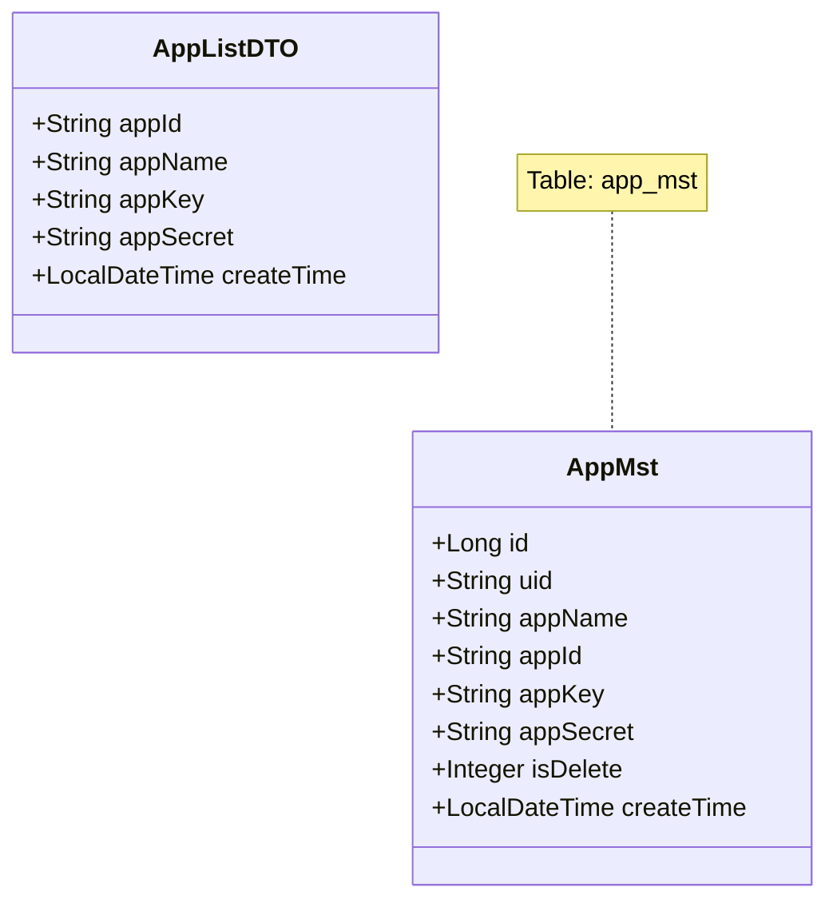
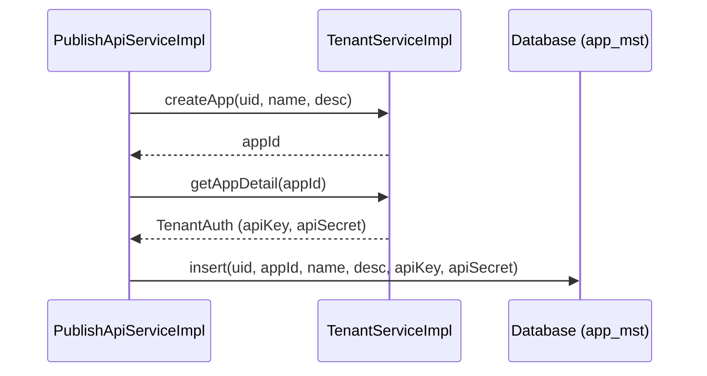

<!-- source: DeepWiki mcp.deepwiki.com · repo iflytek/astron-agent · page 4.5 Bot API Publishing Service · fetched 2026-10-26 -->

# Bot API Publishing Service

<details>
<summary>Relevant source files</summary>

The following files were used as context for generating this wiki page:

- [console/backend/commons/src/main/java/com/iflytek/astron/console/commons/dto/bot/ChatBotApi.java](console/backend/commons/src/main/java/com/iflytek/astron/console/commons/dto/bot/ChatBotApi.java)
- [console/backend/commons/src/main/java/com/iflytek/astron/console/commons/entity/user/AppMst.java](console/backend/commons/src/main/java/com/iflytek/astron/console/commons/entity/user/AppMst.java)
- [console/backend/commons/src/main/java/com/iflytek/astron/console/commons/mapper/user/AppMstMapper.java](console/backend/commons/src/main/java/com/iflytek/astron/console/commons/mapper/user/AppMstMapper.java)
- [console/backend/commons/src/main/java/com/iflytek/astron/console/commons/service/user/AppMstService.java](console/backend/commons/src/main/java/com/iflytek/astron/console/commons/service/user/AppMstService.java)
- [console/backend/commons/src/main/java/com/iflytek/astron/console/commons/service/user/Impl/AppMstServiceImpl.java](console/backend/commons/src/main/java/com/iflytek/astron/console/commons/service/user/Impl/AppMstServiceImpl.java)
- [console/backend/hub/pom.xml](console/backend/hub/pom.xml)
- [console/backend/hub/src/main/java/com/iflytek/astron/console/hub/controller/publish/PublishApiController.java](console/backend/hub/src/main/java/com/iflytek/astron/console/hub/controller/publish/PublishApiController.java)
- [console/backend/hub/src/main/java/com/iflytek/astron/console/hub/dto/publish/AppListDTO.java](console/backend/hub/src/main/java/com/iflytek/astron/console/hub/dto/publish/AppListDTO.java)
- [console/backend/hub/src/main/java/com/iflytek/astron/console/hub/dto/publish/BotApiInfoDTO.java](console/backend/hub/src/main/java/com/iflytek/astron/console/hub/dto/publish/BotApiInfoDTO.java)
- [console/backend/hub/src/main/java/com/iflytek/astron/console/hub/dto/publish/BotApiRealTimeUsageDTO.java](console/backend/hub/src/main/java/com/iflytek/astron/console/hub/dto/publish/BotApiRealTimeUsageDTO.java)
- [console/backend/hub/src/main/java/com/iflytek/astron/console/hub/dto/publish/CreateAppVo.java](console/backend/hub/src/main/java/com/iflytek/astron/console/hub/dto/publish/CreateAppVo.java)
- [console/backend/hub/src/main/java/com/iflytek/astron/console/hub/dto/publish/cbm/AssistantInfo.java](console/backend/hub/src/main/java/com/iflytek/astron/console/hub/dto/publish/cbm/AssistantInfo.java)
- [console/backend/hub/src/main/java/com/iflytek/astron/console/hub/dto/publish/cbm/CbmBody.java](console/backend/hub/src/main/java/com/iflytek/astron/console/hub/dto/publish/cbm/CbmBody.java)
- [console/backend/hub/src/main/java/com/iflytek/astron/console/hub/dto/publish/cbm/CbmForm.java](console/backend/hub/src/main/java/com/iflytek/astron/console/hub/dto/publish/cbm/CbmForm.java)
- [console/backend/hub/src/main/java/com/iflytek/astron/console/hub/dto/publish/cbm/CbmResponse.java](console/backend/hub/src/main/java/com/iflytek/astron/console/hub/dto/publish/cbm/CbmResponse.java)
- [console/backend/hub/src/main/java/com/iflytek/astron/console/hub/dto/publish/cbm/Options.java](console/backend/hub/src/main/java/com/iflytek/astron/console/hub/dto/publish/cbm/Options.java)
- [console/backend/hub/src/main/java/com/iflytek/astron/console/hub/dto/user/TenantAuth.java](console/backend/hub/src/main/java/com/iflytek/astron/console/hub/dto/user/TenantAuth.java)
- [console/backend/hub/src/main/java/com/iflytek/astron/console/hub/service/chat/ChatBotApiService.java](console/backend/hub/src/main/java/com/iflytek/astron/console/hub/service/chat/ChatBotApiService.java)
- [console/backend/hub/src/main/java/com/iflytek/astron/console/hub/service/chat/impl/ChatBotApiServiceImpl.java](console/backend/hub/src/main/java/com/iflytek/astron/console/hub/service/chat/impl/ChatBotApiServiceImpl.java)
- [console/backend/hub/src/main/java/com/iflytek/astron/console/hub/service/publish/PublishApiService.java](console/backend/hub/src/main/java/com/iflytek/astron/console/hub/service/publish/PublishApiService.java)
- [console/backend/hub/src/main/java/com/iflytek/astron/console/hub/service/publish/TenantService.java](console/backend/hub/src/main/java/com/iflytek/astron/console/hub/service/publish/TenantService.java)
- [console/backend/hub/src/main/java/com/iflytek/astron/console/hub/service/publish/impl/PublishApiServiceImpl.java](console/backend/hub/src/main/java/com/iflytek/astron/console/hub/service/publish/impl/PublishApiServiceImpl.java)
- [console/backend/hub/src/main/java/com/iflytek/astron/console/hub/service/publish/impl/TenantServiceImpl.java](console/backend/hub/src/main/java/com/iflytek/astron/console/hub/service/publish/impl/TenantServiceImpl.java)

</details>


## Purpose and Scope

The Bot API Publishing Service enables users to expose their bots as RESTful APIs for external consumption. This service manages the creation of application credentials (apps), associates bots with these apps, and generates API endpoints that external systems can invoke to interact with published bots. It also handles the integration with the MaaS (Model as a Service) platform for workflow-based bot execution.

This document covers the API publishing channel specifically. For information about other publishing channels (Market, WeChat, MCP, Feishu), see **4.3 Multi-Channel Publishing Strategy**. For bot creation and configuration, see **5.1 Bot Creation and Configuration**.

**Sources:** [console/backend/hub/src/main/java/com/iflytek/astron/console/hub/service/publish/impl/PublishApiServiceImpl.java:44-82](), [console/backend/hub/src/main/java/com/iflytek/astron/console/hub/service/publish/PublishApiService.java:14-22]()

## Architecture Overview

The Bot API Publishing Service follows a two-tier model: **Apps** serve as credential containers that hold authentication keys (`appKey`, `appSecret`), and **Bot APIs** represent the published bot-to-app associations with generated service URLs.

### System Components and Code Entities

The following diagram maps high-level functional blocks to specific code entities within the service architecture.

```mermaid
graph TB
    subgraph "Entry Layer"
        [PublishApiController] -- "/publish-api/*" --> Service["PublishApiServiceImpl"]
    end

    subgraph "Business Logic Layer"
        Service -- "createApp" --> TenantSvc["TenantServiceImpl"]
        Service -- "insert/get" --> AppMstSvc["AppMstServiceImpl"]
        Service -- "getOneByUidAndBotId" --> BotApiSvc["ChatBotApiServiceImpl"]
    end
    
    subgraph "Persistence Layer"
        AppMstSvc -- "CRUD" --> AppMstMapper["AppMstMapper (app_mst)"]
        BotApiSvc -- "CRUD" --> ChatBotApiMapper["ChatBotApiMapper (chat_bot_api)"]
    end
    
    subgraph "Infrastructure & External"
        Service -- "tryLock/unlock" --> Redis["RedisUtil (Distributed Lock)"]
        TenantSvc -- "execute" --> OkHttp["OkHttpClient (Tenant API Calls)"]
        Service -- "createApi" --> MaaS["MaasUtil (Workflow API Sync)"]
    end
```

**Sources:** [console/backend/hub/src/main/java/com/iflytek/astron/console/hub/controller/publish/PublishApiController.java:30-34](), [console/backend/hub/src/main/java/com/iflytek/astron/console/hub/service/publish/impl/PublishApiServiceImpl.java:44-82](), [console/backend/hub/src/main/java/com/iflytek/astron/console/hub/service/publish/impl/TenantServiceImpl.java:22-35]()

## Service Endpoints

The service exposes primary REST endpoints through `PublishApiController` for credential and publishing management:

| Endpoint | Method | Description | Rate Limit |
|----------|--------|-------------|------------|
| `/publish-api/create-user-app` | POST | Create a new app (credential container) | 30/60s per user |
| `/publish-api/app-list` | GET | List all apps for the current user | 30/60s per user |
| `/publish-api/create-bot-api` | POST | Publish a bot as an API under an app | 30/60s per user |
| `/publish-api/get-bot-api-info` | GET | Retrieve API information for a published bot | 30/60s per user |

All endpoints enforce rate limiting using the `@RateLimit` annotation [console/backend/hub/src/main/java/com/iflytek/astron/console/hub/controller/publish/PublishApiController.java:36-61]().

**Sources:** [console/backend/hub/src/main/java/com/iflytek/astron/console/hub/controller/publish/PublishApiController.java:35-61]()

## App Creation and Management

### App Entity Structure

The `AppMst` entity represents an application credential container that stores authentication keys for API access.



**Sources:** [console/backend/commons/src/main/java/com/iflytek/astron/console/commons/entity/user/AppMst.java:21-58](), [console/backend/hub/src/main/java/com/iflytek/astron/console/hub/dto/publish/AppListDTO.java:21-42]()

### App Creation Flow with Tenant Service

The app creation process involves coordination between the console hub and the external tenant service:

1. **Uniqueness Check**: `AppMstService.exist` verifies if the app name is already taken [console/backend/hub/src/main/java/com/iflytek/astron/console/hub/service/publish/impl/PublishApiServiceImpl.java:90-92]().
2. **Tenant Provisioning**: `TenantService.createApp` sends a POST request to the tenant API to register the application [console/backend/hub/src/main/java/com/iflytek/astron/console/hub/service/publish/impl/TenantServiceImpl.java:38-51]().
3. **Credential Retrieval**: The service fetches the generated `apiKey` and `apiSecret` via `tenantService.getAppDetail` [console/backend/hub/src/main/java/com/iflytek/astron/console/hub/service/publish/impl/PublishApiServiceImpl.java:98]().
4. **Local Persistence**: Metadata and credentials are saved to the local `app_mst` table via `appMstService.insert` [console/backend/hub/src/main/java/com/iflytek/astron/console/hub/service/publish/impl/PublishApiServiceImpl.java:102]().

**Sources:** [console/backend/hub/src/main/java/com/iflytek/astron/console/hub/service/publish/impl/PublishApiServiceImpl.java:87-105](), [console/backend/hub/src/main/java/com/iflytek/astron/console/hub/service/publish/impl/TenantServiceImpl.java:38-99]()

## Bot API Publishing Lifecycle

### Authorization and Distributed Locking

Bot API publishing has strict authorization requirements and concurrency controls to ensure data integrity:

- **Space Creator Restriction**: Only the space creator can publish APIs for bots within that space [console/backend/hub/src/main/java/com/iflytek/astron/console/hub/service/publish/impl/PublishApiServiceImpl.java:122-124]().
- **Distributed Locking**: To prevent duplicate publishing attempts for the same user, a Redis lock is acquired using the key `publish_api + uid` for 3000ms [console/backend/hub/src/main/java/com/iflytek/astron/console/hub/service/publish/impl/PublishApiServiceImpl.java:132-134]().
- **Version Constraint**: Currently, only bots with version matching `BotVersionEnum.WORKFLOW.getVersion()` are supported for API publishing [console/backend/hub/src/main/java/com/iflytek/astron/console/hub/service/publish/impl/PublishApiServiceImpl.java:136-141]().

### API Creation Logic

When `createBotApi` is invoked, the service performs the following steps:

1. **Validation**: Verifies existence of the bot and the target application [console/backend/hub/src/main/java/com/iflytek/astron/console/hub/service/publish/impl/PublishApiServiceImpl.java:126-130]().
2. **MaaS Synchronization**: For workflow bots, it calls `createMaasApi` (internal method) which uses `maasUtil.createApi` to register the bot as an executable API in the MaaS platform [console/backend/hub/src/main/java/com/iflytek/astron/console/hub/service/publish/impl/PublishApiServiceImpl.java:138]().
3. **Status Update**: Executes `releaseManageClientService.releaseBotApi` to finalize the publishing status [console/backend/hub/src/main/java/com/iflytek/astron/console/hub/service/publish/impl/PublishApiServiceImpl.java:80]().
4. **Record Management**: `ChatBotApiService.insertOrUpdate` persists the association between the bot and the app in the `chat_bot_api` table [console/backend/hub/src/main/java/com/iflytek/astron/console/hub/service/chat/impl/ChatBotApiServiceImpl.java:46-58]().

**Sources:** [console/backend/hub/src/main/java/com/iflytek/astron/console/hub/service/publish/impl/PublishApiServiceImpl.java:118-149](), [console/backend/hub/src/main/java/com/iflytek/astron/console/hub/service/chat/impl/ChatBotApiServiceImpl.java:46-58]()

## API Credential Management

API credentials consist of an `appKey` and `appSecret` retrieved from the `TenantAuth` object provided by the `TenantService`.



The credentials are then exposed to the user via the `getAppList` endpoint, which maps `AppMst` entities to `AppListDTO` [console/backend/hub/src/main/java/com/iflytek/astron/console/hub/service/publish/impl/PublishApiServiceImpl.java:108-115]().

**Sources:** [console/backend/hub/src/main/java/com/iflytek/astron/console/hub/service/publish/impl/PublishApiServiceImpl.java:94-102](), [console/backend/hub/src/main/java/com/iflytek/astron/console/hub/dto/user/TenantAuth.java:16-21]()

## API Information Retrieval

The `getApiInfo` method constructs the `BotApiInfoDTO` required for external integration by aggregating data from multiple services:

1. **Bot Metadata**: Fetched via `chatBotDataService.findOne` [console/backend/hub/src/main/java/com/iflytek/astron/console/hub/service/publish/impl/PublishApiServiceImpl.java:158]().
2. **API Mapping**: Fetched via `chatBotApiService.getOneByUidAndBotId` to find which app the bot is published to [console/backend/hub/src/main/java/com/iflytek/astron/console/hub/service/publish/impl/PublishApiServiceImpl.java:162]().
3. **App Credentials**: Fetched via `appMstService.getByAppId` [console/backend/hub/src/main/java/com/iflytek/astron/console/hub/service/publish/impl/PublishApiServiceImpl.java:166]().
4. **URL Construction**: The `serviceUrl` is determined by the bot version. For workflow bots, it uses the `botApiMaasBaseUrl` combined with the standard path `/workflow/v1/chat/completions` [console/backend/hub/src/main/java/com/iflytek/astron/console/hub/service/publish/impl/PublishApiServiceImpl.java:170-176]().

**Sources:** [console/backend/hub/src/main/java/com/iflytek/astron/console/hub/service/publish/impl/PublishApiServiceImpl.java:152-181]()

---

