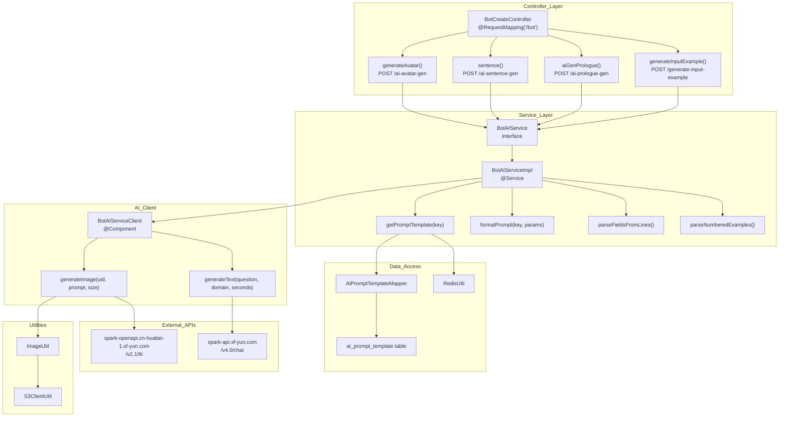
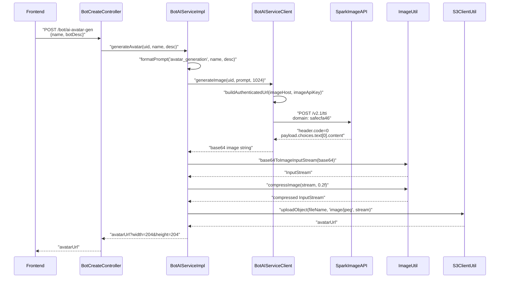
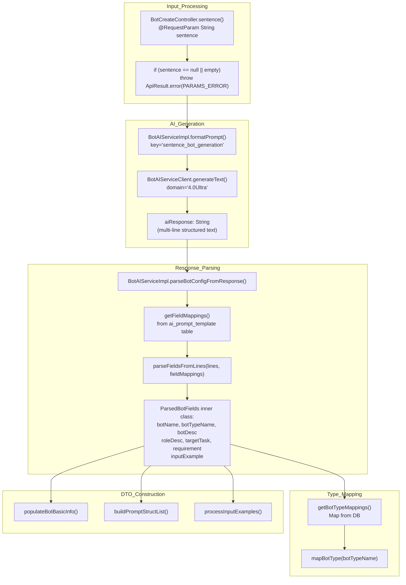
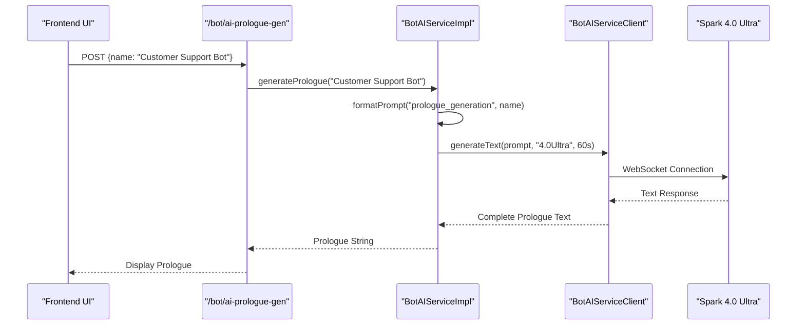
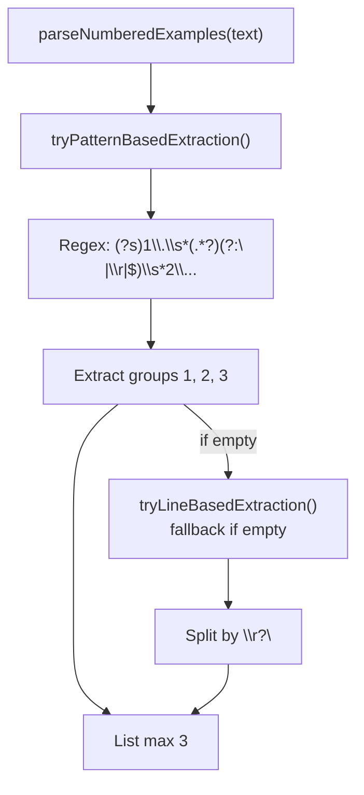
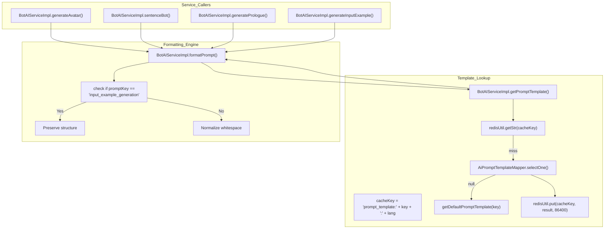

<!-- source: DeepWiki mcp.deepwiki.com · repo iflytek/astron-agent · page 5.2 AI-Assisted Bot Generation · fetched 2026-10-26 -->

# AI-Assisted Bot Generation

<details>
<summary>Relevant source files</summary>

The following files were used as context for generating this wiki page:

- [console/backend/commons/src/main/java/com/iflytek/astron/console/commons/entity/bot/BotTemplate.java](console/backend/commons/src/main/java/com/iflytek/astron/console/commons/entity/bot/BotTemplate.java)
- [console/backend/commons/src/main/java/com/iflytek/astron/console/commons/enums/bot/DefaultBotModelEnum.java](console/backend/commons/src/main/java/com/iflytek/astron/console/commons/enums/bot/DefaultBotModelEnum.java)
- [console/backend/commons/src/main/java/com/iflytek/astron/console/commons/mapper/bot/BotTemplateMapper.java](console/backend/commons/src/main/java/com/iflytek/astron/console/commons/mapper/bot/BotTemplateMapper.java)
- [console/backend/commons/src/main/java/com/iflytek/astron/console/commons/service/bot/BotDatasetService.java](console/backend/commons/src/main/java/com/iflytek/astron/console/commons/service/bot/BotDatasetService.java)
- [console/backend/hub/src/main/java/com/iflytek/astron/console/hub/controller/bot/BotController.java](console/backend/hub/src/main/java/com/iflytek/astron/console/hub/controller/bot/BotController.java)
- [console/backend/hub/src/main/java/com/iflytek/astron/console/hub/controller/bot/BotCreateController.java](console/backend/hub/src/main/java/com/iflytek/astron/console/hub/controller/bot/BotCreateController.java)
- [console/backend/hub/src/main/java/com/iflytek/astron/console/hub/controller/user/MyBotController.java](console/backend/hub/src/main/java/com/iflytek/astron/console/hub/controller/user/MyBotController.java)
- [console/backend/hub/src/main/java/com/iflytek/astron/console/hub/service/bot/BotAIService.java](console/backend/hub/src/main/java/com/iflytek/astron/console/hub/service/bot/BotAIService.java)
- [console/backend/hub/src/main/java/com/iflytek/astron/console/hub/service/bot/BotTransactionalService.java](console/backend/hub/src/main/java/com/iflytek/astron/console/hub/service/bot/BotTransactionalService.java)
- [console/backend/hub/src/main/java/com/iflytek/astron/console/hub/service/bot/impl/BotAIServiceImpl.java](console/backend/hub/src/main/java/com/iflytek/astron/console/hub/service/bot/impl/BotAIServiceImpl.java)
- [console/backend/hub/src/main/java/com/iflytek/astron/console/hub/service/workflow/BotChainService.java](console/backend/hub/src/main/java/com/iflytek/astron/console/hub/service/workflow/BotChainService.java)
- [console/backend/hub/src/main/java/com/iflytek/astron/console/hub/util/BotAIServiceClient.java](console/backend/hub/src/main/java/com/iflytek/astron/console/hub/util/BotAIServiceClient.java)
- [console/backend/toolkit/src/main/java/com/iflytek/astron/console/toolkit/service/repo/MassDatasetInfoService.java](console/backend/toolkit/src/main/java/com/iflytek/astron/console/toolkit/service/repo/MassDatasetInfoService.java)
- [console/frontend/src/components/config-page-component/config-base/index.tsx](console/frontend/src/components/config-page-component/config-base/index.tsx)
- [console/frontend/src/components/wx-modal/index.tsx](console/frontend/src/components/wx-modal/index.tsx)
- [console/frontend/src/constants/index.ts](console/frontend/src/constants/index.ts)
- [console/frontend/src/locales/en-En/openPlatform-En/agentPage.ts](console/frontend/src/locales/en-En/openPlatform-En/agentPage.ts)
- [console/frontend/src/locales/en-En/openPlatform-En/createAgent.ts](console/frontend/src/locales/en-En/openPlatform-En/createAgent.ts)
- [console/frontend/src/locales/zh-ZH/openPlatform-ZH/agentPage.ts](console/frontend/src/locales/zh-ZH/openPlatform-ZH/agentPage.ts)
- [console/frontend/src/locales/zh-ZH/openPlatform-ZH/createAgent.ts](console/frontend/src/locales/zh-ZH/openPlatform-ZH/createAgent.ts)
- [console/frontend/src/pages/home-page/index.tsx](console/frontend/src/pages/home-page/index.tsx)
- [console/frontend/src/pages/release-management/agent-list/index.module.scss](console/frontend/src/pages/release-management/agent-list/index.module.scss)
- [console/frontend/src/pages/release-management/agent-list/index.tsx](console/frontend/src/pages/release-management/agent-list/index.tsx)
- [console/frontend/src/pages/release-management/detail-overview/index.tsx](console/frontend/src/pages/release-management/detail-overview/index.tsx)
- [console/frontend/src/pages/space-page/agent-page/components/delete-bot/index.tsx](console/frontend/src/pages/space-page/agent-page/components/delete-bot/index.tsx)
- [console/frontend/src/pages/space-page/agent-page/index.tsx](console/frontend/src/pages/space-page/agent-page/index.tsx)
- [console/frontend/src/pages/workflow/components/btn-groups/index.tsx](console/frontend/src/pages/workflow/components/btn-groups/index.tsx)
- [console/frontend/src/services/agent.ts](console/frontend/src/services/agent.ts)
- [console/frontend/src/services/release-management.ts](console/frontend/src/services/release-management.ts)
- [console/frontend/src/services/spark-common.ts](console/frontend/src/services/spark-common.ts)
- [console/frontend/src/types/agent-square.ts](console/frontend/src/types/agent-square.ts)

</details>


## Overview
The AI-assisted bot generation system provides four distinct features that leverage iFLYTEK Spark APIs to automate bot configuration: avatar image generation, one-sentence bot creation, prologue text generation, and input example generation. These features integrate with the bot creation workflow through dedicated REST endpoints in `BotCreateController` [console/backend/hub/src/main/java/com/iflytek/astron/console/hub/controller/bot/BotCreateController.java:45-45]().

Related documentation: Bot creation workflows (section 5.1), LLM provider integration (section 8.4).

## Feature Summary

| Feature | Endpoint | Controller Method | Service Method | External API |
|---------|----------|------------------|----------------|--------------|
| Avatar Generation | `POST /bot/ai-avatar-gen` | `generateAvatar()` | `BotAIServiceImpl.generateAvatar()` | Spark Image API `safecfa46` domain |
| One-Sentence Bot | `POST /bot/ai-sentence-gen` | `sentence()` | `BotAIServiceImpl.sentenceBot()` | Spark 4.0 Ultra WebSocket |
| Prologue Generation | `POST /bot/ai-prologue-gen` | `aiGenPrologue()` | `BotAIServiceImpl.generatePrologue()` | Spark 4.0 Ultra WebSocket |
| Input Examples | `POST /bot/generate-input-example` | `generateInputExample()` | `BotAIServiceImpl.generateInputExample()` | Spark 4.0 Ultra WebSocket |

**Sources:**
- [console/backend/hub/src/main/java/com/iflytek/astron/console/hub/controller/bot/BotCreateController.java:141-211]()
- [console/backend/hub/src/main/java/com/iflytek/astron/console/hub/service/bot/BotAIService.java:17-46]()

## Component Architecture

| Layer | Class | Responsibility |
|-------|-------|----------------|
| Controller | `BotCreateController` | HTTP endpoints at `/bot/*`, request validation, rate limiting via `@RateLimit` [console/backend/hub/src/main/java/com/iflytek/astron/console/hub/controller/bot/BotCreateController.java:45-185]() |
| Service Interface | `BotAIService` | Method signatures for generation operations [console/backend/hub/src/main/java/com/iflytek/astron/console/hub/service/bot/BotAIService.java:17-46]() |
| Service Implementation | `BotAIServiceImpl` | Prompt template management, response parsing, field extraction [console/backend/hub/src/main/java/com/iflytek/astron/console/hub/service/bot/impl/BotAIServiceImpl.java:39-153]() |
| AI Client | `BotAIServiceClient` | Spark API communication (HTTP POST for images, WebSocket for text), HMAC-SHA256 authentication [console/backend/hub/src/main/java/com/iflytek/astron/console/hub/util/BotAIServiceClient.java:35-118]() |
| Prompt Mapper | `AiPromptTemplateMapper` | MyBatis-Plus mapper for `ai_prompt_template` table [console/backend/hub/src/main/java/com/iflytek/astron/console/hub/mapper/AiPromptTemplateMapper.java:1-10]() |
| Cache | `RedisUtil` | Prompt template caching with 86400s TTL [console/backend/hub/src/main/java/com/iflytek/astron/console/hub/service/bot/impl/BotAIServiceImpl.java:64-99]() |
| Image Utilities | `ImageUtil` | Base64 decoding, image compression [console/backend/hub/src/main/java/com/iflytek/astron/console/hub/util/ImageUtil.java:1-50]() |
| Object Storage | `S3ClientUtil` | MinIO upload to `avatar/{uid}/{timestamp}.jpg` path pattern [console/backend/hub/src/main/java/com/iflytek/astron/console/hub/service/bot/impl/BotAIServiceImpl.java:276-276]() |

**Rate Limiting Configuration:**
- Avatar generation: 50 requests per user per day (`@RateLimit(dimension = "USER", window = 86400, limit = 50)`) [console/backend/hub/src/main/java/com/iflytek/astron/console/hub/controller/bot/BotCreateController.java:142-142]()
- Text generation endpoints: 1 request per user per second (`@RateLimit(dimension = "USER", window = 1, limit = 1)`) [console/backend/hub/src/main/java/com/iflytek/astron/console/hub/controller/bot/BotCreateController.java:168-168]()

**Database Schema:**

`ai_prompt_template` table stores localized prompt templates [console/backend/hub/src/main/java/com/iflytek/astron/console/hub/entity/AiPromptTemplate.java:1-30]():

| Column | Type | Description |
|--------|------|-------------|
| `id` | INT | Primary key |
| `prompt_key` | VARCHAR(100) | Template identifier (e.g., `avatar_generation`) |
| `language_code` | VARCHAR(10) | Language code (`en`, `zh`) |
| `prompt_content` | TEXT | Template content with `{0}`, `{1}` placeholders |
| `is_active` | TINYINT | Activation flag (1 = active) |

Query pattern: `LambdaQueryWrapper.eq(prompt_key, language_code, is_active=1)` with fallback to `language_code='en'` and hardcoded defaults [console/backend/hub/src/main/java/com/iflytek/astron/console/hub/service/bot/impl/BotAIServiceImpl.java:71-97]().

**Sources:**
- [console/backend/hub/src/main/java/com/iflytek/astron/console/hub/service/bot/impl/BotAIServiceImpl.java:44-100]()
- [console/backend/hub/src/main/java/com/iflytek/astron/console/hub/controller/bot/BotCreateController.java:81-194]()
- [console/backend/hub/src/main/java/com/iflytek/astron/console/hub/util/BotAIServiceClient.java:35-118]()

## Service Architecture

**Class Hierarchy and Request Flow**



**Sources:**
- [console/backend/hub/src/main/java/com/iflytek/astron/console/hub/controller/bot/BotCreateController.java:141-194]()
- [console/backend/hub/src/main/java/com/iflytek/astron/console/hub/service/bot/impl/BotAIServiceImpl.java:39-100]()
- [console/backend/hub/src/main/java/com/iflytek/astron/console/hub/util/BotAIServiceClient.java:35-118]()

---

## Avatar Generation

### Request Flow

**Avatar Generation Sequence**



### Implementation

**Constants** (from `BotAIServiceImpl` and `BotAIServiceClient`):

```java
IMAGE_COMPRESS_SCALE = 0.2f // BotAIServiceImpl:41
BASE_IMAGE_SIZE = 1024 // BotAIServiceImpl:42
IMAGE_GENERATION_DOMAIN = "safecfa46" // BotAIServiceClient:39
imageHost = "http://spark-openapi.cn-huabei-1.xf-yun.com/v2.1/tti" // BotAIServiceClient:41
ALLOWED_IMAGE_SIZES = [512, 640, 768, 1024] // BotAIServiceClient:37
```

**Processing Steps** (`BotAIServiceImpl.generateAvatar()`):

1. Validate inputs: `uid != null && !StrUtil.isBlank(botName)` [console/backend/hub/src/main/java/com/iflytek/astron/console/hub/service/bot/impl/BotAIServiceImpl.java:196-200]()
2. Format prompt: `formatPrompt("avatar_generation", botName, botDesc)` [console/backend/hub/src/main/java/com/iflytek/astron/console/hub/service/bot/impl/BotAIServiceImpl.java:202-202]()
3. Call image API: `aiServiceClient.generateImage(uid, prompt, BASE_IMAGE_SIZE)` [console/backend/hub/src/main/java/com/iflytek/astron/console/hub/service/bot/impl/BotAIServiceImpl.java:214-214]()
4. Parse response: Extract `payload.choices.text[0].content` as base64 string [console/backend/hub/src/main/java/com/iflytek/astron/console/hub/service/bot/impl/BotAIServiceImpl.java:231-231]()
5. Decode image: `ImageUtil.base64ToImageInputStream(base64Image)` [console/backend/hub/src/main/java/com/iflytek/astron/console/hub/service/bot/impl/BotAIServiceImpl.java:257-257]()
6. Compress: `ImageUtil.compressImage(imageInput, IMAGE_COMPRESS_SCALE)` [console/backend/hub/src/main/java/com/iflytek/astron/console/hub/service/bot/impl/BotAIServiceImpl.java:266-266]()
7. Upload: `s3ClientUtil.uploadObject("avatar/{uid}/{timestamp}.jpg", "image/jpeg", stream)` [console/backend/hub/src/main/java/com/iflytek/astron/console/hub/service/bot/impl/BotAIServiceImpl.java:276-276]()
8. Return URL with dimensions: `avatarUrl + "?width=204&height=204"` [console/backend/hub/src/main/java/com/iflytek/astron/console/hub/service/bot/impl/BotAIServiceImpl.java:283-283]()

**Sources:**
- [console/backend/hub/src/main/java/com/iflytek/astron/console/hub/service/bot/impl/BotAIServiceImpl.java:41-43]()
- [console/backend/hub/src/main/java/com/iflytek/astron/console/hub/service/bot/impl/BotAIServiceImpl.java:195-284]()
- [console/backend/hub/src/main/java/com/iflytek/astron/console/hub/util/BotAIServiceClient.java:37-42]()

---

## One-Sentence Bot Creation

### Process Overview

The one-sentence bot creation endpoint (`POST /bot/ai-sentence-gen`) accepts a natural language description and returns a complete `BotGenerationDTO` object. Spark 4.0 Ultra generates structured text which is parsed using configurable field mappings [console/backend/hub/src/main/java/com/iflytek/astron/console/hub/controller/bot/BotCreateController.java:168-177]().

**Bot Generation Pipeline**



### Configuration Structures

**Field Mappings** (`parseJsonToFieldMappings()`):
Loaded from `ai_prompt_template` where `prompt_key = 'field_mappings'` [console/backend/hub/src/main/java/com/iflytek/astron/console/hub/service/bot/impl/BotAIServiceImpl.java:158-166](). Structure: `Map<String, List<String>>` mapping field identifiers to localized prefixes [console/backend/hub/src/main/java/com/iflytek/astron/console/hub/service/bot/impl/BotAIServiceImpl.java:639-656]().

**Bot Type Mappings** (`parseJsonToBotTypeMappings()`):
Loaded from `ai_prompt_template` where `prompt_key = 'bot_type_mappings'` [console/backend/hub/src/main/java/com/iflytek/astron/console/hub/service/bot/impl/BotAIServiceImpl.java:171-179](). Maps category names to `bot_type_list.type_id`. Default ID is 17 (Lifestyle) [console/backend/hub/src/main/java/com/iflytek/astron/console/hub/service/bot/impl/BotAIServiceImpl.java:593-601]().

**Sources:**
- [console/backend/hub/src/main/java/com/iflytek/astron/console/hub/service/bot/impl/BotAIServiceImpl.java:287-323]()
- [console/backend/hub/src/main/java/com/iflytek/astron/console/hub/service/bot/impl/BotAIServiceImpl.java:389-415]()
- [console/backend/hub/src/main/java/com/iflytek/astron/console/hub/service/bot/impl/BotAIServiceImpl.java:511-538]()

---

## Prologue Generation

### Process Flow



Method `BotAIServiceImpl.generatePrologue()` [console/backend/hub/src/main/java/com/iflytek/astron/console/hub/service/bot/impl/BotAIServiceImpl.java:604-634]() uses the `prologue_generation` template to generate a friendly opening message based on the bot's name.

**Sources:**
- [console/backend/hub/src/main/java/com/iflytek/astron/console/hub/service/bot/impl/BotAIServiceImpl.java:604-634]()
- [console/backend/hub/src/main/java/com/iflytek/astron/console/hub/controller/bot/BotCreateController.java:202-211]()

---

## Input Example Generation

### Process Overview

The system generates up to 3 task descriptions that a user might input to interact with the bot, based on its name, description, and prompt [console/backend/hub/src/main/java/com/iflytek/astron/console/hub/service/bot/BotAIService.java:38-46]().

**Parsing Strategy**



Method `parseNumberedExamples()` [console/backend/hub/src/main/java/com/iflytek/astron/console/hub/service/bot/impl/BotAIServiceImpl.java:817-832]() implements dual-strategy extraction using regex patterns or line-by-line fallback.

**Sources:**
- [console/backend/hub/src/main/java/com/iflytek/astron/console/hub/service/bot/impl/BotAIServiceImpl.java:817-909]()

---

## Prompt Template System

### Architecture

**Template Lookup and Caching**



**Cache Configuration**:
- **Key Pattern**: `"prompt_template:" + promptKey + ":" + languageCode` [console/backend/hub/src/main/java/com/iflytek/astron/console/hub/service/bot/impl/BotAIServiceImpl.java:64-64]()
- **TTL**: 86400 seconds (24 hours) [console/backend/hub/src/main/java/com/iflytek/astron/console/hub/service/bot/impl/BotAIServiceImpl.java:99-99]()

**Formatting Logic**:
- **Normalization**: Most prompts normalize whitespace using `template.replaceAll("\\s+", " ")` [console/backend/hub/src/main/java/com/iflytek/astron/console/hub/service/bot/impl/BotAIServiceImpl.java:129-129]().
- **Exceptions**: `input_example_generation` preserves structure and newlines [console/backend/hub/src/main/java/com/iflytek/astron/console/hub/service/bot/impl/BotAIServiceImpl.java:115-126]().

**Sources:**
- [console/backend/hub/src/main/java/com/iflytek/astron/console/hub/service/bot/impl/BotAIServiceImpl.java:59-99]()
- [console/backend/hub/src/main/java/com/iflytek/astron/console/hub/service/bot/impl/BotAIServiceImpl.java:104-150]()
- [console/backend/hub/src/main/java/com/iflytek/astron/console/hub/service/bot/impl/BotAIServiceImpl.java:692-746]()

---

