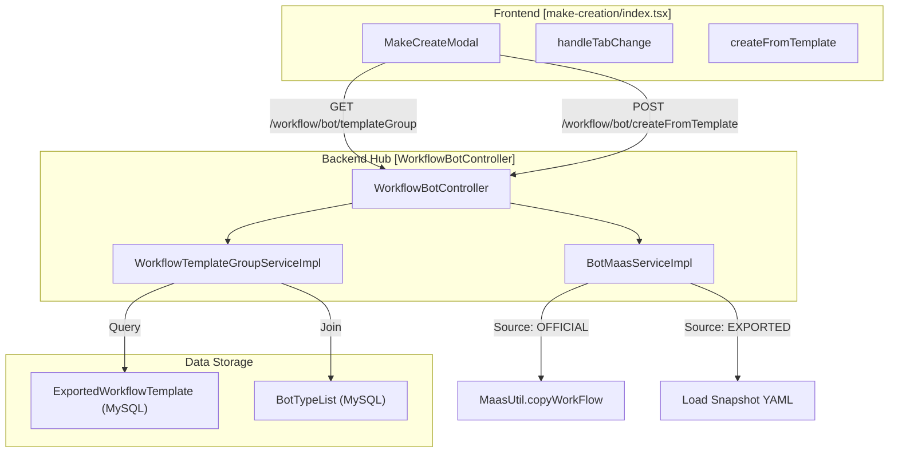
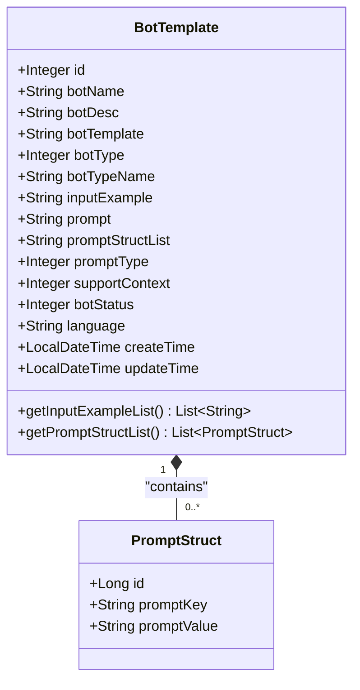
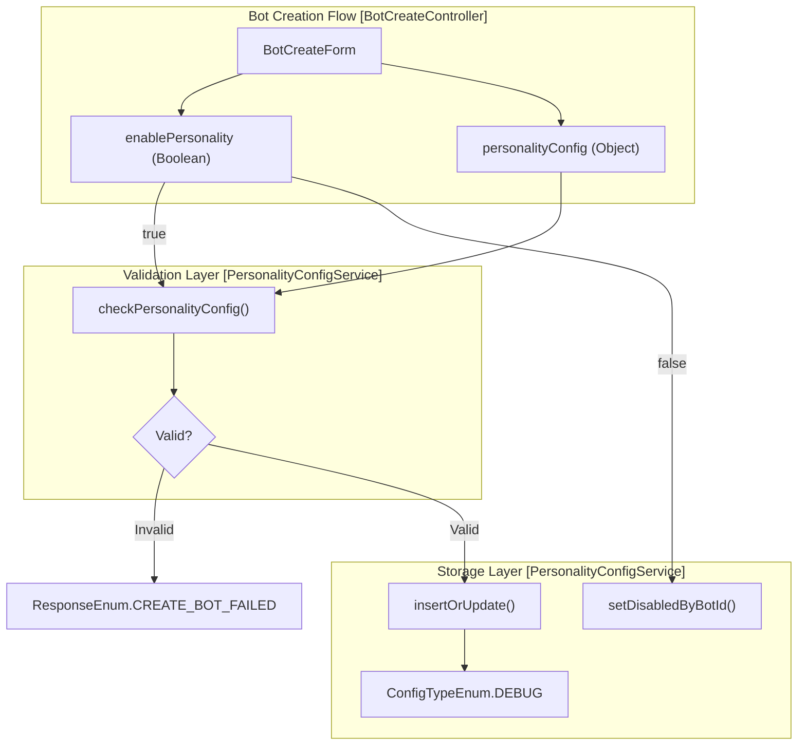
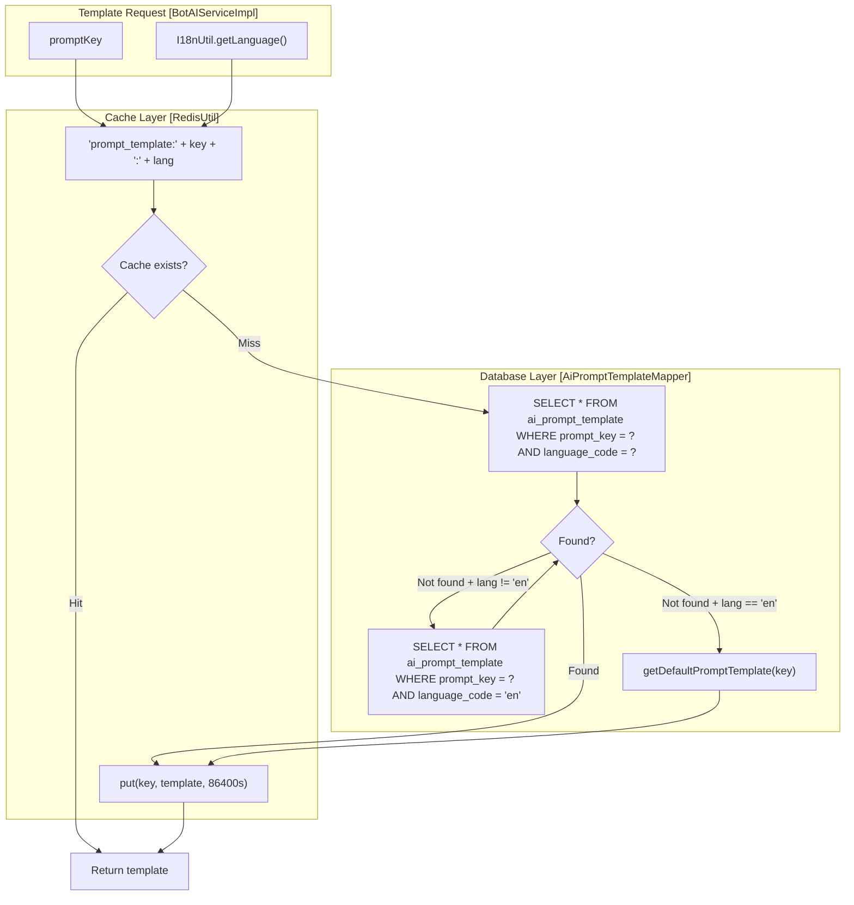

<!-- source: DeepWiki mcp.deepwiki.com · repo iflytek/astron-agent · page 5.3 Bot Templates and Personalities · fetched 2026-10-26 -->

# Bot Templates and Personalities

Relevant source files

The following files were used as context for generating this wiki page:

- [AGENTS.md](AGENTS.md)
- [console/backend/commons/src/main/java/com/iflytek/astron/console/commons/entity/bot/BotTemplate.java](console/backend/commons/src/main/java/com/iflytek/astron/console/commons/entity/bot/BotTemplate.java)
- [console/backend/commons/src/main/java/com/iflytek/astron/console/commons/enums/bot/DefaultBotModelEnum.java](console/backend/commons/src/main/java/com/iflytek/astron/console/commons/enums/bot/DefaultBotModelEnum.java)
- [console/backend/commons/src/main/java/com/iflytek/astron/console/commons/mapper/bot/BotTemplateMapper.java](console/backend/commons/src/main/java/com/iflytek/astron/console/commons/mapper/bot/BotTemplateMapper.java)
- [console/backend/commons/src/main/java/com/iflytek/astron/console/commons/service/bot/BotDatasetService.java](console/backend/commons/src/main/java/com/iflytek/astron/console/commons/service/bot/BotDatasetService.java)
- [console/backend/hub/src/main/java/com/iflytek/astron/console/hub/controller/bot/BotController.java](console/backend/hub/src/main/java/com/iflytek/astron/console/hub/controller/bot/BotController.java)
- [console/backend/hub/src/main/java/com/iflytek/astron/console/hub/controller/bot/BotCreateController.java](console/backend/hub/src/main/java/com/iflytek/astron/console/hub/controller/bot/BotCreateController.java)
- [console/backend/hub/src/main/java/com/iflytek/astron/console/hub/controller/user/MyBotController.java](console/backend/hub/src/main/java/com/iflytek/astron/console/hub/controller/user/MyBotController.java)
- [console/backend/hub/src/main/java/com/iflytek/astron/console/hub/controller/workflow/WorkflowBotController.java](console/backend/hub/src/main/java/com/iflytek/astron/console/hub/controller/workflow/WorkflowBotController.java)
- [console/backend/hub/src/main/java/com/iflytek/astron/console/hub/entity/maas/ExportedWorkflowTemplate.java](console/backend/hub/src/main/java/com/iflytek/astron/console/hub/entity/maas/ExportedWorkflowTemplate.java)
- [console/backend/hub/src/main/java/com/iflytek/astron/console/hub/entity/maas/MaasDuplicate.java](console/backend/hub/src/main/java/com/iflytek/astron/console/hub/entity/maas/MaasDuplicate.java)
- [console/backend/hub/src/main/java/com/iflytek/astron/console/hub/entity/maas/MaasTemplate.java](console/backend/hub/src/main/java/com/iflytek/astron/console/hub/entity/maas/MaasTemplate.java)
- [console/backend/hub/src/main/java/com/iflytek/astron/console/hub/entity/maas/WorkflowTemplateExportRequest.java](console/backend/hub/src/main/java/com/iflytek/astron/console/hub/entity/maas/WorkflowTemplateExportRequest.java)
- [console/backend/hub/src/main/java/com/iflytek/astron/console/hub/mapper/ExportedWorkflowTemplateMapper.java](console/backend/hub/src/main/java/com/iflytek/astron/console/hub/mapper/ExportedWorkflowTemplateMapper.java)
- [console/backend/hub/src/main/java/com/iflytek/astron/console/hub/service/bot/BotAIService.java](console/backend/hub/src/main/java/com/iflytek/astron/console/hub/service/bot/BotAIService.java)
- [console/backend/hub/src/main/java/com/iflytek/astron/console/hub/service/bot/BotTransactionalService.java](console/backend/hub/src/main/java/com/iflytek/astron/console/hub/service/bot/BotTransactionalService.java)
- [console/backend/hub/src/main/java/com/iflytek/astron/console/hub/service/bot/impl/BotAIServiceImpl.java](console/backend/hub/src/main/java/com/iflytek/astron/console/hub/service/bot/impl/BotAIServiceImpl.java)
- [console/backend/hub/src/main/java/com/iflytek/astron/console/hub/service/workflow/BotChainService.java](console/backend/hub/src/main/java/com/iflytek/astron/console/hub/service/workflow/BotChainService.java)
- [console/backend/hub/src/main/java/com/iflytek/astron/console/hub/service/workflow/BotMaasService.java](console/backend/hub/src/main/java/com/iflytek/astron/console/hub/service/workflow/BotMaasService.java)
- [console/backend/hub/src/main/java/com/iflytek/astron/console/hub/service/workflow/impl/BotMaasServiceImpl.java](console/backend/hub/src/main/java/com/iflytek/astron/console/hub/service/workflow/impl/BotMaasServiceImpl.java)
- [console/backend/hub/src/main/java/com/iflytek/astron/console/hub/service/workflow/impl/WorkflowTemplateGroupServiceImpl.java](console/backend/hub/src/main/java/com/iflytek/astron/console/hub/service/workflow/impl/WorkflowTemplateGroupServiceImpl.java)
- [console/backend/hub/src/main/java/com/iflytek/astron/console/hub/util/BotAIServiceClient.java](console/backend/hub/src/main/java/com/iflytek/astron/console/hub/util/BotAIServiceClient.java)
- [console/backend/hub/src/main/resources/db/migration/V1.26__add_exported_workflow_template.sql](console/backend/hub/src/main/resources/db/migration/V1.26__add_exported_workflow_template.sql)
- [console/backend/toolkit/src/main/java/com/iflytek/astron/console/toolkit/service/repo/MassDatasetInfoService.java](console/backend/toolkit/src/main/java/com/iflytek/astron/console/toolkit/service/repo/MassDatasetInfoService.java)
- [console/frontend/src/components/make-creation/index.module.scss](console/frontend/src/components/make-creation/index.module.scss)
- [console/frontend/src/components/make-creation/index.tsx](console/frontend/src/components/make-creation/index.tsx)

This page documents the bot template system and personality configuration features in Astron Agent. Templates provide pre-configured bot structures that users can instantiate quickly, while personality configuration allows customization of bot behavior and conversational style.

---

## Overview

The platform provides three primary mechanisms for template-based and customized bot creation:

1.  **Official & Exported Templates**: Pre-built bot configurations. Official templates are platform-provided, while exported templates allow users to save and reuse their own workflows as blueprints [console/backend/hub/src/main/java/com/iflytek/astron/console/hub/service/workflow/impl/BotMaasServiceImpl.java:93-99]().
2.  **Bot Templates (Legacy/Simple)**: Basic bot configurations stored in the database with multi-language support, managed via `BotTemplate` entities [console/backend/commons/src/main/java/com/iflytek/astron/console/commons/entity/bot/BotTemplate.java:17-21]().
3.  **Personality Configuration**: Behavioral customization layer applied to bots, managed by the `PersonalityConfigService` [console/backend/hub/src/main/java/com/iflytek/astron/console/hub/controller/bot/BotCreateController.java:72-73]().

**Sources**: [console/backend/hub/src/main/java/com/iflytek/astron/console/hub/service/workflow/impl/BotMaasServiceImpl.java:57-99](), [console/backend/hub/src/main/java/com/iflytek/astron/console/hub/controller/bot/BotCreateController.java:72-73]()

---

## Workflow Template System Architecture

The platform distinguishes between "Official" templates (from the MaaS platform) and "Exported" templates (user-created within the workspace).

### Template Creation and Retrieval

Title: Workflow Template Management Space

**Sources**: [console/frontend/src/components/make-creation/index.tsx:9-14](), [console/backend/hub/src/main/java/com/iflytek/astron/console/hub/controller/workflow/WorkflowBotController.java:58-72](), [console/backend/hub/src/main/java/com/iflytek/astron/console/hub/service/workflow/impl/BotMaasServiceImpl.java:93-125](), [console/backend/hub/src/main/java/com/iflytek/astron/console/hub/service/workflow/impl/WorkflowTemplateGroupServiceImpl.java:32-54]()

### Creation Logic (Official vs. Exported)

*   **Official Templates**: These utilize `MaasUtil.copyWorkFlow` to duplicate an existing workflow on the underlying MaaS platform. The system generates a temporary Redisson bucket entry to track the synchronization process [console/backend/hub/src/main/java/com/iflytek/astron/console/hub/service/workflow/impl/BotMaasServiceImpl.java:101-125]().
*   **Exported Templates**: These rely on a `snapshotYaml` stored in the `ExportedWorkflowTemplate` table. The `WorkflowExportService` parses this YAML to reconstruct the workflow and its associated nodes for the new bot [console/backend/hub/src/main/java/com/iflytek/astron/console/hub/service/workflow/impl/BotMaasServiceImpl.java:127-149]().

**Sources**: [console/backend/hub/src/main/java/com/iflytek/astron/console/hub/service/workflow/impl/BotMaasServiceImpl.java:101-149]()

---

## Bot Template Data Model

### BotTemplate Entity Structure

The `BotTemplate` class defines the structure for simple pre-configured agents, primarily used in the basic creation flow.

Title: Bot Template Class Diagram

**Sources**: [console/backend/commons/src/main/java/com/iflytek/astron/console/commons/entity/bot/BotTemplate.java:17-99]()

### Exported Workflow Template Entity

For complex workflow-based bots, the `ExportedWorkflowTemplate` entity is used.

| Field | Type | Purpose |
| :--- | :--- | :--- |
| `id` | Long | Primary Key [console/backend/hub/src/main/java/com/iflytek/astron/console/hub/entity/maas/ExportedWorkflowTemplate.java:15]() |
| `snapshotYaml` | String | The full YAML representation of the workflow structure [console/backend/hub/src/main/java/com/iflytek/astron/console/hub/entity/maas/ExportedWorkflowTemplate.java:23]() |
| `groupId` | Integer | Links to `BotTypeList` for categorization [console/backend/hub/src/main/java/com/iflytek/astron/console/hub/entity/maas/ExportedWorkflowTemplate.java:20]() |
| `spaceId` | Long | Multi-tenancy isolation [console/backend/hub/src/main/java/com/iflytek/astron/console/hub/entity/maas/ExportedWorkflowTemplate.java:19]() |

**Sources**: [console/backend/hub/src/main/java/com/iflytek/astron/console/hub/entity/maas/ExportedWorkflowTemplate.java:13-30]()

---

## Personality Configuration System

### Personality Integration Architecture

Personality settings allow for fine-tuning the bot's tone and behavior. This is handled during the bot creation process in `BotCreateController`.

Title: Personality Config Logic Flow

**Sources**: [console/backend/hub/src/main/java/com/iflytek/astron/console/hub/controller/bot/BotCreateController.java:95-119]()

---

## AI Prompt Template System

The `BotAIServiceImpl` uses a prompt template system that supports internationalization, caching, and dynamic parameter formatting for generating bot attributes (avatars, descriptions, etc.).

### Prompt Template Resolution

Templates are stored in the `ai_prompt_template` table and managed via `AiPromptTemplateMapper`.

Title: Prompt Template Resolution Architecture

**Sources**: [console/backend/hub/src/main/java/com/iflytek/astron/console/hub/service/bot/impl/BotAIServiceImpl.java:59-102]()

### Template Formatting Logic

The `formatPrompt` method handles parameter substitution using `MessageFormat` or `String.format` [console/backend/hub/src/main/java/com/iflytek/astron/console/hub/service/bot/impl/BotAIServiceImpl.java:107-148]().

*   **Input Example Generation**: Preserves structure and newlines by expanding `%n` to `System.lineSeparator()` [console/backend/hub/src/main/java/com/iflytek/astron/console/hub/service/bot/impl/BotAIServiceImpl.java:115-126]().
*   **Default Behavior**: Normalizes spaces to a single line and converts legacy `%s` templates to `MessageFormat` indices (e.g., `{0}`) [console/backend/hub/src/main/java/com/iflytek/astron/console/hub/service/bot/impl/BotAIServiceImpl.java:129-148]().

**Sources**: [console/backend/hub/src/main/java/com/iflytek/astron/console/hub/service/bot/impl/BotAIServiceImpl.java:106-153]()

---

## Bot Model Configuration

The platform supports both default Spark models and custom models.

### Default Models

The `DefaultBotModelEnum` defines the standard models available out-of-the-box.

| Model | Domain | Icon |
| :--- | :--- | :--- |
| X1 | `x1` | iFLYTEK Spark Icon [console/backend/commons/src/main/java/com/iflytek/astron/console/commons/enums/bot/DefaultBotModelEnum.java:9]() |
| SPARK_4_0 | `spark` | iFLYTEK Spark Icon [console/backend/commons/src/main/java/com/iflytek/astron/console/commons/enums/bot/DefaultBotModelEnum.java:10]() |

The `BotController` ensures that when a bot is created or updated, the underlying workflow's runtime model is synchronized via `workflowService.syncWorkflowModelConfig` [console/backend/hub/src/main/java/com/iflytek/astron/console/hub/controller/bot/BotController.java:113-130]().

**Sources**: [console/backend/commons/src/main/java/com/iflytek/astron/console/commons/enums/bot/DefaultBotModelEnum.java:1-51](), [console/backend/hub/src/main/java/com/iflytek/astron/console/hub/controller/bot/BotController.java:113-130]()

---

