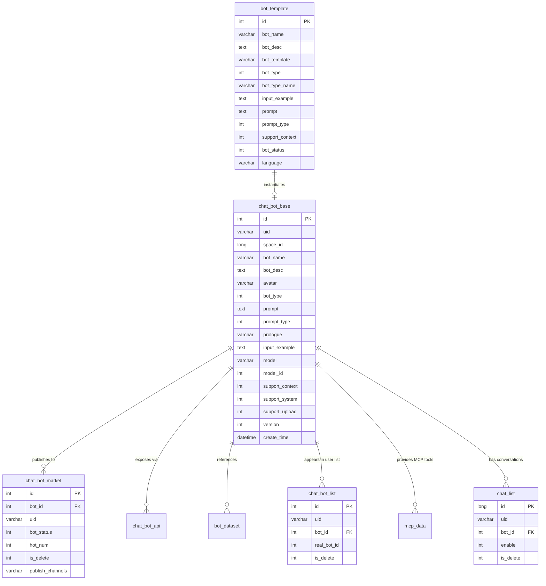

<!-- source: DeepWiki mcp.deepwiki.com · repo iflytek/astron-agent · page 5.4 Bot Data Models and Schema · fetched 2026-10-26 -->

# Bot Data Models and Schema

<details>
<summary>Relevant source files</summary>

The following files were used as context for generating this wiki page:

- [console/backend/commons/src/main/java/com/iflytek/astron/console/commons/constant/RedisKeyConstant.java](console/backend/commons/src/main/java/com/iflytek/astron/console/commons/constant/RedisKeyConstant.java)
- [console/backend/commons/src/main/java/com/iflytek/astron/console/commons/dto/bot/BotCreateForm.java](console/backend/commons/src/main/java/com/iflytek/astron/console/commons/dto/bot/BotCreateForm.java)
- [console/backend/commons/src/main/java/com/iflytek/astron/console/commons/entity/bot/ChatBotBase.java](console/backend/commons/src/main/java/com/iflytek/astron/console/commons/entity/bot/ChatBotBase.java)
- [console/backend/commons/src/main/java/com/iflytek/astron/console/commons/enums/ShelfStatusEnum.java](console/backend/commons/src/main/java/com/iflytek/astron/console/commons/enums/ShelfStatusEnum.java)
- [console/backend/commons/src/main/java/com/iflytek/astron/console/commons/enums/bot/BotTypeEnum.java](console/backend/commons/src/main/java/com/iflytek/astron/console/commons/enums/bot/BotTypeEnum.java)
- [console/backend/commons/src/main/java/com/iflytek/astron/console/commons/service/bot/BotService.java](console/backend/commons/src/main/java/com/iflytek/astron/console/commons/service/bot/BotService.java)
- [console/backend/commons/src/main/java/com/iflytek/astron/console/commons/service/bot/ChatBotDataService.java](console/backend/commons/src/main/java/com/iflytek/astron/console/commons/service/bot/ChatBotDataService.java)
- [console/backend/commons/src/main/java/com/iflytek/astron/console/commons/service/bot/impl/BotServiceImpl.java](console/backend/commons/src/main/java/com/iflytek/astron/console/commons/service/bot/impl/BotServiceImpl.java)
- [console/backend/commons/src/main/java/com/iflytek/astron/console/commons/service/bot/impl/ChatBotDataServiceImpl.java](console/backend/commons/src/main/java/com/iflytek/astron/console/commons/service/bot/impl/ChatBotDataServiceImpl.java)
- [console/backend/commons/src/main/java/com/iflytek/astron/console/commons/service/data/impl/ChatListDataServiceImpl.java](console/backend/commons/src/main/java/com/iflytek/astron/console/commons/service/data/impl/ChatListDataServiceImpl.java)
- [console/backend/commons/src/main/java/com/iflytek/astron/console/commons/service/workflow/WorkflowBotService.java](console/backend/commons/src/main/java/com/iflytek/astron/console/commons/service/workflow/WorkflowBotService.java)
- [console/backend/commons/src/main/java/com/iflytek/astron/console/commons/util/BotUtil.java](console/backend/commons/src/main/java/com/iflytek/astron/console/commons/util/BotUtil.java)
- [console/backend/commons/src/main/resources/mapper/ChatBotBaseMapper.xml](console/backend/commons/src/main/resources/mapper/ChatBotBaseMapper.xml)
- [console/backend/commons/src/main/resources/mapper/ChatBotMarketMapper.xml](console/backend/commons/src/main/resources/mapper/ChatBotMarketMapper.xml)
- [console/backend/commons/src/main/resources/mapper/McpDataMapper.xml](console/backend/commons/src/main/resources/mapper/McpDataMapper.xml)
- [console/backend/commons/src/test/java/com/iflytek/astron/console/commons/service/bot/impl/ChatBotDataServiceImplTest.java](console/backend/commons/src/test/java/com/iflytek/astron/console/commons/service/bot/impl/ChatBotDataServiceImplTest.java)
- [console/backend/hub/src/main/java/com/iflytek/astron/console/hub/dto/publish/BotDetailResponseDto.java](console/backend/hub/src/main/java/com/iflytek/astron/console/hub/dto/publish/BotDetailResponseDto.java)
- [console/backend/hub/src/main/java/com/iflytek/astron/console/hub/dto/publish/BotPublishInfoDto.java](console/backend/hub/src/main/java/com/iflytek/astron/console/hub/dto/publish/BotPublishInfoDto.java)
- [console/backend/hub/src/main/java/com/iflytek/astron/console/hub/dto/publish/BotTraceRequestDto.java](console/backend/hub/src/main/java/com/iflytek/astron/console/hub/dto/publish/BotTraceRequestDto.java)
- [console/backend/hub/src/main/java/com/iflytek/astron/console/hub/dto/publish/CreateBotApiVo.java](console/backend/hub/src/main/java/com/iflytek/astron/console/hub/dto/publish/CreateBotApiVo.java)
- [console/backend/hub/src/main/java/com/iflytek/astron/console/hub/dto/workflow/WorkflowReleaseRequestDto.java](console/backend/hub/src/main/java/com/iflytek/astron/console/hub/dto/workflow/WorkflowReleaseRequestDto.java)
- [console/backend/hub/src/main/java/com/iflytek/astron/console/hub/dto/workflow/WorkflowReleaseResponseDto.java](console/backend/hub/src/main/java/com/iflytek/astron/console/hub/dto/workflow/WorkflowReleaseResponseDto.java)
- [console/backend/hub/src/test/java/com/iflytek/astron/console/hub/data/impl/ChatDataServiceImplTest.java](console/backend/hub/src/test/java/com/iflytek/astron/console/hub/data/impl/ChatDataServiceImplTest.java)
- [console/backend/hub/src/test/java/com/iflytek/astron/console/hub/data/impl/ReqKnowledgeRecordsDataServiceImplTest.java](console/backend/hub/src/test/java/com/iflytek/astron/console/hub/data/impl/ReqKnowledgeRecordsDataServiceImplTest.java)
- [console/backend/hub/src/test/java/com/iflytek/astron/console/hub/data/impl/ShareDataServiceImplTest.java](console/backend/hub/src/test/java/com/iflytek/astron/console/hub/data/impl/ShareDataServiceImplTest.java)

</details>


This page documents the database schema, entity classes, and data transfer objects (DTOs) used to represent bots throughout their lifecycle in the Astron Agent platform. This includes core bot entities, templates, type classifications, and model configurations.

For information about the bot creation workflow and API endpoints, see [Bot Creation and Configuration](5.1). For details on how bots are published and synced to different storage tables, see [Multi-Channel Publishing Strategy](4.3).

## Core Bot Entity Model

The platform uses a multi-table strategy to store bot data across different lifecycle stages: draft/edit mode, published marketplace versions, and API-exposed versions.

### Database Schema Overview


**Sources**: [console/backend/commons/src/main/resources/mapper/ChatBotBaseMapper.xml:5-44](), [console/backend/commons/src/main/java/com/iflytek/astron/console/commons/service/bot/impl/ChatBotDataServiceImpl.java:89-102](), [console/backend/commons/src/main/java/com/iflytek/astron/console/commons/service/data/impl/ChatListDataServiceImpl.java:46-61](), [console/backend/commons/src/main/resources/mapper/ChatBotMarketMapper.xml:59-72]()

### ChatBotBase Entity

The `chat_bot_base` table stores all bot configurations during draft and edit phases. This is the primary source of truth for bot definitions.

| Field | Type | Description |
|-------|------|-------------|
| `id` | INT | Primary key, auto-increment |
| `uid` | VARCHAR | Owner user ID |
| `space_id` | LONG | Tenant space identifier |
| `bot_name` | VARCHAR | Display name |
| `bot_desc` | TEXT | Description |
| `avatar` | VARCHAR | Avatar image URL |
| `bot_type` | INT | Type category (1=System, 3=Workflow, 4=Talk) [console/backend/commons/src/main/java/com/iflytek/astron/console/commons/enums/bot/BotTypeEnum.java:8-10]() |
| `prompt` | TEXT | System prompt or instruction template |
| `prompt_type` | INT | Prompt format type (1=structured, 0=plain text) |
| `prologue` | VARCHAR | Opening message shown to users |
| `model` | VARCHAR | LLM model domain (e.g., "spark") |
| `model_id` | INT | ID of the selected model configuration |
| `support_context` | INT | Whether bot maintains conversation context (0/1) |
| `support_upload` | INT | Whether file upload is supported (Cast to Signed) |

**Sources**: [console/backend/commons/src/main/resources/mapper/ChatBotBaseMapper.xml:5-44](), [console/backend/commons/src/main/java/com/iflytek/astron/console/commons/service/bot/impl/ChatBotDataServiceImpl.java:171-180](), [console/backend/commons/src/main/java/com/iflytek/astron/console/commons/enums/bot/BotTypeEnum.java:6-11]()

### ChatBotMarket and List Entities

- **ChatBotMarket**: Tracks bots published to the "Agent Square". It mirrors essential metadata and tracks popularity via `hot_num` [console/backend/commons/src/main/resources/mapper/ChatBotBaseMapper.xml:31-32](). It also manages `publish_channels` which defines where the bot is visible (Market, API, MCP) [console/backend/commons/src/main/resources/mapper/ChatBotMarketMapper.xml:123-128]().
- **ChatBotList**: Represents the collection of bots a specific user has "added" to their sidebar. The `addV2Bot` function handles migrating or adding bots to this list [console/backend/commons/src/main/java/com/iflytek/astron/console/commons/service/bot/impl/BotServiceImpl.java:141-153]().

## Conversation and Interaction Data

The platform tracks user interactions with bots through several related tables to manage chat history and knowledge retrieval.

### Chat History and Knowledge Mapping

| Entity | Role | Key Function |
|-------|------|--------------|
| `ChatList` | Represents a top-level conversation session [console/backend/commons/src/main/java/com/iflytek/astron/console/commons/service/data/impl/ChatListDataServiceImpl.java:46-61](). | `createChat` |
| `ChatReqRecords` | Stores individual user questions within a session [console/backend/hub/src/test/java/com/iflytek/astron/console/hub/data/impl/ChatDataServiceImplTest.java:107-114](). | `findRequestsByChatIdAndUid` |
| `ChatRespRecords` | Stores the AI's response to a specific request [console/backend/hub/src/test/java/com/iflytek/astron/console/hub/data/impl/ChatDataServiceImplTest.java:115-122](). | `findResponsesByReqId` |
| `ReqKnowledgeRecords` | Maps a specific request to the knowledge chunks retrieved for it [console/backend/hub/src/test/java/com/iflytek/astron/console/hub/data/impl/ReqKnowledgeRecordsDataServiceImplTest.java:49-59](). | `findByReqIds` |

**Sources**: [console/backend/commons/src/main/java/com/iflytek/astron/console/commons/service/data/impl/ChatListDataServiceImpl.java:78-81](), [console/backend/hub/src/test/java/com/iflytek/astron/console/hub/data/impl/ChatDataServiceImplTest.java:127-166](), [console/backend/hub/src/test/java/com/iflytek/astron/console/hub/data/impl/ReqKnowledgeRecordsDataServiceImplTest.java:64-114]()

## Bot Template and Classification

The system uses pre-defined types and templates to facilitate bot creation.

### Bot Type List
The `bot_type_list` table categorizes bots into domains. The `BotServiceImpl` handles internationalization of these types based on the request language [console/backend/commons/src/main/java/com/iflytek/astron/console/commons/service/bot/impl/BotServiceImpl.java:122-135]().

### Bot Template Structure
Templates provide the blueprint for new bots. Input examples within templates use the `BOT_INPUT_EXAMPLE_SPLIT` ("%%split%%") to separate multiple suggestions [console/backend/commons/src/main/java/com/iflytek/astron/console/commons/service/bot/impl/BotServiceImpl.java:111-111]().

**Sources**: [console/backend/commons/src/main/java/com/iflytek/astron/console/commons/service/bot/impl/BotServiceImpl.java:122-135](), [console/backend/commons/src/main/java/com/iflytek/astron/console/commons/service/bot/impl/ChatBotDataServiceImpl.java:86-86]()

## Data Transfer Objects (DTOs)

The system uses multiple DTOs to bridge the gap between internal entities and external API requirements.

### Data Mapping Flow

```mermaid
graph TB
    subgraph "Natural Language / UI Space"
        "BotCreateForm"["BotCreateForm<br/>(User Input)"]
        "BotInfoDto"["BotInfoDto<br/>(Marketplace View)"]
        "WorkflowReleaseRequestDto"["WorkflowReleaseRequestDto<br/>(Publish Action)"]
    end
    
    subgraph "Code Logic (Functions)"
        "insertWorkflowBot"["BotServiceImpl.insertWorkflowBot()"]
        "getBotInfo"["BotServiceImpl.getBotInfo()"]
        "syncToSpark"["BotUtil.syncToSparkDatabase()"]
        "updatePublishStatus"["ChatBotMarketMapper.updatePublishStatus()"]
    end
    
    subgraph "Entity / Database Space"
        "ChatBotBase"["ChatBotBase Entity"]
        "ChatBotMarket"["ChatBotMarket Entity"]
        "ChatList"["ChatList Entity"]
    end
    
    "BotCreateForm" --> "insertWorkflowBot"
    "insertWorkflowBot" --> "ChatBotBase"
    "ChatBotBase" --> "getBotInfo"
    "getBotInfo" --> "BotInfoDto"
    "ChatBotBase" --> "syncToSpark"
    "syncToSpark" --> "ChatBotMarket"
    "ChatBotBase" --> "syncToSpark"
    "syncToSpark" --> "ChatList"
    "WorkflowReleaseRequestDto" --> "updatePublishStatus"
    "updatePublishStatus" --> "ChatBotMarket"
```
**Sources**: [console/backend/commons/src/main/java/com/iflytek/astron/console/commons/service/bot/impl/BotServiceImpl.java:156-176](), [console/backend/commons/src/main/java/com/iflytek/astron/console/commons/util/BotUtil.java:49-77](), [console/backend/hub/src/main/java/com/iflytek/astron/console/hub/dto/workflow/WorkflowReleaseRequestDto.java:9-54]()

### BotDetail and BotInfoDto

- **BotDetail**: A comprehensive object returned by `ChatBotBaseMapper.botDetail` which performs a `LEFT JOIN` between `chat_bot_base` and `chat_bot_market` to retrieve both configuration and market status [console/backend/commons/src/main/resources/mapper/ChatBotBaseMapper.xml:5-44]().
- **BotInfoDto**: Used for the bot detail page. It aggregates basic info, market info, input examples, creator details, and dataset associations [console/backend/commons/src/main/java/com/iflytek/astron/console/commons/service/bot/impl/BotServiceImpl.java:165-174]().

## Bot Lifecycle Logic in Code

### Data Synchronization

When a workflow is synchronized to the bot system via `BotUtil.syncToSparkDatabase`, it creates a `ChatBotBase` record and an entry in the user's `ChatBotList` [console/backend/commons/src/main/java/com/iflytek/astron/console/commons/util/BotUtil.java:49-67]().

Key logic in `ChatBotDataServiceImpl`:
- **Soft Delete**: Uses `is_delete = 0` filters across all query methods like `findByIdAndSpaceId` [console/backend/commons/src/main/java/com/iflytek/astron/console/commons/service/bot/impl/ChatBotDataServiceImpl.java:95-101]().
- **Model Updates**: Explicitly handles setting `model_id` to null in the database if the entity field is null, bypassing standard MyBatis-Plus null-skipping [console/backend/commons/src/main/java/com/iflytek/astron/console/commons/service/bot/impl/ChatBotDataServiceImpl.java:173-180]().
- **Permission Checking**: `ChatBotBaseMapper.checkBotPermission` validates that a bot belongs to the user or is within a permitted `spaceId` [console/backend/commons/src/main/resources/mapper/ChatBotBaseMapper.xml:51-60]().
- **Channel Management**: The `updatePublishStatus` method in `ChatBotMarketMapper` updates the `bot_status` and `publish_channels` (e.g., Market, API, MCP) based on user release requests [console/backend/commons/src/main/resources/mapper/ChatBotMarketMapper.xml:123-146]().

**Sources**: [console/backend/commons/src/main/java/com/iflytek/astron/console/commons/service/bot/impl/ChatBotDataServiceImpl.java:88-187](), [console/backend/commons/src/main/java/com/iflytek/astron/console/commons/util/BotUtil.java:49-77](), [console/backend/commons/src/main/resources/mapper/ChatBotBaseMapper.xml:51-60](), [console/backend/commons/src/main/resources/mapper/ChatBotMarketMapper.xml:123-146]()

---

