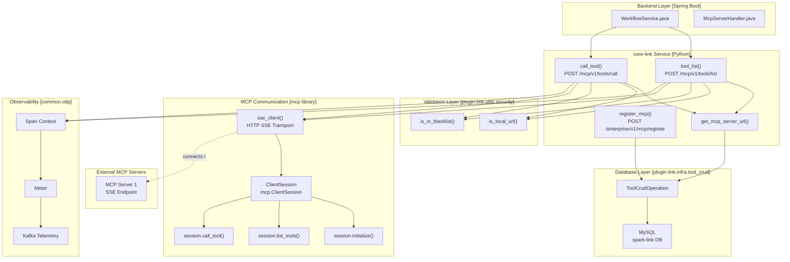
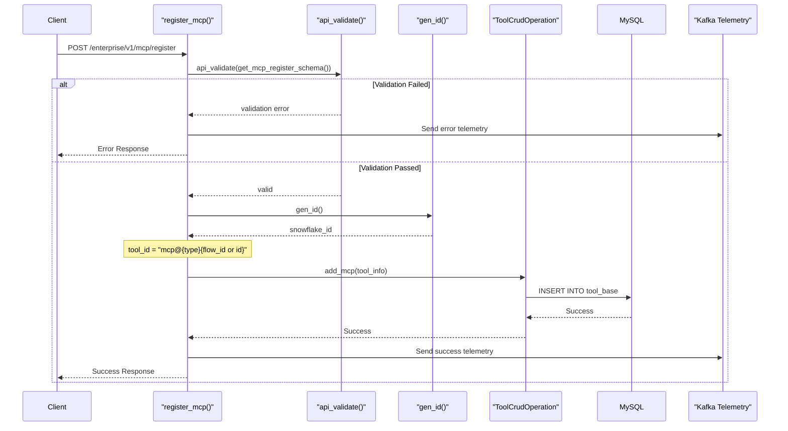
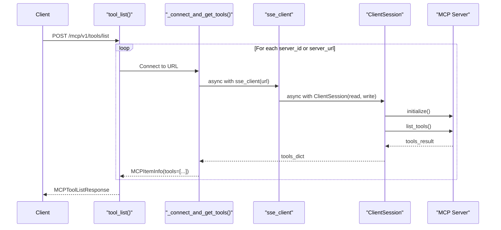
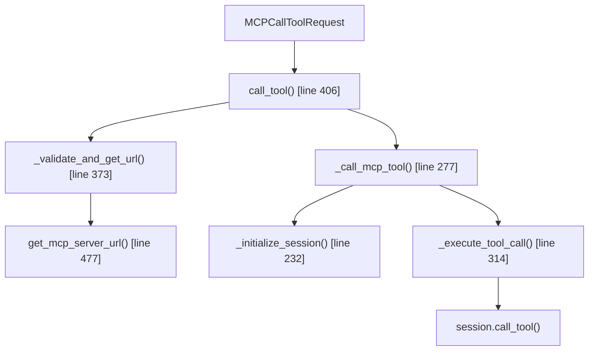

<!-- source: DeepWiki mcp.deepwiki.com · repo iflytek/astron-agent · page 6.3 MCP Protocol Integration · fetched 2026-10-26 -->

# MCP Protocol Integration

Relevant source files

The following files were used as context for generating this wiki page:

- [console/backend/commons/src/main/resources/mapper/BotDatasetMaasMapper.xml](console/backend/commons/src/main/resources/mapper/BotDatasetMaasMapper.xml)
- [console/backend/toolkit/src/main/java/com/iflytek/astron/console/toolkit/handler/McpServerHandler.java](console/backend/toolkit/src/main/java/com/iflytek/astron/console/toolkit/handler/McpServerHandler.java)
- [console/backend/toolkit/src/main/java/com/iflytek/astron/console/toolkit/service/model/ModelService.java](console/backend/toolkit/src/main/java/com/iflytek/astron/console/toolkit/service/model/ModelService.java)
- [console/backend/toolkit/src/main/java/com/iflytek/astron/console/toolkit/service/repo/FileInfoV2Service.java](console/backend/toolkit/src/main/java/com/iflytek/astron/console/toolkit/service/repo/FileInfoV2Service.java)
- [console/backend/toolkit/src/main/java/com/iflytek/astron/console/toolkit/service/workflow/WorkflowService.java](console/backend/toolkit/src/main/java/com/iflytek/astron/console/toolkit/service/workflow/WorkflowService.java)
- [console/backend/toolkit/src/main/java/com/iflytek/astron/console/toolkit/tool/UrlCheckTool.java](console/backend/toolkit/src/main/java/com/iflytek/astron/console/toolkit/tool/UrlCheckTool.java)
- [core/plugin/link/.gitignore](core/plugin/link/.gitignore)
- [core/plugin/link/config.env](core/plugin/link/config.env)
- [core/plugin/link/consts/const.py](core/plugin/link/consts/const.py)
- [core/plugin/link/consts/keys/xc_utils_keys.py](core/plugin/link/consts/keys/xc_utils_keys.py)
- [core/plugin/link/infra/kafka_telemetry.py](core/plugin/link/infra/kafka_telemetry.py)
- [core/plugin/link/service/community/deprecated/management_server.py](core/plugin/link/service/community/deprecated/management_server.py)
- [core/plugin/link/service/community/tools/http/execution_server.py](core/plugin/link/service/community/tools/http/execution_server.py)
- [core/plugin/link/service/community/tools/http/management_server.py](core/plugin/link/service/community/tools/http/management_server.py)
- [core/plugin/link/service/community/tools/mcp/mcp_server.py](core/plugin/link/service/community/tools/mcp/mcp_server.py)
- [core/plugin/link/service/enterprise/extension.py](core/plugin/link/service/enterprise/extension.py)
- [core/plugin/link/tests/unit/test_response_filter.py](core/plugin/link/tests/unit/test_response_filter.py)
- [core/plugin/link/tests/unit/test_services.py](core/plugin/link/tests/unit/test_services.py)
- [core/plugin/link/utils/open_api_schema/response_filter.py](core/plugin/link/utils/open_api_schema/response_filter.py)

## Purpose and Scope

This document describes the Model Context Protocol (MCP) integration in the Astron Agent platform. MCP enables secure communication with external tool servers through a standardized protocol, allowing dynamic tool discovery and execution. The integration provides FastAPI endpoints for MCP server registration, tool listing, and tool invocation with comprehensive security validations and observability tracking.

The MCP support is primarily implemented within the `core-link` service, which acts as an execution and management bridge for community and enterprise tools.

## MCP Protocol Overview

Model Context Protocol (MCP) is a standardized protocol for communication between the Astron Agent platform and external tool servers. Unlike HTTP tools which are statically defined with OpenAPI schemas, MCP tools are discovered dynamically from MCP servers.

### Key Characteristics

| Feature | Description |
|---------|-------------|
| **Communication** | Server-Sent Events (SSE) with bidirectional messaging [core/plugin/link/service/community/tools/mcp/mcp_server.py:94-96]() |
| **Discovery** | Dynamic tool listing through `list_tools()` [core/plugin/link/service/community/tools/mcp/mcp_server.py:110-111]() |
| **Execution** | Tool invocation through `call_tool()` with structured arguments [core/plugin/link/service/community/tools/mcp/mcp_server.py:349-350]() |
| **Session Management** | `ClientSession` manages connection lifecycle [core/plugin/link/service/community/tools/mcp/mcp_server.py:96-98]() |
| **Schema Format** | Tools provide `inputSchema` for parameter validation [core/plugin/link/service/community/tools/mcp/mcp_server.py:119-121]() |
| **Response Types** | Supports text and image content types [core/plugin/link/api/schemas/community/tools/mcp/mcp_tools_schema.py]() |

The MCP client implementation uses the official `mcp` Python library with SSE transport, establishing persistent connections to MCP servers for tool operations.

**Sources:** [core/plugin/link/service/community/tools/mcp/mcp_server.py:1-38]()

## Architecture and Components

### MCP Integration Architecture

The following diagram bridges the Natural Language Space to the Code Entity Space, showing how the `core-link` service (Python) and the backend interact for MCP logic.

Title: MCP Service Interaction Map

**Sources:** [core/plugin/link/service/community/tools/mcp/mcp_server.py:1-514](), [core/plugin/link/service/enterprise/extension.py:1-168](), [console/backend/toolkit/src/main/java/com/iflytek/astron/console/toolkit/service/workflow/WorkflowService.java:72]()

### Core Components

| Component | File Location | Purpose |
|-----------|---------------|---------|
| `tool_list()` | [core/plugin/link/service/community/tools/mcp/mcp_server.py:160-229]() | Lists available tools from MCP servers |
| `call_tool()` | [core/plugin/link/service/community/tools/mcp/mcp_server.py:406-474]() | Executes a tool on an MCP server |
| `register_mcp()` | [core/plugin/link/service/enterprise/extension.py:34-167]() | Registers MCP server/tool in database |
| `get_mcp_server_url()` | [core/plugin/link/service/community/tools/mcp/mcp_server.py:477-513]() | Retrieves MCP server URL from database |
| `sse_client` | [core/plugin/link/service/community/tools/mcp/mcp_server.py:17]() | SSE transport for MCP communication |
| `ClientSession` | [core/plugin/link/service/community/tools/mcp/mcp_server.py:16]() | Manages MCP protocol session |
| `McpServerTool` | [console/backend/toolkit/src/main/java/com/iflytek/astron/console/toolkit/entity/tool/McpServerTool.java]() | Java entity for MCP tool configuration |

**Sources:** [core/plugin/link/service/community/tools/mcp/mcp_server.py:1-514](), [core/plugin/link/service/enterprise/extension.py:1-168](), [console/backend/toolkit/src/main/java/com/iflytek/astron/console/toolkit/service/workflow/WorkflowService.java:72]()

## MCP Server Registration

MCP servers must be registered before their tools can be discovered or executed. Registration stores the server URL and metadata in the database. The `core-link` service handles the registration logic through `register_mcp` [core/plugin/link/service/enterprise/extension.py:34]().

### Registration Flow

Title: MCP Registration Sequence

### Tool ID Generation

The system generates unique tool IDs for MCP servers using the pattern:
- With `flow_id`: `mcp@{type}{flow_id}` [core/plugin/link/service/enterprise/extension.py:105]()
- Without `flow_id`: `mcp@{type}{new_id[2:]}` [core/plugin/link/service/enterprise/extension.py:107]()

This distinguishes MCP tools from standard HTTP tools (which use the `tool@` prefix).

**Sources:** [core/plugin/link/service/enterprise/extension.py:34-167](), [core/plugin/link/utils/json_schemas/read_json_schemas.py:29]()

## Tool Discovery and Listing

The `tool_list` endpoint discovers available tools from one or more MCP servers dynamically. It supports querying by `mcp_server_ids` (stored in DB) or directly via `mcp_server_urls` [core/plugin/link/service/community/tools/mcp/mcp_server.py:165-166]().

### Tool Listing Flow

Title: Dynamic Tool Discovery

**Sources:** [core/plugin/link/service/community/tools/mcp/mcp_server.py:160-229](), [core/plugin/link/service/community/tools/mcp/mcp_server.py:89-158]()

## Tool Execution Flow

The `call_tool` endpoint executes a specific tool on an MCP server with provided arguments. It validates the server URL against security policies before attempting connection [core/plugin/link/service/community/tools/mcp/mcp_server.py:373-380]().

### Code Execution Mapping

The following diagram maps the logical execution steps to specific internal helper functions in `mcp_server.py`.

Title: MCP Call Internal Mapping

**Sources:** [core/plugin/link/service/community/tools/mcp/mcp_server.py:232-474]()

## Security and Validation

The MCP integration implements multiple security layers to prevent SSRF attacks and unauthorized access to internal resources.

### Security Checks

| Check | Function | Configuration | Purpose |
|-------|----------|---------------|---------|
| **Local URL** | `is_local_url()` [core/plugin/link/utils/security/access_interceptor.py]() | Hardcoded patterns | Blocks localhost, 127.0.0.1, private IPs [core/plugin/link/service/community/tools/mcp/mcp_server.py:54]() |
| **IP Blacklist** | `is_in_blacklist()` [core/plugin/link/utils/security/access_interceptor.py]() | `IP_BLACK_LIST` env var | Blocks specific IP addresses [core/plugin/link/config.env:103]() |
| **Domain Blacklist** | `is_in_blacklist()` | `DOMAIN_BLACK_LIST` env var | Blocks specific domain names [core/plugin/link/config.env:104]() |
| **Segment Blacklist** | `is_in_blacklist()` | `SEGMENT_BLACK_LIST` env var | Blocks network segments (CIDR) [core/plugin/link/config.env:102]() |

**Sources:** [core/plugin/link/service/community/tools/mcp/mcp_server.py:41-87](), [core/plugin/link/service/community/tools/mcp/mcp_server.py:373-403](), [core/plugin/link/config.env:101-104]()

## Database Integration

MCP servers and their metadata are stored in the MySQL database using the `ToolCrudOperation` class.

### URL Retrieval Process

The `get_mcp_server_url()` function in the Python service retrieves the MCP server URL from the database by querying the `tool_base` table using `ToolCrudOperation(get_db_engine())` [core/plugin/link/service/community/tools/mcp/mcp_server.py:490-491]().

**Sources:** [core/plugin/link/service/community/tools/mcp/mcp_server.py:477-513](), [core/plugin/link/domain/models/manager.py:28]()

## Error Handling and Observability

The MCP integration includes comprehensive error handling and observability through OpenTelemetry and Kafka telemetry.

### Error Codes

Specific error codes are defined in `ErrCode` [core/plugin/link/utils/errors/code.py]():
- `MCP_SERVER_CONNECT_ERR`: Failed to establish SSE connection [core/plugin/link/service/community/tools/mcp/mcp_server.py:150]()
- `MCP_SERVER_INITIAL_ERR`: Session initialization failed [core/plugin/link/service/community/tools/mcp/mcp_server.py:100]()
- `MCP_SERVER_LOCAL_URL_ERR`: URL points to local resource [core/plugin/link/service/community/tools/mcp/mcp_server.py:55]()

### Observability Integration

The integration uses `common.otlp.trace.span.Span` and `common.otlp.metrics.meter.Meter` for tracing and metrics [core/plugin/link/service/community/tools/mcp/mcp_server.py:168-193](). Telemetry data is sent synchronously to Kafka using `send_telemetry_sync()` [core/plugin/link/infra/kafka_telemetry.py:30]().

**Sources:** [core/plugin/link/service/community/tools/mcp/mcp_server.py:160-229](), [core/plugin/link/service/community/tools/mcp/mcp_server.py:406-474](), [core/plugin/link/infra/kafka_telemetry.py:30-34]()

## Configuration

MCP integration configuration is managed through environment variables and the `config.env` file.

| Variable | Default | Description |
|----------|---------|-------------|
| `OTLP_ENABLE` | `0` | Enable/disable OpenTelemetry telemetry [core/plugin/link/config.env:55]() |
| `KAFKA_ENABLE` | `0` | Enable/disable Kafka event streaming [core/plugin/link/config.env:83]() |
| `KAFKA_TOPIC` | `spark-agent-builder` | Kafka topic for telemetry events [core/plugin/link/config.env:86]() |
| `SERVICE_PORT` | `18888` | Port for the link service [core/plugin/link/config.env:10]() |

**Sources:** [core/plugin/link/config.env:1-112]()

---

