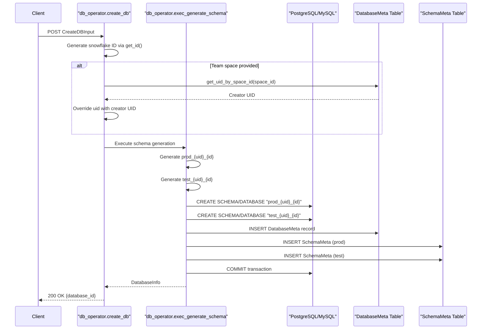
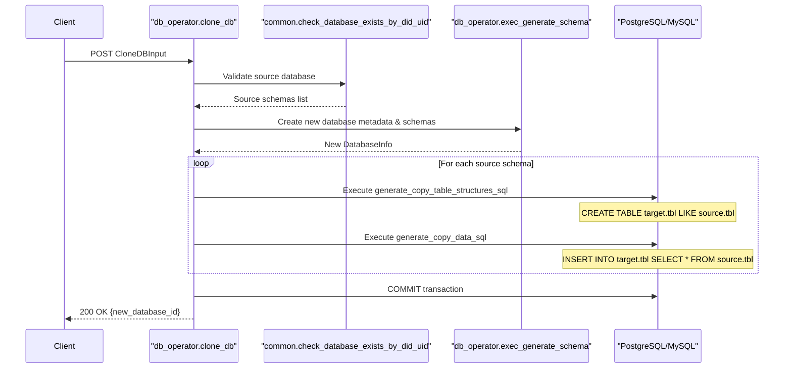
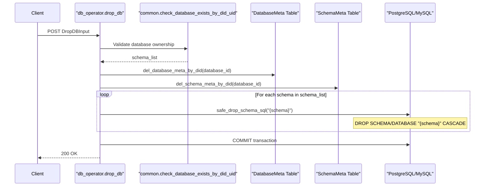

<!-- source: DeepWiki mcp.deepwiki.com · repo iflytek/astron-agent · page 7.1 Database Lifecycle Operations · fetched 2026-10-26 -->

# Database Lifecycle Operations

<details>
<summary>Relevant source files</summary>

The following files were used as context for generating this wiki page:

- [core/memory/database/alembic/README.md](core/memory/database/alembic/README.md)
- [core/memory/database/alembic/alembic.ini](core/memory/database/alembic/alembic.ini)
- [core/memory/database/alembic/env.py](core/memory/database/alembic/env.py)
- [core/memory/database/alembic/script.py.mako](core/memory/database/alembic/script.py.mako)
- [core/memory/database/alembic/versions/2026_02_11_1801-f2a4ce6e3198_init.py](core/memory/database/alembic/versions/2026_02_11_1801-f2a4ce6e3198_init.py)
- [core/memory/database/api/router.py](core/memory/database/api/router.py)
- [core/memory/database/api/v1/__init__.py](core/memory/database/api/v1/__init__.py)
- [core/memory/database/api/v1/common.py](core/memory/database/api/v1/common.py)
- [core/memory/database/api/v1/db_operator.py](core/memory/database/api/v1/db_operator.py)
- [core/memory/database/api/v1/exec_ddl.py](core/memory/database/api/v1/exec_ddl.py)
- [core/memory/database/api/v1/exec_dml.py](core/memory/database/api/v1/exec_dml.py)
- [core/memory/database/config.env](core/memory/database/config.env)
- [core/memory/database/domain/entity/general.py](core/memory/database/domain/entity/general.py)
- [core/memory/database/domain/entity/schema.py](core/memory/database/domain/entity/schema.py)
- [core/memory/database/domain/models/database_meta.py](core/memory/database/domain/models/database_meta.py)
- [core/memory/database/domain/models/schema_meta.py](core/memory/database/domain/models/schema_meta.py)
- [core/memory/database/exceptions/e.py](core/memory/database/exceptions/e.py)
- [core/memory/database/exceptions/error_code.py](core/memory/database/exceptions/error_code.py)
- [core/memory/database/main.py](core/memory/database/main.py)
- [core/memory/database/pyproject.toml](core/memory/database/pyproject.toml)
- [core/memory/database/repository/middleware/database/db_factory.py](core/memory/database/repository/middleware/database/db_factory.py)
- [core/memory/database/repository/middleware/database/db_manager.py](core/memory/database/repository/middleware/database/db_manager.py)
- [core/memory/database/repository/middleware/mid_utils.py](core/memory/database/repository/middleware/mid_utils.py)
- [core/memory/database/utils/retry.py](core/memory/database/utils/retry.py)
- [core/memory/database/uv.lock](core/memory/database/uv.lock)

</details>


This page documents the core database lifecycle operations in the memory database service, including database creation, cloning, deletion, and metadata management. These operations manage PostgreSQL schemas or MySQL databases with user-specific namespacing to enforce data isolation in the multi-tenant architecture.

For SQL execution within databases (DML statements), see [7.2 DML Execution and SQL Rewriting](). For schema modification operations (DDL statements), see [7.3 DDL Execution and Security](). For multi-tenancy enforcement mechanisms, see [7.4 Multi-Tenancy and Data Isolation]().

## Schema Naming Convention and Namespace Isolation

The memory database service uses PostgreSQL schemas (or MySQL databases) with a strict naming convention to enforce user-level data isolation. Each database created by a user results in **two schemas**: one for production (`prod`) and one for testing (`test`).

**Schema Naming Pattern:**
- Production schema: `prod_{uid}_{database_id}` [core/memory/database/api/v1/db_operator.py:83]()
- Test schema: `test_{uid}_{database_id}` [core/memory/database/api/v1/db_operator.py:84]()

Where:
- `{uid}` - User ID or creator user ID resolved from team space [core/memory/database/api/v1/db_operator.py:75-81]()
- `{database_id}` - Unique database identifier generated via snowflake ID algorithm [core/memory/database/api/v1/db_operator.py:74]()

**Example:**
- User `u1` creates database with ID `1001`
- Production schema: `prod_u1_1001` [core/memory/database/api/v1/db_operator.py:83]()
- Test schema: `test_u1_1001` [core/memory/database/api/v1/db_operator.py:84]()

This naming convention ensures user isolation and environment separation.

Sources: [core/memory/database/api/v1/db_operator.py:70-117](), [core/common/utils/snowfake.py:10-20]()

## Database Lifecycle State Machine

The following diagram illustrates the lifecycle of a database entity within the system, from initial creation to final deletion.

| Diagram: Database State Transitions |
| :--- |
```mermaid
stateDiagram-v2
    [*] --> "NonExistent"
    "NonExistent" --> "Creating" : "POST /create_database"
    "Creating" --> "Active" : "Schemas created successfully"
    "Creating" --> "Failed" : "Creation error"
    "Failed" --> [*]
    
    "Active" --> "Cloning" : "POST /clone_database"
    "Cloning" --> "Active" : "Clone successful"
    "Cloning" --> "Active" : "Original unchanged"
    
    "Active" --> "Modifying" : "POST /modify_db_description"
    "Modifying" --> "Active" : "Description updated"
    
    "Active" --> "Dropping" : "POST /drop_database"
    "Dropping" --> "Deleted" : "Schemas dropped, metadata removed"
    "Deleted" --> [*]
    
    note right of "Active"
        Metadata in "DatabaseMeta" table
        Schemas in "SchemaMeta" table
        PostgreSQL/MySQL schemas exist
    end note
```

Sources: [core/memory/database/api/v1/db_operator.py:122-184](), [core/memory/database/api/v1/db_operator.py:187-275](), [core/memory/database/api/v1/db_operator.py:339-423]()

## Database Creation Flow

### API Endpoint and Input Schema

**Endpoint:** `POST /create_database` [core/memory/database/api/v1/db_operator.py:122]()

**Input Schema:** `CreateDBInput` [core/memory/database/api/schemas/create_db_types.py:1-20]()
- `uid` (str) - User ID creating the database
- `database_name` (str) - Logical name for the database
- `description` (str) - Human-readable description
- `space_id` (str, optional) - Team space ID for shared access

### Creation Process

The creation process involves generating a unique ID, resolving the owner UID (especially for team spaces), and physically creating the production/test schemas via the database adapter.

| Diagram: Creation Sequence |
| :--- |


Sources: [core/memory/database/api/v1/db_operator.py:70-117](), [core/memory/database/api/v1/db_operator.py:122-184](), [core/common/utils/snowfake.py:10-14]()

### Schema Creation Security

The service uses an adapter pattern to handle dialect-specific schema creation. The `safe_create_schema_sql` function uses the configured adapter to generate properly quoted identifiers [core/memory/database/api/v1/db_operator.py:40-49]().

```python
def safe_create_schema_sql(schema_name: str) -> sqlalchemy.sql.elements.TextClause:
    """Safely create CREATE SCHEMA/DATABASE SQL using the configured adapter."""
    adapter = get_adapter()
    return adapter.safe_create_schema_sql(schema_name)
```

Sources: [core/memory/database/api/v1/db_operator.py:40-49]()

## Database Cloning Flow

Database cloning creates a complete copy of an existing database including all table structures and data across both production and test schemas.

### API Endpoint and Input Schema

**Endpoint:** `POST /clone_database` [core/memory/database/api/v1/db_operator.py:187]()

**Input Schema:** `CloneDBInput` [core/memory/database/api/schemas/clone_db_types.py:1-20]()

### Cloning Process

The cloning operation involves validating the source, creating new metadata via `exec_generate_schema`, and then copying table structures and data using the adapter's SQL generation utilities [core/memory/database/api/v1/db_operator.py:187-275]().

| Diagram: Cloning Logic |
| :--- |


Sources: [core/memory/database/api/v1/db_operator.py:187-275](), [core/memory/database/api/v1/common.py:22-64]()

## Database Deletion Flow

Database deletion removes both the physical schemas/databases and all associated metadata from the control tables.

### API Endpoint and Input Schema

**Endpoint:** `POST /drop_database` [core/memory/database/api/v1/db_operator.py:339]()

### Deletion Process

The service uses the adapter's `safe_drop_schema_sql` to generate the appropriate `DROP` command, typically including `CASCADE` for PostgreSQL [core/memory/database/api/v1/db_operator.py:51-60]().

| Diagram: Deletion and Cascade |
| :--- |


Sources: [core/memory/database/api/v1/db_operator.py:339-423](), [core/memory/database/api/v1/db_operator.py:51-60]()

## Metadata Management

Database and schema metadata are managed within a management schema using `DatabaseMeta` and `SchemaMeta` models. These tables are initialized via Alembic migrations [core/memory/database/alembic/versions/2026_02_11_1801-f2a4ce6e3198_init.py:39-108]().

### Database Metadata Table

**Model:** `DatabaseMeta` [core/memory/database/domain/models/database_meta.py:1-20]()

| Column | Type | Description |
| :--- | :--- | :--- |
| `id` | BigInteger | Snowflake-generated unique database ID [core/memory/database/domain/models/database_meta.py:11]() |
| `uid` | String | User ID or Creator UID [core/memory/database/domain/models/database_meta.py:12]() |
| `name` | String | Logical database name [core/memory/database/domain/models/database_meta.py:13]() |
| `description` | String | User-provided description [core/memory/database/domain/models/database_meta.py:14]() |
| `space_id` | String | Team space identifier [core/memory/database/domain/models/database_meta.py:15]() |

### Schema Metadata Table

**Model:** `SchemaMeta` [core/memory/database/domain/models/schema_meta.py:1-18]()

| Column | Type | Description |
| :--- | :--- | :--- |
| `id` | BigInteger | Primary key [core/memory/database/domain/models/schema_meta.py:11]() |
| `database_id` | BigInteger | Reference to `DatabaseMeta.id` [core/memory/database/domain/models/schema_meta.py:12]() |
| `schema_name` | String | Actual PostgreSQL/MySQL schema name [core/memory/database/domain/models/schema_meta.py:13]() |

Sources: [core/memory/database/domain/models/database_meta.py:1-20](), [core/memory/database/domain/models/schema_meta.py:1-18](), [core/memory/database/alembic/versions/2026_02_11_1801-f2a4ce6e3198_init.py:39-108]()

## Error Handling and Observability

The service integrates with OpenTelemetry for metrics and tracing.

- **Metrics**: Tracks success and error counts for operations like `create_database` using the OTLP metric service [core/memory/database/api/v1/db_operator.py:128-129]().
- **Tracing**: Spans record critical metadata like `uid`, `space_id`, and specific execution events [core/memory/database/api/v1/db_operator.py:131-148]().
- **Exceptions**: Custom error codes (e.g., `CodeEnum.DatabaseNotExistError`, `CodeEnum.CreatDBError`) provide standardized API responses [core/memory/database/api/v1/common.py:34-38](), [core/memory/database/api/v1/db_operator.py:176-180]().

Sources: [core/memory/database/api/v1/db_operator.py:128-183](), [core/memory/database/exceptions/error_code.py:1-50](), [core/memory/database/api/v1/common.py:22-64]()

---

