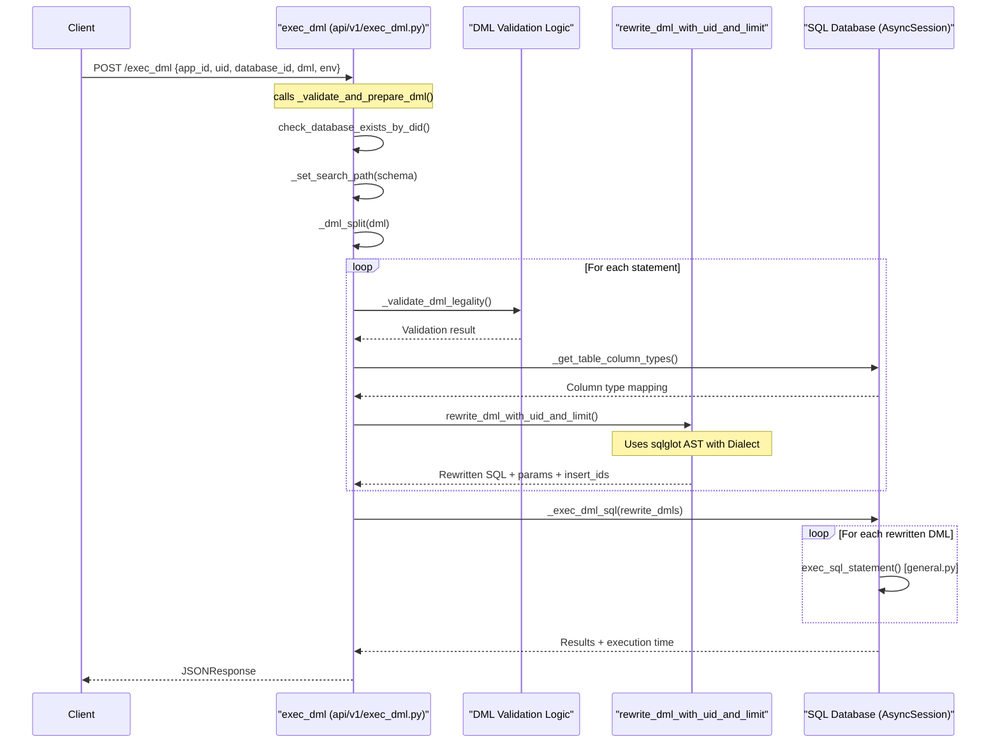
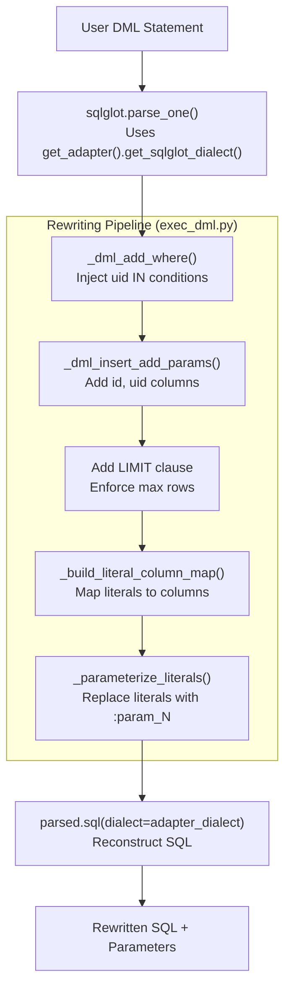

<!-- source: DeepWiki mcp.deepwiki.com · repo iflytek/astron-agent · page 7.2 DML Execution and SQL Rewriting · fetched 2026-10-26 -->

# DML Execution and SQL Rewriting

<details>
<summary>Relevant source files</summary>

The following files were used as context for generating this wiki page:

- [console/backend/toolkit/src/main/java/com/iflytek/astron/console/toolkit/service/database/DatabaseService.java](console/backend/toolkit/src/main/java/com/iflytek/astron/console/toolkit/service/database/DatabaseService.java)
- [console/backend/toolkit/src/main/java/com/iflytek/astron/console/toolkit/util/S3Util.java](console/backend/toolkit/src/main/java/com/iflytek/astron/console/toolkit/util/S3Util.java)
- [console/backend/toolkit/src/main/java/com/iflytek/astron/console/toolkit/util/database/SqlRenderer.java](console/backend/toolkit/src/main/java/com/iflytek/astron/console/toolkit/util/database/SqlRenderer.java)
- [console/backend/toolkit/src/main/java/com/iflytek/astron/console/toolkit/util/database/dialect/DbDialect.java](console/backend/toolkit/src/main/java/com/iflytek/astron/console/toolkit/util/database/dialect/DbDialect.java)
- [console/backend/toolkit/src/main/java/com/iflytek/astron/console/toolkit/util/database/dialect/MysqlDialect.java](console/backend/toolkit/src/main/java/com/iflytek/astron/console/toolkit/util/database/dialect/MysqlDialect.java)
- [console/backend/toolkit/src/main/java/com/iflytek/astron/console/toolkit/util/database/dialect/PostgresDialect.java](console/backend/toolkit/src/main/java/com/iflytek/astron/console/toolkit/util/database/dialect/PostgresDialect.java)
- [console/backend/toolkit/src/test/java/com/iflytek/astron/console/toolkit/service/model/ModelServiceTest.java](console/backend/toolkit/src/test/java/com/iflytek/astron/console/toolkit/service/model/ModelServiceTest.java)
- [core/memory/database/api/router.py](core/memory/database/api/router.py)
- [core/memory/database/api/v1/__init__.py](core/memory/database/api/v1/__init__.py)
- [core/memory/database/api/v1/common.py](core/memory/database/api/v1/common.py)
- [core/memory/database/api/v1/db_operator.py](core/memory/database/api/v1/db_operator.py)
- [core/memory/database/api/v1/exec_ddl.py](core/memory/database/api/v1/exec_ddl.py)
- [core/memory/database/api/v1/exec_dml.py](core/memory/database/api/v1/exec_dml.py)
- [core/memory/database/main.py](core/memory/database/main.py)
- [core/memory/database/repository/middleware/database/db_factory.py](core/memory/database/repository/middleware/database/db_factory.py)
- [core/memory/database/repository/middleware/mid_utils.py](core/memory/database/repository/middleware/mid_utils.py)
- [core/memory/database/tests/test_exec_dml.py](core/memory/database/tests/test_exec_dml.py)

</details>


## Purpose and Scope

This document describes the DML (Data Manipulation Language) execution and SQL rewriting subsystem of the Memory Database Service. This subsystem is responsible for:

- Accepting and validating DML statements (`SELECT`, `INSERT`, `UPDATE`, `DELETE`). [[core/memory/database/api/v1/exec_dml.py:1-9]]()
- Rewriting SQL to enforce multi-tenancy through automatic `uid` filtering. [[core/memory/database/api/v1/exec_dml.py:481-546]]()
- Parameterizing literal values to prevent SQL injection attacks and handle specific data types like `datetime`. [[core/memory/database/api/v1/exec_dml.py:384-424]]()
- Applying row-level security and query limits (default 100 rows). [[core/memory/database/api/v1/exec_dml.py:548-574]]()
- Executing rewritten queries against tenant-specific schemas (e.g., `prod_uid_dbid`) using the configured database dialect. [[core/memory/database/api/v1/exec_dml.py:24-25]](), [[core/memory/database/api/v1/db_operator.py:83-84]]()

For information about database lifecycle operations, see **7.1 Database Lifecycle Operations**. For DDL execution, see **7.3 DDL Execution and Security**.

**Sources:** [[core/memory/database/api/v1/exec_dml.py:1-34]]()

---

## DML Execution Flow

The DML execution flow processes user-submitted SQL statements through validation, rewriting, and execution stages. The main entry point is the `exec_dml` function. [[core/memory/database/api/v1/exec_dml.py:946-1031]]()

### Code Entity Interaction Diagram

This diagram maps the high-level execution flow to specific functions and classes in the codebase.



**Sources:** [[core/memory/database/api/v1/exec_dml.py:946-1031]](), [[core/memory/database/api/v1/exec_dml.py:816-852]](), [[core/memory/database/api/v1/exec_dml.py:1033-1084]](), [[core/memory/database/domain/entity/general.py:24-24]]()

---

## SQL Rewriting Architecture

The SQL rewriting pipeline transforms user-submitted DML into secure, multi-tenant-aware SQL using the `sqlglot` library for AST (Abstract Syntax Tree) manipulation. [[core/memory/database/api/v1/exec_dml.py:11-11]]()



The `rewrite_dml_with_uid_and_limit` function orchestrates this pipeline and is dialect-aware, supporting both PostgreSQL and MySQL syntax. [[core/memory/database/api/v1/exec_dml.py:427-479]]()

**Sources:** [[core/memory/database/api/v1/exec_dml.py:427-479]](), [[core/memory/database/api/v1/exec_dml.py:11-11]]()

---

## UID Filtering and Data Isolation

The system enforces row-level security by automatically injecting `uid` filter conditions into all DML statements.

### WHERE Clause Injection

For `SELECT`, `UPDATE`, and `DELETE` statements, the `_dml_add_where` function modifies the WHERE clause to ensure users only interact with their own data. [[core/memory/database/api/v1/exec_dml.py:481-546]]()

```sql
-- Original query
SELECT * FROM users WHERE age > 18

-- Rewritten query (uid='user456', app_id='app123')
SELECT * FROM users WHERE (age > 18) AND users.uid IN ('user456', 'app123:user456') LIMIT 100
```

The injection logic creates an `IN` clause matching the user's `uid` directly and the composite `app_id:uid` format used for application-scoped data. [[core/memory/database/api/v1/exec_dml.py:530-540]]()

### INSERT Statement Injection

For `INSERT` statements, the `_dml_insert_add_params` function adds mandatory metadata columns to every row: [[core/memory/database/api/v1/exec_dml.py:576-664]]()

| Column | Value | Purpose |
|--------|-------|---------|
| `id` | `get_id()` (snowflake ID) | Primary key for the row [[core/memory/database/api/v1/exec_dml.py:14-14]]() |
| `uid` | `app_id:uid` | Owner identifier for multi-tenancy isolation |
| `create_time` | `datetime.now()` | Audit timestamp |
| `update_time` | `datetime.now()` | Audit timestamp |

The function automatically removes any user-provided values for these reserved columns defined in `INSERT_EXTRA_COLUMNS`. [[core/memory/database/api/v1/exec_dml.py:38-38]]()

**Sources:** [[core/memory/database/api/v1/exec_dml.py:481-546]](), [[core/memory/database/api/v1/exec_dml.py:38-38]](), [[core/memory/database/api/v1/exec_dml.py:576-664]]()

---

## Parameterization and SQL Injection Prevention

The system converts literals in DML statements to parameterized placeholders (`:param_N`), preventing SQL injection while maintaining query correctness.

### Parameterization Logic

The `_parameterize_literals` function implements this logic: [[core/memory/database/api/v1/exec_dml.py:384-424]]()

1. **Skip Numeric Values**: Numeric literals are generally left as-is unless they require specific type handling. [[core/memory/database/api/v1/exec_dml.py:402-402]]()
2. **Generate Parameter Names**: Each literal gets a unique parameter name (`param_0`, `param_1`, etc.). [[core/memory/database/api/v1/exec_dml.py:408-408]]()
3. **Type Conversion**: If a literal maps to a `timestamp` or `datetime` column, the string is converted to a `datetime.datetime` object for safe driver-level binding. [[core/memory/database/api/v1/exec_dml.py:412-416]]()
4. **AST Replacement**: The `exp.Literal` node is replaced with an `exp.Placeholder`. [[core/memory/database/api/v1/exec_dml.py:421-421]]()

### Example Transformation

```python
# Original query
"SELECT * FROM users WHERE name = 'Alice'"

# Rewritten query
"SELECT * FROM users WHERE name = :param_0 AND users.uid IN (:param_1, :param_2) LIMIT 100"

# Parameters dict
{
    'param_0': 'Alice',
    'param_1': 'user456',
    'param_2': 'app123:user456'
}
```

**Sources:** [[core/memory/database/api/v1/exec_dml.py:384-424]]()

---

## Column Type Resolution and Literal Mapping

To enable type-aware parameterization, the system builds a mapping from literal values in the SQL AST to their corresponding table columns.

### Literal-to-Column Mapping

The `literal_column_map` (type: `Dict[int, str]`) maps Python object IDs of `exp.Literal` AST nodes to qualified column names (e.g., `users.name`). This is handled by specific builders:
- `_build_insert_literal_map`: Maps values in `VALUES` clauses to column names. [[core/memory/database/api/v1/exec_dml.py:41-66]]()
- `_build_update_literal_map`: Maps values in `SET` clauses. [[core/memory/database/api/v1/exec_dml.py:69-102]]()
- `_build_select_literal_map`: Recursively maps literals in `WHERE` clauses using `_map_where_literals_recursive`. [[core/memory/database/api/v1/exec_dml.py:142-175]](), [[core/memory/database/api/v1/exec_dml.py:125-140]]()

### Column Type Query

The `_get_table_column_types` function queries the database's `information_schema.columns` to determine if a literal needs specific conversion (like `timestamp`). [[core/memory/database/api/v1/exec_dml.py:329-375]]()

**Sources:** [[core/memory/database/api/v1/exec_dml.py:39-175]](), [[core/memory/database/api/v1/exec_dml.py:329-375]]()

---

## Validation and Security Checks

### Identifier Validation

The `_validate_name_pattern` function enforces strict naming rules: column and key names must contain only ASCII letters and underscores. [[core/memory/database/api/v1/exec_dml.py:766-814]]()

```python
# Allowed characters for identifiers
allow_chars = string.ascii_letters + "_"
```

The system also uses a specialized `SqlRenderer` utility in the console backend to validate identifiers before they reach the execution engine. This utility checks against an `IDENTIFIER` regex pattern and a `RESERVED` keyword set. [[console/backend/toolkit/src/main/java/com/iflytek/astron/console/toolkit/util/database/SqlRenderer.java:19-55]]()

### Reserved Keyword and Function Validation

The system checks identifiers and function calls against a blacklist:
- **Keywords**: `validate_reserved_keywords` checks against dialect-specific reserved words retrieved via the database adapter. [[core/memory/database/api/v1/common.py:122-135]]()
- **Functions**: `validate_reserved_functions` prevents execution of dangerous database functions defined in the adapter's blacklist. [[core/memory/database/api/v1/common.py:138-151]]()

**Sources:** [[core/memory/database/api/v1/exec_dml.py:766-814]](), [[core/memory/database/api/v1/common.py:122-151]](), [[console/backend/toolkit/src/main/java/com/iflytek/astron/console/toolkit/util/database/SqlRenderer.java:12-55]]()

---

## Observability and Error Handling

The DML execution endpoint implements comprehensive observability using OpenTelemetry.

### Observability Integration

- **Metrics**: Tracks success and error counts by user ID via `get_otlp_metric_service`. [[core/memory/database/api/v1/exec_dml.py:13-13]](), [[core/memory/database/api/v1/exec_dml.py:950-950]]()
- **Tracing**: Records input DML, rewritten SQL, and schema information in the span context via `get_otlp_span_service`. [[core/memory/database/api/v1/exec_dml.py:13-13]](), [[core/memory/database/api/v1/exec_dml.py:952-952]]()

### Error Catalog

| Code | Enum | Condition |
|------|------|-----------|
| `40300` | `DMLNotAllowed` | Invalid name pattern or reserved keyword/function. [[core/memory/database/api/v1/common.py:131-131]]() |
| `50001` | `DatabaseNotExistError` | Database or schema doesn't exist. [[core/memory/database/api/v1/common.py:34-34]]() |
| `50004` | `DatabaseExecutionError` | SQL execution error returned by the database engine. [[core/memory/database/api/v1/common.py:52-52]]() |

**Sources:** [[core/memory/database/api/v1/exec_dml.py:946-1031]](), [[core/memory/database/api/v1/common.py:22-63]]()

---

