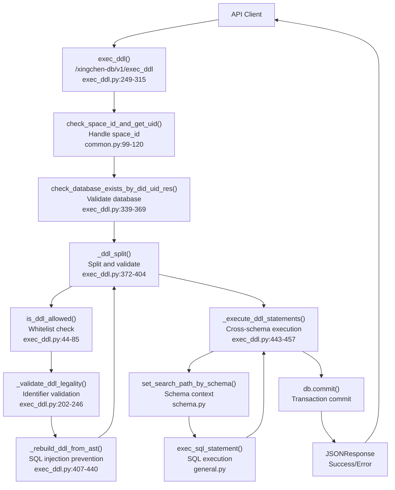

<!-- source: DeepWiki mcp.deepwiki.com · repo iflytek/astron-agent · page 7.3 DDL Execution and Security · fetched 2026-10-26 -->

# DDL Execution and Security

<details>
<summary>Relevant source files</summary>

The following files were used as context for generating this wiki page:

- [core/memory/database/api/router.py](core/memory/database/api/router.py)
- [core/memory/database/api/v1/__init__.py](core/memory/database/api/v1/__init__.py)
- [core/memory/database/api/v1/common.py](core/memory/database/api/v1/common.py)
- [core/memory/database/api/v1/db_operator.py](core/memory/database/api/v1/db_operator.py)
- [core/memory/database/api/v1/exec_ddl.py](core/memory/database/api/v1/exec_ddl.py)
- [core/memory/database/api/v1/exec_dml.py](core/memory/database/api/v1/exec_dml.py)
- [core/memory/database/main.py](core/memory/database/main.py)
- [core/memory/database/repository/middleware/database/db_factory.py](core/memory/database/repository/middleware/database/db_factory.py)
- [core/memory/database/repository/middleware/mid_utils.py](core/memory/database/repository/middleware/mid_utils.py)

</details>


This document describes the DDL (Data Definition Language) execution system in the `core-database` service, focusing on security validation, SQL injection prevention, and multi-schema execution patterns. For DML (Data Manipulation Language) execution and query rewriting, see [7.2 DML Execution and SQL Rewriting](). For database lifecycle operations (creation, cloning, dropping), see [7.1 Database Lifecycle Operations]().

## Purpose and Scope

The DDL execution system provides a secure interface for executing schema modification statements (CREATE TABLE, ALTER TABLE, DROP TABLE, etc.) on user-specific schemas. The system enforces strict security controls including:

- **Statement type whitelisting** - Only approved DDL operations are allowed.
- **Identifier validation** - Column and table names must conform to strict patterns.
- **Reserved keyword blocking** - Database reserved words and dangerous functions are prohibited.
- **SQL injection prevention** - AST-based reconstruction ensures structural safety.
- **Multi-schema execution** - DDL changes are applied to both production and test environments.

The implementation is primarily located in [core/memory/database/api/v1/exec_ddl.py]().

---

## DDL Execution Architecture

The DDL execution flow follows a secure pipeline from API request to database execution, with multiple validation and reconstruction stages to prevent malicious or malformed SQL.

### DDL Execution Pipeline in `exec_ddl.py`

Sources: [core/memory/database/api/v1/exec_ddl.py:249-315](), [core/memory/database/api/v1/common.py:99-120](), [core/memory/database/api/v1/exec_ddl.py:339-369](), [core/memory/database/api/v1/exec_ddl.py:372-404](), [core/memory/database/api/v1/exec_ddl.py:44-85](), [core/memory/database/api/v1/exec_ddl.py:202-246](), [core/memory/database/api/v1/exec_ddl.py:407-440](), [core/memory/database/api/v1/exec_ddl.py:443-457]()

### API Endpoint and Input Schema

The DDL execution endpoint accepts POST requests at `/xingchen-db/v1/exec_ddl` [core/memory/database/api/router.py:21]() with the following input structure defined in `ExecDDLInput`:

| Field | Type | Required | Description |
|-------|------|----------|-------------|
| `uid` | string | Yes | User identifier (1-64 chars, no special symbols) |
| `database_id` | integer | Yes | Database ID to execute against |
| `ddl` | string | Yes | DDL statement(s) to execute |
| `space_id` | string | No | Team space ID for multi-tenancy |

The endpoint is defined in [core/memory/database/api/v1/exec_ddl.py:249-315]() and uses the `ExecDDLInput` schema [core/memory/database/api/v1/exec_ddl.py:12]().

Sources: [core/memory/database/api/v1/exec_ddl.py:249-315](), [core/memory/database/api/router.py:16-25]()

---

## Security Validation Pipeline

The DDL validation pipeline implements defense-in-depth through multiple sequential checks, each blocking progressively more sophisticated attack vectors.

### Security Check Sequence in `_validate_ddl_legality`

```mermaid
graph LR
    Input["DDL Statement<br/>Input String"]
    
    Split["Statement Splitting<br/>Split by semicolon"]
    
    WhitelistCheck["Whitelist Check<br/>is_ddl_allowed()"]
    WhitelistAllowed{{"Allowed<br/>Statement?"}}
    
    Parse["SQL Parsing<br/>sqlglot.parse_one()"]
    ParseSuccess{{"Valid<br/>Syntax?"}}
    
    FunctionCheck["Function Validation<br/>_collect_functions_names()"]
    FunctionReserved{{"Reserved<br/>Function?"}}
    
    IdentifierCheck["Identifier Validation<br/>_collect_ddl_identifiers()"]
    PatternCheck["Pattern Validation<br/>_validate_name_pattern_ddl()"]
    PatternValid{{"Valid<br/>Pattern?"}}
    
    KeywordCheck["Keyword Validation<br/>validate_reserved_keywords()"]
    KeywordReserved{{"Reserved<br/>Keyword?"}}
    
    Reconstruct["AST Reconstruction<br/>_rebuild_ddl_from_ast()"]
    ReconstructSuccess{{"Reconstruction<br/>Success?"}}
    
    SafeDDL["Safe DDL Statement<br/>Ready for execution"]
    
    Error["Error Response<br/>DMLNotAllowed/SQLParseError"]
    
    Input --> Split
    Split --> WhitelistCheck
    WhitelistCheck --> WhitelistAllowed
    WhitelistAllowed -->|No| Error
    WhitelistAllowed -->|Yes| Parse
    
    Parse --> ParseSuccess
    ParseSuccess -->|No| Error
    ParseSuccess -->|Yes| FunctionCheck
    
    FunctionCheck --> FunctionReserved
    FunctionReserved -->|Yes| Error
    FunctionReserved -->|No| IdentifierCheck
    
    IdentifierCheck --> PatternCheck
    PatternCheck --> PatternValid
    PatternValid -->|No| Error
    PatternValid -->|Yes| KeywordCheck
    
    KeywordCheck --> KeywordReserved
    KeywordReserved -->|Yes| Error
    KeywordReserved -->|No| Reconstruct
    
    Reconstruct --> ReconstructSuccess
    ReconstructSuccess -->|No| Error
    ReconstructSuccess -->|Yes| SafeDDL
```

Sources: [core/memory/database/api/v1/exec_ddl.py:44-85](), [core/memory/database/api/v1/exec_ddl.py:202-246](), [core/memory/database/api/v1/exec_ddl.py:372-404](), [core/memory/database/api/v1/common.py:122-151]()

### Validation Stages

The pipeline implements four distinct validation stages:

1. **Statement Type Validation**: Whitelists allowed DDL operations via `is_ddl_allowed` [core/memory/database/api/v1/exec_ddl.py:44-85]().
2. **Function Name Validation**: Blocks reserved database functions using `_collect_functions_names` [core/memory/database/api/v1/exec_ddl.py:144-177]().
3. **Identifier Validation**: Enforces strict naming rules for columns/tables via `_validate_name_pattern_ddl` [core/memory/database/api/v1/exec_ddl.py:180-200]().
4. **AST Reconstruction**: Rebuilds SQL from parsed AST to prevent injection using `_rebuild_ddl_from_ast` [core/memory/database/api/v1/exec_ddl.py:407-440]().

---

## Statement Type Validation

The system restricts DDL execution to a whitelist defined in `ALLOWED_DDL_STATEMENTS` [core/memory/database/api/v1/exec_ddl.py:34-41]():

```python
ALLOWED_DDL_STATEMENTS = {
    "CREATE TABLE",
    "ALTER TABLE",
    "DROP TABLE",
    "DROP DATABASE",
    "COMMENT",
    "RENAME",
}
```

### Statement Type Detection

The `is_ddl_allowed()` function [core/memory/database/api/v1/exec_ddl.py:44-85]() uses `sqlglot` to parse the statement and determine the object type. It handles specific `sqlglot` expressions:

- **Drop**: Extracts `kind` (e.g., "TABLE" or "DATABASE") [core/memory/database/api/v1/exec_ddl.py:62-64]().
- **Create**: Extracts `kind` [core/memory/database/api/v1/exec_ddl.py:65-67]().
- **Alter**: Extracts `kind` [core/memory/database/api/v1/exec_ddl.py:68-70]().
- **Command**: Fallback for complex statements using regex to identify "ALTER TABLE" [core/memory/database/api/v1/exec_ddl.py:71-76]().

Sources: [core/memory/database/api/v1/exec_ddl.py:34-85]()

---

## Identifier and Keyword Validation

### Identifier Collection

The `_collect_ddl_identifiers()` function [core/memory/database/api/v1/exec_ddl.py:180-200]() walks the AST to extract column names from `ColumnDef` nodes [core/memory/database/api/v1/exec_ddl.py:196-199](). This ensures that every column being created or altered is checked against security policies.

### Function Name Collection

The `_collect_functions_names()` function [core/memory/database/api/v1/exec_ddl.py:144-177]() extracts function names. It includes a `sqlglot_func_key_map` [core/memory/database/api/v1/exec_ddl.py:149-163]() to translate internal `sqlglot` keys (like `currenttimestamp`) to standard SQL function names [core/memory/database/api/v1/exec_ddl.py:172]().

### Reserved Keyword and Dangerous Function Validation

The system uses adapter-specific lists for blocking:
- **`validate_reserved_keywords()`**: Checks identifiers against adapter-provided reserved keywords [core/memory/database/api/v1/common.py:122-135]().
- **`validate_reserved_functions()`**: Checks function names against adapter-provided dangerous functions [core/memory/database/api/v1/common.py:138-151]().

Sources: [core/memory/database/api/v1/common.py:122-151](), [core/memory/database/api/v1/exec_ddl.py:144-200]()

---

## AST Reconstruction

After validation, `_rebuild_ddl_from_ast()` [core/memory/database/api/v1/exec_ddl.py:407-440]() rebuilds the SQL string.

```python
dialect = get_adapter().get_sqlglot_dialect()
parsed = sqlglot.parse_one(ddl, dialect=dialect, error_level="raise")
safe_sql = parsed.sql(dialect=dialect, pretty=False)
```

This process strips comments, normalizes whitespace, and ensures that only the validated structural components of the SQL are sent to the database [core/memory/database/api/v1/exec_ddl.py:433-435](), effectively neutralizing SQL injection payloads.

Sources: [core/memory/database/api/v1/exec_ddl.py:407-440]()

---

## Cross-Schema Execution

DDL statements are executed across multiple schemas (typically production and test) to maintain consistency.

### Execution Implementation

The `_execute_ddl_statements()` function [core/memory/database/api/v1/exec_ddl.py:443-457]() handles the multi-schema loop:

1. Iterates through `schema_list` [core/memory/database/api/v1/exec_ddl.py:447]().
2. Sets the `search_path` using `set_search_path_by_schema()` [core/memory/database/api/v1/exec_ddl.py:449]().
3. Executes each validated DDL statement via `exec_sql_statement()` [core/memory/database/api/v1/exec_ddl.py:453]().

### Space-Based UID Resolution

If a `space_id` is provided, the system resolves the correct owner `uid` by calling `check_space_id_and_get_uid()` [core/memory/database/api/v1/common.py:99-120](). This ensures that even if a team member executes the DDL, it targets the schemas belonging to the database creator [core/memory/database/api/v1/common.py:105]().

Sources: [core/memory/database/api/v1/exec_ddl.py:443-457](), [core/memory/database/api/v1/common.py:99-120]()

---

## Safe Schema Identifier Escaping

For internal operations like database creation, the system uses safe escaping utilities in `db_operator.py`:

- **`safe_create_schema_sql()`**: Uses the configured adapter to wrap schema names in properly quoted identifiers [core/memory/database/api/v1/db_operator.py:40-48]().
- **`safe_drop_schema_sql()`**: Safely constructs `DROP SCHEMA/DATABASE` SQL using the adapter [core/memory/database/api/v1/db_operator.py:51-59]().

Sources: [core/memory/database/api/v1/db_operator.py:40-59]()

---

## Error Handling and Observability

The system integrates with OpenTelemetry for tracing and metrics:

- **Tracing**: Every DDL execution starts a `Span` [core/memory/database/api/v1/exec_ddl.py:261-267]().
- **Metrics**: Success and error counts are recorded using `get_otlp_metric_service` [core/memory/database/api/v1/exec_ddl.py:258-259]().
- **Transaction Safety**: If any part of the execution fails, `db.rollback()` is called to maintain schema integrity [core/memory/database/api/v1/exec_ddl.py:310]().

Sources: [core/memory/database/api/v1/exec_ddl.py:249-315]()

---

