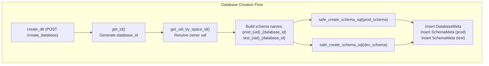
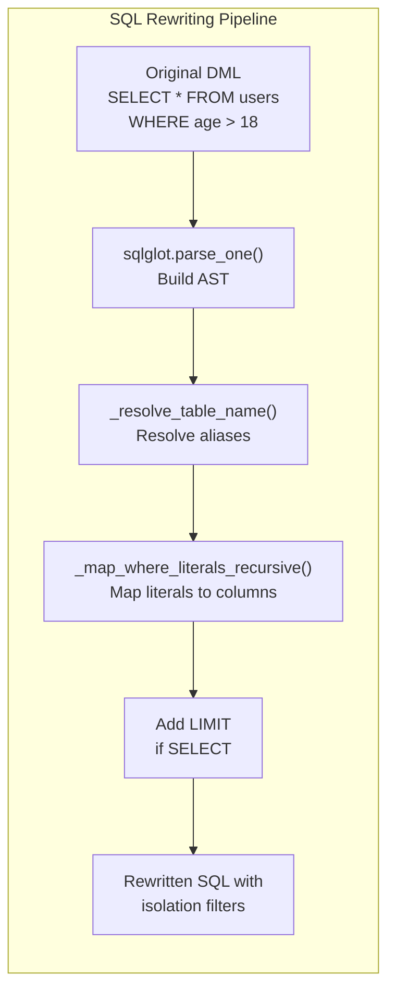
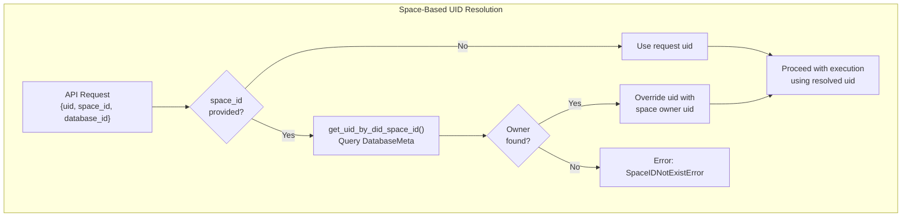

<!-- source: DeepWiki mcp.deepwiki.com · repo iflytek/astron-agent · page 7.4 Multi-Tenancy and Data Isolation · fetched 2026-10-26 -->

# Multi-Tenancy and Data Isolation

<details>
<summary>Relevant source files</summary>

The following files were used as context for generating this wiki page:

- [core/memory/database/alembic/README.md](core/memory/database/alembic/README.md)
- [core/memory/database/alembic/alembic.ini](core/memory/database/alembic/alembic.ini)
- [core/memory/database/alembic/env.py](core/memory/database/alembic/env.py)
- [core/memory/database/alembic/script.py.mako](core/memory/database/alembic/script.py.mako)
- [core/memory/database/alembic/versions/2026_02_11_1801-f2a4ce6e3198_init.py](core/memory/database/alembic/versions/2026_02_11_1801-f2a4ce6e3198_init.py)
- [core/memory/database/api/router.py](core/memory/database/api/router.py)
- [core/memory/database/api/v1/__init__.py](core/memory/database/api/v1/__init__.py)
- [core/memory/database/api/v1/common.py](core/memory/database/api/v1/common.py)
- [core/memory/database/api/v1/db_operator.py](core/memory/database/api/v1/db_operator.py)
- [core/memory/database/api/v1/exec_ddl.py](core/memory/database/api/v1/exec_ddl.py)
- [core/memory/database/api/v1/exec_dml.py](core/memory/database/api/v1/exec_dml.py)
- [core/memory/database/config.env](core/memory/database/config.env)
- [core/memory/database/domain/entity/general.py](core/memory/database/domain/entity/general.py)
- [core/memory/database/domain/entity/schema.py](core/memory/database/domain/entity/schema.py)
- [core/memory/database/domain/models/database_meta.py](core/memory/database/domain/models/database_meta.py)
- [core/memory/database/domain/models/schema_meta.py](core/memory/database/domain/models/schema_meta.py)
- [core/memory/database/exceptions/e.py](core/memory/database/exceptions/e.py)
- [core/memory/database/exceptions/error_code.py](core/memory/database/exceptions/error_code.py)
- [core/memory/database/main.py](core/memory/database/main.py)
- [core/memory/database/pyproject.toml](core/memory/database/pyproject.toml)
- [core/memory/database/repository/middleware/database/db_factory.py](core/memory/database/repository/middleware/database/db_factory.py)
- [core/memory/database/repository/middleware/database/db_manager.py](core/memory/database/repository/middleware/database/db_manager.py)
- [core/memory/database/repository/middleware/mid_utils.py](core/memory/database/repository/middleware/mid_utils.py)
- [core/memory/database/utils/retry.py](core/memory/database/utils/retry.py)
- [core/memory/database/uv.lock](core/memory/database/uv.lock)

</details>


## Purpose and Scope

This document describes how the Memory Database Service enforces multi-tenancy and data isolation to ensure secure separation of data between users and teams. The service employs a dual-layer isolation strategy: **schema-based namespace isolation** at the database level and **row-level security through automatic SQL rewriting** at the query level. This approach prevents unauthorized data access while maintaining performance and simplicity.

For information about database lifecycle operations (creation, cloning, deletion), see [7.1 Database Lifecycle Operations](). For details on SQL execution mechanics and parameterization, see [7.2 DML Execution and SQL Rewriting]() and [7.3 DDL Execution and Security]().

---

## Schema-Based Namespace Isolation

### Schema Naming Convention

Each database instance is isolated using backend-specific namespaces (schemas in PostgreSQL or separate databases in MySQL) with a strict naming convention that embeds tenant identifiers:

```
{environment}_{uid}_{database_id}
```

Where:
- `environment`: Either `prod` or `test` [core/memory/database/api/v1/db_operator.py:83-84]()
- `uid`: User identifier (or space owner identifier for team spaces) [core/memory/database/api/v1/db_operator.py:75-81]()
- `database_id`: Unique database identifier generated by Snowflake ID algorithm [core/memory/database/api/v1/db_operator.py:74-74]()

**Example**: `prod_u12345_9876543210`

This naming scheme ensures that:
1. Each user's databases are physically separated at the storage level.
2. Production and test environments are isolated within the same database instance.
3. Schema names are globally unique and cannot collide.

### Schema Creation and Management

When a database is created via `create_db`, the service provisions two schemas:

| Schema Type | Format | Purpose |
|-------------|--------|---------|
| Production Schema | `prod_{uid}_{database_id}` | Live production data [core/memory/database/api/v1/db_operator.py:83-83]() |
| Test Schema | `test_{uid}_{database_id}` | Development and testing data [core/memory/database/api/v1/db_operator.py:84-84]() |

Sources: [core/memory/database/api/v1/db_operator.py:70-117]()

### Schema Creation Flow

The following diagram illustrates the process of provisioning isolated schemas during database creation.

Title: "Database Creation and Schema Provisioning Flow"


Sources: [core/memory/database/api/v1/db_operator.py:70-117](), [core/memory/database/domain/models/database_meta.py:1-20](), [core/memory/database/domain/models/schema_meta.py:1-20]()

### Secure Identifier Escaping

All schema and table identifiers are safely handled using database-specific adapters to prevent SQL injection during DDL operations. The system uses `get_adapter()` to retrieve the correct dialect-specific logic for quoting [core/memory/database/api/v1/db_operator.py:40-59]().

Sources: [core/memory/database/api/v1/db_operator.py:40-59](), [core/memory/database/domain/entity/schema.py:9-21]()

---

## Row-Level Data Isolation Through SQL Rewriting

### Automatic UID and App ID Injection

Every DML statement (SELECT, UPDATE, DELETE, INSERT) is automatically rewritten to inject user and application identifiers. This ensures that users can only access their own data, even if they query the correct schema.

### DML Rewriting Mechanism

The DML execution flow (invoked during `exec_dml`) transforms SQL statements to enforce row-level isolation by appending `uid` filters to the `WHERE` clause.

**Original SQL:**
```sql
SELECT * FROM users WHERE age > 18
```

**Rewritten SQL (Simplified):**
```sql
SELECT * FROM users 
WHERE (age > 18) AND users.uid IN (:param_uid_0, :param_uid_1) 
LIMIT 100
```

Where the parameters correspond to the user's `uid` and the `app_id:uid` combination to support cross-application data access within the same tenant context.

Sources: [core/memory/database/api/v1/exec_dml.py:11-33]()

### DML SQL Rewriting Pipeline

This diagram shows how raw user SQL is transformed into a secure, isolated query within the `exec_dml` flow.

Title: "SQL Rewriting and Isolation Pipeline"


Sources: [core/memory/database/api/v1/exec_dml.py:104-141](), [core/memory/database/api/v1/exec_dml.py:41-67]()

### UID Injection Logic

For `UPDATE`, `DELETE`, and `SELECT` statements, the system iterates through all tables involved and appends the isolation filter. It resolves table names even when aliases are used in the query by mapping literals to columns recursively [core/memory/database/api/v1/exec_dml.py:125-141]().

### INSERT Statement Handling

For `INSERT` statements, the service automatically injects system-managed columns defined in `INSERT_EXTRA_COLUMNS`: `id`, `uid`, `create_time`, and `update_time` [core/memory/database/api/v1/exec_dml.py:38-38]().

Sources: [core/memory/database/api/v1/exec_dml.py:38-67]()

---

## Space-Based Multi-Tenancy Model

### Personal vs Team Spaces

The service supports two types of database ownership:

| Space Type | Description | UID Behavior |
|-----------|-------------|--------------|
| Personal Space | User-owned database | Uses `uid` from request |
| Team Space | Shared team database | `uid` is resolved from `space_id` owner via `get_uid_by_did_space_id` [core/memory/database/api/v1/common.py:99-119]() |

### Space Resolution Flow

When a `space_id` is provided, the system verifies if the `space_id` contains the requested `database_id` and retrieves the owner's `uid` to ensure data consistency within the team space.

Title: "Space-Based Multi-Tenancy Resolution"


Sources: [core/memory/database/api/v1/common.py:99-119](), [core/memory/database/domain/entity/database_meta.py:11-15]()

---

## Data Access Validation and Authorization

### Database Existence Validation

Before any operation, the service validates that the database exists and belongs to the user or space.

```python
# From common.py:22-47
async def check_database_exists_by_did_uid(
    db: Any, database_id: int, uid: str, span_context: Any
) -> Tuple[Optional[List[List[str]]], Optional[Any]]:
    """Check if database exists and return its schemas."""
    db_id_res = await get_id_by_did_uid(db, database_id=database_id, uid=uid)
    if not db_id_res:
        # Log error and return DatabaseNotExistError
        return None, format_response(...)
    
    res = await get_schema_name_by_did(db, database_id=database_id)
    return res, None
```

Sources: [core/memory/database/api/v1/common.py:22-47](), [core/memory/database/api/v1/common.py:66-88]()

---

## Security Mechanisms and Safeguards

### Identifier Validation Rules

To prevent SQL injection and ensure schema integrity, all identifiers must conform to strict naming patterns and avoid reserved keywords.

- **Keyword Validation**: `validate_reserved_keywords` checks identifiers against a dialect-specific list of reserved keywords [core/memory/database/api/v1/common.py:122-135]().
- **Function Validation**: `validate_reserved_functions` prohibits the use of dangerous functions like `current_user` or `session_user` in user queries [core/memory/database/api/v1/common.py:138-151]().

### DDL Whitelisting

Only a specific subset of DDL statements defined in `ALLOWED_DDL_STATEMENTS` is allowed for execution via the API [core/memory/database/api/v1/exec_ddl.py:34-41](). This includes `CREATE TABLE`, `ALTER TABLE`, and `DROP TABLE`. The `is_ddl_allowed` function parses the SQL AST to verify the statement type [core/memory/database/api/v1/exec_ddl.py:44-80]().

Sources: [core/memory/database/api/v1/exec_ddl.py:34-80](), [core/memory/database/api/v1/common.py:122-151]()

### Search Path Management

For every request, the service explicitly sets the database `search_path` (or equivalent) to the specific tenant schema using `set_search_path_by_schema`, preventing cross-schema data leakage during raw SQL execution [core/memory/database/domain/entity/schema.py:10-21](). This is applied in both DML [core/memory/database/api/v1/exec_dml.py:25-25]() and DDL [core/memory/database/api/v1/exec_ddl.py:20-20]() execution paths.

Sources: [core/memory/database/domain/entity/schema.py:9-21](), [core/memory/database/api/v1/exec_dml.py:25-25](), [core/memory/database/api/v1/exec_ddl.py:20-20]()

---

