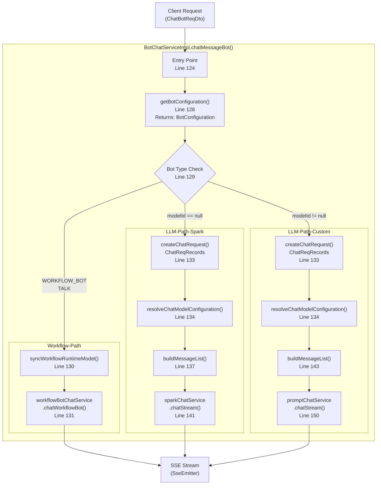

<!-- source: DeepWiki mcp.deepwiki.com · repo iflytek/astron-agent · page 8.1 Chat Service Architecture · fetched 2026-10-26 -->

# Chat Service Architecture

<details>
<summary>Relevant source files</summary>

The following files were used as context for generating this wiki page:

- [console/backend/commons/src/main/java/com/iflytek/astron/console/commons/entity/bot/ChatBotMarket.java](console/backend/commons/src/main/java/com/iflytek/astron/console/commons/entity/bot/ChatBotMarket.java)
- [console/backend/commons/src/main/java/com/iflytek/astron/console/commons/service/data/ChatHistoryService.java](console/backend/commons/src/main/java/com/iflytek/astron/console/commons/service/data/ChatHistoryService.java)
- [console/backend/commons/src/main/java/com/iflytek/astron/console/commons/service/data/DatasetDataService.java](console/backend/commons/src/main/java/com/iflytek/astron/console/commons/service/data/DatasetDataService.java)
- [console/backend/commons/src/main/java/com/iflytek/astron/console/commons/service/data/impl/DatasetDataServiceImpl.java](console/backend/commons/src/main/java/com/iflytek/astron/console/commons/service/data/impl/DatasetDataServiceImpl.java)
- [console/backend/hub/src/main/java/com/iflytek/astron/console/hub/controller/chat/ChatHistoryController.java](console/backend/hub/src/main/java/com/iflytek/astron/console/hub/controller/chat/ChatHistoryController.java)
- [console/backend/hub/src/main/java/com/iflytek/astron/console/hub/controller/chat/ChatMessageController.java](console/backend/hub/src/main/java/com/iflytek/astron/console/hub/controller/chat/ChatMessageController.java)
- [console/backend/hub/src/main/java/com/iflytek/astron/console/hub/data/ReqKnowledgeRecordsDataService.java](console/backend/hub/src/main/java/com/iflytek/astron/console/hub/data/ReqKnowledgeRecordsDataService.java)
- [console/backend/hub/src/main/java/com/iflytek/astron/console/hub/data/impl/ReqKnowledgeRecordsDataServiceImpl.java](console/backend/hub/src/main/java/com/iflytek/astron/console/hub/data/impl/ReqKnowledgeRecordsDataServiceImpl.java)
- [console/backend/hub/src/main/java/com/iflytek/astron/console/hub/dto/chat/BotDebugRequest.java](console/backend/hub/src/main/java/com/iflytek/astron/console/hub/dto/chat/BotDebugRequest.java)
- [console/backend/hub/src/main/java/com/iflytek/astron/console/hub/entity/ReqKnowledgeRecords.java](console/backend/hub/src/main/java/com/iflytek/astron/console/hub/entity/ReqKnowledgeRecords.java)
- [console/backend/hub/src/main/java/com/iflytek/astron/console/hub/mapper/ReqKnowledgeRecordsMapper.java](console/backend/hub/src/main/java/com/iflytek/astron/console/hub/mapper/ReqKnowledgeRecordsMapper.java)
- [console/backend/hub/src/main/java/com/iflytek/astron/console/hub/service/bot/impl/BotTransactionalServiceImpl.java](console/backend/hub/src/main/java/com/iflytek/astron/console/hub/service/bot/impl/BotTransactionalServiceImpl.java)
- [console/backend/hub/src/main/java/com/iflytek/astron/console/hub/service/chat/BotChatService.java](console/backend/hub/src/main/java/com/iflytek/astron/console/hub/service/chat/BotChatService.java)
- [console/backend/hub/src/main/java/com/iflytek/astron/console/hub/service/chat/impl/BotChatServiceImpl.java](console/backend/hub/src/main/java/com/iflytek/astron/console/hub/service/chat/impl/BotChatServiceImpl.java)
- [console/backend/hub/src/main/java/com/iflytek/astron/console/hub/service/chat/impl/ChatEnhanceServiceImpl.java](console/backend/hub/src/main/java/com/iflytek/astron/console/hub/service/chat/impl/ChatEnhanceServiceImpl.java)
- [console/backend/hub/src/main/java/com/iflytek/astron/console/hub/service/chat/impl/ChatHistoryServiceImpl.java](console/backend/hub/src/main/java/com/iflytek/astron/console/hub/service/chat/impl/ChatHistoryServiceImpl.java)
- [console/backend/hub/src/main/java/com/iflytek/astron/console/hub/service/knowledge/impl/KnowledgeServiceImpl.java](console/backend/hub/src/main/java/com/iflytek/astron/console/hub/service/knowledge/impl/KnowledgeServiceImpl.java)
- [console/backend/hub/src/test/java/com/iflytek/astron/console/hub/service/knowledge/impl/KnowledgeServiceImplTest.java](console/backend/hub/src/test/java/com/iflytek/astron/console/hub/service/knowledge/impl/KnowledgeServiceImplTest.java)
- [console/backend/hub/src/test/java/com/iflytek/astron/console/hub/service/share/impl/ShareServiceImplTest.java](console/backend/hub/src/test/java/com/iflytek/astron/console/hub/service/share/impl/ShareServiceImplTest.java)

</details>


## Purpose and Scope

This document describes the architecture of the Chat Service within the Console Hub backend, which processes chat requests from users interacting with bots. The service handles bot type routing, configuration resolution between market and base entities, conversation history management, token budget optimization, knowledge base integration, and real-time streaming responses via Server-Sent Events (SSE).

For information about workflow-based bot execution, see [Workflow and Publishing System](). For bot creation and publishing, see [Bot Lifecycle Management](). For frontend chat UI and API integration, see [Console Frontend Application]().

---

## Service Architecture Overview

The Chat Service is implemented in the Console Hub Java Spring Boot application and serves as the orchestration layer for all chat interactions.

```mermaid
graph TB
    subgraph "Console-Hub-Service"
        BotChatController["ChatMessageController<br/>(REST Endpoints)"]
        
        subgraph "Core-Service-Layer"
            BotChatService["BotChatServiceImpl<br/>Main Orchestration"]
            ChatListService["ChatListService<br/>Session Management"]
            PersonalityConfigService["PersonalityConfigService<br/>Prompt Enhancement"]
        end
        
        subgraph "Bot-Type-Routing"
            WorkflowRouter["workflowBotChatService<br/>(WORKFLOW_BOT, TALK)"]
            SparkRouter["sparkChatService<br/>(modelId == null)"]
            PromptRouter["promptChatService<br/>(modelId != null)"]
        end
        
        subgraph "Data-Access-Services"
            ChatBotDataService["ChatBotDataServiceImpl<br/>Bot Metadata"]
            ChatDataService["ChatDataService<br/>Chat Records"]
            ChatHistoryService["ChatHistoryServiceImpl<br/>History Processing"]
            ReqKnowledgeRecordsDataService["ReqKnowledgeRecordsDataService<br/>Knowledge Storage"]
        end
        
        subgraph "Integration-Services"
            KnowledgeService["KnowledgeService<br/>RAG Queries"]
            ModelService["ModelService<br/>LLM Configuration"]
            WorkflowService["WorkflowService<br/>Model Sync"]
        end
    end
    
    subgraph "Persistence-Layer"
        MySQL["MySQL DB<br/>chat_bot_base<br/>chat_bot_market<br/>chat_list<br/>chat_req_records<br/>chat_resp_records<br/>req_knowledge_records"]
    end
    
    subgraph "External-Engines"
        WorkflowEngine["Core Workflow Service"]
        SparkLLM["Spark LLM API"]
        CustomLLM["Custom LLM<br/>OpenAI-compatible"]
        RagFlow["RagFlow/Knowledge Service"]
    end
    
    BotChatController --> BotChatService
    BotChatService --> ChatListService
    BotChatService --> PersonalityConfigService
    
    BotChatService --> WorkflowRouter
    BotChatService --> SparkRouter
    BotChatService --> PromptRouter
    
    BotChatService --> ChatBotDataService
    BotChatService --> ChatDataService
    BotChatService --> ChatHistoryService
    BotChatService --> ReqKnowledgeRecordsDataService
    BotChatService --> KnowledgeService
    BotChatService --> ModelService
    BotChatService --> WorkflowService
    
    WorkflowRouter --> WorkflowEngine
    SparkRouter --> SparkLLM
    PromptRouter --> CustomLLM
    KnowledgeService --> RagFlow
    
    ChatBotDataService --> MySQL
    ChatDataService --> MySQL
    ReqKnowledgeRecordsDataService --> MySQL
```



**Sources:** [console/backend/hub/src/main/java/com/iflytek/astron/console/hub/service/chat/impl/BotChatServiceImpl.java:64-112](), [console/backend/hub/src/main/java/com/iflytek/astron/console/hub/controller/chat/ChatMessageController.java:45-59](), [console/backend/hub/src/main/java/com/iflytek/astron/console/hub/service/chat/impl/ChatHistoryServiceImpl.java:26-33]()

---

## Request Processing Flow

The following diagram illustrates the complete request processing flow from client to response, mapping natural language concepts to actual code entities.



**Sources:** [console/backend/hub/src/main/java/com/iflytek/astron/console/hub/service/chat/impl/BotChatServiceImpl.java:124-152](), [console/backend/hub/src/main/java/com/iflytek/astron/console/hub/controller/chat/ChatMessageController.java:69-102]()

---

## Bot Configuration Resolution

The service resolves bot configuration from two possible sources based on bot status and availability.

### Configuration Sources

| Source | Condition | Entity | Priority |
|--------|-----------|--------|----------|
| **Market Bot** | `botStatus` is `ShelfStatusEnum.ON_SHELF` | `ChatBotMarket` | High |
| **Base Bot** | Market bot not found or not on shelf | `ChatBotBase` | Fallback |

### BotConfiguration Record

The `getBotConfiguration()` method [console/backend/hub/src/main/java/com/iflytek/astron/console/hub/service/chat/impl/BotChatServiceImpl.java:310-334]() returns a record containing:

```java
record BotConfiguration(
    String prompt,           // System prompt
    boolean supportContext,  // Enable multi-turn conversation
    String model,           // Model identifier (e.g., "x1", "v4.0")
    String openedTool,      // Comma-separated tool list
    Integer version,        // Bot version type (BotTypeEnum)
    Long modelId,          // Custom LLM model ID (null for Spark)
    boolean supportDocument // Enable knowledge base integration
)
```

### Personality Configuration Enhancement

The prompt is enhanced through `PersonalityConfigService.getChatPrompt()` which supports two configuration types:
- `ConfigTypeEnum.MARKET` [console/backend/hub/src/main/java/com/iflytek/astron/console/hub/enums/ConfigTypeEnum.java:12]() - For published bots.
- `ConfigTypeEnum.DEBUG` [console/backend/hub/src/main/java/com/iflytek/astron/console/hub/enums/ConfigTypeEnum.java:13]() - For development/testing bots.

**Sources:** [console/backend/hub/src/main/java/com/iflytek/astron/console/hub/service/chat/impl/BotChatServiceImpl.java:310-334](), [console/backend/hub/src/main/java/com/iflytek/astron/console/hub/service/chat/impl/BotChatServiceImpl.java:128](), [console/backend/commons/src/main/java/com/iflytek/astron/console/commons/entity/bot/ChatBotMarket.java:14-114]()

---

## Model Selection and Synchronization

### Workflow Runtime Model Sync

When a workflow-based bot is initiated, the system synchronizes the selected LLM configuration with the workflow engine to ensure runtime consistency via `syncWorkflowRuntimeModel` [console/backend/hub/src/main/java/com/iflytek/astron/console/hub/service/chat/impl/BotChatServiceImpl.java:336-351]().

1. **Resolution**: `modelService.getDetail()` [console/backend/hub/src/main/java/com/iflytek/astron/console/hub/service/chat/impl/BotChatServiceImpl.java:340]() identifies the model details.
2. **Synchronization**: `workflowService.syncWorkflowModelConfig()` [console/backend/hub/src/main/java/com/iflytek/astron/console/hub/service/chat/impl/BotChatServiceImpl.java:345]() pushes this configuration to the workflow platform.

### LLM Provider Selection

The architecture differentiates between native Spark models and external providers:
- **Spark Path**: Triggered when `modelId` is null. Uses `sparkChatService.chatStream()` [console/backend/hub/src/main/java/com/iflytek/astron/console/hub/service/chat/impl/BotChatServiceImpl.java:141]().
- **Custom Path**: Triggered when a `modelId` is present. Resolves provider details via `modelService.getDetail()` and uses `promptChatService.chatStream()` [console/backend/hub/src/main/java/com/iflytek/astron/console/hub/service/chat/impl/BotChatServiceImpl.java:150]().

**Sources:** [console/backend/hub/src/main/java/com/iflytek/astron/console/hub/service/chat/impl/BotChatServiceImpl.java:134-152](), [console/backend/hub/src/main/java/com/iflytek/astron/console/hub/service/chat/impl/BotChatServiceImpl.java:336-351]()

---

## Token Management and History Truncation

The service implements token budget management to ensure conversations fit within LLM context windows.

### Token Budget Calculation

The `calculateTokenStatistics()` method [console/backend/hub/src/main/java/com/iflytek/astron/console/hub/service/chat/impl/BotChatServiceImpl.java:391-400]() computes:
- `systemTokens`: Estimation of the system prompt.
- `currentUserTokens`: Estimation of the current user message.
- `availableTokens`: `maxInputTokens` (default 8000 [console/backend/hub/src/main/java/com/iflytek/astron/console/hub/service/chat/impl/BotChatServiceImpl.java:85]()) minus reserved tokens.

### Token Estimation Algorithm

The `estimateTokenCount()` method [console/backend/hub/src/main/java/com/iflytek/astron/console/hub/service/chat/impl/BotChatServiceImpl.java:590-617]() uses character-based multipliers:
- **Chinese**: 1.5 tokens per character.
- **English/Numbers**: 1.3 tokens per character.

### History Truncation Strategy

The `truncateHistoryByTokens()` method [console/backend/hub/src/main/java/com/iflytek/astron/console/hub/service/chat/impl/BotChatServiceImpl.java:560-581]() implements a **newest-first** accumulation:
1. Iterates through messages from most recent to oldest.
2. Stops once the `availableTokens` budget is exceeded.
3. Returns the truncated list in chronological order.

**Sources:** [console/backend/hub/src/main/java/com/iflytek/astron/console/hub/service/chat/impl/BotChatServiceImpl.java:391-400](), [console/backend/hub/src/main/java/com/iflytek/astron/console/hub/service/chat/impl/BotChatServiceImpl.java:560-617]()

---

## Knowledge-Enhanced Chat Flow

### Knowledge Retrieval

The `KnowledgeService` retrieves relevant text chunks from associated datasets:
1. **Association**: `datasetDataService.findMaasDatasetsByBotIdAndIsAct()` [console/backend/hub/src/main/java/com/iflytek/astron/console/hub/service/knowledge/impl/KnowledgeServiceImpl.java:45]() finds active datasets.
2. **Hit Test**: `repoService.hitTest()` [console/backend/hub/src/main/java/com/iflytek/astron/console/hub/service/knowledge/impl/KnowledgeServiceImpl.java:70]() performs vector search on the knowledge base.

### Retrieval Persistence

Retrieved chunks are persisted in the `req_knowledge_records` table [console/backend/hub/src/main/java/com/iflytek/astron/console/hub/entity/ReqKnowledgeRecords.java:10]() to allow for history reconstruction. The `ReqKnowledgeRecordsDataService` handles these operations [console/backend/hub/src/main/java/com/iflytek/astron/console/hub/data/ReqKnowledgeRecordsDataService.java:13]().

### Prompt Wrapping

User prompts are wrapped with retrieved knowledge using i18n templates [console/backend/hub/src/main/java/com/iflytek/astron/console/hub/service/chat/impl/BotChatServiceImpl.java:451-456](). Historical user messages are also enhanced with their specific knowledge context during multi-turn retrieval in `ChatHistoryServiceImpl.getSystemBotHistory()` [console/backend/hub/src/main/java/com/iflytek/astron/console/hub/service/chat/impl/ChatHistoryServiceImpl.java:73-79]().

**Sources:** [console/backend/hub/src/main/java/com/iflytek/astron/console/hub/service/knowledge/impl/KnowledgeServiceImpl.java:43-77](), [console/backend/hub/src/main/java/com/iflytek/astron/console/hub/service/chat/impl/ChatHistoryServiceImpl.java:44-92](), [console/backend/hub/src/main/java/com/iflytek/astron/console/hub/service/chat/impl/BotChatServiceImpl.java:411-459]()

---

## Chat Session and History Management

### Conversation History Assembly

The `ChatHistoryService` is responsible for merging request and response records into a unified list of `MessageDto` objects:
- **Sequential Merging**: It iterates through `ChatReqModelDto` records and pairs them with their corresponding `ChatRespModelDto` [console/backend/hub/src/main/java/com/iflytek/astron/console/hub/service/chat/impl/ChatHistoryServiceImpl.java:67-90]().
- **Multimodal Support**: It handles image URLs and content types in responses, appending history in multimodal protocol formats [console/backend/hub/src/main/java/com/iflytek/astron/console/hub/service/chat/impl/ChatHistoryServiceImpl.java:135-151]().

### Session Restart

The `clear()` method [console/backend/hub/src/main/java/com/iflytek/astron/console/hub/service/chat/impl/BotChatServiceImpl.java:250-275]() manages the logical deletion of the current chat session and the creation of a new `ChatList` entry, effectively resetting the conversation context for the user.

**Sources:** [console/backend/hub/src/main/java/com/iflytek/astron/console/hub/service/chat/impl/ChatHistoryServiceImpl.java:44-158](), [console/backend/hub/src/main/java/com/iflytek/astron/console/hub/service/chat/impl/BotChatServiceImpl.java:250-275]()

---

